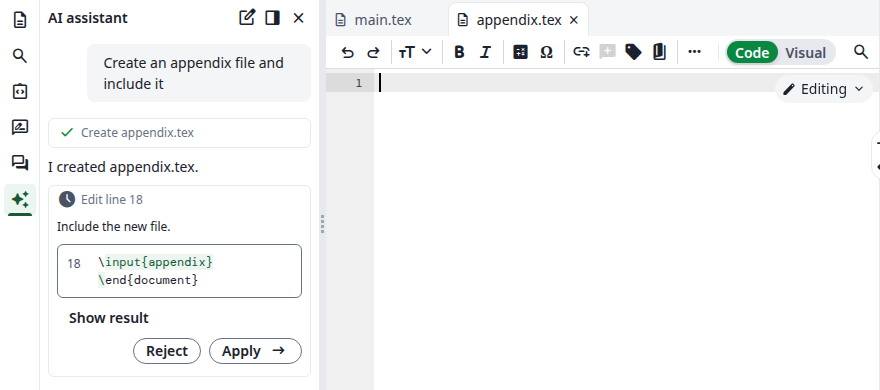

Avustaja työskentelee avoinna olevan projektin parissa. Se lukee asiakirjojasi ja ehdottaa muokkauksia, ja sinä otat jokaisen käyttöön tai hylkäät sen. Kuvakaappausten vastaukset ovat esimerkkejä: saamasi vastaus riippuu sivustosi käyttämästä mallista.

<Info>

Jos vasemmassa palkissa ei näy **AI assistant** -kohtaa, ohjaa ylläpitäjä sivulle [Tekoälyintegraatio](/fi/on-premises/configuration/overleaf-toolkit/integrations/ai-integration).

</Info>

## Keskustelun aloittaminen {#start-a-chat}

<Steps>
<Step title="Avaa avustaja">
Napsauta editorin vasemmassa palkissa **AI assistant**. Paneeli avautuu editorin viereen.
</Step>

<Step title="Hyväksy ehdot">
Ensimmäisellä kerralla paneeli näyttää tekoälyominaisuuksien ehdot. Napsauta **Accept and continue**. Teet tämän vain kerran, ja se koskee myös [virheavustajaa](/fi/on-premises/user-guide/users/error-assistant).

<Frame caption="Ehdot näytetään kerran">
  
</Frame>
</Step>

<Step title="Kysy jotain">
Kirjoita kenttään <strong>What would you like to do?</strong> ja paina Enter tai napsauta nuolta. Voit myös napsauttaa ehdotusta **Start a chat** -kohdan alla. Ehdotukset vaihtelevat keskustelusta toiseen, ja **Fix the compile errors** tulee mukaan, kun viimeisimmässä käännöksessä on virheitä.

<Frame caption="Tyhjä keskustelu">
  
</Frame>
</Step>

<Step title="Lue vastaus">
Avustajan toimet näkyvät rivinä ruudussa, esimerkiksi **Read line 15-16 of main.tex**, ja valmis vaihe saa valintamerkin. Sen jälkeen tulee vastaus. Jos malli jakaa päättelynsä, lue se napsauttamalla **Reasoned for 1 s**.

<Frame caption="Kysymys ja vastaus">
  
</Frame>
</Step>
</Steps>

## Kysyminen valituista riveistä {#ask-about-selected-lines}

Valitse rivejä editorissa. Viestikentän yläpuolelle ilmestyy tunniste, kuten `main.tex: 16`, ja valittu teksti lähtee viestisi mukana. Tyhjässä keskustelussa ehdotukset koskevat valintaa, esimerkiksi **Make it shorter**.

<Frame caption="Valittu rivi">
  
</Frame>

## Ehdotetun muokkauksen tarkistaminen {#review-a-suggested-edit}

Muokkaus päätyy asiakirjaan vasta, kun otat sen käyttöön.

<Steps>
<Step title="Lue ehdotus">
**Edit line 16** -niminen ruutu näyttää syyn, rivinumeron ja muutoksen: vanha teksti on yliviivattu ja uusi korostettu. Asiakirja ei ole vielä muuttunut. **Show result** näyttää vain uuden tekstin, ja **Show diff** palaa takaisin.

<Frame caption="Päätöstäsi odottava muokkaus">
  
</Frame>
</Step>

<Step title="Ota se käyttöön">
Napsauta **Apply**. Muutos näkyy editorissa, ruutu saa valintamerkin ja avustaja jatkaa. Jos muokkaus on toisessa asiakirjassa, kyseinen asiakirja avautuu.

<Frame caption="Muokkaus on otettu käyttöön">
  
</Frame>
</Step>

<Step title="Peru, jos muutat mielesi">
**Undo** poistaa muutoksen asiakirjasta, ja **Apply** palauttaa sen. Avustajalle ei kerrota kummastakaan.
</Step>
</Steps>

### Muokkauksen hylkääminen {#reject-an-edit}

Napsauta **Reject**. Asiakirja pysyy ennallaan, ruudussa lukee <strong>The user declined this edit.</strong> ja avustaja jatkaa tietäen, että kieltäydyit. Painikkeet katoavat, joten pyydä muokkausta uudelleen, jos haluat sen takaisin.

Jos kirjoitat uuden viestin päättämisen sijaan, muokkausta ei oteta käyttöön, ja ruutu kertoo sen.

<Frame caption="Hylätty muokkaus ja ratkaisematon muokkaus">
  
</Frame>

## Mitä avustaja voi tehdä projektissa {#what-the-assistant-can-do-in-a-project}

Vain muokkaukset odottavat sinua. Muut vaiheet suoritetaan heti, kun avustaja tekee ne.

| Rivi keskustelussa | Mitä se tekee |
| -------------------- | ------------ |
| **Read line 15-16 of main.tex** | Lukee asiakirjan rivejä |
| **Find “schedule” in main.tex** | Etsii tekstiä asiakirjasta |
| **List the project files** | Luettelee projektin tiedostot |
| **Create appendix.tex** | Luo tyhjän asiakirjan ja avaa sen |
| **Edit line 16** | Ehdottaa muokkausta, katso yllä |
| **Compile** | Kääntää projektin |
| **Check the compile log** | Lukee viimeisimmän käännöksen virheet ja varoitukset |
| **Look at PDF page 1** | Näyttää PDF:n sivun keskustelussa |
| **Read the PDF structure** | Lukee PDF:n rakenteen |
| **Switch to xelatex** | Vaihtaa projektin kääntäjän, kuten **Settings**-kohdassa |
| <strong>Search the web for “...”</strong> | Hakee verkosta |
| <strong>Search the help pages for “...”</strong> | Hakee ohjesivuilta |

<Frame caption="Uusi tiedosto ja sitten muokkaus toisessa asiakirjassa">
  
</Frame>

<Frame caption="Käännös ja PDF:n sivu">
  
</Frame>

Hakurivi näyttää löydettyjen tulosten määrän. Napsauta sitä nähdäksesi tulokset. Hakujen saatavuus riippuu sivustostasi, katso [Valinnaiset hakupalvelut](/fi/on-premises/configuration/overleaf-toolkit/integrations/ai-integration#optional-search-services).

<Frame caption="Haun tulokset">
  
</Frame>

**Fix the compile errors** -ehdotus pyytää avustajaa tarkistamaan lokin ja korjaamaan löytämänsä. Korjaukset tulevat tarkistettavina muokkauksina.

## Kuvan tai PDF:n liittäminen {#attach-an-image-or-a-pdf}

Napsauta viestikentän kuvakuvaketta, **Attach image or PDF**, ja valitse tiedosto. Sen nimi näkyy tekstisi yläpuolella. Kirjoita viesti ja lähetä se.

<Frame caption="Viestiin liitetty tiedosto">
  
</Frame>

Paneeli hylkää muut tiedostot ilmoituksella <strong>Only images and PDF files can be attached.</strong> ja suuret tiedostot ilmoituksella <strong>Files must be smaller than 2 MB.</strong>

## Avustajan pysäyttäminen {#stop-the-assistant}

Kun avustaja työskentelee, viestikentän nuolesta tulee **Stop**-painike. Napsauta sitä. Käynnissä oleva vaihe päättyy ilmoitukseen <strong>Stopped by the user.</strong>, eikä mitään muuta tapahdu ennen kuin kirjoitat uudelleen.

<Frame caption="Stop-painike">
  
</Frame>

## Jos avustaja pysähtyy itsestään {#if-the-assistant-stops-by-itself}

Avustaja voi tehdä yhtä viestiä kohden rajallisen määrän vaiheita. Rajan täyttyessä paneelissa lukee <strong>The assistant used all the steps it may take for one message. Reply to let it carry on.</strong> Vastaa esimerkiksi `Go on`, niin se jatkaa.

<Frame caption="Vaiheraja">
  
</Frame>

Jos paneelissa lukee **Something’s gone wrong**, pyyntö epäonnistui. Lähetä viesti uudelleen tai napsauta **Start new chat**.

## Paneelin siirtäminen ja uudelleen aloittaminen {#move-the-panel-and-start-over}

Nämä painikkeet ovat paneelin yläosassa:

* **Start new chat** tyhjentää paneelin. Aiempien keskustelujen luetteloa ei ole. Sivun uudelleenlataus tyhjentää myös keskustelun.
* **Move to the right** siirtää paneelin PDF:n oikealle puolelle, jossa se pysyy auki, kun käytät tiedostopuuta. **Move to the left** siirtää sen takaisin. Keskustelu säilyy.
* **Close** piilottaa paneelin. Tuo se takaisin keskusteluineen napsauttamalla vasemman palkin **AI assistant** -kohtaa.

<Frame caption="Paneeli oikealla">
  
</Frame>

## Tokenien käyttö {#token-usage}

Avustaja ei näytä, montako tokenia olet käyttänyt. Jos sivustosi asettaa rajan ja saavutat sen, seuraava viestisi ei saa vastausta. Paneeli näyttää **Usage limit reached** ja ajan, jonka kuluttua voit taas keskustella, ja viestikenttä on harmaana.

<Frame caption="Raja on saavutettu">
  
</Frame>

Uusi keskustelu näyttää saman ilmoituksen. Uudelleenlatauksen jälkeen kenttä näyttää taas tavalliselta, mutta myös seuraava viesti saa ilmoituksen. [Virheavustaja](/fi/on-premises/user-guide/users/error-assistant) lasketaan samaan rajaan ja näyttää lokimerkinnässä **Usage limit reached**.

Ylläpitäjä asettaa rajan, katso [Käyttö ja nollaus](/fi/on-premises/configuration/overleaf-toolkit/integrations/ai-integration#usage-and-reset).
