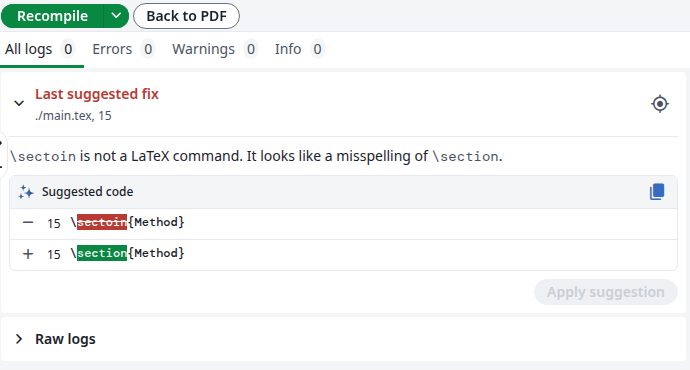

<Info>

Jos lokimerkinnässä ei ole **Suggest fix** -painiketta, ohjaa ylläpitäjä sivulle [Tekoälyintegraatio](/fi/on-premises/configuration/overleaf-toolkit/integrations/ai-integration).

</Info>

<Steps>
<Step title="Avaa lokit">
Kun käännöksessä on virheitä, **Recompile**-painikkeen vieressä olevaan lokikuvakkeeseen ilmestyy punainen luku, ja punainen piste merkitsee rivin editorissa. Napsauta kuvaketta. Jos käännös ei tuottanut PDF:ää, lokit ovat jo auki.

<Frame caption="Käännös, jossa on yksi virhe">
  
</Frame>
</Step>

<Step title="Napsauta Suggest fix">
Napsauta lokimerkinnän oikealla puolella olevaa kipinäkuvaketta, **Suggest fix**. Se on myös varoituksissa, jotka viittaavat projektisi tiedostoon.

<Frame caption="Suggest fix -painike">
  
</Frame>

Ensimmäisellä kerralla merkinnässä lukee **Before you use Error Assist**. Napsauta **Accept and continue**. Teet tämän vain kerran, ja se koskee myös [tekoälyavustajaa](/fi/on-premises/user-guide/users/ai-assistant).

<Frame caption="Näytetään kerran">
  
</Frame>
</Step>

<Step title="Lue ehdotus">
Merkintä selittää virheen ja näyttää muutettavan rivin: vanha teksti on rivillä <strong>-</strong> ja uusi teksti rivillä <strong>+</strong>. Rivinumeron napsauttaminen vie kyseiselle riville editorissa, ja kopiointikuvake kopioi uuden tekstin.

<Frame caption="Ehdotettu korjaus">
  
</Frame>

Jos avustajalla ei ole korjausta, se vain selittää, eikä mitään voi ottaa käyttöön. Päivityskuvake, **Suggest a different fix**, kysyy uudelleen.
</Step>

<Step title="Ota käyttöön tai jätä">
Ota korjaus käyttöön napsauttamalla **Apply suggestion**. Rivi muuttuu editorissa, merkinnässä lukee **Suggestion applied**, ja projekti käännetään uudelleen. Kun virheitä ei enää ole, PDF palaa. Peru muutos painamalla editorissa `Ctrl+Z`.

<Frame caption="Korjaus on otettu käyttöön">
  
</Frame>

Jos haluat hylätä ehdotuksen, älä tee mitään: hylkäyspainiketta ei ole, ja asiakirja pysyy ennallaan, kunnes napsautat **Apply suggestion**.

Jos muokkaat riviä ensin, **Apply suggestion** poistuu käytöstä. Saat uuden ehdotuksen napsauttamalla **Suggest a different fix**.
</Step>
</Steps>

## Ehdotuksen löytäminen uudelleen {#find-the-suggestion-again}

Seuraavan käännöksen jälkeen lokit näyttävät ehdotuksen nimellä **Last suggested fix**, otitpa sen käyttöön tai et. Avaa se napsauttamalla nuolta.

<Frame caption="Viimeisin ehdotus jää lokeihin">
  
</Frame>

Virheavustaja lasketaan samaan rajaan kuin tekoälyavustaja, katso [Tokenien käyttö](/fi/on-premises/user-guide/users/ai-assistant#token-usage).
