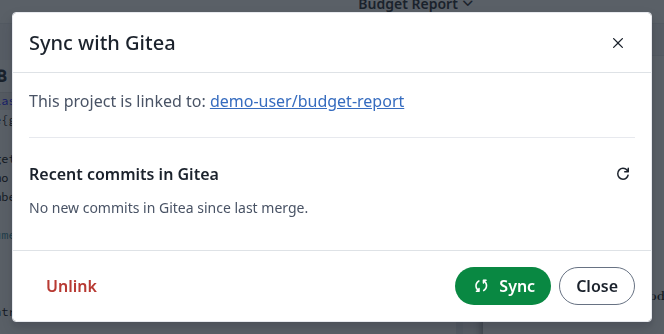

Yhdistä projekti Gitea-repositorioon. Muutokset kulkevat molempiin suuntiin, ja vain kun valitset **Sync**: mitään ei synkronoida itsestään.

<Info>

Ylläpitäjän on ensin otettava [Gitea-synkronointi](/fi/on-premises/configuration/overleaf-toolkit/integrations/gitea-synchronisation) käyttöön.

</Info>

## Gitea-tilin linkittäminen {#link-your-gitea-account}

Teet tämän kerran.

<Steps>
<Step title="Avaa tilisi asetukset">
Valitse **Account** ja sitten **Account settings**. Etsi **Project synchronisation** -kohdasta **Gitea** ja valitse **Link**.

<Frame caption="Gitea tilin asetuksissa">
  
</Frame>
</Step>

<Step title="Valtuuta Giteassa">
Gitea avautuu. Kirjaudu sisään, jos sitä pyydetään, ja valtuuta sitten sovellus.
</Step>

<Step title="Tarkista linkitys">
Palaat tilin asetuksiin. Vihreä viesti kertoo, että Gitea-tilisi on linkitetty, ja painikkeessa lukee nyt **Unlink**.

<Frame caption="Gitea-tilisi on linkitetty">
  
</Frame>
</Step>
</Steps>

Jos tiliäsi ei ole vielä linkitetty, **Import from Gitea** ja editorin **Gitea**-kortti pyytävät sinua linkittämään sen ensin. Valitse **Link to your Gitea account**. Päädyt näin myös tilin asetuksiin, uuteen välilehteen, jos aloitit editorissa. Palaa sitten takaisin ja aloita alusta.

<Frame caption="Kehote, kun tiliäsi ei ole linkitetty">
  
</Frame>

## Repositorion tuominen {#import-a-repository}

Tämä luo Gitea-repositoriosta uuden projektin, joka on jo linkitetty siihen.

<Steps>
<Step title="Avaa tuontivalintaikkuna">
Valitse projektisivulla **New project** ja sitten **Import from Gitea**.

<Frame caption="New project -valikko">
  
</Frame>
</Step>

<Step title="Valitse repositorio">
Valitse repositorion vieressä **Import to Overleaf**. Luettelossa ovat omat repositoriosi ja organisaatioidesi repositoriot. Tyhjää repositoriota ei näytetä: siinä on oltava vähintään yksi commit.

<Frame caption="Gitea-repositoriosi">
  
</Frame>
</Step>

<Step title="Tarkista projekti">
Uusi projekti avautuu repositorion tiedostoineen.

<Frame caption="Tuotu projekti">
  
</Frame>
</Step>
</Steps>

## Projektin vieminen uuteen repositorioon {#export-a-project-to-a-new-repository}

Tämä luo projektista repositorion ja linkittää ne. Projektin voi linkittää vain tällä tavalla tai tuomalla: et voi linkittää sitä jo olemassa olevaan repositorioon.

<Steps>
<Step title="Avaa Gitea editorissa">
Avaa projekti. Valitse vasemmasta palkista **Integrations** ja sitten **Gitea**.

<Frame caption="Integrations-paneeli">
  
</Frame>
</Step>

<Step title="Täytä repositorion tiedot">
Valitse **Owner**, joka voi olla sinä tai jokin organisaatioistasi. Kun valitset organisaation, kentän nimi on **Organization**. **Repository Name** on aluksi projektin nimi: jos nimessä on välilyöntejä, vaihda se, koska Gitea ei hyväksy niitä. Kuvaus on valinnainen, ja **Private** on valittuna oletuksena. Valitse **Create a Gitea repository**.

<Frame caption="Export Project to Gitea">
  
</Frame>

Jos nimessä on välilyöntejä tai se on jo käytössä, valintaikkunassa lukee <strong>Please check that the repository name is valid, and that you have permission to create the repository.</strong> Vaihda nimi ja valitse painike uudelleen.
</Step>

<Step title="Tarkista linkitys">
Valintaikkunassa lukee nyt **This project is linked to** ja repositorion nimi.

<Frame caption="Projekti on linkitetty">
  
</Frame>
</Step>
</Steps>

## Synkronointi {#sync}

<Steps>
<Step title="Avaa synkronointivalintaikkuna">
Avaa linkitetty projekti. Valitse vasemmasta palkista **Integrations** ja sitten **Gitea**.

**Recent commits in Gitea** luettelee, mitä projektiin tulee.

<Frame caption="Uusi commit odottaa Giteassa">
  
</Frame>
</Step>

<Step title="Kuvaile muutoksesi">
Jos muutit jotain projektissa, näkyviin tulee commit-viestin kenttä. Se on valinnainen: jos jätät sen tyhjäksi, commitin nimi on `Updates from Overleaf`.

<Frame caption="Muutostesi commit-viesti">
  
</Frame>
</Step>

<Step title="Valitse Sync">
Valitse **Sync**. Uudet commitit Giteasta tulevat projektiin, ja muutoksesi menevät repositorion oletushaaraan. Jos molemmat puolet muuttivat eri asioita, ne yhdistetään puolestasi pull requestin kautta, joka jää Giteaan tallenteeksi.
</Step>

<Step title="Tarkista tulos">
Valintaikkunassa näkyy <strong>No new commits in Gitea since last merge.</strong>, ja commit-viestin kenttä on poissa. Editorin tiedostot ja Gitean commitit ovat ajan tasalla.

<Frame caption="Kaikki on synkronoitu">
  
</Frame>
</Step>
</Steps>

### Jos samat rivit muuttuivat molemmilla puolilla {#if-the-same-lines-changed-on-both-sides}

Valintaikkuna kertoo, ettei muutoksia voitu yhdistää, ja nimeää uuden haaran, `overleaf-YYYY-MM-DD-HHMMSS`, jossa muutoksesi ovat. Overleaf avaa myös pull requestin tästä haarasta Giteaan.

<Frame caption="Ristiriita">
  
</Frame>

1.  Yhdistä tämä haara oletushaaraan Gitillä ja korjaa ristiriita. Voit sulkea valintaikkunan sillä välin: se näyttää saman viestin, kun avaat sen uudelleen.

    ```bash
    git clone <repository-address>
    cd <repository-name>
    git merge origin/overleaf-YYYY-MM-DD-HHMMSS
    # fix the conflict in the file Git names
    git add <file>
    git commit
    git push
    ```
2. Valitse **I have manually merged. Continue**. Yhdistetty tulos tulee projektiin. Jos valitset sen ennen kuin haara on yhdistetty, valintaikkuna pysyy ennallaan.
3. Haara jää Giteaan, ja sen pull request pysyy avoinna. Sulje pull request ja poista haara, kun et enää tarvitse niitä.

Sama valintaikkuna tulee näkyviin, kun haaran suojaussääntö pidättää pull requestin, esimerkiksi kun se vaatii hyväksynnän, vaikka mitkään rivit eivät ole ristiriidassa. Kun sääntö sallii sen, yhdistä pull request Giteassa ja valitse **I have manually merged. Continue**. Katso [Miten synkronointi toimii Gitean kanssa](/fi/on-premises/configuration/overleaf-toolkit/integrations/gitea-synchronisation#how-syncing-works-with-gitea).

## Projektin linkityksen poistaminen {#unlink-a-project}

Tee tämä, kun et enää halua projektin synkronoituvan.

<Steps>
<Step title="Valitse Unlink">
Valitse synkronointivalintaikkunassa **Unlink**.
</Step>

<Step title="Vahvista">
Valitse **Confirm**. Tämä poistaa vain linkityksen: varoituksessa mainittu yhteys omistamaasi repositorioon on vaihtoehto, joka sinulla on myöhemmin, ei jotain, mikä tapahtuu nyt.

<Frame caption="Vahvista linkityksen poistaminen">
  
</Frame>
</Step>

<Step title="Tarkista tulos">
Valintaikkunassa näkyy nyt **Export Project to Gitea**. Projekti ja repositorio säilyttävät molemmat sisältönsä. Synkronoidaksesi uudelleen vie projekti uuteen repositorioon tai tuo repositorio uuteen projektiin.
</Step>
</Steps>

## Gitea-tilin linkityksen poistaminen {#unlink-your-gitea-account}

Valitse **Account settings** -kohdan **Gitea**-osiossa **Unlink** ja sitten valintaikkunassa uudelleen **Unlink**.

<Frame caption="Tilisi linkityksen poistaminen">
  
</Frame>

Projektisi pysyvät linkitettyinä repositorioihinsa. Et voi synkronoida niitä ennen kuin linkität tilisi uudelleen.

<Info>

Kuka voi tehdä mitäkin jaetussa projektissa, kerrotaan kohdassa [Kuka voi linkittää ja synkronoida](/fi/on-premises/configuration/overleaf-toolkit/integrations/gitea-synchronisation#who-can-link-and-sync).

</Info>
