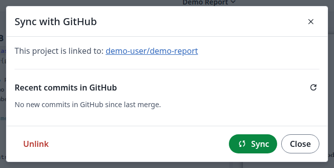

Yhdistä projekti GitHub-repositorioon. Muutokset kulkevat molempiin suuntiin, ja vain kun valitset **Sync**: mitään ei synkronoida itsestään.

<Info>

Jos et näe GitHub-vaihtoehtoa kohdassa **Account settings** tai editorissa, pyydä ylläpitäjää ottamaan [GitHub-synkronointi](/fi/on-premises/configuration/overleaf-toolkit/integrations/github-synchronisation) käyttöön.

</Info>

## GitHub-tilin linkittäminen {#link-your-github-account}

Teet tämän kerran.

<Steps>
<Step title="Avaa tilisi asetukset">
Valitse **Account** ja sitten **Account settings**. Vieritä kohtaan **GitHub** ja valitse **Link**.

<Frame caption="GitHub tilin asetuksissa">
  
</Frame>
</Step>

<Step title="Valtuuta GitHubissa">
GitHub avautuu. Kirjaudu sisään, jos sitä pyydetään, ja valtuuta sitten sovellus.
</Step>

<Step title="Tarkista linkitys">
Palaat tilin asetuksiin, ja painikkeessa lukee nyt **Unlink**.

<Frame caption="GitHub-tilisi on linkitetty">
  
</Frame>
</Step>
</Steps>

Jos tiliäsi ei ole vielä linkitetty, **Import from GitHub** ja editorin **GitHub**-kortti pyytävät sinua linkittämään sen ensin. Valitse **Link to your GitHub account**. Päädyt näin myös tilin asetuksiin, uuteen välilehteen, jos aloitit editorissa. Palaa sitten takaisin ja aloita alusta.

<Frame caption="Kehote, kun tiliäsi ei ole linkitetty">
  
</Frame>

## Repositorion tuominen {#import-a-repository}

Tämä luo GitHub-repositoriosta uuden projektin, joka on jo linkitetty siihen.

<Steps>
<Step title="Avaa tuontivalintaikkuna">
Valitse projektisivulla **New project** ja sitten **Import from GitHub**.

<Frame caption="New project -valikko">
  
</Frame>

<Info>

**New project** tulee näkyviin, kun sinulla on projekti. Tervetulosivun **Create a new project** -valikossa ei ole tuontia, joten luo ensin tyhjä projekti.

</Info>
</Step>

<Step title="Valitse repositorio">
Valitse repositorion vieressä **Import to Overleaf**. Luettelossa ovat omat repositoriosi ja organisaatioidesi repositoriot.

<Frame caption="GitHub-repositoriosi">
  
</Frame>

Jos organisaation repositorio puuttuu, valitse <strong>Can't see what you're looking for?</strong>, niin näet GitHubin ohjeen sovelluksen hyväksymisestä kyseiselle organisaatiolle.
</Step>

<Step title="Tarkista projekti">
Uusi projekti avautuu repositorion tiedostoineen.

<Frame caption="Tuotu projekti">
  
</Frame>
</Step>
</Steps>

## Projektin vieminen uuteen repositorioon {#export-a-project-to-a-new-repository}

Tämä luo repositorion omistamastasi projektista ja linkittää ne. Projektin voi linkittää vain tällä tavalla tai tuomalla: et voi linkittää sitä jo olemassa olevaan repositorioon.

<Steps>
<Step title="Avaa GitHub editorissa">
Avaa projekti. Valitse vasemmasta palkista **Integrations** ja sitten **GitHub**.

<Frame caption="Integrations-paneeli">
  
</Frame>
</Step>

<Step title="Täytä repositorion tiedot">
Valitse **Owner**, joka voi olla sinä tai jokin organisaatioistasi. **Repository Name** on aluksi projektin nimi. Kuvaus on valinnainen, ja **Private** on valittuna oletuksena. Valitse **Create a GitHub repository**.

<Frame caption="Export Project to GitHub">
  
</Frame>
</Step>

<Step title="Tarkista linkitys">
Valintaikkunassa lukee nyt **This project is linked to** ja repositorion nimi.

<Frame caption="Projekti on linkitetty">
  
</Frame>
</Step>
</Steps>

## Synkronointi {#sync}

<Steps>
<Step title="Avaa synkronointivalintaikkuna">
Avaa linkitetty projekti. Valitse vasemmasta palkista **Integrations** ja sitten **GitHub**.

**Recent commits in GitHub** luettelee, mitä projektiin tulee.

<Frame caption="Uusi commit odottaa GitHubissa">
  
</Frame>
</Step>

<Step title="Kuvaile muutoksesi">
Jos muutit jotain projektissa, näkyviin tulee commit-viestin kenttä. Se on valinnainen: jos jätät sen tyhjäksi, commitin nimi on `Updates from Overleaf`.

<Frame caption="Muutostesi commit-viesti">
  
</Frame>
</Step>

<Step title="Valitse Sync">
Valitse **Sync**. Uudet commitit GitHubista tulevat projektiin, ja muutoksesi menevät repositorion oletushaaraan. Jos molemmat puolet muuttivat eri asioita, ne yhdistetään puolestasi.
</Step>

<Step title="Tarkista tulos">
Valintaikkunassa näkyy <strong>No new commits in GitHub since last merge.</strong>, ja commit-viestin kenttä on poissa. Editorin tiedostot ja GitHubin commitit ovat ajan tasalla.

<Frame caption="Kaikki on synkronoitu">
  
</Frame>
</Step>
</Steps>

### Jos samat rivit muuttuivat molemmilla puolilla {#if-the-same-lines-changed-on-both-sides}

Valintaikkuna kertoo, ettei muutoksia voitu yhdistää, ja nimeää uuden haaran, `overleaf-YYYY-MM-DD-HHMMSS`, jossa muutoksesi ovat.

<Frame caption="Ristiriita">
  
</Frame>

1. Yhdistä tämä haara oletushaaraan GitHubissa tai Gitillä. Voit sulkea valintaikkunan sillä välin: se näyttää saman viestin, kun avaat sen uudelleen.
2. Valitse **I have manually merged. Continue**. Yhdistetty tulos tulee projektiin.
3. Haara jää GitHubiin. Poista se, kun et enää tarvitse sitä.

## Projektin linkityksen poistaminen {#unlink-a-project}

Tee tämä, kun et enää halua projektin synkronoituvan. Vain projektin omistaja voi tehdä sen.

<Steps>
<Step title="Valitse Unlink">
Valitse synkronointivalintaikkunassa **Unlink**.
</Step>

<Step title="Vahvista">
Valitse **Confirm**. Tilausta koskeva huomautus ei estä sinua linkittämästä projektia uudelleen.

<Frame caption="Vahvista linkityksen poistaminen">
  
</Frame>
</Step>

<Step title="Tarkista tulos">
Valintaikkunassa näkyy nyt **Export Project to GitHub**. Projekti ja repositorio säilyttävät molemmat sisältönsä. Synkronoidaksesi uudelleen vie projekti uuteen repositorioon tai tuo repositorio uuteen projektiin.
</Step>
</Steps>

## GitHub-tilin linkityksen poistaminen {#unlink-your-github-account}

Valitse **Account settings** -kohdan **GitHub**-osiossa **Unlink** ja sitten valintaikkunassa uudelleen **Unlink**.

<Frame caption="Tilisi linkityksen poistaminen">
  
</Frame>

Projektisi pysyvät linkitettyinä repositorioihinsa. Et voi synkronoida niitä ennen kuin linkität tilisi uudelleen.

<Info>

Kuka voi tehdä mitäkin jaetussa projektissa, kerrotaan kohdassa [Kuka voi linkittää ja synkronoida](/fi/on-premises/configuration/overleaf-toolkit/integrations/github-synchronisation#who-can-link-and-sync). Jokainen synkronoiva yhteistyökumppani linkittää oman GitHub-tilinsä.

</Info>
