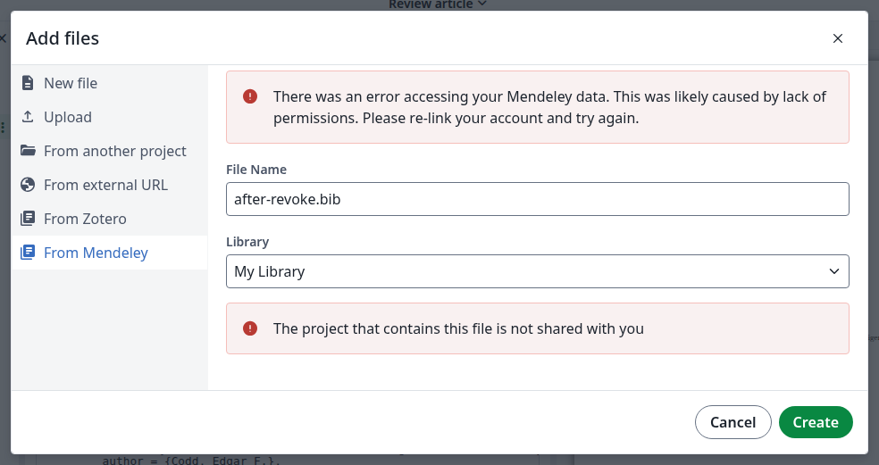

Tuo Mendeley-kirjasto projektiin `.bib`-tiedostona ja viittaa siitä tavalliseen tapaan. Tiedosto on kopio: se muuttuu vain, kun napsautat **Refresh**.

<Info>

Jos **Account settings** -kohdassa ei näy Mendeley-vaihtoehtoa, pyydä ylläpitäjää ottamaan käyttöön [Mendeley-integraatio](/fi/on-premises/configuration/overleaf-toolkit/integrations/mendeley-integration).

</Info>

## Mendeley-tilin yhdistäminen {#link-your-mendeley-account}

Teet tämän vain kerran.

<Steps>
<Step title="Avaa tilin asetukset">
Napsauta **Account** ja sitten **Account settings**. Etsi **Reference managers** -kohdasta **Mendeley** ja napsauta **Link to Mendeley**.

<Frame caption="Mendeley tilin asetuksissa">
  
</Frame>

Editorin **Integrations**-paneelin **Mendeley**-kortti vie samaan paikkaan samassa välilehdessä.

<Frame caption="Integrations-paneeli">
  
</Frame>
</Step>

<Step title="Valtuuta palvelussa Mendeley">
Mendeley avautuu. Kirjaudu sisään, jos sitä pyydetään, ja valtuuta sitten sovellus.
</Step>

<Step title="Tarkista yhteys">
Palaat tilin asetuksiin. Vihreä ilmoitus kertoo **Reference manager linked**, ja painikkeessa lukee nyt **Unlink**.

<Frame caption="Mendeley-tilisi on yhdistetty">
  
</Frame>
</Step>
</Steps>

Jos et salli käyttöä palvelussa Mendeley, samassa osiossa lukee **Sorry, something went wrong**. Yritä uudelleen napsauttamalla **Link to Mendeley**.

## Tiedoston luominen kirjastosta {#create-a-file-from-your-library}

<Steps>
<Step title="Avaa Add files -valintaikkuna">
Avaa projekti. Napsauta tiedostopuussa **New file** ja sitten **From Mendeley**. Tämä kohta näkyy vasta, kun tilisi on yhdistetty.
</Step>

<Step title="Valitse tiedoston nimi ja kirjasto">
**File Name** on aluksi `mendeley.bib`. Säilytä `.bib`-pääte: ilman sitä et saa esikatselua, eivätkä `\cite` ja `\bibliography` löydä merkintöjä.

**Library** on aluksi **My Library**, ja siinä näkyvät myös ryhmäsi. Yksi tiedosto sisältää yhden kirjaston.

<Frame caption="Tiedosto henkilökohtaisesta kirjastosta">
  
</Frame>
</Step>

<Step title="Napsauta Create">
Valintaikkuna sulkeutuu, ja tiedosto näkyy tiedostopuussa. Napsauta sitä: se näyttää tuontiajan ja merkinnät. Et voi muokata sitä editorissa.

<Frame caption="Tuotu tiedosto">
  
</Frame>

Jos **Create** ei näytä tekevän mitään, samanniminen tiedosto on jo olemassa. Valitse toinen nimi.
</Step>
</Steps>

### Ryhmän tuominen {#import-a-group}

Toista samat vaiheet omalla tiedostonimellä ja valitse ryhmä **Library**-kohdasta. Projektissa voi olla useita tällaisia tiedostoja.

<Frame caption="Tiedosto ryhmästä">
  
</Frame>

## Viittaaminen tiedostosta {#cite-from-the-file}

<Steps>
<Step title="Aloita viittaus">
Kirjoita `.tex`-tiedostoon `\cite{`. Luettelo näyttää projektin kaikkien `.bib`-tiedostojen merkinnät. Lisää merkintä napsauttamalla sitä.

<Frame caption="Tuotujen tiedostojen merkinnät">
  
</Frame>
</Step>

<Step title="Tai hae otsikon tai tekijän mukaan">
Napsauta luettelon alla olevaa **Search**-painiketta tai paina Ctrl+välilyönti aaltosulkeiden sisällä. Suodata kirjoittamalla, napsauta yhtä tai useampaa merkintää ja sitten **Insert**.

<Frame caption="Lähdehaku">
  
</Frame>
</Step>

<Step title="Lisää lähdeluettelo">
Lisää nämä rivit ennen `\end{document}`-riviä käyttäen tiedostosi nimeä ilman `.bib`-päätettä. Jos tiedostoja on useita, erota nimet pilkuilla.

```latex
\bibliographystyle{plain}
\bibliography{mendeley}
```

Napsauta **Recompile**. Lähde näkyy PDF:ssä.

<Frame caption="Käännetty lähde">
  
</Frame>
</Step>
</Steps>

Tuotuja tiedostoja ei tarjota **Settings**-kohdan **References**-osiossa, **Main bibliography file for this project**, joten luettelo pysyy tyhjänä, jos projektissa ei ole muuta `.bib`-tiedostoa. Voit silti viitata niistä.

<Frame caption="Tyhjä luettelo on odotettu">
  
</Frame>

## Tiedoston päivittäminen {#refresh-the-file}

Mendeley-kirjastosi muutokset eivät siirry projektiin itsestään.

<Steps>
<Step title="Avaa tiedosto">
Napsauta tiedostopuussa tuotua tiedostoa.
</Step>

<Step title="Napsauta Refresh">
Koko tiedosto tuodaan uudelleen kirjastosta, jonka valitsit sitä luodessasi: uudet merkinnät ilmestyvät ja poistetut katoavat. Yläreunan aika muuttuu.

<Frame caption="Päivitetty tiedosto">
  
</Frame>
</Step>

<Step title="Käännä uudelleen">
Päivitä PDF napsauttamalla **Recompile**.
</Step>
</Steps>

Jokainen tiedosto päivitetään erikseen: päivitä ryhmäsi tiedosto erikseen. Kuka voi päivittää tiedoston jaetussa projektissa, kerrotaan [ylläpitäjien huomautuksissa](/on-premises/configuration/overleaf-toolkit/integrations/mendeley-integration#notes).

## Mendeley-tilin yhteyden poistaminen {#unlink-your-mendeley-account}

Napsauta **Account settings** -kohdassa **Mendeley**-osion **Unlink**-painiketta ja sitten valintaikkunassa uudelleen **Unlink**. Painikkeessa lukee taas **Link to Mendeley**.

<Frame caption="Tilin yhteyden poistaminen">
  
</Frame>

Tuomasi tiedostot jäävät projekteihisi ja kääntyvät edelleen. **From Mendeley** katoaa **Add files** -valintaikkunasta, ja **Refresh** näyttää virheen, kunnes yhdistät tilisi uudelleen.

<Frame caption="Päivitys ilman yhdistettyä tiliä">
  
</Frame>

Kun olet yhdistänyt tilin uudelleen, **Refresh** toimii samoissa tiedostoissa.

## Jos jokin menee pieleen {#if-something-goes-wrong}

**Could not load references from Mendeley, please re-link your account and try again** tai **There was an error accessing your Mendeley data** **Add files** -valintaikkunassa: Overleaf ei enää voi lukea kirjastoasi, esimerkiksi koska poistit sen käyttöoikeuden palvelussa Mendeley. Napsauta **Account settings** -kohdassa **Unlink** ja sitten **Link to Mendeley**. Siihen asti myös **Create** epäonnistuu ilmoituksella **The project that contains this file is not shared with you**, jopa omassa projektissasi.

<Frame caption="Overleaf ei enää voi lukea kirjastoasi">
  
</Frame>

**The remote service produced an error**, kun napsautat **Refresh**: pyyntö palveluun Mendeley epäonnistui. Tiedoston sisältö säilyy. Napsauta **Refresh** myöhemmin uudelleen.
