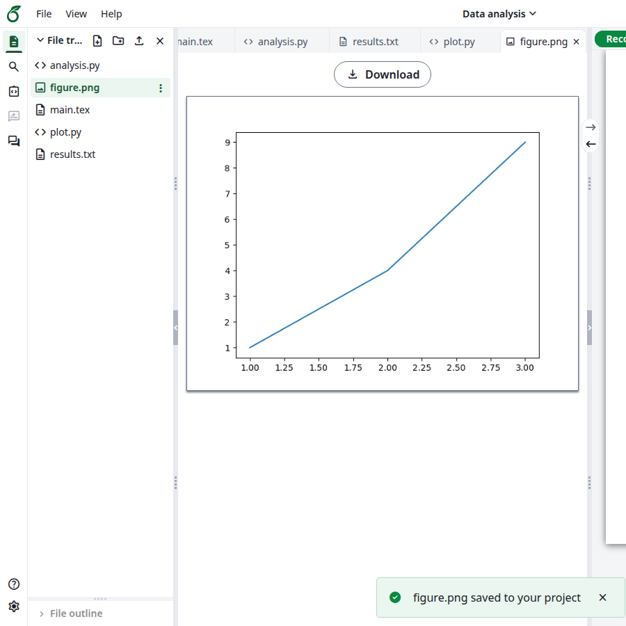

Python-skriptit suoritetaan selaimessasi, joten tuloste näkyy heti editorin alla. Mitään ei tarvitse määrittää.

<Steps>
<Step title="Luo skripti">
Napsauta tiedostopuussa **New file** -kuvaketta. Kirjoita nimi, joka päättyy `.py`, ja napsauta **Create**.

<Frame caption="Uusi Python-tiedosto">
  
</Frame>

Editorin alle ilmestyvät **Run**-painike ja tulosteruutu. Ensimmäisellä kerralla painike pysyy pois käytöstä, kunnes Python on latautunut.
</Step>

<Step title="Suorita se">
Kirjoita koodisi ja napsauta **Run**. Skriptin tulostama teksti näkyy tulosteruudussa. Sinun ei tarvitse tallentaa ensin.

Skriptin kirjoittamat tiedostot tallentuvat projektiisi. Viesti kertoo, mitkä, esimerkiksi **results.txt saved to your project**, ja tiedosto näkyy tiedostopuussa.

<Frame caption="Tuloste ja tallennettu tiedosto">
  
</Frame>
</Step>

<Step title="Pysäytä skripti">
Kun skripti on käynnissä, **Run** muuttuu **Stop**-painikkeeksi. Keskeytä skripti napsauttamalla sitä. Tulosteruutu päättyy tekstiin **Execution interrupted**.

<Frame caption="Käynnissä oleva skripti">
  
</Frame>
</Step>
</Steps>

## Kuvan käyttäminen dokumentissa {#use-a-figure-in-your-document}

Kuvaajilla ei ole ikkunaa, jossa ne näkyisivät, joten tallenna ne tiedostoon. Esimerkiksi:

```python
import matplotlib.pyplot as plt

plt.plot([1, 2, 3], [1, 4, 9])
plt.savefig("figure.png")
```

`figure.png` ilmestyy projektiisi valmiina käytettäväksi komennossa `\includegraphics{figure.png}`.

<Frame caption="Tallennettu kuvaaja">
  
</Frame>

## Projektin tiedostojen lukeminen {#read-your-project’s-files}

Skripti voi avata projektisi tiedostoja niiden polun perusteella:

```python
print(open("results.txt").read())
```

## Jos jokin menee pieleen {#if-something-goes-wrong}

<strong>Skripti aiheuttaa virheen.</strong> Virhe näkyy punaisena tulosteruudussa kaiken sen jälkeen, mitä skripti tulosti ennen sitä.

<Frame caption="Virhe skriptissä">
  
</Frame>

<strong>`ModuleNotFoundError: No module named ...`.</strong> Käytettävissä ovat vain Pyodideen sisäänrakennetut paketit, eikä `pip`-komennolla asennettuja paketteja voi käyttää. NumPy ja Matplotlib kuuluvat käytettävissä oleviin, ja viesti linkittää [koko luetteloon](https://pyodide.org/en/stable/usage/packages-in-pyodide.html).

<Frame caption="Paketti, joka ei ole käytettävissä">
  
</Frame>
