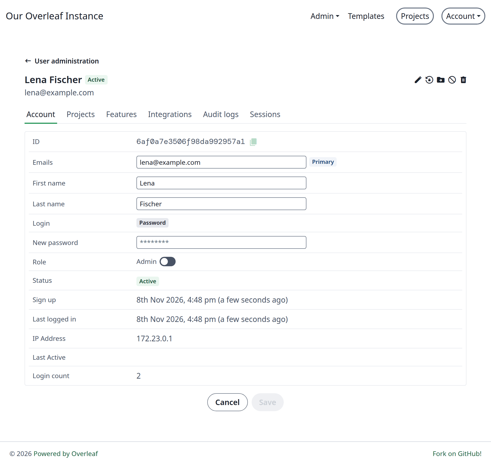
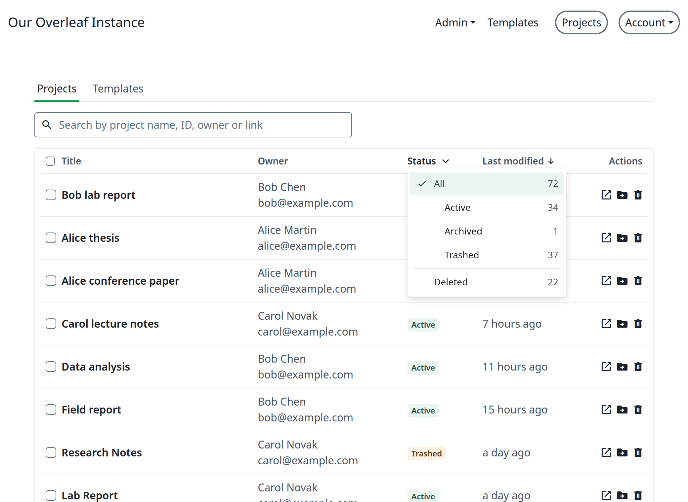
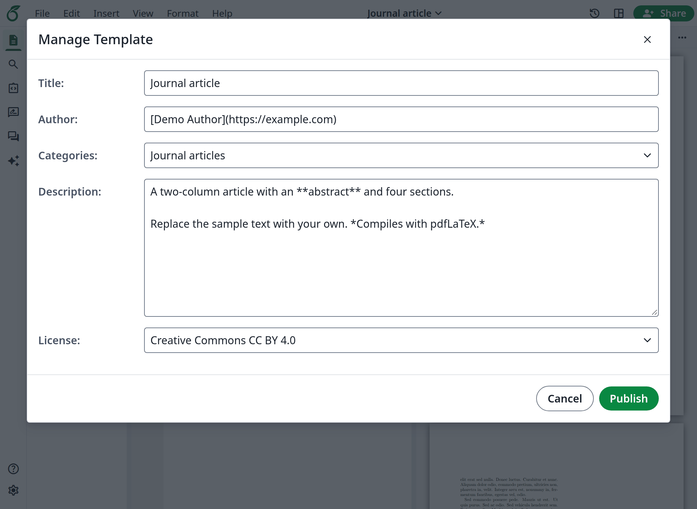
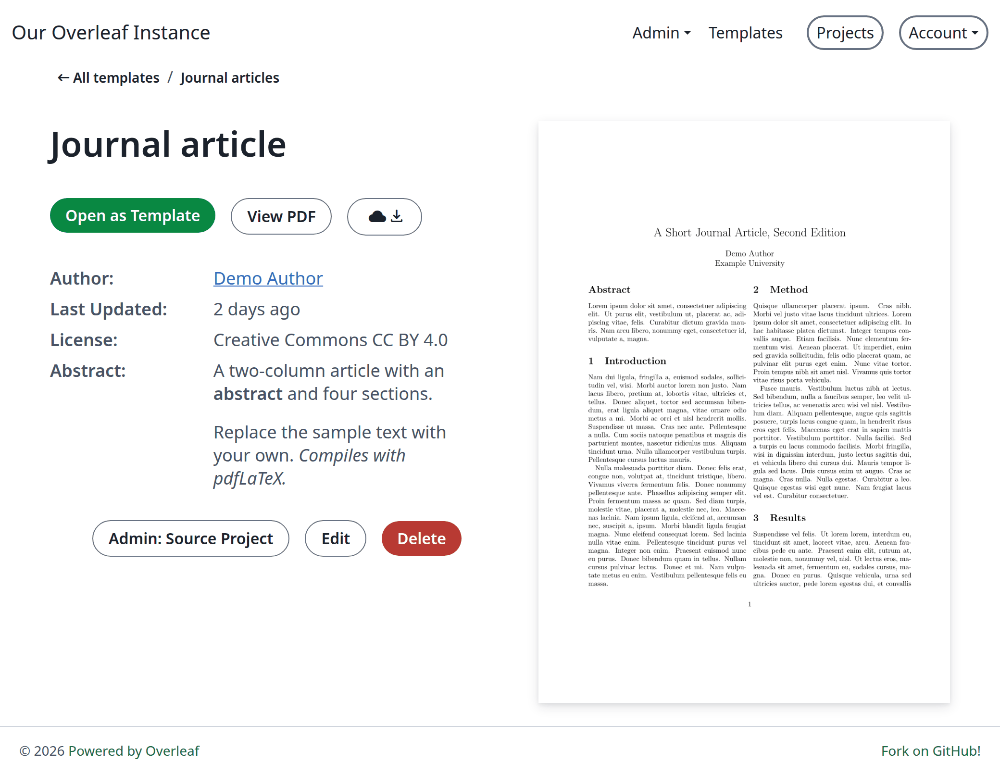
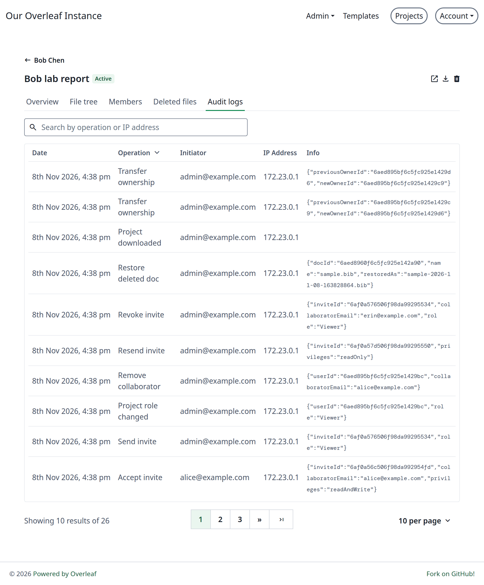

Gérer une instance Overleaf pour un laboratoire ou un département amène les mêmes questions chaque semaine. Pourquoi cet étudiant ne peut-il pas se connecter ? Qui utilise encore le serveur ? Qui a donné les droits d'administration à ce compte ? Où est passée la thèse de l'an dernier ? Nous avons reconstruit le panneau d'administration pour que vous puissiez y répondre sans ouvrir un shell de base de données.

Le nouveau panneau reprend l'apparence d'Overleaf 6.3 et est traduit dans toutes les langues prises en charge par l'interface. Il propose une liste de tous les utilisateurs, une liste de tous les projets, une page pour chacun d'eux, un endroit pour gérer vos modèles, et des journaux d'audit.

<Info>

Le nouveau panneau d'administration est fusionné dans notre branche principale et sera officiellement publié dans la v6.4.0. Toutes les captures d'écran de cet article proviennent d'une instance de test remplie de comptes fictifs.

</Info>

### Ce qu'il contient {#what’s-in-it}

* **Liste des utilisateurs** : recherche, filtres par méthode de connexion, rôle et statut, et actions groupées.
* **Page d'un utilisateur** : le compte, les projets, les fonctionnalités, les intégrations, les journaux d'audit et les sessions d'une personne.
* **Liste des projets** : tous les projets de l'instance, recherchables par nom, ID, propriétaire ou lien de partage.
* **Page d'un projet** : les paramètres, fichiers, membres, fichiers supprimés et journaux d'audit d'un projet.
* **Gestion des modèles** : publier un projet comme modèle, le mettre à jour et garder la galerie en ordre.
* **Journaux d'audit** : qui a fait quoi, quand, et depuis quelle adresse IP.

## Une seule liste pour tous les utilisateurs {#one-list-for-every-user}

Cliquez sur **Admin**, puis sur **Manage Users**. Chaque compte occupe une ligne qui indique comment il se connecte, son rôle et son statut.

<Frame caption="La liste des utilisateurs">
  
</Frame>

Recherchez par nom, e-mail ou ID. Les en-têtes **Login**, **Role** et **Status** sont des filtres, et chaque option indique combien de comptes elle renverrait. Vous voyez d'un coup d'œil combien de personnes arrivent par SAML, et chaque fournisseur OIDC apparaît sous le nom que vous lui avez donné.

<Frame caption="Filtrer par méthode de connexion">
  
</Frame>

Chaque compte a exactement un statut, et la somme des quatre statuts donne le total.

| Statut       | Signification                                                              |
| ------------ | -------------------------------------------------------------------------- |
| **Active**   | S'est connecté ou a ouvert un projet au cours des 12 derniers mois.        |
| **Pending**  | Ne s'est jamais connecté.                                                  |
| **Inactive** | S'est connecté auparavant, mais pas au cours des 12 derniers mois.         |
| **Disabled** | Un administrateur a empêché le compte de se connecter.                     |

Les comptes supprimés restent à l'écart dans leur propre filtre. Si une recherche correspond aussi à un compte supprimé, une ligne au-dessus du tableau le signale et propose de l'afficher.

<Frame caption="Filtrer par statut">
  
</Frame>

La recherche, le tri et la pagination s'exécutent sur le serveur, si bien que les listes ne s'arrêtent plus aux 1 000 premières lignes.

### Accueillir des personnes, avec ou sans e-mail {#bring-people-in-with-or-without-email}

**Create account** ajoute un utilisateur et vous donne le lien dont il a besoin. Lorsque l'[envoi d'e-mails](/fr/on-premises/configuration/overleaf-toolkit/email-delivery  "mention") n'est pas configuré, la boîte de dialogue le dit clairement et vous permet de copier le lien, de sorte qu'une petite instance peut tout de même accueillir de nouvelles personnes.

<Frame caption="Le lien d'activation d'un nouveau compte">
  
</Frame>

Le panneau propose le bon lien pour chaque compte : **Send activation email** pour un compte qui ne s'est jamais connecté, valable 7 jours, et **Send reset link** pour un compte qui s'est déjà connecté, valable 1 heure. Les comptes qui se connectent par SSO n'ont pas de mot de passe local et ne reçoivent donc ni l'un ni l'autre.

### Modifier plusieurs comptes à la fois {#change-many-accounts-at-once}

Cochez quelques comptes et la barre d'outils propose **Send activation email**, **Transfer this user's projects**, **Disable**, **Enable**, **Make admin**, **Remove admin** et **Delete account**. La boîte de dialogue liste les comptes avant que vous confirmiez. Si certains échouent, elle vous indique lesquels, et ce qui a déjà fonctionné reste fait.

<Frame caption="Actions groupées">
  
</Frame>

### Difficile de se tromper {#hard-to-get-wrong}

* Votre propre compte est marqué **You** et ses actions sont grisées, vous ne pouvez donc ni vous désactiver, ni vous supprimer, ni vous rétrograder.
* Chaque action demande une confirmation dans une boîte de dialogue qui nomme le compte.
* **Delete account** peut d'abord confier les projets de l'utilisateur à quelqu'un d'autre.
* Un compte supprimé peut être restauré, avec les projets supprimés en même temps que lui. Seul **Delete permanently** est définitif, et il vous avertit.

## Tout sur une personne {#everything-about-one-person}

Cliquez sur un nom pour ouvrir la page de l'utilisateur. Elle comporte six onglets et les mêmes icônes d'action que la liste.

### Compte {#account}

Les détails du compte, de l'ID et des e-mails jusqu'à la dernière connexion et son adresse IP. Cliquez sur le crayon pour modifier l'e-mail, les noms ou le mot de passe, ou pour activer ou désactiver **Admin**.

<Frame caption="Modifier un compte">
  
</Frame>

### Projets {#projects}

Les projets dont cette personne est propriétaire, avec leur propre recherche, leur filtre de statut et leurs actions.

<Frame caption="Les projets d'un utilisateur">
  
</Frame>

### Fonctionnalités {#features}

Ce qui est activé pour ce compte, comme le nombre de collaborateurs par projet, le délai de compilation, les intégrations et l'IA, ainsi que l'utilisation de l'IA par le compte et un bouton pour la réinitialiser.

<Frame caption="Les fonctionnalités d'un utilisateur">
  
</Frame>

### Intégrations {#integrations}

Les jetons d'accès Git de la personne et les services qu'elle a liés.

<Frame caption="Les intégrations d'un utilisateur">
  
</Frame>

### Sessions {#sessions}

Les endroits où la personne est connectée. **Clear sessions** la déconnecte partout, ce qui est la première chose à faire quand un ordinateur portable disparaît.

<Frame caption="Les sessions d'un utilisateur">
  
</Frame>

## Tous les projets de l'instance {#every-project-on-the-instance}

Cliquez sur **Admin**, puis sur **Project/Object Lookup**. La liste affiche les projets de tous les utilisateurs, avec leurs propriétaires et leurs statuts. Le champ de recherche accepte le nom d'un projet, son ID, son propriétaire ou un lien. Collez un lien de partage et vous trouvez le projet qui se cache derrière.

<Frame caption="Tous les projets">
  
</Frame>

Le filtre **Status** sépare les projets **Active**, **Archived**, **Trashed** et **Deleted**. Cochez plusieurs projets pour les télécharger dans un seul fichier `.zip`, changer leur propriétaire ou les supprimer. Dans la vue **Deleted**, les boutons sont **Restore** et **Delete permanently**.

<Frame caption="Filtrer les projets par statut">
  
</Frame>

## Tout sur un projet {#everything-about-one-project}

Cliquez sur le titre d'un projet pour ouvrir sa page.

### Vue d'ensemble {#overview}

Modifiez le nom, le partage par lien, le compilateur, la version de TeX Live et le document principal. **Change project owner** donne le projet à un autre utilisateur, ce qui aide quand quelqu'un quitte le laboratoire et que sa thèse doit rester.

<Frame caption="Modifier un projet">
  
</Frame>

### Arborescence des fichiers {#file-tree}

Les fichiers et dossiers du projet, en lecture seule.

<Frame caption="Les fichiers d'un projet">
  
</Frame>

### Membres {#members}

Le propriétaire, les collaborateurs et les invitations en attente. Changez le rôle d'un collaborateur, retirez son accès, ou renvoyez ou révoquez une invitation.

<Frame caption="Modifier les membres d'un projet">
  
</Frame>

### Fichiers supprimés {#deleted-files}

Les fichiers retirés du projet. **Restore file** place une copie dans le dossier racine du projet, et la ligne affiche le nom de la copie.

<Frame caption="Un fichier restauré">
  
</Frame>

## Gestion des modèles {#template-management}

Un modèle commence comme un projet ordinaire. Vous le publiez depuis l'éditeur, puis vous le gérez depuis sa page dans la galerie ou depuis le panneau d'administration.

### Tous les modèles dans un seul tableau {#all-templates-in-one-table}

Cliquez sur **Admin**, puis sur **Project/Object Lookup**, puis sur l'onglet **Templates**. Il liste chaque modèle publié avec son auteur, son propriétaire et sa date de dernière modification, et vous pouvez y effectuer une recherche. Cliquez sur un titre pour ouvrir le modèle, sur un propriétaire pour ouvrir la page de cet utilisateur, ou sur la corbeille pour supprimer un modèle. Une suppression est inscrite dans [votre propre journal d'audit](#when-there-is-no-log-left).

<Frame caption="Tous les modèles dans le panneau d'administration">
  
</Frame>

### Publier depuis l'éditeur {#publish-from-the-editor}

Ouvrez un projet et compilez-le jusqu'à ce que le PDF soit correct, car la galerie affiche le PDF de la dernière compilation réussie. Cliquez ensuite sur **File**, puis sur **Manage Template**, et renseignez le titre, l'auteur, une catégorie, une description en Markdown et une licence. Le compilateur et le document principal du projet accompagnent le modèle, de sorte que les projets ouverts à partir de celui-ci utilisent les mêmes.

<Frame caption="Publier un projet comme modèle">
  
</Frame>

### Mettre à jour un modèle {#update-a-template}

Pour modifier les fichiers et le PDF d'un modèle, publiez de nouveau le projet sous le même titre. La boîte de dialogue vous indique que le titre existe déjà, et le bouton devient **Overwrite**. Les projets que des personnes ont déjà ouverts à partir du modèle ne changent pas.

<Frame caption="Publier sous le même titre">
  
</Frame>

### La page du modèle {#the-template-page}

Tout le monde peut utiliser **Open as Template**, **View PDF** et le bouton de téléchargement. Les administrateurs disposent en plus de **Admin: Source Project**, **Edit** et **Delete**.

<Frame caption="La page d'un modèle">
  
</Frame>

**Edit** modifie ce que la galerie affiche d'un modèle : son titre, son auteur, sa catégorie, sa description et sa licence, ainsi que la langue de correction orthographique des projets ouverts à partir de celui-ci. Les fichiers et le PDF ne sont pas touchés. Le modèle conserve sa propre copie des fichiers, donc supprimer le projet source n'emporte pas le modèle.

<Frame caption="Modifier les détails d'un modèle">
  
</Frame>

### Une galerie pour vos utilisateurs {#a-gallery-for-your-users}

La galerie s'ouvre avec une carte par catégorie, et chaque catégorie a sa propre page. Les catégories proviennent de votre configuration des [Modèles](/fr/on-premises/configuration/overleaf-toolkit/templates  "mention"), où vous pouvez aussi autoriser un utilisateur qui n'est pas administrateur à publier.

<Frame caption="La galerie de modèles">
  
</Frame>

La page **All templates** affiche chaque modèle avec un aperçu de sa première page, et vos utilisateurs peuvent y effectuer une recherche et la trier par titre ou par date.

<Frame caption="Tous les modèles">
  
</Frame>

## Journaux d'audit : qui a fait quoi, et quand {#audit-logs-who-did-what-and-when}

C'est la partie dont nous sommes le plus fiers. Chaque compte et chaque projet a désormais son propre journal d'audit, et les administrateurs du site peuvent le lire directement dans le panneau.

Ouvrez l'onglet **Audit logs** sur la page d'un utilisateur. Les entrées les plus récentes apparaissent en premier.

<Frame caption="Le journal d'audit d'un compte">
  
</Frame>

Lue de bas en haut, cette page raconte une histoire. Lena s'est connectée. Un administrateur a porté son délai de compilation à 300 secondes, désactivé son accès à l'IA, lui a envoyé un lien de réinitialisation du mot de passe, l'a nommée administratrice puis est revenu dessus, et a ensuite désactivé puis réactivé le compte. Lena s'est reconnectée, et l'administrateur a effacé ses sessions.

| Colonne        | Ce qu'elle vous apprend                                                                                       |
| -------------- | ------------------------------------------------------------------------------------------------------------- |
| **Date**       | Quand cela s'est produit.                                                                                     |
| **Operation**  | Ce qui s'est produit.                                                                                         |
| **Initiator**  | Qui l'a fait. Ce qu'un administrateur fait à un compte affiche l'administrateur, pas l'utilisateur.           |
| **IP Address** | D'où venait la requête.                                                                                       |
| **Info**       | Les détails, comme le nouveau délai de compilation, ou si l'e-mail est réellement parti.                      |

### Trouver l'entrée dont vous avez besoin {#find-the-entry-you-need}

Recherchez par opération ou par adresse IP. L'en-tête **Operation** est un filtre qui liste chaque opération de ce journal et le nombre de fois où elle s'est produite.

<Frame caption="Filtrer par opération">
  
</Frame>

### Un journal pour chaque projet {#a-log-for-every-project}

La page du projet a le même onglet. Elle montre qui a été invité, qui a rejoint, quel rôle a changé, qui a téléchargé le projet et qui l'a repris.

<Frame caption="Le journal d'audit d'un projet">
  
</Frame>

### Ce qui est enregistré {#what-gets-recorded}

Voici les principales opérations de chaque journal, sous les noms que vous voyez dans le panneau.

| Journal | Domaine                       | Opérations                                                                                                                                                                                                                                  |
| ------- | ----------------------------- | ------------------------------------------------------------------------------------------------------------------------------------------------------------------------------------------------------------------------------------------- |
| Compte  | Connexion et mot de passe     | Login, Logout, Failed password match, Update password, Reset password                                                                                                                                                                       |
| Compte  | E-mail et SSO                 | Add email, Remove email, Change primary email, Link SSO, Unlink SSO                                                                                                                                                                         |
| Compte  | Intégrations                  | Link GitHub, Unlink GitHub, Link Dropbox, Unlink Dropbox, Integration account linked, Integration account unlinked, Create Git token, Delete Git token                                                                                      |
| Compte  | Actions des administrateurs   | Create account, Send activation email, Send password reset email, Change name, Change admin access, Change features, Change AI features, Reset AI usage, Account suspension, Account reactivation, Clear sessions, Transfer projects, Delete account, Restore account |
| Projet  | Partage                       | Send invite, Resend invite, Revoke invite, Accept invite, Join via token, Accept via link sharing, Remove collaborator, Leave project, Project role changed, Toggle access level, Transfer ownership                                       |
| Projet  | Fichiers                      | Project downloaded, Project exported docx, Project exported markdown, Project exported html, Restore deleted doc                                                                                                                            |
| Projet  | Actions des administrateurs   | Project deleted, Project restored                                                                                                                                                                                                           |
| Projet  | Synchronisation Git           | Integration repo linked, Integration repo unlinked                                                                                                                                                                                          |

### Quand il ne reste plus de journal {#when-there-is-no-log-left}

**Delete permanently** supprime un compte ou un projet avec son journal, et un modèle n'en a jamais eu. Ces actions sont donc écrites dans le journal de l'administrateur qui les a effectuées, avec l'e-mail ou l'ID de ce qui a été supprimé.

<Frame caption="Suppressions définitives dans le journal de l'administrateur">
  
</Frame>

### Bon à savoir {#good-to-know}

* Les entrées sont conservées deux ans et demi, puis MongoDB les supprime automatiquement.
* Derrière un proxy inverse, définissez [`OVERLEAF_TRUSTED_PROXY_IPS`](/fr/on-premises/configuration/overleaf-toolkit/environment-variables  "mention") pour que le journal affiche l'adresse du visiteur et non celle du proxy.
* Tout n'est pas encore enregistré. Les clone et push Git, les modifications des paramètres d'un projet comme son nom ou son compilateur, ainsi que les projets qu'un propriétaire crée, archive, met à la corbeille ou supprime n'apparaissent pas dans le journal du projet.

## Essayez-le {#try-it}

Le nouveau panneau est livré avec Ayakaleaf Pro v6.4.0. Les guides pas à pas sont déjà en ligne :

* [Gestion des utilisateurs](/fr/on-premises/user-guide/administrators/user-management  "mention")
* [Gestion des projets](/fr/on-premises/user-guide/administrators/project-management  "mention")
* [Gestion des modèles](/on-premises/user-guide/administrators/template-management  "mention")

Si quelque chose manque ou ne fonctionne pas comme vous l'attendez, dites-le-nous sur [GitHub](https://github.com/ayaka-notes/ayakaleaf-pro/issues).
