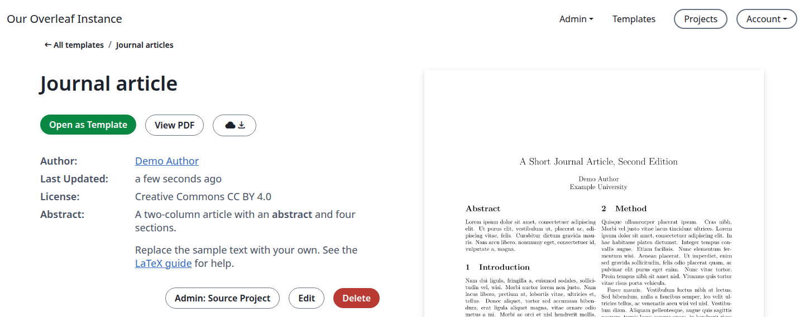

Vous publiez les modèles depuis l'éditeur, et vous les gérez sur leur page dans la galerie ou dans le panneau d'administration.

<Info>

Pour activer la galerie, choisir ses catégories ou autoriser un utilisateur qui n'est pas administrateur à publier, consultez [Modèles](/fr/on-premises/configuration/overleaf-toolkit/templates).

</Info>

## Publier un projet {#publish-a-project}

<Steps>
<Step title="Compiler le projet">
Ouvrez le projet et cliquez sur **Recompile**. Le PDF que vous voyez est celui que la galerie affichera.

Tant que l'éditeur n'a pas de PDF, par exemple lorsque vous ouvrez un projet qui ne compile pas, **Manage Template** est grisé.

<Frame caption="Pas encore de PDF, donc rien à publier">
  
</Frame>

<Warning>

La publication enregistre les fichiers tels qu'ils sont maintenant, ainsi que le PDF de la dernière compilation réussie. Si vous avez modifié le projet après cette compilation, ou si la dernière compilation a échoué, la galerie affiche un ancien PDF à côté de fichiers plus récents, qui peuvent ne pas compiler. Recompilez jusqu'à ce que le PDF soit correct, puis publiez.

</Warning>
</Step>

<Step title="Ouvrir le formulaire">
Dans le menu supérieur de l'éditeur, cliquez sur **File**, puis sur **Manage Template**.

<Frame caption="Le menu File">
  
</Frame>
</Step>

<Step title="Remplir le formulaire">
<Frame caption="La boîte de dialogue Manage Template">
  
</Frame>

| Champ | Remarques |
| --- | --- |
| **Title** | Correspond d'abord au nom du projet. Doit être unique dans la galerie. 150 caractères au maximum. |
| **Author** | Correspond d'abord à votre nom. Un lien Markdown tel que `[Demo Author](https://example.com)` devient un lien sur la page du modèle. |
| **Categories** | Une catégorie, voir [Catégories](/fr/on-premises/user-guide/administrators/template-management#categories). |
| **Description** | Prend en charge le Markdown. 4096 caractères au maximum. La page du modèle l'affiche comme **Abstract**, et la galerie en affiche le début en texte brut. |
| **License** | **Creative Commons CC BY 4.0**, **LaTeX Project Public License 1.3c** ou <strong>Other (as stated in the work)</strong>. |

Le compilateur et le document principal du projet accompagnent le modèle : définissez-les donc d'abord dans le projet. Les projets ouverts à partir du modèle utilisent les mêmes.
</Step>

<Step title="Cliquer sur Publish">
La page du modèle s'ouvre.

<Frame caption="Le nouveau modèle">
  
</Frame>

**Admin: Source Project**, **Edit** et **Delete** vous sont réservés. Les autres utilisateurs ne voient que **Open as Template**, **View PDF** et le bouton de téléchargement.
</Step>

<Step title="Vérifier la galerie">
Cliquez sur **Templates** en haut à droite. Le nouveau modèle est le premier de la liste.
</Step>
</Steps>

## Catégories {#categories}

Un modèle appartient à une catégorie. Les noms et les descriptions proviennent de votre [configuration](/fr/on-premises/configuration/overleaf-toolkit/templates#configuration) et ne peuvent pas être modifiés sur le site.

Vous les voyez à ces endroits :

* **Categories** dans le formulaire.
* Les cartes en haut de la page de la galerie, `/templates`. Cliquez sur **Template Gallery** sur la page **All templates** pour y accéder.
* Une page pour chaque catégorie, par exemple `/templates/presentation`. Une catégorie sans modèles affiche <strong>No Templates.</strong>
* **New project**, puis **More templates**, sur la page des projets.
* Le lien au-dessus du titre sur la page du modèle.

<Frame caption="Les catégories sur la page de la galerie">
  
</Frame>

**All templates** dans le formulaire signifie aucune catégorie propre : le modèle figure uniquement dans la liste complète.

## Mettre à jour un modèle {#update-a-template}

Pour modifier les fichiers et le PDF, publiez à nouveau le projet sous le même titre.

<Steps>
<Step title="Modifier le projet">
Modifiez le projet et cliquez sur **Recompile**.
</Step>

<Step title="Publier à nouveau">
Cliquez sur **File**, puis sur **Manage Template**. Le formulaire affiche les détails du modèle, que vous pouvez modifier. Cliquez sur **Publish**.

Un message indique que le titre existe déjà, et le bouton devient **Overwrite**.

<Frame caption="Publier sous le même titre">
  
</Frame>

Si vous modifiez **Title** à ce moment-là, le message disparaît et **Publish** crée un nouveau modèle.
</Step>

<Step title="Cliquer sur Overwrite">
La même page du modèle s'ouvre, avec le nouveau PDF.

<Frame caption="Le modèle mis à jour">
  
</Frame>

Les projets que les utilisateurs ont déjà ouverts à partir du modèle ne changent pas.
</Step>
</Steps>

<Warning>

Le formulaire retrouve le modèle grâce au nom du projet. Si vous avez renommé le modèle avec **Edit**, le formulaire s'ouvre avec le nom du projet, votre nom, la première catégorie et une description vide, et saisir le titre du modèle ne rétablit pas ses détails. **Overwrite** remplace alors les détails par le contenu du formulaire : remplissez-les donc à nouveau d'abord.

</Warning>

## Modifier les détails {#edit-the-details}

Cela change ce que la galerie affiche à propos d'un modèle, pas ses fichiers ni son PDF.

<Steps>
<Step title="Ouvrir le modèle">
Cliquez sur **Templates** en haut à droite, cliquez sur le modèle, puis sur **Edit**.
</Step>

<Step title="Modifier les champs">
Les champs sont les mêmes que lors de la publication, avec un de plus : **Language** est la langue de vérification orthographique des projets ouverts à partir du modèle. Pour un projet publié avec la langue par défaut, il affiche **Off**, et les projets ouverts à partir de celui-ci utilisent <strong>English (American)</strong>.

<Frame caption="La boîte de dialogue Edit template">
  
</Frame>

Un titre déjà utilisé par un autre modèle est refusé : **Save** reste grisé jusqu'à ce que vous changiez **Title**.
</Step>

<Step title="Cliquer sur Save">
La boîte de dialogue se ferme et la page du modèle affiche les nouveaux détails.
</Step>
</Steps>

## Le projet source {#the-source-project}

**Admin: Source Project** ouvre le projet à partir duquel le modèle a été publié.

Le modèle conserve sa propre copie des fichiers. Si vous supprimez définitivement le projet, le bouton disparaît, et les utilisateurs peuvent toujours ouvrir le modèle. Un projet qui est seulement dans **Trash** conserve le bouton. Consultez également les questions-réponses dans [Modèles](/fr/on-premises/configuration/overleaf-toolkit/templates).

## Supprimer un modèle {#delete-a-template}

<Steps>
<Step title="Cliquer sur Delete">
Sur la page du modèle, cliquez sur **Delete**. La boîte de dialogue indique le nom du modèle.

<Frame caption="La boîte de dialogue Delete template">
  
</Frame>
</Step>

<Step title="Cliquer sur Confirm">
Vous revenez à la page d'où vous veniez, et le modèle ne figure plus dans la galerie. Son lien affiche désormais **Not found**.

Le projet source est conservé, tout comme les projets que les utilisateurs ont ouverts à partir du modèle.
</Step>
</Steps>

## Gérer les modèles dans le panneau d'administration {#manage-templates-in-the-admin-panel}

Cliquez sur **Admin**, puis sur **Project/Object Lookup**, puis sur l'onglet **Templates**. Il répertorie chaque modèle avec son auteur et son propriétaire, et vous pouvez y effectuer des recherches.

<Frame caption="Tous les modèles dans le panneau d'administration">
  
</Frame>

* Cliquez sur un titre pour ouvrir la page du modèle, ou sur l'icône d'ouverture pour l'ouvrir dans un nouvel onglet.
* Cliquez sur un propriétaire pour ouvrir la page de cet utilisateur.
* Cliquez sur l'icône de corbeille, puis sur **Delete**, pour supprimer un modèle. La boîte de dialogue avertit que cette action est irréversible, et le modèle quitte la galerie.

## Si la publication est refusée {#if-publishing-is-refused}

Le formulaire vous permet de saisir plus que ce que le site accepte. Un **Title** de plus de 150 caractères affiche `Template title exceeds the maximum length of 150 characters.`, et une **Description** de plus de 4096 caractères affiche `Template description exceeds the maximum length of 4096 characters.`

**Publish** reste alors grisé même si vous raccourcissez le texte. Cliquez sur **Cancel**, puis sur **File** et sur **Manage Template**, et remplissez à nouveau le formulaire.
