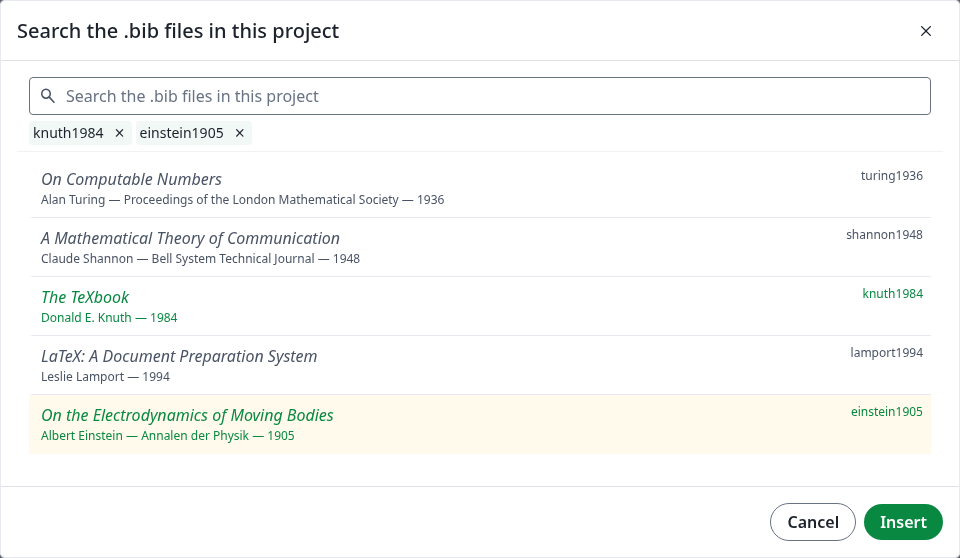

La recherche de références parcourt tous les fichiers `.bib` de votre projet : vous trouvez ainsi une référence sans vous souvenir de sa clé de citation. Rien n'est à configurer.

Votre projet a besoin d'au moins un fichier `.bib`. Vous pouvez en téléverser un, ou importer votre bibliothèque depuis [Zotero](/fr/on-premises/user-guide/users/zotero-integration) ou [Mendeley](/fr/on-premises/user-guide/users/mendeley-integration).

## Insérer une citation {#insert-a-citation}

<Steps>
<Step title="Commencer une citation">
Dans un fichier `.tex`, tapez `\cite{`. L'éditeur ajoute l'accolade fermante. Sous le curseur, vous voyez les clés de citation et un encadré bleu, **Open advanced reference search**.

<Frame caption="L'encadré bleu sous une citation">
  
</Frame>

Le bouton **Insert citation** de la barre d'outils, ainsi que **Insert** puis **Citation**, commencent aussi un `\cite{}` pour vous. L'encadré apparaît également pour d'autres commandes de citation, comme `\citep`, `\autocite`, `\parencite` et `\textcite`.
</Step>

<Step title="Ouvrir la recherche">
Cliquez sur **Search** dans l'encadré bleu, ou appuyez sur Ctrl+Espace entre les accolades. La boîte de dialogue liste toutes les entrées, avec leur titre, clé de citation, auteur, revue et année.

<Frame caption="Toutes les entrées du projet">
  
</Frame>
</Step>

<Step title="Trouver l'entrée">
Tapez dans le champ de recherche. Il cherche dans la clé de citation, l'auteur, le titre, la revue et l'année, et surligne ce qu'il trouve. Chaque mot doit correspondre : `turing 1936` trouve donc l'article de Turing de 1936. Les autres champs, comme l'éditeur, ne sont pas recherchés.

<Frame caption="Recherche par auteur et par année">
  
</Frame>
</Step>

<Step title="Choisir une ou plusieurs entrées">
Cliquez sur une entrée. Elle devient verte et sa clé apparaît au-dessus de la liste. Pour en ajouter une autre, cliquez dessus ou lancez une nouvelle recherche : vos choix sont conservés. Pour en retirer une, cliquez de nouveau dessus ou sur le <strong>×</strong> à côté de sa clé.

<Frame caption="Deux entrées choisies">
  
</Frame>
</Step>

<Step title="Cliquer sur Insert">
Les clés apparaissent entre les accolades, séparées par des virgules. Si votre document n'a pas encore de bibliographie, ajoutez ces lignes avant `\end{document}`, en utilisant les noms de vos fichiers `.bib` sans l'extension :

```latex
\bibliographystyle{plain}
\bibliography{refs,more}
```

Cliquez sur **Recompile**. Les références apparaissent dans le PDF.

<Frame caption="La citation compilée">
  
</Frame>
</Step>
</Steps>

La recherche fonctionne de la même façon dans l'éditeur **Visual**.

## Modifier une citation {#change-a-citation}

<strong>Ajouter une référence :</strong> placez le curseur entre les accolades d'une citation existante et ouvrez la recherche. **Insert** ajoute les nouvelles clés après celles déjà présentes.

<strong>Remplacer des références :</strong> sélectionnez les clés dans l'éditeur, puis appuyez sur Ctrl+Espace. Les clés apparaissent au-dessus de la liste et le bouton indique désormais **Replace**. Retirez celles dont vous ne voulez pas, ajoutez-en d'autres, puis cliquez sur **Replace**. Une clé qui ne figure dans aucun fichier `.bib` reste jusqu'à ce que vous la retiriez.

<Frame caption="Remplacer les clés sélectionnées">
  
</Frame>

## Utiliser le clavier {#use-the-keyboard}

| Touche | Ce qu'elle fait |
| --- | ------------ |
| **Flèche bas** | Passe du champ de recherche à la liste, puis descend dans la liste |
| **Flèche haut** | Remonte dans la liste |
| **Espace** | Choisit l'entrée, ou la retire de vos choix |
| **Entrée** | Insère vos choix, lorsque vous êtes dans la liste |
| **Tab** | Passe du champ de recherche à la liste et aux boutons |
| **Échap** | Ferme la boîte de dialogue sans rien modifier |

## D'où viennent les entrées {#where-the-entries-come-from}

La recherche couvre tous les fichiers `.bib` du projet, y compris ceux importés depuis Zotero ou Mendeley. Lorsque vous modifiez un fichier `.bib`, la recherche suivante trouve les nouvelles entrées.

## En cas de problème {#if-something-goes-wrong}

| Ce que vous voyez | Pourquoi | Que faire |
| ------------ | --- | ---------- |
| La liste de la boîte de dialogue est vide | Le projet n'a aucun fichier `.bib` | Téléversez-en un ou créez-en un |
| Pas d'encadré bleu, et Ctrl+Espace liste des commandes LaTeX | Le curseur n'est pas entre les accolades d'une citation | Cliquez entre les accolades |
| Ctrl+Espace ne fait rien | Votre ordinateur utilise ce raccourci pour autre chose | Cliquez sur **Search** dans l'encadré bleu |
| Une entrée est introuvable | La recherche ne couvre que la clé, l'auteur, le titre, la revue et l'année | Recherchez par l'un de ces champs |
