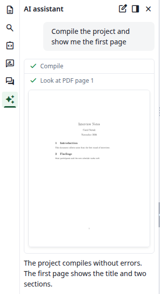

L'assistant travaille sur le projet que vous avez ouvert. Il lit vos documents et propose des modifications, et vous appliquez ou refusez chacune d'elles. Les réponses des captures d'écran sont des exemples : ce que vous obtenez dépend du modèle utilisé par votre instance.

<Info>

Si vous ne voyez pas **AI assistant** dans la barre de gauche, consultez [Intégration de l'IA](/fr/on-premises/configuration/overleaf-toolkit/integrations/ai-integration) pour votre administrateur.

</Info>

## Démarrer une conversation {#start-a-chat}

<Steps>
<Step title="Ouvrir l'assistant">
Dans la barre de gauche de l'éditeur, cliquez sur **AI assistant**. Le panneau s'ouvre à côté de l'éditeur.
</Step>

<Step title="Accepter les conditions">
La première fois, le panneau affiche les conditions des fonctionnalités d'IA. Cliquez sur **Accept and continue**. Vous ne le faites qu'une fois, et cela vaut aussi pour l'[Assistant d'erreurs](/fr/on-premises/user-guide/users/error-assistant).

<Frame caption="Les conditions, affichées une seule fois">
  
</Frame>
</Step>

<Step title="Poser une question">
Tapez dans <strong>What would you like to do?</strong> et appuyez sur Entrée, ou cliquez sur la flèche. Vous pouvez aussi cliquer sur une suggestion sous **Start a chat**. Les suggestions changent d'une conversation à l'autre, et **Fix the compile errors** s'y ajoute lorsque la dernière compilation comporte des erreurs.

<Frame caption="Une conversation vide">
  
</Frame>
</Step>

<Step title="Lire la réponse">
Ce que l'assistant a fait apparaît sous forme de lignes dans un encadré, comme **Read line 15-16 of main.tex**, avec une coche une fois l'étape terminée. La réponse suit. Si le modèle partage son raisonnement, cliquez sur **Reasoned for 1 s** pour le lire.

<Frame caption="Une question et sa réponse">
  
</Frame>
</Step>
</Steps>

## Poser une question sur des lignes sélectionnées {#ask-about-selected-lines}

Sélectionnez des lignes dans l'éditeur. Une étiquette comme `main.tex: 16` apparaît au-dessus de la zone de message, et le texte sélectionné accompagne votre message. Dans une conversation vide, les suggestions portent sur la sélection, comme **Make it shorter**.

<Frame caption="Une ligne sélectionnée">
  
</Frame>

## Examiner une modification proposée {#review-a-suggested-edit}

Une modification n'entre dans votre document que lorsque vous l'appliquez.

<Steps>
<Step title="Lire la suggestion">
Un encadré intitulé **Edit line 16** indique la raison, le numéro de ligne et la modification : l'ancien texte est barré et le nouveau est surligné. Le document n'a pas encore changé. **Show result** n'affiche que le nouveau texte, et **Show diff** revient en arrière.

<Frame caption="Une modification en attente de votre décision">
  
</Frame>
</Step>

<Step title="L'appliquer">
Cliquez sur **Apply**. La modification apparaît dans l'éditeur, l'encadré reçoit une coche et l'assistant poursuit. Si la modification concerne un autre document, celui-ci s'ouvre.

<Frame caption="La modification est appliquée">
  
</Frame>
</Step>

<Step title="Revenir en arrière si vous changez d'avis">
**Undo** retire la modification du document, et **Apply** la remet. L'assistant n'est informé ni de l'un ni de l'autre.
</Step>
</Steps>

### Refuser une modification {#reject-an-edit}

Cliquez sur **Reject**. Le document reste tel quel, l'encadré indique <strong>The user declined this edit.</strong> et l'assistant poursuit en sachant que vous avez refusé. Les boutons disparaissent : pour récupérer la modification, redemandez-la.

Si vous écrivez un nouveau message au lieu de décider, la modification n'est pas appliquée et l'encadré l'indique.

<Frame caption="Une modification refusée, et une laissée sans décision">
  
</Frame>

## Ce que l'assistant peut faire dans un projet {#what-the-assistant-can-do-in-a-project}

Seules les modifications attendent votre décision. Les autres étapes s'exécutent dès que l'assistant les lance.

| La ligne dans la conversation | Ce qu'elle fait |
| -------------------- | ------------ |
| **Read line 15-16 of main.tex** | Lit des lignes d'un document |
| **Find “schedule” in main.tex** | Recherche du texte dans un document |
| **List the project files** | Liste les fichiers du projet |
| **Create appendix.tex** | Crée un document vide et l'ouvre |
| **Edit line 16** | Propose une modification, voir ci-dessus |
| **Compile** | Compile le projet |
| **Check the compile log** | Lit les erreurs et avertissements de la dernière compilation |
| **Look at PDF page 1** | Affiche une page du PDF dans la conversation |
| **Read the PDF structure** | Lit la structure du PDF |
| **Switch to xelatex** | Change le compilateur du projet, comme dans **Settings** |
| <strong>Search the web for “...”</strong> | Effectue une recherche sur le web |
| <strong>Search the help pages for “...”</strong> | Effectue une recherche dans les pages d'aide |

<Frame caption="Un nouveau fichier, puis une modification dans un autre document">
  
</Frame>

<Frame caption="Une compilation et une page du PDF">
  
</Frame>

Une ligne de recherche indique le nombre de résultats trouvés. Cliquez dessus pour les lister. La disponibilité des recherches dépend de votre instance, voir [Services de recherche facultatifs](/fr/on-premises/configuration/overleaf-toolkit/integrations/ai-integration#optional-search-services).

<Frame caption="Les résultats d'une recherche">
  
</Frame>

La suggestion **Fix the compile errors** demande à l'assistant de vérifier le journal et de corriger ce qu'il trouve. Ses corrections arrivent sous forme de modifications à examiner.

## Joindre une image ou un PDF {#attach-an-image-or-a-pdf}

Dans la zone de message, cliquez sur l'icône d'image, **Attach image or PDF**, et choisissez un fichier. Son nom apparaît au-dessus de votre texte. Rédigez votre message et envoyez-le.

<Frame caption="Un fichier joint à un message">
  
</Frame>

Le panneau refuse les autres fichiers avec <strong>Only images and PDF files can be attached.</strong> et les fichiers volumineux avec <strong>Files must be smaller than 2 MB.</strong>

## Arrêter l'assistant {#stop-the-assistant}

Pendant que l'assistant travaille, la flèche de la zone de message devient un bouton **Stop**. Cliquez dessus. Une étape en cours se termine par <strong>Stopped by the user.</strong> et rien d'autre ne se passe jusqu'à ce que vous écriviez à nouveau.

<Frame caption="Le bouton Stop">
  
</Frame>

## Si l'assistant s'arrête de lui-même {#if-the-assistant-stops-by-itself}

L'assistant ne peut effectuer qu'un nombre limité d'étapes pour un message. À la limite, le panneau affiche <strong>The assistant used all the steps it may take for one message. Reply to let it carry on.</strong> Répondez, par exemple avec `Go on`, et il continue.

<Frame caption="La limite d'étapes">
  
</Frame>

Si le panneau affiche **Something’s gone wrong**, la requête a échoué. Renvoyez votre message ou cliquez sur **Start new chat**.

## Déplacer le panneau et recommencer {#move-the-panel-and-start-over}

Ces boutons se trouvent en haut du panneau :

* **Start new chat** vide le panneau. Il n'y a pas de liste des conversations précédentes. Recharger la page vide aussi la conversation.
* **Move to the right** place le panneau à droite du PDF, où il reste ouvert pendant que vous utilisez l'arborescence des fichiers. **Move to the left** le remet en place. La conversation est conservée.
* **Close** masque le panneau. Cliquez sur **AI assistant** dans la barre de gauche pour le rouvrir, avec la conversation toujours présente.

<Frame caption="Le panneau à droite">
  
</Frame>

## Utilisation des jetons {#token-usage}

L'assistant n'affiche pas le nombre de jetons que vous avez utilisés. Si votre instance fixe une limite et que vous l'atteignez, votre message suivant ne reçoit pas de réponse. Le panneau affiche **Usage limit reached** et le délai avant de pouvoir discuter à nouveau, et la zone de message est grisée.

<Frame caption="La limite est atteinte">
  
</Frame>

Une nouvelle conversation affiche le même avis. Après un rechargement, la zone semble de nouveau normale, mais le message suivant reçoit lui aussi l'avis. L'[Assistant d'erreurs](/fr/on-premises/user-guide/users/error-assistant) est soumis à la même limite et affiche **Usage limit reached** dans l'entrée du journal.

Votre administrateur fixe la limite, voir [Utilisation et réinitialisation](/fr/on-premises/configuration/overleaf-toolkit/integrations/ai-integration#usage-and-reset).
