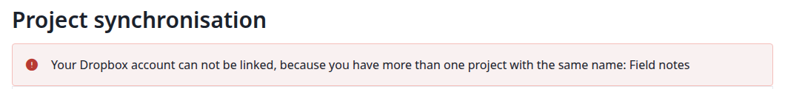

Gardez tous vos projets synchronisés avec un dossier de votre Dropbox. Les modifications circulent dans les deux sens en arrière-plan, à une exception près : ce que vous tapez dans l'éditeur atteint Dropbox quelques minutes après que vous avez quitté le projet, ou lorsque vous cliquez sur **sync this project now**.

<Info>

Si vous ne voyez aucune option Dropbox dans **Account settings** ni dans l'éditeur, demandez à votre administrateur d'activer la [synchronisation Dropbox](/fr/on-premises/configuration/overleaf-toolkit/integrations/dropbox-synchronisation).

</Info>

## Lier votre compte Dropbox {#link-your-dropbox-account}

Vous ne le faites qu'une fois.

<Steps>
<Step title="Ouvrir les paramètres de votre compte">
Cliquez sur **Account**, puis sur **Account settings**. Sous **Project synchronisation**, trouvez **Dropbox** et cliquez sur **Link**.

<Frame caption="Dropbox dans les paramètres du compte">
  
</Frame>
</Step>

<Step title="Autoriser sur Dropbox">
Dropbox s'ouvre. Connectez-vous si on vous le demande, puis autorisez l'application.
</Step>

<Step title="Vérifier le lien">
Vous revenez aux paramètres du compte. Un message vert indique que votre compte Dropbox est lié, et le bouton indique maintenant **Unlink**. Sous Dropbox, un état indique que vos projets sont en cours d'envoi.

<Frame caption="Votre compte Dropbox est lié">
  
</Frame>

L'état passe à **Overleaf and Dropbox have processed all updates** lorsqu'ils sont tous arrivés.

<Frame caption="Tout est synchronisé">
  
</Frame>
</Step>
</Steps>

Si votre compte n'est pas encore lié, la carte **Dropbox** de l'éditeur vous demande d'abord de le lier. Cliquez sur **Update Dropbox Settings** : les paramètres du compte s'ouvrent dans un nouvel onglet. Liez-y votre compte, puis actualisez la page de l'éditeur, comme l'indique la boîte de dialogue.

<Frame caption="L'invite lorsque votre compte n'est pas lié">
  
</Frame>

Si vous n'autorisez pas l'accès sur Dropbox, vous revenez aux paramètres du compte sans message, et le bouton indique toujours **Link**.

### Si vous avez des projets portant le même nom {#if-you-have-projects-with-the-same-name}

Vous ne pouvez pas lier votre compte tant que deux de vos projets portent le même nom. Le message les nomme. Les projets archivés et ceux de la corbeille comptent aussi.

<Frame caption="Deux projets portant le même nom">
  
</Frame>

Renommez l'un d'eux et cliquez à nouveau sur **Link**.

## Retrouver vos projets dans Dropbox {#find-your-projects-in-dropbox}

Chacun de vos projets est un dossier dans `Apps/<app name>/` de votre Dropbox, avec tous ses fichiers. Votre administrateur a choisi le nom de l'application. Chaque projet est synchronisé, y compris ceux que vous créerez plus tard : vous ne pouvez pas en choisir certains.

Pour voir le dossier d'un projet, ouvrez le projet. Dans la barre de gauche, cliquez sur **Integrations**, puis sur **Dropbox**.

<Frame caption="Le panneau Integrations">
  
</Frame>

La boîte de dialogue nomme le dossier et renvoie vers celui-ci sur Dropbox.

<Frame caption="Le dossier de ce projet">
  
</Frame>

Un nouveau projet portant le même nom qu'un projet existant reçoit un dossier numéroté, comme `Field notes (1)`. La boîte de dialogue indique quel est son dossier.

<Frame caption="Un dossier numéroté">
  
</Frame>

## Les modifications faites dans Overleaf {#changes-you-make-in-overleaf}

Vous n'avez rien à cliquer.

* **Les nouveaux fichiers, renommages, déplacements et suppressions** atteignent Dropbox immédiatement. Un nouveau dossier y apparaît avec son premier fichier.
* **Renommer un projet** renomme son dossier.
* **Les modifications que vous tapez dans l'éditeur** n'atteignent pas Dropbox tant que le projet est ouvert, et cliquer sur **Recompile** ne les envoie pas. Elles partent environ trois minutes après que tout le monde a quitté le projet. Pour les envoyer plus tôt, consultez [Forcer une synchronisation](#force-a-sync).
* **Supprimer un projet** laisse son dossier dans Dropbox. Supprimez le dossier vous-même si vous n'en avez plus besoin.

## Les modifications faites dans Dropbox {#changes-you-make-in-dropbox}

Ici non plus, vous n'avez rien à cliquer. Dropbox informe Overleaf de la modification, qui apparaît généralement en quelques secondes, y compris dans un éditeur ouvert, sans rechargement.

* **Les nouveaux fichiers, modifications, renommages et suppressions** dans un dossier de projet sont appliqués au projet. Les nouveaux dossiers aussi.
* **Un nouveau dossier à la racine du dossier de l'application** devient un nouveau projet.
* **Les fichiers qu'Overleaf ne synchronise pas**, comme les fichiers `.DS_Store` ou `.aux`, restent uniquement dans Dropbox.

L'historique du projet marque ces modifications <strong>(via Dropbox)</strong>.

### Si le fichier est ouvert dans l'éditeur {#if-the-file-is-open-in-the-editor}

Le fichier change sous vos yeux, et une boîte de dialogue vous en informe. Cliquez sur **OK**.

<Frame caption="Un fichier ouvert a changé dans Dropbox">
  
</Frame>

La version Dropbox remplace ce que vous aviez tapé et pas encore envoyé. Votre texte n'est pas perdu : il reste dans l'historique du projet.

<Frame caption="Le texte remplacé dans l'historique">
  
</Frame>

### Renommer ou supprimer un dossier de projet {#rename-or-delete-a-project-folder}

Renommez un projet dans Overleaf, pas dans Dropbox. Pour Overleaf, un dossier renommé dans Dropbox est un dossier supprimé plus un nouveau : vous obtenez un nouveau projet avec le nouveau nom, et l'ancien projet reste.

Lorsque vous supprimez un dossier de projet dans Dropbox, le projet reste dans votre liste de projets, avec ses fichiers et son historique. La prochaine fois que vous l'ouvrez, une boîte de dialogue vous en informe une fois. Cliquez sur **OK**.

<Frame caption="Le dossier de ce projet a disparu de Dropbox">
  
</Frame>

Le projet continue de se synchroniser. Pour le remettre entièrement dans Dropbox, cliquez sur **sync this project now**.

### Lorsqu'un projet est archivé ou dans la corbeille {#while-a-project-is-archived-or-in-the-trash}

Les modifications que vous faites dans son dossier Dropbox ne sont pas appliquées, et restaurer le projet ne les fait pas entrer. Overleaf cesse alors d'envoyer les fichiers que vous avez modifiés, de sorte que les deux côtés diffèrent. Enregistrez à nouveau un tel fichier dans Dropbox : la version Dropbox remplace celle d'Overleaf.

## Forcer une synchronisation {#force-a-sync}

Chaque projet a son propre lien. Utilisez-le lorsque vous voulez vos modifications dans Dropbox tout de suite, sans quitter le projet.

<Steps>
<Step title="Ouvrir la boîte de dialogue de synchronisation">
Ouvrez le projet. Dans la barre de gauche, cliquez sur **Integrations**, puis sur **Dropbox**.
</Step>

<Step title="Cliquer sur sync this project now">
Le lien se trouve à la fin de <strong>Changes not appearing in Dropbox?</strong>
</Step>

<Step title="Vérifier le résultat">
Un message bleu indique qu'une synchronisation manuelle a démarré, et l'état affiche **Sending and receiving updates**. Il repasse à **Overleaf and Dropbox have processed all updates** une fois la synchronisation terminée.

<Frame caption="Une synchronisation manuelle est en cours">
  
</Frame>
</Step>
</Steps>

Le lien envoie tout le projet vers Dropbox, y compris les modifications encore dans l'éditeur. Il lit aussi les modifications en attente dans Dropbox, pour tous vos projets. Si votre site ne peut pas recevoir les [notifications de Dropbox](/fr/on-premises/configuration/overleaf-toolkit/integrations/dropbox-synchronisation#webhook), les modifications de Dropbox n'arrivent que de cette façon.

Vous pouvez le faire une fois par minute pour chaque projet. Plus tôt, un message rouge vous demande de patienter.

<Frame caption="Attendez une minute avant la suivante">
  
</Frame>

## Supprimer le lien de votre compte Dropbox {#unlink-your-dropbox-account}

<Steps>
<Step title="Cliquer sur Unlink">
Dans **Account settings**, sous **Dropbox**, cliquez sur **Unlink**.
</Step>

<Step title="Confirmer">
Cliquez sur **Unlink** dans la boîte de dialogue.

<Frame caption="Supprimer le lien de votre compte">
  
</Frame>
</Step>

<Step title="Vérifier le résultat">
Le bouton indique de nouveau **Link**, et la carte **Dropbox** de l'éditeur indique que votre compte n'est pas lié. Plus rien ne se synchronise, dans aucun sens. Vos projets et les dossiers dans Dropbox conservent leurs fichiers.
</Step>
</Steps>

### Lier à nouveau plus tard {#link-again-later}

Cliquez sur **Link**. Vos projets sont de nouveau envoyés vers Dropbox :

* Chaque fichier remplace celui du même nom dans Dropbox. Ce que vous avez modifié dans ces fichiers dans Dropbox pendant que le lien était supprimé est écrasé : reportez donc d'abord ces modifications dans le projet.
* Un fichier qui n'existe que dans Dropbox y reste, et entre dans le projet la prochaine fois que vous le modifiez.
* Un projet que vous avez renommé pendant que le lien était supprimé reçoit un nouveau dossier. L'ancien dossier reste.

### Si Overleaf supprime le lien de votre compte {#if-overleaf-unlinks-your-account}

Overleaf supprime le lien de votre compte lorsque Dropbox n'accepte plus ce lien. La liste des projets en indique la raison, jusqu'à ce que vous liiez à nouveau votre compte.

<Frame caption="Le lien de votre compte a été supprimé">
  
</Frame>

Pour les raisons possibles, consultez le Q\&A de la [synchronisation Dropbox](/fr/on-premises/configuration/overleaf-toolkit/integrations/dropbox-synchronisation).

<Info>

Pour savoir ce que reçoivent les collaborateurs d'un projet partagé, consultez [Fonctionnement de la synchronisation](/fr/on-premises/configuration/overleaf-toolkit/integrations/dropbox-synchronisation#fonctionnement-de-la-synchronisation).

</Info>
