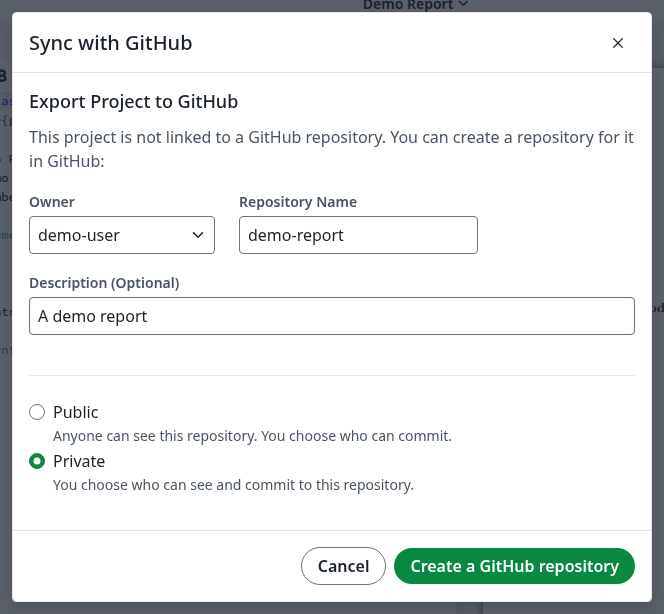

Connectez un projet à un dépôt GitHub. Les modifications circulent dans les deux sens, et uniquement lorsque vous cliquez sur **Sync** : rien ne se synchronise tout seul.

<Info>

Si vous ne voyez aucune option GitHub dans **Account settings** ni dans l'éditeur, demandez à votre administrateur d'activer la [synchronisation GitHub](/fr/on-premises/configuration/overleaf-toolkit/integrations/github-synchronisation).

</Info>

## Lier votre compte GitHub {#link-your-github-account}

Vous ne le faites qu'une fois.

<Steps>
<Step title="Ouvrir les paramètres de votre compte">
Cliquez sur **Account**, puis sur **Account settings**. Faites défiler jusqu'à **GitHub** et cliquez sur **Link**.

<Frame caption="GitHub dans les paramètres du compte">
  
</Frame>
</Step>

<Step title="Autoriser sur GitHub">
GitHub s'ouvre. Connectez-vous si on vous le demande, puis autorisez l'application.
</Step>

<Step title="Vérifier le lien">
Vous revenez aux paramètres du compte, et le bouton indique maintenant **Unlink**.

<Frame caption="Votre compte GitHub est lié">
  
</Frame>
</Step>
</Steps>

Si votre compte n'est pas encore lié, **Import from GitHub** et la carte **GitHub** de l'éditeur vous demandent d'abord de le lier. Cliquez sur **Link to your GitHub account**. Vous arrivez également dans les paramètres du compte, dans un nouvel onglet si vous étiez dans l'éditeur. Revenez ensuite en arrière et recommencez.

<Frame caption="L'invite lorsque votre compte n'est pas lié">
  
</Frame>

## Importer un dépôt {#import-a-repository}

Cela crée un nouveau projet à partir d'un dépôt GitHub, déjà lié à celui-ci.

<Steps>
<Step title="Ouvrir la boîte de dialogue d'importation">
Sur la page des projets, cliquez sur **New project**, puis sur **Import from GitHub**.

<Frame caption="Le menu New project">
  
</Frame>

<Info>

**New project** apparaît dès que vous avez un projet. Le menu **Create a new project** de la page d'accueil ne propose pas d'importation : créez donc d'abord un projet vide.

</Info>
</Step>

<Step title="Choisir le dépôt">
Cliquez sur **Import to Overleaf** à côté du dépôt. La liste contient vos dépôts et ceux de vos organisations.

<Frame caption="Vos dépôts GitHub">
  
</Frame>

S'il manque le dépôt d'une organisation, cliquez sur <strong>Can't see what you're looking for?</strong> pour consulter l'aide de GitHub sur l'approbation de l'application pour cette organisation.
</Step>

<Step title="Vérifier le projet">
Le nouveau projet s'ouvre avec les fichiers du dépôt.

<Frame caption="Le projet importé">
  
</Frame>
</Step>
</Steps>

## Exporter un projet vers un nouveau dépôt {#export-a-project-to-a-new-repository}

Cela crée un dépôt à partir d'un projet dont vous êtes propriétaire et les lie. Un projet ne peut être lié que de cette façon ou par importation : vous ne pouvez pas le lier à un dépôt qui existe déjà.

<Steps>
<Step title="Ouvrir GitHub dans l'éditeur">
Ouvrez le projet. Dans la barre de gauche, cliquez sur **Integrations**, puis sur **GitHub**.

<Frame caption="Le panneau Integrations">
  
</Frame>
</Step>

<Step title="Renseigner le dépôt">
Choisissez l'**Owner**, qui peut être vous ou l'une de vos organisations. **Repository Name** reprend au départ le nom du projet. La description est facultative, et **Private** est sélectionné par défaut. Cliquez sur **Create a GitHub repository**.

<Frame caption="Export Project to GitHub">
  
</Frame>
</Step>

<Step title="Vérifier le lien">
La boîte de dialogue indique maintenant **This project is linked to** et nomme le dépôt.

<Frame caption="Le projet est lié">
  
</Frame>
</Step>
</Steps>

## Synchroniser {#sync}

<Steps>
<Step title="Ouvrir la boîte de dialogue de synchronisation">
Ouvrez un projet lié. Dans la barre de gauche, cliquez sur **Integrations**, puis sur **GitHub**.

**Recent commits in GitHub** liste ce qui va arriver dans le projet.

<Frame caption="Un nouveau commit en attente sur GitHub">
  
</Frame>
</Step>

<Step title="Décrire vos modifications">
Si vous avez modifié quelque chose dans le projet, un champ de message de commit apparaît. Il est facultatif : si vous le laissez vide, le commit s'appelle `Updates from Overleaf`.

<Frame caption="Le message de commit de vos modifications">
  
</Frame>
</Step>

<Step title="Cliquer sur Sync">
Cliquez sur **Sync**. Les nouveaux commits de GitHub arrivent dans le projet, et vos modifications partent vers la branche par défaut du dépôt. Si les deux côtés ont modifié des choses différentes, elles sont fusionnées pour vous.
</Step>

<Step title="Vérifier le résultat">
La boîte de dialogue affiche <strong>No new commits in GitHub since last merge.</strong> et le champ de message de commit a disparu. Les fichiers de l'éditeur et les commits sur GitHub sont à jour.

<Frame caption="Tout est synchronisé">
  
</Frame>
</Step>
</Steps>

### Si les mêmes lignes ont changé des deux côtés {#if-the-same-lines-changed-on-both-sides}

La boîte de dialogue indique que les modifications n'ont pas pu être fusionnées et nomme une nouvelle branche, `overleaf-YYYY-MM-DD-HHMMSS`, qui contient vos modifications.

<Frame caption="Un conflit">
  
</Frame>

1. Fusionnez cette branche dans la branche par défaut sur GitHub ou avec Git. Vous pouvez fermer la boîte de dialogue entre-temps : elle affiche le même message lorsque vous la rouvrez.
2. Cliquez sur **I have manually merged. Continue**. Le résultat fusionné arrive dans le projet.
3. La branche reste sur GitHub. Supprimez-la lorsque vous n'en avez plus besoin.

## Supprimer le lien d'un projet {#unlink-a-project}

Faites-le lorsque vous ne voulez plus que le projet se synchronise. Seul le propriétaire du projet peut le faire.

<Steps>
<Step title="Cliquer sur Unlink">
Dans la boîte de dialogue de synchronisation, cliquez sur **Unlink**.
</Step>

<Step title="Confirmer">
Cliquez sur **Confirm**. La mention d'un abonnement ne vous empêche pas de lier à nouveau le projet.

<Frame caption="Confirmer la suppression du lien">
  
</Frame>
</Step>

<Step title="Vérifier le résultat">
La boîte de dialogue affiche maintenant **Export Project to GitHub**. Le projet et le dépôt conservent tous deux leur contenu. Pour synchroniser à nouveau, exportez le projet vers un nouveau dépôt, ou importez le dépôt dans un nouveau projet.
</Step>
</Steps>

## Supprimer le lien de votre compte GitHub {#unlink-your-github-account}

Dans **Account settings**, sous **GitHub**, cliquez sur **Unlink**, puis à nouveau sur **Unlink** dans la boîte de dialogue.

<Frame caption="Supprimer le lien de votre compte">
  
</Frame>

Vos projets restent liés à leurs dépôts. Vous ne pouvez pas les synchroniser tant que vous n'avez pas lié à nouveau votre compte.

<Info>

Pour savoir qui peut faire quoi dans un projet partagé, consultez [Qui peut lier et synchroniser](/fr/on-premises/configuration/overleaf-toolkit/integrations/github-synchronisation#who-can-link-and-sync). Chaque collaborateur qui synchronise lie son propre compte GitHub.

</Info>
