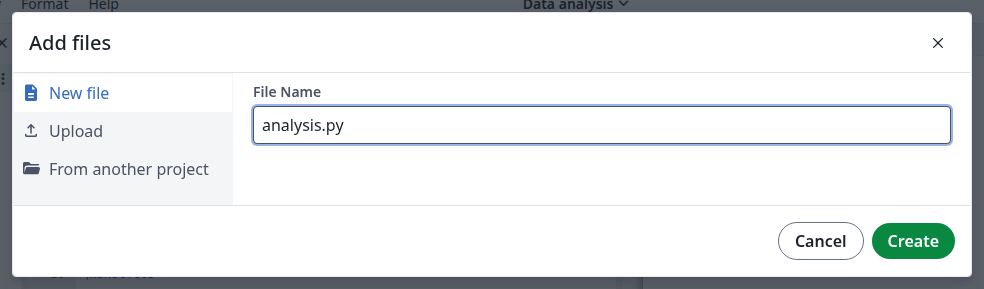

Les scripts Python s'exécutent dans votre navigateur, la sortie apparaît donc juste sous l'éditeur. Aucune configuration n'est nécessaire.

<Steps>
<Step title="Créer un script">
Dans l'arborescence des fichiers, cliquez sur l'icône **New file**. Saisissez un nom qui se termine par `.py` et cliquez sur **Create**.

<Frame caption="Un nouveau fichier Python">
  
</Frame>

Le bouton **Run** et un volet de sortie apparaissent sous l'éditeur. La première fois, le bouton reste désactivé pendant le chargement de Python.
</Step>

<Step title="L'exécuter">
Écrivez votre code et cliquez sur **Run**. Ce que le script affiche apparaît dans le volet de sortie. Vous n'avez pas besoin d'enregistrer d'abord.

Les fichiers que le script écrit sont placés dans votre projet. Un message vous indique lesquels, par exemple **results.txt saved to your project**, et le fichier apparaît dans l'arborescence.

<Frame caption="La sortie et un fichier enregistré">
  
</Frame>
</Step>

<Step title="Arrêter un script">
Pendant l'exécution d'un script, **Run** devient **Stop**. Cliquez dessus pour interrompre le script. Le volet de sortie se termine par **Execution interrupted**.

<Frame caption="Un script en cours d'exécution">
  
</Frame>
</Step>
</Steps>

## Utiliser une figure dans votre document {#use-a-figure-in-your-document}

Les graphiques n'ont pas de fenêtre où s'afficher, enregistrez-les donc dans un fichier. Par exemple :

```python
import matplotlib.pyplot as plt

plt.plot([1, 2, 3], [1, 4, 9])
plt.savefig("figure.png")
```

`figure.png` apparaît dans votre projet, prêt pour `\includegraphics{figure.png}`.

<Frame caption="Un graphique enregistré">
  
</Frame>

## Lire les fichiers de votre projet {#read-your-project’s-files}

Un script peut ouvrir les fichiers de votre projet par leur chemin :

```python
print(open("results.txt").read())
```

## En cas de problème {#if-something-goes-wrong}

<strong>Le script lève une erreur.</strong> L'erreur apparaît en rouge dans le volet de sortie, après tout ce que le script a affiché avant.

<Frame caption="Une erreur dans un script">
  
</Frame>

<strong>`ModuleNotFoundError: No module named ...`.</strong> Seuls les paquets intégrés à Pyodide sont disponibles, et les paquets installés avec `pip` ne peuvent pas être utilisés. NumPy et Matplotlib en font partie, et le message renvoie vers la [liste complète](https://pyodide.org/en/stable/usage/packages-in-pyodide.html).

<Frame caption="Un paquet non disponible">
  
</Frame>
