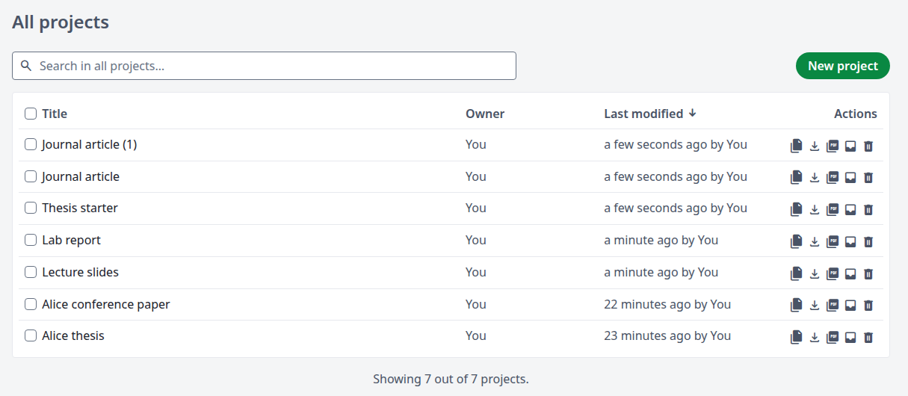

Les modèles sont des projets que votre administrateur a publiés. En ouvrir un vous donne un nouveau projet qui vous appartient.

<Info>

Si vous ne voyez pas de lien **Templates**, demandez à votre administrateur d'activer la [galerie de modèles](/fr/on-premises/configuration/overleaf-toolkit/templates).

</Info>

## Ouvrir la galerie {#open-the-gallery}

Sur la page des projets, cliquez sur **Templates** en haut à droite.

<Frame caption="Le lien Templates">
  
</Frame>

La page **All templates** s'ouvre, avec les modèles mis à jour le plus récemment en premier.

<Frame caption="Tous les modèles">
  
</Frame>

Si vous n'avez pas encore de projets, cliquez sur **Browse templates** sur la page d'accueil.

<Frame caption="La page d'accueil">
  
</Frame>

Si vous avez des projets, vous pouvez aussi cliquer sur **New project**, puis sur **More templates**, puis sur une catégorie.

<Frame caption="More templates">
  
</Frame>

Par défaut, la galerie nécessite une connexion : si quelqu'un vous envoie un lien vers un modèle et que vous n'êtes pas connecté, vous accédez d'abord à la page de connexion, puis au modèle.

## Trouver un modèle {#find-a-template}

**Recherchez** dans la zone. La liste se met à jour au fil de la saisie et porte sur le titre, l'auteur et la description. Si rien ne correspond, la page affiche <strong>No Templates.</strong>

<Frame caption="Recherche de slides">
  
</Frame>

**Triez** avec **Last Updated** ou **Title**, à droite au-dessus de la liste. Cliquez à nouveau sur le tri actif pour inverser l'ordre.

**Changez de page** sous la liste. Une page affiche neuf modèles.

<Frame caption="Les boutons de page">
  
</Frame>

<strong>Parcourir par catégorie :</strong> cliquez sur **Template Gallery** sur la page **All templates**. La page de la galerie comporte une carte pour chaque catégorie, avec tous les modèles en dessous.

<Frame caption="Les catégories">
  
</Frame>

Cliquez sur une carte pour voir les modèles de cette catégorie. Vous pouvez également rechercher et trier ici, et **All templates** vous ramène en arrière.

<Frame caption="Une page de catégorie">
  
</Frame>

## Ouvrir un modèle comme nouveau projet {#open-a-template-as-a-new-project}

<Steps>
<Step title="Ouvrir le modèle">
Cliquez sur un modèle. Vous voyez un aperçu de sa première page, l'auteur, la dernière mise à jour, la licence et le résumé.

<Frame caption="La page du modèle">
  
</Frame>

**View PDF** ouvre le PDF complet. Le bouton à côté télécharge les fichiers sous forme de zip.
</Step>

<Step title="Cliquer sur Open as Template">
Après un bref écran de chargement, l'éditeur s'ouvre avec votre nouveau projet.

<Frame caption="Votre nouveau projet">
  
</Frame>
</Step>

<Step title="Vérifier le projet">
Le projet porte le nom et les fichiers du modèle, ainsi que le même compilateur et le même document principal. Il se compile à l'ouverture, et vous en êtes le propriétaire dans la liste des projets.

Ouvrir à nouveau le même modèle crée un autre projet, tel que `Journal article (1)`.

<Frame caption="Chaque ouverture crée un projet">
  
</Frame>
</Step>
</Steps>

Votre projet ne dépend pas du modèle : il reste tel quel lorsque le modèle est mis à jour ou supprimé.

<Info>

Un compte normal ne peut ni publier ni modifier des modèles : le menu **File** ne contient pas **Manage Template**, et la page du modèle n'a ni **Edit** ni **Delete**. Pour ajouter un modèle à la galerie, adressez-vous à votre administrateur.

</Info>
