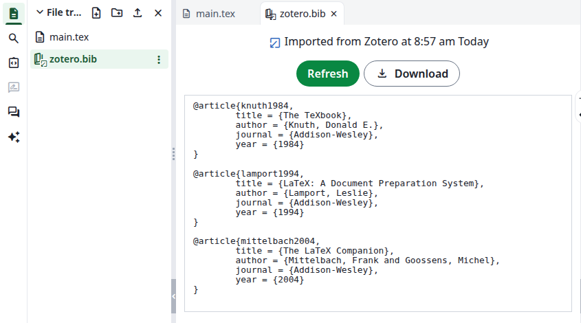

Importez une bibliothèque Zotero dans un projet sous forme de fichier `.bib`, puis citez à partir de celui-ci comme d'habitude. Le fichier est une copie : il ne change que lorsque vous cliquez sur **Refresh**.

<Info>

Si vous ne voyez aucune option Zotero dans **Account settings**, demandez à votre administrateur d'activer l'[intégration Zotero](/fr/on-premises/configuration/overleaf-toolkit/integrations/zotero-integration).

</Info>

## Lier votre compte Zotero {#link-your-zotero-account}

Vous ne le faites qu'une seule fois.

<Steps>
<Step title="Ouvrir les paramètres de votre compte">
Cliquez sur **Account**, puis sur **Account settings**. Sous **Reference managers**, trouvez **Zotero** et cliquez sur **Link to Zotero**.

<Frame caption="Zotero dans les paramètres du compte">
  
</Frame>

La carte **Zotero** du panneau **Integrations** de l'éditeur vous amène au même endroit, dans le même onglet.

<Frame caption="Le panneau Integrations">
  
</Frame>
</Step>

<Step title="Autoriser sur Zotero">
Zotero s'ouvre. Connectez-vous si on vous le demande, puis autorisez l'application. Elle demande uniquement à lire votre bibliothèque et vos groupes : elle ne peut donc rien modifier dans Zotero.
</Step>

<Step title="Vérifier la liaison">
Vous revenez aux paramètres du compte. Un message vert indique **Reference manager linked**, et le bouton affiche désormais **Unlink**.

<Frame caption="Votre compte Zotero est lié">
  
</Frame>
</Step>
</Steps>

Si vous n'autorisez pas l'accès sur Zotero, la même section indique **Sorry, something went wrong**. Cliquez sur **Link to Zotero** pour réessayer.

## Créer un fichier à partir de votre bibliothèque {#create-a-file-from-your-library}

<Steps>
<Step title="Ouvrir la boîte de dialogue Add files">
Ouvrez un projet. Dans l'arborescence des fichiers, cliquez sur **New file**, puis sur **From Zotero**. Cette entrée n'apparaît qu'une fois votre compte lié.
</Step>

<Step title="Choisir le nom du fichier et la bibliothèque">
**File Name** vaut d'abord `zotero.bib`. Conservez l'extension `.bib` : sans elle, vous n'avez pas d'aperçu, et ni `\cite` ni `\bibliography` ne trouvent ses entrées.

**Library** vaut d'abord **My Library** et liste aussi vos bibliothèques de groupe. Un fichier contient une bibliothèque.

<Frame caption="Un fichier issu de votre bibliothèque personnelle">
  
</Frame>
</Step>

<Step title="Cliquer sur Create">
La boîte de dialogue se ferme et le fichier apparaît dans l'arborescence. Cliquez dessus : il indique quand il a été importé, ainsi que ses entrées. Vous ne pouvez pas le modifier dans l'éditeur.

<Frame caption="Le fichier importé">
  
</Frame>

Si **Create** semble ne rien faire, un fichier portant ce nom existe déjà. Choisissez un autre nom.
</Step>
</Steps>

### Importer une bibliothèque de groupe {#import-a-group-library}

Recommencez avec un nom de fichier propre et choisissez le groupe sous **Library**. Un projet peut contenir plusieurs de ces fichiers.

<Frame caption="Un fichier issu d'une bibliothèque de groupe">
  
</Frame>

## Citer à partir du fichier {#cite-from-the-file}

<Steps>
<Step title="Commencer une citation">
Dans un fichier `.tex`, tapez `\cite{`. La liste affiche les entrées de tous les fichiers `.bib` du projet. Cliquez sur l'une d'elles pour l'insérer.

<Frame caption="Les entrées des fichiers importés">
  
</Frame>
</Step>

<Step title="Ou rechercher par titre ou par auteur">
Cliquez sur **Search** sous la liste, ou appuyez sur Ctrl+Espace entre les accolades. Tapez pour filtrer, cliquez sur une ou plusieurs entrées, puis sur **Insert**.

<Frame caption="La recherche de références">
  
</Frame>
</Step>

<Step title="Ajouter la bibliographie">
Ajoutez ces lignes avant `\end{document}`, en utilisant les noms de vos fichiers sans `.bib`, séparés par des virgules :

```latex
\bibliographystyle{plain}
\bibliography{reading-group,zotero}
```

Cliquez sur **Recompile**. La référence apparaît dans le PDF.

<Frame caption="La référence compilée">
  
</Frame>
</Step>
</Steps>

Les fichiers importés ne sont pas proposés dans **Settings** sous **References**, **Main bibliography file for this project** : la liste reste donc vide si le projet n'a pas d'autre fichier `.bib`. Vous pouvez quand même citer à partir d'eux.

<Frame caption="La liste vide est normale">
  
</Frame>

## Actualiser le fichier {#refresh-the-file}

Les modifications de votre bibliothèque Zotero n'arrivent pas d'elles-mêmes dans le projet, et la compilation ne les récupère pas.

<Steps>
<Step title="Ouvrir le fichier">
Dans l'arborescence des fichiers, cliquez sur le fichier importé.
</Step>

<Step title="Cliquer sur Refresh">
Le fichier entier est réimporté depuis la bibliothèque choisie lors de sa création : les nouvelles entrées apparaissent et celles supprimées disparaissent. L'heure affichée en haut change.

<Frame caption="Le fichier actualisé">
  
</Frame>
</Step>

<Step title="Recompiler">
Les nouvelles entrées figurent tout de suite dans la liste `\cite{`. Cliquez sur **Recompile** pour mettre à jour le PDF.
</Step>
</Steps>

Chaque fichier s'actualise séparément : actualisez à part le fichier de votre groupe. Pour savoir qui peut actualiser un fichier dans un projet partagé, consultez les [remarques pour les administrateurs](/on-premises/configuration/overleaf-toolkit/integrations/zotero-integration#notes).

## Supprimer la liaison de votre compte Zotero {#unlink-your-zotero-account}

Dans **Account settings**, sous **Zotero**, cliquez sur **Unlink**, puis de nouveau sur **Unlink** dans la boîte de dialogue. Le bouton affiche à nouveau **Link to Zotero**.

<Frame caption="Supprimer la liaison de votre compte">
  
</Frame>

Les fichiers importés restent dans vos projets et se compilent toujours. **From Zotero** disparaît de la boîte de dialogue **Add files**, et **Refresh** affiche une erreur jusqu'à ce que vous liiez à nouveau votre compte.

<Frame caption="Actualisation sans compte lié">
  
</Frame>

Une fois le compte lié à nouveau, **Refresh** fonctionne sur les mêmes fichiers.

## En cas de problème {#if-something-goes-wrong}

**Could not load references from Zotero, please re-link your account and try again**, ou **There was an error accessing your Zotero data** dans la boîte de dialogue **Add files** : Overleaf ne peut plus lire votre bibliothèque, par exemple parce que vous avez retiré son accès sur Zotero. Dans **Account settings**, cliquez sur **Unlink**, puis sur **Link to Zotero**. D'ici là, **Create** échoue aussi, avec le message **The project that contains this file is not shared with you**, même dans votre propre projet.

<Frame caption="Overleaf ne peut plus lire votre bibliothèque">
  
</Frame>

**The remote service produced an error** lorsque vous cliquez sur **Refresh** : la requête vers Zotero a échoué. Le fichier conserve son contenu. Cliquez à nouveau sur **Refresh** plus tard.
