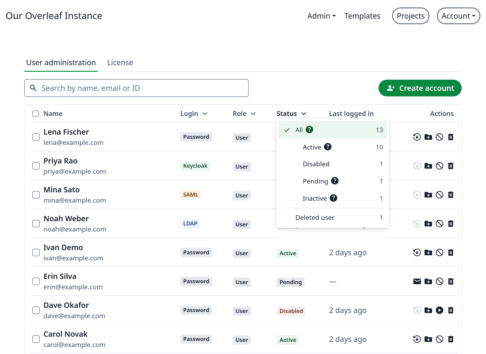
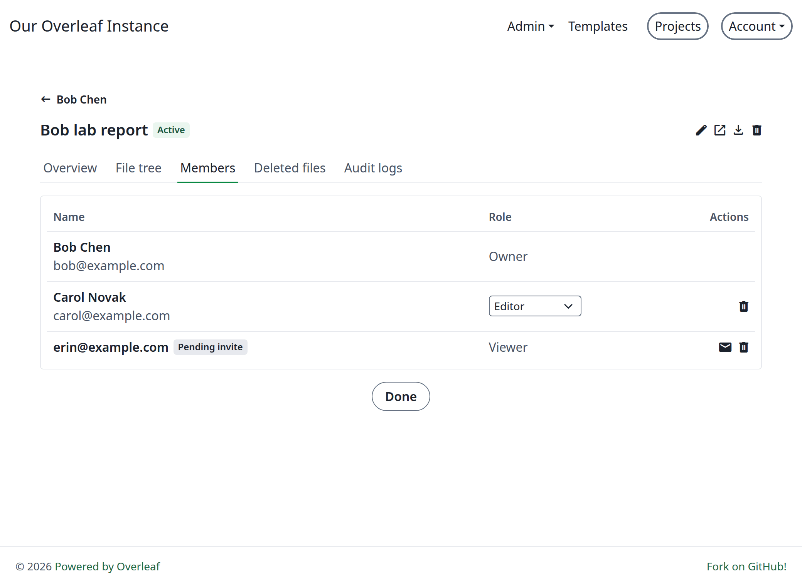

Mengelola instans Overleaf untuk sebuah lab atau departemen selalu memunculkan pertanyaan yang sama setiap minggu. Mengapa mahasiswa ini tidak bisa login? Siapa yang masih memakai server? Siapa yang memberi akun itu hak admin? Ke mana perginya tesis tahun lalu? Kami membangun ulang panel admin agar Anda dapat menjawabnya tanpa membuka shell basis data.

Panel baru ini mengikuti tampilan Overleaf 6.3 dan diterjemahkan ke setiap bahasa yang didukung antarmuka. Panel ini memiliki satu daftar untuk semua pengguna, satu daftar untuk semua proyek, satu halaman untuk masing-masing, tempat untuk mengelola template Anda, dan log audit.

<Info>

Panel admin baru sudah digabungkan ke cabang utama kami dan akan dirilis secara resmi di v6.4.0. Setiap tangkapan layar dalam tulisan ini berasal dari instans uji yang berisi akun rekaan.

</Info>

### Isinya {#what’s-in-it}

* **Daftar pengguna**: pencarian, filter berdasarkan metode login, peran, dan status, serta tindakan massal.
* **Halaman pengguna**: akun, proyek, fitur, integrasi, log audit, dan sesi dari satu orang.
* **Daftar proyek**: setiap proyek di instans, dapat dicari berdasarkan nama, ID, pemilik, atau tautan berbagi.
* **Halaman proyek**: pengaturan, file, anggota, file yang dihapus, dan log audit dari satu proyek.
* **Manajemen template**: terbitkan proyek sebagai template, perbarui, dan jaga galeri tetap rapi.
* **Log audit**: siapa melakukan apa, kapan, dan dari alamat IP mana.

## Satu daftar untuk setiap pengguna {#one-list-for-every-user}

Klik **Admin**, lalu **Manage Users**. Setiap akun adalah satu baris yang menunjukkan cara akun itu login, perannya, dan statusnya.

<Frame caption="Daftar pengguna">
  
</Frame>

Cari berdasarkan nama, email, atau ID. Judul kolom **Login**, **Role**, dan **Status** adalah filter, dan setiap opsi menunjukkan berapa banyak akun yang akan ditampilkannya. Anda dapat melihat sekilas berapa banyak orang yang masuk melalui SAML, dan setiap penyedia OIDC muncul dengan nama yang Anda berikan.

<Frame caption="Memfilter berdasarkan metode login">
  
</Frame>

Setiap akun memiliki tepat satu status, dan keempat status itu dijumlahkan menjadi total.

| Status       | Artinya                                                               |
| ------------ | --------------------------------------------------------------------- |
| **Active**   | Login atau membuka proyek dalam 12 bulan terakhir.                    |
| **Pending**  | Belum pernah login.                                                   |
| **Inactive** | Pernah login, tetapi tidak dalam 12 bulan terakhir.                   |
| **Disabled** | Seorang administrator menghentikan akun ini agar tidak dapat login.   |

Akun yang dihapus disingkirkan ke filternya sendiri. Jika pencarian juga cocok dengan akun yang dihapus, sebuah baris di atas tabel memberitahukannya dan menawarkan untuk menampilkannya.

<Frame caption="Memfilter berdasarkan status">
  
</Frame>

Pencarian, pengurutan, dan paginasi berjalan di server, sehingga daftar tidak lagi berhenti di 1.000 baris pertama.

### Undang orang, dengan atau tanpa email {#bring-people-in-with-or-without-email}

**Create account** menambahkan pengguna dan memberi Anda tautan yang mereka perlukan. Jika [pengiriman email](/id/on-premises/configuration/overleaf-toolkit/email-delivery  "mention") belum disiapkan, dialog menyatakannya dengan jelas dan memungkinkan Anda menyalin tautan, sehingga instans kecil pun tetap dapat menerima pengguna baru.

<Frame caption="Tautan aktivasi akun baru">
  
</Frame>

Panel menawarkan tautan yang tepat untuk setiap akun: **Send activation email** untuk akun yang belum pernah login, berlaku 7 hari, dan **Send reset link** untuk akun yang pernah login, berlaku 1 jam. Akun yang login melalui SSO tidak memiliki kata sandi lokal, jadi tidak mendapatkan keduanya.

### Ubah banyak akun sekaligus {#change-many-accounts-at-once}

Centang beberapa akun dan bilah alat menawarkan **Send activation email**, **Transfer this user's projects**, **Disable**, **Enable**, **Make admin**, **Remove admin**, dan **Delete account**. Dialog mencantumkan akun-akun tersebut sebelum Anda mengonfirmasi. Jika sebagian gagal, dialog memberi tahu Anda yang mana, dan yang sudah berhasil tetap berlaku.

<Frame caption="Tindakan massal">
  
</Frame>

### Sulit untuk salah {#hard-to-get-wrong}

* Akun Anda sendiri ditandai **You** dan tindakannya dinonaktifkan, sehingga Anda tidak dapat menonaktifkan, menghapus, atau menurunkan peran diri sendiri.
* Setiap tindakan meminta konfirmasi dalam dialog yang menyebutkan nama akun.
* **Delete account** dapat menyerahkan proyek pengguna kepada orang lain terlebih dahulu.
* Akun yang dihapus dapat dipulihkan, bersama proyek yang ikut terhapus dengannya. Hanya **Delete permanently** yang bersifat final, dan tindakan ini memperingatkan Anda.

## Segala hal tentang satu orang {#everything-about-one-person}

Klik sebuah nama untuk membuka halaman pengguna. Halaman ini memiliki enam tab, dan ikon tindakan yang sama seperti daftar.

### Akun {#account}

Detail akun, mulai dari ID dan email hingga login terakhir beserta alamat IP-nya. Klik ikon pensil untuk mengubah email, nama, atau kata sandi, atau untuk mengaktifkan atau menonaktifkan **Admin**.

<Frame caption="Mengedit akun">
  
</Frame>

### Proyek {#projects}

Proyek yang dimiliki orang ini, dengan pencarian, filter status, dan tindakannya sendiri.

<Frame caption="Proyek seorang pengguna">
  
</Frame>

### Fitur {#features}

Apa yang diaktifkan untuk akun ini, seperti kolaborator per proyek, batas waktu kompilasi, integrasi, dan AI, beserta penggunaan AI akun tersebut dan tombol untuk mengatur ulangnya.

<Frame caption="Fitur seorang pengguna">
  
</Frame>

### Integrasi {#integrations}

Token akses Git milik orang tersebut dan layanan yang telah mereka tautkan.

<Frame caption="Integrasi seorang pengguna">
  
</Frame>

### Sesi {#sessions}

Di mana orang tersebut sedang login. **Clear sessions** mengeluarkan mereka dari semua tempat, dan itulah hal pertama yang perlu dilakukan saat laptop hilang.

<Frame caption="Sesi seorang pengguna">
  
</Frame>

## Setiap proyek di instans {#every-project-on-the-instance}

Klik **Admin**, lalu **Project/Object Lookup**. Daftar ini menampilkan proyek dari setiap pengguna, beserta pemilik dan statusnya. Kotak pencarian menerima nama proyek, ID-nya, pemiliknya, atau sebuah tautan. Tempelkan tautan berbagi dan Anda akan menemukan proyek di baliknya.

<Frame caption="Semua proyek">
  
</Frame>

Filter **Status** memisahkan proyek **Active**, **Archived**, **Trashed**, dan **Deleted**. Centang beberapa proyek untuk mengunduhnya dalam satu file `.zip`, mengubah pemiliknya, atau menghapusnya. Di tampilan **Deleted**, tombolnya adalah **Restore** dan **Delete permanently**.

<Frame caption="Memfilter proyek berdasarkan status">
  
</Frame>

## Segala hal tentang satu proyek {#everything-about-one-project}

Klik judul proyek untuk membuka halamannya.

### Ikhtisar {#overview}

Ubah nama, berbagi tautan, compiler, versi TeX Live, dan dokumen utama. **Change project owner** memberikan proyek kepada pengguna lain, yang berguna ketika seseorang meninggalkan lab dan tesisnya harus tetap ada.

<Frame caption="Mengedit proyek">
  
</Frame>

### Pohon file {#file-tree}

File dan folder proyek, hanya-baca.

<Frame caption="File sebuah proyek">
  
</Frame>

### Anggota {#members}

Pemilik, kolaborator, dan undangan yang tertunda. Ubah peran kolaborator, cabut aksesnya, atau kirim ulang atau batalkan undangan.

<Frame caption="Mengubah anggota proyek">
  
</Frame>

### File yang dihapus {#deleted-files}

File yang dihapus dari proyek. **Restore file** menaruh salinannya di folder root proyek, dan baris tersebut menampilkan nama salinannya.

<Frame caption="File yang dipulihkan">
  
</Frame>

## Manajemen template {#template-management}

Template dimulai sebagai proyek biasa. Anda menerbitkannya dari editor, dan mengelolanya dari halamannya di galeri atau dari panel admin.

### Semua template dalam satu tabel {#all-templates-in-one-table}

Klik **Admin**, lalu **Project/Object Lookup**, lalu tab **Templates**. Tab ini mencantumkan setiap template yang diterbitkan beserta penulis, pemilik, dan waktu terakhir diubah, dan Anda dapat mencarinya. Klik judul untuk membuka template, klik pemilik untuk membuka halaman pengguna tersebut, atau klik ikon tempat sampah untuk menghapus template. Penghapusan dicatat di [log audit Anda sendiri](#when-there-is-no-log-left).

<Frame caption="Semua template di panel admin">
  
</Frame>

### Terbitkan dari editor {#publish-from-the-editor}

Buka proyek dan kompilasi hingga PDF-nya terlihat benar, karena galeri menampilkan PDF dari kompilasi terakhir yang berhasil. Lalu klik **File**, kemudian **Manage Template**, dan isi judul, penulis, kategori, deskripsi dalam Markdown, dan lisensi. Compiler dan dokumen utama proyek ikut bersama template, sehingga proyek yang dibuka darinya menggunakan yang sama.

<Frame caption="Menerbitkan proyek sebagai template">
  
</Frame>

### Perbarui template {#update-a-template}

Untuk mengubah file dan PDF template, terbitkan proyek lagi dengan judul yang sama. Dialog memberi tahu Anda bahwa judul tersebut sudah ada, dan tombolnya berubah menjadi **Overwrite**. Proyek yang sudah dibuka orang dari template tersebut tidak berubah.

<Frame caption="Menerbitkan dengan judul yang sama">
  
</Frame>

### Halaman template {#the-template-page}

Semua orang dapat menggunakan **Open as Template**, **View PDF**, dan tombol unduh. Administrator juga mendapatkan **Admin: Source Project**, **Edit**, dan **Delete**.

<Frame caption="Halaman sebuah template">
  
</Frame>

**Edit** mengubah apa yang ditampilkan galeri tentang template: judul, penulis, kategori, deskripsi, dan lisensinya, serta bahasa pemeriksa ejaan untuk proyek yang dibuka darinya. Tindakan ini tidak menyentuh file atau PDF. Template menyimpan salinan filenya sendiri, sehingga menghapus proyek sumber tidak ikut menghapus template.

<Frame caption="Mengedit detail template">
  
</Frame>

### Galeri untuk pengguna Anda {#a-gallery-for-your-users}

Galeri dibuka dengan kartu untuk setiap kategori, dan setiap kategori memiliki halamannya sendiri. Kategori berasal dari konfigurasi [Template](/id/on-premises/configuration/overleaf-toolkit/templates  "mention") Anda, tempat Anda juga dapat mengizinkan pengguna yang bukan administrator untuk menerbitkan.

<Frame caption="Galeri template">
  
</Frame>

Halaman **All templates** menampilkan setiap template dengan pratinjau halaman pertamanya, dan pengguna Anda dapat mencarinya serta mengurutkannya berdasarkan judul atau tanggal.

<Frame caption="Semua template">
  
</Frame>

## Log audit: siapa melakukan apa, dan kapan {#audit-logs-who-did-what-and-when}

Inilah bagian yang paling kami banggakan. Setiap akun dan setiap proyek kini memiliki log auditnya sendiri, dan administrator situs dapat membacanya langsung di panel.

Buka tab **Audit logs** di halaman pengguna. Entri terbaru muncul lebih dulu.

<Frame caption="Log audit sebuah akun">
  
</Frame>

Jika dibaca dari bawah ke atas, halaman ini bercerita. Lena login. Seorang administrator menaikkan batas waktu kompilasinya menjadi 300 detik, menonaktifkan akses AI-nya, mengiriminya tautan reset kata sandi, menjadikannya admin lalu mencabutnya kembali, kemudian menonaktifkan dan mengaktifkan kembali akunnya. Lena login lagi, dan administrator menghapus sesinya.

| Kolom          | Apa yang diberitahukannya                                                                                 |
| -------------- | --------------------------------------------------------------------------------------------------------- |
| **Date**       | Kapan hal itu terjadi.                                                                                    |
| **Operation**  | Apa yang terjadi.                                                                                         |
| **Initiator**  | Siapa yang melakukannya. Tindakan administrator terhadap akun menampilkan administrator, bukan pengguna.  |
| **IP Address** | Dari mana permintaan berasal.                                                                             |
| **Info**       | Detailnya, seperti batas waktu kompilasi yang baru, atau apakah email benar-benar terkirim.               |

### Temukan entri yang Anda perlukan {#find-the-entry-you-need}

Cari berdasarkan operasi atau alamat IP. Judul kolom **Operation** adalah filter yang mencantumkan setiap operasi di log ini dan berapa kali operasi itu terjadi.

<Frame caption="Memfilter berdasarkan operasi">
  
</Frame>

### Log untuk setiap proyek {#a-log-for-every-project}

Halaman proyek memiliki tab yang sama. Tab ini menunjukkan siapa yang diundang, siapa yang bergabung, siapa yang perannya diubah, siapa yang mengunduh proyek, dan siapa yang mengambil alihnya.

<Frame caption="Log audit sebuah proyek">
  
</Frame>

### Apa yang dicatat {#what-gets-recorded}

Berikut operasi utama di setiap log, dengan nama yang Anda lihat di panel.

| Log    | Area                   | Operasi                                                                                                                                                                                                                                     |
| ------ | ---------------------- | ------------------------------------------------------------------------------------------------------------------------------------------------------------------------------------------------------------------------------------------- |
| Akun   | Login dan kata sandi   | Login, Logout, Failed password match, Update password, Reset password                                                                                                                                                                       |
| Akun   | Email dan SSO          | Add email, Remove email, Change primary email, Link SSO, Unlink SSO                                                                                                                                                                         |
| Akun   | Integrasi              | Link GitHub, Unlink GitHub, Link Dropbox, Unlink Dropbox, Integration account linked, Integration account unlinked, Create Git token, Delete Git token                                                                                      |
| Akun   | Tindakan administrator | Create account, Send activation email, Send password reset email, Change name, Change admin access, Change features, Change AI features, Reset AI usage, Account suspension, Account reactivation, Clear sessions, Transfer projects, Delete account, Restore account |
| Proyek | Berbagi                | Send invite, Resend invite, Revoke invite, Accept invite, Join via token, Accept via link sharing, Remove collaborator, Leave project, Project role changed, Toggle access level, Transfer ownership                                       |
| Proyek | File                   | Project downloaded, Project exported docx, Project exported markdown, Project exported html, Restore deleted doc                                                                                                                            |
| Proyek | Tindakan administrator | Project deleted, Project restored                                                                                                                                                                                                           |
| Proyek | Sinkronisasi Git       | Integration repo linked, Integration repo unlinked                                                                                                                                                                                          |

### Ketika tidak ada log yang tersisa {#when-there-is-no-log-left}

**Delete permanently** menghapus akun atau proyek beserta lognya, dan template memang tidak pernah memiliki log. Karena itu, tindakan ini dicatat di log administrator yang melakukannya, beserta email atau ID dari apa yang dihapus.

<Frame caption="Penghapusan permanen di log milik administrator sendiri">
  
</Frame>

### Perlu diketahui {#good-to-know}

* Entri disimpan selama dua setengah tahun, lalu MongoDB menghapusnya secara otomatis.
* Di belakang reverse proxy, atur [`OVERLEAF_TRUSTED_PROXY_IPS`](/id/on-premises/configuration/overleaf-toolkit/environment-variables  "mention") agar log menampilkan alamat pengunjung, bukan alamat proxy.
* Belum semuanya dicatat. Git clone dan push, perubahan pengaturan proyek seperti nama atau compiler, serta proyek yang dibuat, diarsipkan, dibuang, atau dihapus oleh pemilik tidak muncul di log proyek.

## Cobalah {#try-it}

Panel baru ini hadir bersama Ayakaleaf Pro v6.4.0. Panduan langkah demi langkah sudah tersedia:

* [Manajemen pengguna](/id/on-premises/user-guide/administrators/user-management  "mention")
* [Manajemen proyek](/id/on-premises/user-guide/administrators/project-management  "mention")
* [Manajemen template](/on-premises/user-guide/administrators/template-management  "mention")

Jika ada yang kurang atau tidak bekerja seperti yang Anda harapkan, beri tahu kami di [GitHub](https://github.com/ayaka-notes/ayakaleaf-pro/issues).
