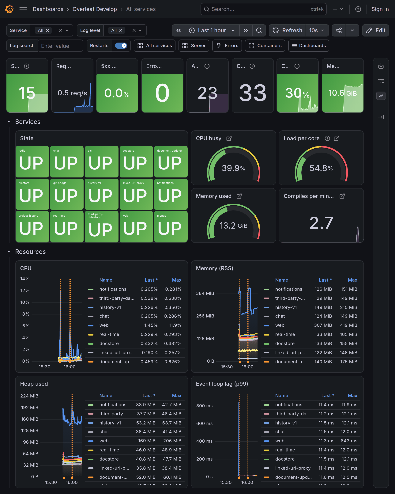
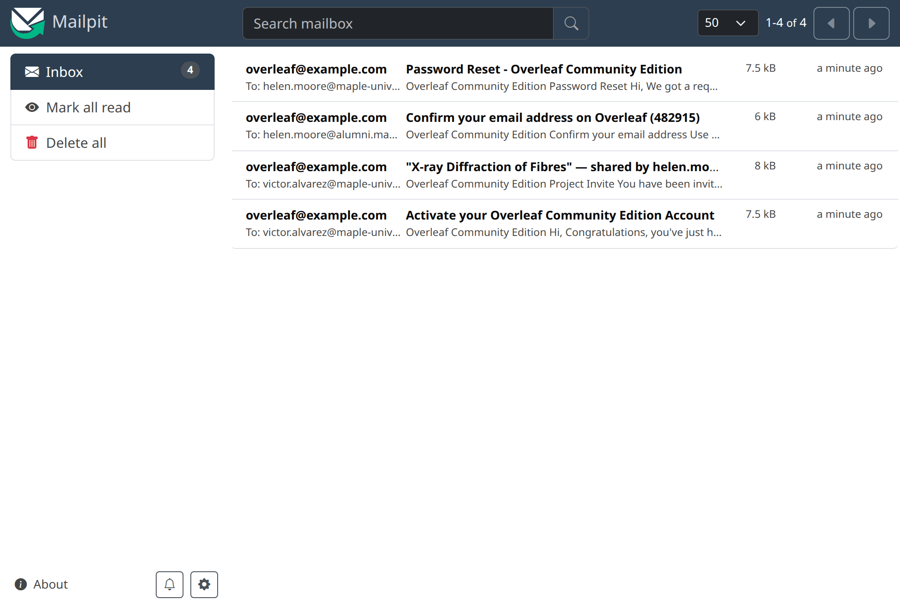

## Alat Pengembangan yang Direkomendasikan {#develop-tools-recommended}

Layanan opsional ini tidak diperlukan untuk menjalankan Overleaf, tetapi sangat membantu saat mengembangkan, men-debug, dan memeriksa data. Semuanya merupakan bagian dari lingkungan pengembangan, jadi tidak ada yang perlu ditambahkan ke `docker-compose.yml`. Setelah Anda login ke situs, menu **Dev tools** di bilah navigasinya menautkan ke alat yang disajikan situs di path-nya sendiri.

| Alat | Alamat | Didefinisikan di |
| --- | --- | --- |
| **Grafana**, status, metrik, dan log setiap layanan | [http://localhost/grafana/](http://localhost/grafana/) | `develop/grafana/docker-compose.yml`, aktif saat `GRAFANA_ENABLED=true` di `develop/dev.rc` (default) |
| **Mailpit**, kotak masuk untuk setiap email yang dikirim situs | [http://localhost/mailpit/](http://localhost/mailpit/) | `develop/mail/docker-compose.yml`, aktif saat `MAILPIT_ENABLED=true` (default) |
| **Mongo Express**, UI untuk MongoDB | [http://localhost/mongo-express/](http://localhost/mongo-express/) | `develop/docker-compose.yml`, selalu aktif |
| **RedisInsight**, UI untuk data Redis | [http://localhost/redis-insight/](http://localhost/redis-insight/) | `develop/docker-compose.yml`, selalu aktif |
| **Hoppscotch**, klien API berbasis browser yang mirip Postman | [http://localhost:9170](http://localhost:9170/) (`HOPPSCOTCH_PORT`) | `develop/hoppscotch/docker-compose.yml`, aktif saat `HOPPSCOTCH_ENABLED=true` (default) |

<Warning>

Tidak satu pun alat ini memiliki login: pengguna anonim Grafana adalah admin-nya, dan Mongo Express dapat mengubah dokumen apa pun. Situs, Hoppscotch, Mongo Express (8081), dan RedisInsight (5540) hanya mendengarkan di `127.0.0.1` host, sehingga host lain tidak dapat menjangkaunya.

</Warning>

### Grafana {#grafana}

Grafana disajikan oleh situs di `/grafana/` melalui webpack-dev-server, sehingga tidak memerlukan port sendiri. Folder **Overleaf Develop**-nya berisi dasbor berikut:

| Dasbor | Yang ditampilkan |
| --- | --- |
| All services (beranda) | Status setiap layanan, indikator host, beban, dan log. Klik sebuah layanan untuk membuka dasbornya |
| Server | CPU, beban, memori, disk, dan jaringan host, serta kompilasi clsi |
| Errors | Log error, respons 5xx dan 4xx, pesan error yang paling sering muncul, dan rute yang gagal |
| Data flow | Jalur sebuah pengeditan: document-updater dan Redis, project-history, history-v1, Mongo, penyimpanan objek |
| Containers | Status setiap container, CPU, memori, jaringan, dan disk, termasuk kompilasi sandbox |
| Satu per layanan | Layanan Node.js, git-bridge (JVM), mongo, dan redis |

<Columns cols={2}>
<Column>

<Frame caption="All services: status setiap layanan, host, dan sumber daya yang digunakan setiap layanan">
  
</Frame>

</Column>

<Column>

<Frame caption="Data flow: sebuah pengeditan dalam perjalanan dari document-updater melalui project-history ke history-v1 dan Mongo">
  
</Frame>

</Column>
</Columns>

Prometheus mengambil `/metrics` dari layanan, `mongodb-exporter`, `redis-exporter`, `cadvisor`, dan `node-exporter`; Alloy mengirim log setiap container proyek ke Loki, tempat filter **Log search**, **Service**, dan **Log level** di dasbor membacanya. Datanya hanya ada di dalam container, jadi membuat ulang container akan mengosongkannya. cAdvisor berjalan dengan hak istimewa dan membaca `/`, `/sys`, data Docker, dan socket containerd milik host secara read-only; node-exporter membaca `/` milik host.

Dasbor dihasilkan secara otomatis: ubah `develop/grafana/make-dashboards` lalu jalankan, alih-alih mengedit file JSON.

### Mailpit {#mailpit}

Dengan `MAILPIT_ENABLED=true`, `web` mengirim setiap email ke Mailpit alih-alih ke server email sungguhan, dan konfirmasi email aktif (`EMAIL_CONFIRMATION_DISABLED=false`). Tautan aktivasi, undangan proyek, reset kata sandi, dan kode konfirmasi kemudian dapat diikuti dari kotak masuk.

<Frame caption="Email aktivasi, undangan proyek, kode konfirmasi, dan reset kata sandi di Mailpit">
  
</Frame>

Mailpit tidak memiliki volume: membuat ulang container-nya akan mengosongkan kotak masuk.

### Mongo Express {#mongo-express}

Mongo Express menampilkan koleksi database `sharelatex`, dan dapat melihat, mengedit, mengimpor, dan mengekspor dokumennya.

<Frame caption="Koleksi database sharelatex di Mongo Express">
  
</Frame>

### RedisInsight {#redisinsight}

RedisInsight menyimpan koneksinya di `develop/data/redis-insight`. Pertama kali, pilih **Connect existing database** lalu masukkan host `redis` dan port `6379`.

<Frame caption="RedisInsight terhubung ke layanan redis">
  
</Frame>

### Menyiapkan Hoppscotch {#setup-hoppscotch}

#### Mem-proxy Permintaan API {#proxy-api-request}

Hoppscotch mengirim permintaan dari browser, yang tidak dapat menjangkau layanan melalui nama Docker-nya. Proxy-nya, Proxyscotch, berjalan di dalam jaringan Docker dan disajikan di `/proxy` pada alamat Hoppscotch. Buka [http://localhost:9170](http://localhost:9170/), masuk ke Settings → Interceptor, pilih **Proxy**, lalu atur Proxy URL ke `http://localhost:9170/proxy`. Pengaturan ini tersimpan di browser.

<Frame caption="Pengaturan Interceptor. Tangkapan layar berasal dari penyiapan lama: gunakan `http://localhost:9170/proxy` sebagai Proxy URL.">
  
</Frame>

Sekarang Anda dapat menguji dengan [http://web:3000/status](http://web:3000/status) untuk memeriksa apakah web sudah aktif:

<Frame>
  
</Frame>

#### Mengimpor API layanan {#import-the-service-apis}

`develop/hoppscotch/openapi/` berisi file OpenAPI untuk API internal setiap layanan. Di Hoppscotch, buka Collections → Import → Import from File lalu pilih semua file sekaligus. Setiap file menjadi koleksi yang permintaannya menuju alamat Docker layanan. File yang sama ditampilkan di bagian [API Layanan](/id/dev/service-api/overview).

#### Masalah CSRF {#csrf-problems}

<Warning>

Jika Anda menggunakan Postman atau alat debug lain untuk membuat permintaan **post**, Anda mungkin mendapati bahwa login **ditolak (forbidden)**, dan penyebabnya adalah error 403. Hal ini karena Overleaf dilindungi oleh verifikasi **csrf**.

</Warning>

<Frame>
  
</Frame>

Di konsol Anda, Anda mungkin melihat:

<Frame>
  
</Frame>

Untuk mengatasi hal ini dalam pengembangan Overleaf Anda, Anda perlu menyiapkan token csrf. Berikut tutorial lengkapnya.

<Steps>
<Step title="Tambahkan Pre-Request">
Tambahkan kode berikut ke Pre-Request

<Frame>
  
</Frame>

Skripnya adalah sebagai berikut:

```js wrap
pm.sendRequest("http://web:3000/dev/csrf", function (err, res) {
    if (err) {
        console.log(err);
        return;
    }

    // 1) Save CSRF token (/dev/csrf)
    const token = res.text().trim();
    pw.env.set("csrftoken", token);
    console.log("csrftoken =", token);

    const setCookieHeader = (res.headers || []).find(h => h.key?.toLowerCase() === "set-cookie")?.value;
    console.log("set-cookie =", setCookieHeader);

    if (!setCookieHeader) return;

    const cookiePair = setCookieHeader.split(";")[0].trim(); // overleaf.sid=...
    pw.env.set("cookie_header", cookiePair);
    console.log("cookie_header =", cookiePair);
});
```
</Step>

<Step title="Tambahkan Header Permintaan">
Anda perlu menambahkan header berikut:

| Nama Header  | Nilai Header        |
| ------------ | ------------------- |
| Content-Type | `application/json`  |
| X-Csrf-Token | `<<csrftoken>>`     |
| Cookie       | `<<cookie_header>>` |

<Frame>
  
</Frame>
</Step>

<Step title="Login dengan Alat API">
Sekarang Anda dapat login dengan nama pengguna dan kata sandi Anda.

```json5
{
  "_csrf": "<<csrftoken>>",
  "email": "admin@overleaf.com",
  "password": "xxxxxx"
}
```

Berikut adalah respons ketika Anda memasukkan nama pengguna atau kata sandi yang salah.

<Frame>
  
</Frame>
</Step>
</Steps>
