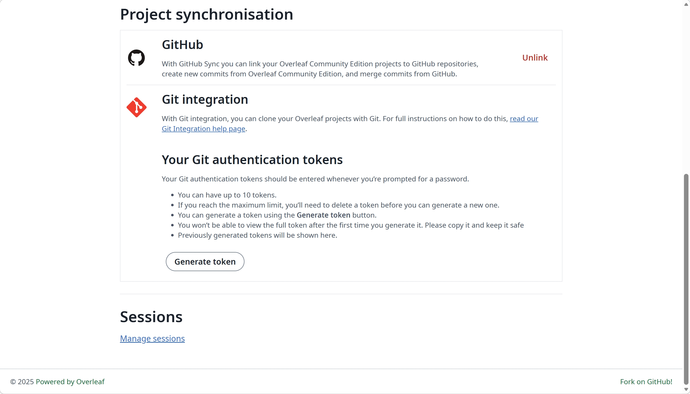

Ada 3 metode autentikasi yang didukung. Setelah dikonfigurasi, Anda dapat login dengan opsi-opsi berikut, seperti yang ditunjukkan pada gambar di bawah.

<Frame>
  
</Frame>

Kami sangat menyarankan Anda menggunakan OIDC, karena ini adalah metode yang paling umum.

<Columns cols={2}>
<Column>

<Card title="Autentikasi OIDC" icon="file-lines" href="/id/on-premises/configuration/overleaf-toolkit/authentication/oidc-authentication" horizontal />

<Card title="Autentikasi SAML" icon="file-lines" href="/id/on-premises/configuration/overleaf-toolkit/authentication/saml-authentication" horizontal />

<Card title="Autentikasi LDAP" icon="file-lines" href="/id/on-premises/configuration/overleaf-toolkit/authentication/ldap-authentication" horizontal />

</Column>

<Column>

<Card title="Akses Publik" icon="file-lines" href="/id/on-premises/configuration/overleaf-toolkit/authentication/public-access" horizontal />

<Card title="reCAPTCHA" icon="file-lines" href="/id/on-premises/configuration/overleaf-toolkit/authentication/recaptcha" horizontal />

<Card title="Pembatasan kata sandi" icon="file-lines" href="/id/on-premises/configuration/overleaf-toolkit/authentication/password-restrictions" horizontal />

</Column>
</Columns>

### Konfigurasi Global

Variabel lingkungan `EXTERNAL_AUTH` diperlukan untuk mengaktifkan modul autentikasi tertentu. Variabel lingkungan ini menentukan metode autentikasi eksternal mana yang diaktifkan. Opsi yang tersedia adalah (dalam huruf kecil):

* saml
* ldap
* oidc

Untuk mengizinkan pengguna masuk hanya dengan metode-metode ini, atur `OVERLEAF_DISABLE_LOCAL_LOGIN=true`. Ini akan menyembunyikan login dengan email dan kata sandi. Pengaturan ini tidak berpengaruh kecuali `EXTERNAL_AUTH` mengaktifkan setidaknya satu metode (ditambahkan di 6.3.1).

### Akun dan kata sandi

Jika `EXTERNAL_AUTH` diatur, sebuah instance dapat memiliki akun dengan dan tanpa kata sandi lokal. Apakah sebuah akun dapat mengatur atau mengubah kata sandi hanya bergantung pada hal tersebut: akun dengan kata sandi lokal dapat mengelolanya, sedangkan akun tanpa kata sandi lokal hanya masuk melalui SSO dan tidak dapat memperolehnya, bahkan dari admin sekalipun.

| Akun | Kata sandi lokal | Masuk dengan | Reset melalui email | Halaman pengaturan | Admin mengatur kata sandi |
| --- | --- | --- | --- | --- | --- |
| Akun lokal, tanpa `EXTERNAL_AUTH` | Ya | Email dan kata sandi | Ya | Ya | Ya |
| Akun lokal di instance dengan `EXTERNAL_AUTH` | Ya | Email dan kata sandi | Ya | Ya | Ya |
| Akun lokal yang ditautkan ke OIDC | Ya | Email dan kata sandi, atau OIDC | Ya | Ya | Ya |
| Akun yang dibuat saat login LDAP, SAML, atau OIDC pertamanya | Tidak | Hanya SSO | Tidak | Tidak | Tidak |
| Akun lokal yang pernah masuk dengan LDAP atau SAML | Tidak, dihapus saat login tersebut | Hanya SSO | Tidak | Tidak | Tidak |
| Akun yang dibuat admin sebagai akun eksternal | Tidak | Hanya SSO | Tidak | Tidak | Tidak |

* LDAP dan SAML mengambil alih akun lokal dengan email yang sama saat login pertamanya, dan menghapus kata sandi lokalnya setiap kali login. Dengan email lain, keduanya membuat akun baru dan membiarkan akun lokal tersebut.
* OIDC ditautkan ke sebuah akun dan mempertahankan kata sandinya, sehingga akun lokal yang ditautkan ke OIDC dapat masuk dengan kedua cara. Akun ditautkan dengan **Link** di halaman pengaturan, atau saat login OIDC pertama jika emailnya cocok. Lihat [Autentikasi OIDC](/id/on-premises/configuration/overleaf-toolkit/authentication/oidc-authentication) untuk cara menautkan.
* Akun yang dibuat admin sebagai akun lokal akan menerima email aktivasi: mengaktifkannya akan mengatur kata sandi dengan cara yang sama seperti reset melalui email.
* Jika beberapa metode diaktifkan, misalnya `EXTERNAL_AUTH=ldap saml oidc`, aturan di atas tetap sama: hanya kata sandi lokal akun yang diperhitungkan.
* Reset melalui email memerlukan pengaturan email (`OVERLEAF_EMAIL_*`). Tanpa pengaturan tersebut, tidak ada email yang dikirim, meskipun halaman menyatakan sebaliknya: sebagai gantinya, admin mengatur kata sandi di **Admin → Manage Users**.
* `OVERLEAF_DISABLE_LOCAL_LOGIN=true` menyembunyikan login dengan email dan kata sandi, tetapi tetap menyimpan kata sandi: kata sandi akan berfungsi kembali saat login ditampilkan lagi.
* Jika `EXTERNAL_AUTH` diatur, pengguna tidak dapat mengubah email mereka sendiri di halaman pengaturan, apa pun metodenya: IdP yang memiliki email tersebut, dan login OIDC pertama seorang pengguna akan menautkan akun yang memiliki email pengguna tersebut. Admin mengubah email di **Admin → Manage Users**.
* Pada instance dengan OIDC, gunakan [pendaftaran dengan email aktivasi](/id/on-premises/configuration/overleaf-toolkit/authentication/public-access#registration-with-activation-email), seperti `OVERLEAF_ALLOW_PUBLIC_REGISTRATION=@<domain>` atau `@*` (email aktivasi membuktikan alamatnya) alih-alih `true`, atau tanpa pendaftaran publik: dengan `true`, siapa pun dapat mendaftar dengan email rekan kerja sebelum login OIDC pertama rekan kerja tersebut, yang akan menautkan rekan kerja itu ke akun tersebut.

### Tanya Jawab

<Accordion title="Dapatkah saya mengaktifkan CAPTCHA untuk login atau pendaftaran?">

<strong>Jawaban:</strong> Ya, mulai v6.4.0. Atur `RECAPTCHA_SITE_KEY` dan `RECAPTCHA_SECRET_KEY` dari kunci reCAPTCHA v2 invisible, lihat [reCAPTCHA](/id/on-premises/configuration/overleaf-toolkit/authentication/recaptcha). Fitur ini mencakup login dengan email dan kata sandi, login LDAP, pendaftaran, dan reset kata sandi. Versi sebelumnya tidak memiliki pengaturan untuk ini; login dibatasi lajunya di semua versi: 20 percobaan per menit per alamat IP dan 10 percobaan per 2 menit per email.

</Accordion>
