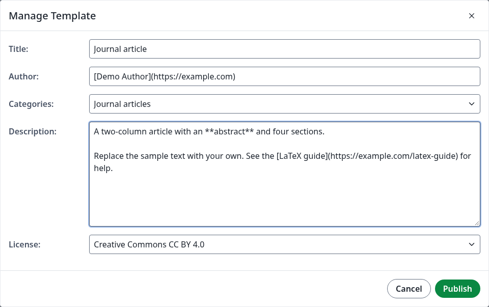

Anda memublikasikan templat dari editor, lalu mengelolanya di halaman templat di galeri atau di panel admin.

<Info>

Untuk mengaktifkan galeri, memilih kategorinya, atau mengizinkan pengguna yang bukan administrator untuk memublikasikan, lihat [Templat](/id/on-premises/configuration/overleaf-toolkit/templates).

</Info>

## Memublikasikan proyek {#publish-a-project}

<Steps>
<Step title="Kompilasi proyek">
Buka proyek dan klik **Recompile**. PDF yang Anda lihat adalah PDF yang akan ditampilkan galeri.

Selama editor belum memiliki PDF, misalnya saat Anda membuka proyek yang tidak dapat dikompilasi, **Manage Template** berwarna abu-abu.

<Frame caption="Belum ada PDF, jadi tidak ada yang bisa dipublikasikan">
  
</Frame>

<Warning>

Publikasi menyimpan file sebagaimana adanya sekarang, beserta PDF dari kompilasi terakhir yang berhasil. Jika Anda mengedit proyek setelah kompilasi itu, atau kompilasi terakhir gagal, galeri menampilkan PDF lama di samping file yang lebih baru, yang mungkin tidak dapat dikompilasi. Kompilasi ulang sampai PDF benar, lalu publikasikan.

</Warning>
</Step>

<Step title="Buka formulir">
Di menu atas editor, klik **File**, lalu **Manage Template**.

<Frame caption="Menu File">
  
</Frame>
</Step>

<Step title="Isi formulir">
<Frame caption="Dialog Manage Template">
  
</Frame>

| Bidang | Catatan |
| --- | --- |
| **Title** | Awalnya berisi nama proyek. Harus unik di galeri. Maksimal 150 karakter. |
| **Author** | Awalnya berisi nama Anda. Tautan Markdown seperti `[Demo Author](https://example.com)` menjadi tautan di halaman templat. |
| **Categories** | Satu kategori, lihat [Kategori](/id/on-premises/user-guide/administrators/template-management#categories). |
| **Description** | Mendukung Markdown. Maksimal 4096 karakter. Halaman templat menampilkannya sebagai **Abstract**, dan galeri menampilkan bagian awalnya sebagai teks biasa. |
| **License** | **Creative Commons CC BY 4.0**, **LaTeX Project Public License 1.3c**, atau <strong>Other (as stated in the work)</strong>. |

Compiler dan dokumen utama proyek ikut bersama templat, jadi atur keduanya di proyek terlebih dahulu. Proyek yang dibuka dari templat menggunakan pengaturan yang sama.
</Step>

<Step title="Klik Publish">
Halaman templat terbuka.

<Frame caption="Templat baru">
  
</Frame>

**Admin: Source Project**, **Edit**, dan **Delete** hanya untuk Anda. Pengguna lain hanya melihat **Open as Template**, **View PDF**, dan tombol unduh.
</Step>

<Step title="Periksa galeri">
Klik **Templates** di kanan atas. Templat baru berada di urutan pertama dalam daftar.
</Step>
</Steps>

## Kategori {#categories}

Sebuah templat berada dalam satu kategori. Nama dan deskripsi berasal dari [konfigurasi](/id/on-premises/configuration/overleaf-toolkit/templates#configuration) Anda dan tidak dapat diubah di situs.

Anda melihatnya di tempat-tempat berikut:

* **Categories** di formulir.
* Kartu di bagian atas halaman galeri, `/templates`. Klik **Template Gallery** di halaman **All templates** untuk menuju ke sana.
* Halaman untuk setiap kategori, misalnya `/templates/presentation`. Kategori tanpa templat menampilkan <strong>No Templates.</strong>
* **New project**, lalu **More templates**, di halaman proyek.
* Tautan di atas judul pada halaman templat.

<Frame caption="Kategori di halaman galeri">
  
</Frame>

**All templates** di formulir berarti tidak ada kategori tersendiri: templat hanya ada di daftar lengkap.

## Memperbarui templat {#update-a-template}

Untuk mengubah file dan PDF, publikasikan ulang proyek dengan judul yang sama.

<Steps>
<Step title="Ubah proyek">
Edit proyek dan klik **Recompile**.
</Step>

<Step title="Publikasikan ulang">
Klik **File**, lalu **Manage Template**. Formulir menampilkan detail templat, yang dapat Anda ubah. Klik **Publish**.

Sebuah pesan menyatakan bahwa judul sudah ada, dan tombol berubah menjadi **Overwrite**.

<Frame caption="Memublikasikan dengan judul yang sama">
  
</Frame>

Jika Anda mengubah **Title** sekarang, pesan akan hilang dan **Publish** membuat templat baru.
</Step>

<Step title="Klik Overwrite">
Halaman templat yang sama terbuka, dengan PDF yang baru.

<Frame caption="Templat yang diperbarui">
  
</Frame>

Proyek yang sudah dibuka pengguna dari templat tidak berubah.
</Step>
</Steps>

<Warning>

Formulir menemukan templat berdasarkan nama proyek. Jika Anda mengganti nama templat dengan **Edit**, formulir terbuka dengan nama proyek, nama Anda, kategori pertama, dan deskripsi kosong, dan mengetik judul templat tidak mengembalikan detailnya. **Overwrite** kemudian mengganti detail dengan isi formulir, jadi isi kembali detail tersebut terlebih dahulu.

</Warning>

## Mengedit detail {#edit-the-details}

Ini mengubah apa yang ditampilkan galeri tentang templat, bukan file atau PDF-nya.

<Steps>
<Step title="Buka templat">
Klik **Templates** di kanan atas, klik templat, lalu klik **Edit**.
</Step>

<Step title="Ubah bidang">
Bidangnya sama seperti saat memublikasikan, ditambah satu: **Language** adalah bahasa pemeriksa ejaan untuk proyek yang dibuka dari templat. Untuk proyek yang dipublikasikan dengan bahasa default, bidang ini menampilkan **Off**, dan proyek yang dibuka darinya menggunakan <strong>English (American)</strong>.

<Frame caption="Dialog Edit template">
  
</Frame>

Judul yang sudah dimiliki templat lain akan ditolak: **Save** tetap berwarna abu-abu sampai Anda mengubah **Title**.
</Step>

<Step title="Klik Save">
Dialog tertutup dan halaman templat menampilkan detail baru.
</Step>
</Steps>

## Proyek sumber {#the-source-project}

**Admin: Source Project** membuka proyek tempat templat dipublikasikan.

Templat menyimpan salinan filenya sendiri. Jika Anda menghapus proyek secara permanen, tombol ini hilang, dan pengguna tetap dapat membuka templat. Proyek yang hanya berada di **Trash** tetap memiliki tombol ini. Lihat juga tanya jawab di [Templat](/id/on-premises/configuration/overleaf-toolkit/templates).

## Menghapus templat {#delete-a-template}

<Steps>
<Step title="Klik Delete">
Di halaman templat, klik **Delete**. Dialog menyebutkan nama templat.

<Frame caption="Dialog Delete template">
  
</Frame>
</Step>

<Step title="Klik Confirm">
Anda kembali ke halaman asal, dan templat tidak lagi ada di galeri. Tautannya kini menampilkan **Not found**.

Proyek sumber tetap ada, begitu pula proyek yang telah dibuka pengguna dari templat.
</Step>
</Steps>

## Mengelola templat di panel admin {#manage-templates-in-the-admin-panel}

Klik **Admin**, lalu **Project/Object Lookup**, lalu tab **Templates**. Tab ini mencantumkan setiap templat beserta penulis dan pemiliknya, dan Anda dapat mencarinya.

<Frame caption="Semua templat di panel admin">
  
</Frame>

* Klik judul untuk membuka halaman templat, atau ikon buka untuk membukanya di tab baru.
* Klik pemilik untuk membuka halaman pengguna tersebut.
* Klik ikon tempat sampah, lalu **Delete**, untuk menghapus templat. Dialog memperingatkan bahwa tindakan ini tidak dapat dibatalkan, dan templat keluar dari galeri.

## Jika publikasi ditolak {#if-publishing-is-refused}

Formulir memungkinkan Anda mengetik lebih banyak daripada yang diterima situs. **Title** yang lebih dari 150 karakter menampilkan `Template title exceeds the maximum length of 150 characters.`, dan **Description** yang lebih dari 4096 karakter menampilkan `Template description exceeds the maximum length of 4096 characters.`

**Publish** kemudian tetap berwarna abu-abu meskipun Anda memperpendek teks. Klik **Cancel**, lalu **File** dan **Manage Template**, dan isi formulir kembali.
