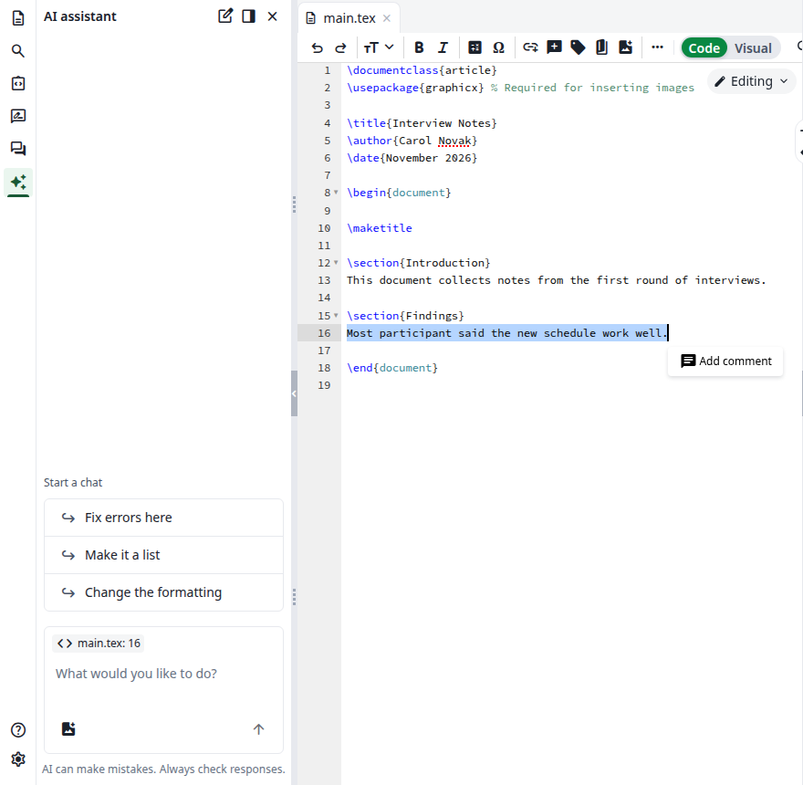
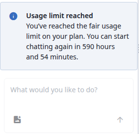

Asisten bekerja pada proyek yang sedang Anda buka. Asisten membaca dokumen Anda dan menyarankan suntingan, lalu Anda menerapkan atau menolak setiap suntingan. Jawaban di tangkapan layar hanyalah contoh: jawaban yang Anda terima bergantung pada model yang digunakan situs Anda.

<Info>

Jika Anda tidak melihat **AI assistant** di bilah kiri, arahkan administrator Anda ke [Integrasi AI](/id/on-premises/configuration/overleaf-toolkit/integrations/ai-integration).

</Info>

## Memulai obrolan {#start-a-chat}

<Steps>
<Step title="Buka asisten">
Di bilah kiri editor, klik **AI assistant**. Panel terbuka di samping editor.
</Step>

<Step title="Terima ketentuan">
Pertama kali, panel menampilkan ketentuan fitur AI. Klik **Accept and continue**. Anda hanya melakukannya sekali, dan ini juga berlaku untuk [Asisten Kesalahan](/id/on-premises/user-guide/users/error-assistant).

<Frame caption="Ketentuan, ditampilkan sekali">
  
</Frame>
</Step>

<Step title="Ajukan pertanyaan">
Ketik di <strong>What would you like to do?</strong> lalu tekan Enter, atau klik panah. Anda juga dapat mengklik saran di bawah **Start a chat**. Saran berubah dari satu obrolan ke obrolan lain, dan **Fix the compile errors** ikut muncul saat kompilasi terakhir memiliki galat.

<Frame caption="Obrolan kosong">
  
</Frame>
</Step>

<Step title="Baca jawaban">
Apa yang dilakukan asisten tampil sebagai baris dalam kotak, seperti **Read line 15-16 of main.tex**, dengan tanda centang saat langkah selesai. Setelah itu muncul jawabannya. Jika model membagikan penalarannya, klik **Reasoned for 1 s** untuk membacanya.

<Frame caption="Pertanyaan dan jawabannya">
  
</Frame>
</Step>
</Steps>

## Bertanya tentang baris yang dipilih {#ask-about-selected-lines}

Pilih baris di editor. Label seperti `main.tex: 16` muncul di atas kotak pesan, dan teks yang dipilih dikirim bersama pesan Anda. Dalam obrolan kosong, saran beralih ke pilihan Anda, seperti **Make it shorter**.

<Frame caption="Baris yang dipilih">
  
</Frame>

## Meninjau suntingan yang disarankan {#review-a-suggested-edit}

Suntingan tidak masuk ke dokumen Anda sampai Anda menerapkannya.

<Steps>
<Step title="Baca saran">
Kotak bernama **Edit line 16** menampilkan alasan, nomor baris, dan perubahannya: teks lama dicoret dan teks baru disorot. Dokumen belum berubah. **Show result** hanya menampilkan teks baru, dan **Show diff** kembali ke tampilan sebelumnya.

<Frame caption="Suntingan yang menunggu keputusan Anda">
  
</Frame>
</Step>

<Step title="Terapkan">
Klik **Apply**. Perubahan muncul di editor, kotak mendapat tanda centang, dan asisten melanjutkan. Jika suntingan ada di dokumen lain, dokumen itu terbuka.

<Frame caption="Suntingan sudah diterapkan">
  
</Frame>
</Step>

<Step title="Batalkan jika Anda berubah pikiran">
**Undo** mengeluarkan perubahan dari dokumen, dan **Apply** memasukkannya kembali. Asisten tidak diberi tahu tentang keduanya.
</Step>
</Steps>

### Menolak suntingan {#reject-an-edit}

Klik **Reject**. Dokumen tetap seperti semula, kotak menampilkan <strong>The user declined this edit.</strong> dan asisten melanjutkan dengan mengetahui bahwa Anda menolak. Tombol menghilang, jadi untuk mendapatkan suntingan itu kembali, mintalah lagi.

Jika Anda menulis pesan baru alih-alih memutuskan, suntingan tidak diterapkan dan kotak menyatakannya.

<Frame caption="Suntingan yang ditolak dan yang belum diputuskan">
  
</Frame>

## Yang dapat dilakukan asisten dalam proyek {#what-the-assistant-can-do-in-a-project}

Hanya suntingan yang menunggu Anda. Langkah lain langsung dijalankan begitu asisten mengambilnya.

| Baris di obrolan | Fungsinya |
| -------------------- | ------------ |
| **Read line 15-16 of main.tex** | Membaca baris dokumen |
| **Find “schedule” in main.tex** | Mencari teks di dokumen |
| **List the project files** | Menampilkan file proyek |
| **Create appendix.tex** | Membuat dokumen kosong dan membukanya |
| **Edit line 16** | Menyarankan suntingan, lihat di atas |
| **Compile** | Mengompilasi proyek |
| **Check the compile log** | Membaca galat dan peringatan kompilasi terakhir |
| **Look at PDF page 1** | Menampilkan halaman PDF di obrolan |
| **Read the PDF structure** | Membaca struktur PDF |
| **Switch to xelatex** | Mengganti kompiler proyek, seperti di **Settings** |
| <strong>Search the web for “...”</strong> | Mencari di web |
| <strong>Search the help pages for “...”</strong> | Mencari di halaman bantuan |

<Frame caption="File baru, lalu suntingan di dokumen lain">
  
</Frame>

<Frame caption="Kompilasi dan halaman PDF">
  
</Frame>

Baris pencarian menampilkan jumlah hasil yang ditemukan. Klik baris tersebut untuk menampilkannya. Ketersediaan pencarian bergantung pada situs Anda, lihat [Layanan pencarian opsional](/id/on-premises/configuration/overleaf-toolkit/integrations/ai-integration#optional-search-services).

<Frame caption="Hasil pencarian">
  
</Frame>

Saran **Fix the compile errors** meminta asisten memeriksa log dan memperbaiki yang ditemukannya. Perbaikannya datang sebagai suntingan untuk Anda tinjau.

## Melampirkan gambar atau PDF {#attach-an-image-or-a-pdf}

Di kotak pesan, klik ikon gambar, **Attach image or PDF**, lalu pilih file. Namanya muncul di atas teks Anda. Tulis pesan Anda dan kirimkan.

<Frame caption="File yang dilampirkan ke pesan">
  
</Frame>

Panel menolak file lain dengan <strong>Only images and PDF files can be attached.</strong> dan file besar dengan <strong>Files must be smaller than 2 MB.</strong>

## Menghentikan asisten {#stop-the-assistant}

Saat asisten bekerja, panah di kotak pesan berubah menjadi tombol **Stop**. Klik tombol tersebut. Langkah yang sedang berjalan berakhir dengan <strong>Stopped by the user.</strong> dan tidak ada hal lain yang terjadi sampai Anda menulis lagi.

<Frame caption="Tombol Stop">
  
</Frame>

## Jika asisten berhenti sendiri {#if-the-assistant-stops-by-itself}

Asisten hanya dapat mengambil sejumlah langkah terbatas untuk satu pesan. Pada batas itu, panel menampilkan <strong>The assistant used all the steps it may take for one message. Reply to let it carry on.</strong> Balas, misalnya dengan `Go on`, dan asisten melanjutkan.

<Frame caption="Batas langkah">
  
</Frame>

Jika panel menampilkan **Something’s gone wrong**, permintaan gagal. Kirim ulang pesan Anda, atau klik **Start new chat**.

## Memindahkan panel dan memulai ulang {#move-the-panel-and-start-over}

Tombol-tombol ini ada di bagian atas panel:

* **Start new chat** mengosongkan panel. Tidak ada daftar obrolan sebelumnya. Memuat ulang halaman juga mengosongkan obrolan.
* **Move to the right** menempatkan panel di sebelah kanan PDF, tempat panel tetap terbuka saat Anda menggunakan pohon file. **Move to the left** mengembalikannya. Obrolan tetap ada.
* **Close** menyembunyikan panel. Klik **AI assistant** di bilah kiri untuk memunculkannya kembali, dengan obrolan masih ada.

<Frame caption="Panel di sebelah kanan">
  
</Frame>

## Penggunaan token {#token-usage}

Asisten tidak menampilkan berapa banyak token yang telah Anda gunakan. Jika situs Anda menetapkan batas dan Anda mencapainya, pesan berikutnya tidak mendapat jawaban. Panel menampilkan **Usage limit reached** dan berapa lama lagi sampai Anda dapat mengobrol kembali, dan kotak pesan menjadi abu-abu.

<Frame caption="Batas tercapai">
  
</Frame>

Obrolan baru menampilkan pemberitahuan yang sama. Setelah memuat ulang, kotak tampak normal kembali, tetapi pesan berikutnya juga mendapat pemberitahuan itu. [Asisten Kesalahan](/id/on-premises/user-guide/users/error-assistant) dihitung dalam batas yang sama dan menampilkan **Usage limit reached** di entri log.

Administrator Anda menetapkan batasnya, lihat [Penggunaan dan pengaturan ulang](/id/on-premises/configuration/overleaf-toolkit/integrations/ai-integration#usage-and-reset).
