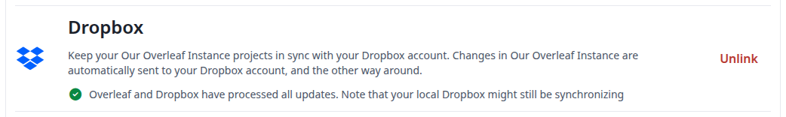
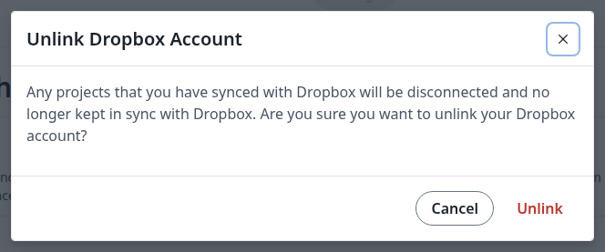

Jaga agar semua proyek Anda tetap tersinkron dengan folder di Dropbox Anda. Perubahan berjalan dua arah di latar belakang, dengan satu pengecualian: apa yang Anda ketik di editor sampai ke Dropbox beberapa menit setelah Anda meninggalkan proyek, atau saat Anda mengklik **sync this project now**.

<Info>

Jika Anda tidak melihat opsi Dropbox di **Account settings** atau di editor, minta administrator Anda untuk mengaktifkan [Sinkronisasi Dropbox](/id/on-premises/configuration/overleaf-toolkit/integrations/dropbox-synchronisation).

</Info>

## Menautkan akun Dropbox Anda {#link-your-dropbox-account}

Anda melakukannya sekali.

<Steps>
<Step title="Buka pengaturan akun Anda">
Klik **Account**, lalu **Account settings**. Di bawah **Project synchronisation**, temukan **Dropbox** dan klik **Link**.

<Frame caption="Dropbox di pengaturan akun">
  
</Frame>
</Step>

<Step title="Otorisasi di Dropbox">
Dropbox terbuka. Masuk jika diminta, lalu otorisasi aplikasi.
</Step>

<Step title="Periksa tautan">
Anda kembali ke pengaturan akun. Pesan hijau menyatakan bahwa akun Dropbox Anda sudah tertaut, dan tombolnya sekarang bertuliskan **Unlink**. Di bawah Dropbox, sebuah status menunjukkan bahwa proyek Anda sedang dikirim.

<Frame caption="Akun Dropbox Anda sudah tertaut">
  
</Frame>

Status berubah menjadi **Overleaf and Dropbox have processed all updates** setelah semuanya sampai.

<Frame caption="Semua sudah tersinkron">
  
</Frame>
</Step>
</Steps>

Jika akun Anda belum tertaut, kartu **Dropbox** di editor meminta Anda menautkannya terlebih dahulu. Klik **Update Dropbox Settings**: pengaturan akun terbuka di tab baru. Tautkan akun Anda di sana, lalu muat ulang halaman editor, seperti yang diminta dialog.

<Frame caption="Permintaan saat akun Anda belum tertaut">
  
</Frame>

Jika Anda tidak mengizinkan akses di Dropbox, Anda kembali ke pengaturan akun tanpa pesan, dan tombolnya masih bertuliskan **Link**.

### Jika Anda memiliki proyek dengan nama yang sama {#if-you-have-projects-with-the-same-name}

Anda tidak dapat menautkan selama dua proyek Anda memiliki nama yang sama. Pesan menyebutkan nama-nama proyek tersebut. Proyek yang diarsipkan dan yang ada di tempat sampah juga dihitung.

<Frame caption="Dua proyek dengan nama yang sama">
  
</Frame>

Ganti nama salah satunya dan klik **Link** lagi.

## Menemukan proyek Anda di Dropbox {#find-your-projects-in-dropbox}

Setiap proyek Anda adalah folder di `Apps/<app name>/` di Dropbox Anda, dengan semua filenya. Administrator Anda memilih nama aplikasinya. Setiap proyek tersinkron, termasuk proyek yang Anda buat nanti: Anda tidak dapat memilih sebagian saja.

Untuk melihat folder sebuah proyek, buka proyek tersebut. Di bilah kiri, klik **Integrations**, lalu **Dropbox**.

<Frame caption="Panel Integrations">
  
</Frame>

Dialog menyebutkan nama folder dan menautkan ke folder itu di Dropbox.

<Frame caption="Folder proyek ini">
  
</Frame>

Proyek baru dengan nama yang sama dengan proyek yang sudah Anda miliki mendapatkan folder bernomor, seperti `Field notes (1)`. Dialog menunjukkan folder mana yang miliknya.

<Frame caption="Folder bernomor">
  
</Frame>

## Perubahan yang Anda buat di Overleaf {#changes-you-make-in-overleaf}

Anda tidak perlu mengklik apa pun.

* **File baru, penggantian nama, pemindahan, dan penghapusan** langsung sampai ke Dropbox. Folder baru muncul di sana bersama file pertamanya.
* **Mengganti nama proyek** mengganti nama foldernya.
* **Suntingan yang Anda ketik di editor** tidak sampai ke Dropbox selama proyek terbuka, dan mengklik **Recompile** tidak mengirimnya. Suntingan dikirim sekitar tiga menit setelah semua orang meninggalkan proyek. Untuk mengirimnya lebih awal, lihat [Memaksa sinkronisasi](#force-a-sync).
* **Menghapus proyek** membiarkan foldernya tetap ada di Dropbox. Hapus folder itu sendiri jika Anda tidak lagi membutuhkannya.

## Perubahan yang Anda buat di Dropbox {#changes-you-make-in-dropbox}

Di sini pun Anda tidak perlu mengklik apa pun. Dropbox memberi tahu Overleaf tentang perubahan, dan perubahan biasanya muncul dalam hitungan detik, termasuk di editor yang terbuka, tanpa memuat ulang.

* **File baru, suntingan, penggantian nama, dan penghapusan** di folder proyek diterapkan ke proyek. Begitu juga folder baru.
* **Folder baru di tingkat teratas folder aplikasi** menjadi proyek baru.
* **File yang tidak disinkronkan Overleaf**, seperti file `.DS_Store` atau `.aux`, hanya tetap ada di Dropbox.

Riwayat proyek menandai perubahan ini dengan <strong>(via Dropbox)</strong>.

### Jika file sedang terbuka di editor {#if-the-file-is-open-in-the-editor}

File berubah di depan Anda, dan sebuah dialog memberi tahu Anda. Klik **OK**.

<Frame caption="File yang Anda buka berubah di Dropbox">
  
</Frame>

Versi Dropbox menggantikan apa yang telah Anda ketik dan belum terkirim. Teks Anda tidak hilang: teks tetap ada di riwayat proyek.

<Frame caption="Teks yang digantikan di riwayat">
  
</Frame>

### Mengganti nama atau menghapus folder proyek {#rename-or-delete-a-project-folder}

Ganti nama proyek di Overleaf, bukan di Dropbox. Bagi Overleaf, folder yang diganti namanya di Dropbox adalah folder yang dihapus ditambah folder baru: Anda mendapatkan proyek baru dengan nama baru, dan proyek lama tetap ada.

Saat Anda menghapus folder proyek di Dropbox, proyek tetap ada di daftar proyek Anda, beserta file dan riwayatnya. Saat Anda membukanya berikutnya, sebuah dialog memberi tahu Anda sekali. Klik **OK**.

<Frame caption="Folder proyek ini hilang dari Dropbox">
  
</Frame>

Proyek tetap tersinkron. Untuk mengembalikan seluruh proyek ke Dropbox, klik **sync this project now**.

### Saat proyek diarsipkan atau ada di tempat sampah {#while-a-project-is-archived-or-in-the-trash}

Perubahan yang Anda buat di foldernya di Dropbox tidak diterapkan, dan memulihkan proyek tidak membawanya masuk. Overleaf kemudian berhenti mengirim file yang Anda ubah, sehingga kedua sisi berbeda. Simpan file tersebut sekali lagi di Dropbox: versi Dropbox menggantikan versi di Overleaf.

## Memaksa sinkronisasi {#force-a-sync}

Setiap proyek memiliki tautannya sendiri. Gunakan tautan ini saat Anda ingin suntingan Anda ada di Dropbox sekarang, tanpa meninggalkan proyek.

<Steps>
<Step title="Buka dialog sinkronisasi">
Buka proyek. Di bilah kiri, klik **Integrations**, lalu **Dropbox**.
</Step>

<Step title="Klik sync this project now">
Tautan ini ada di akhir <strong>Changes not appearing in Dropbox?</strong>
</Step>

<Step title="Periksa hasilnya">
Pesan biru menyatakan bahwa sinkronisasi manual telah dimulai, dan status menampilkan **Sending and receiving updates**. Status kembali menjadi **Overleaf and Dropbox have processed all updates** setelah sinkronisasi selesai.

<Frame caption="Sinkronisasi manual sedang berjalan">
  
</Frame>
</Step>
</Steps>

Tautan ini mengirim seluruh proyek ke Dropbox, termasuk suntingan yang masih ada di editor. Tautan ini juga membaca perubahan yang menunggu di Dropbox, untuk semua proyek Anda. Jika situs Anda tidak dapat menerima [notifikasi dari Dropbox](/id/on-premises/configuration/overleaf-toolkit/integrations/dropbox-synchronisation#webhook), perubahan dari Dropbox hanya masuk dengan cara ini.

Anda dapat melakukannya sekali per menit untuk setiap proyek. Jika lebih cepat dari itu, pesan merah meminta Anda menunggu.

<Frame caption="Tunggu satu menit sebelum berikutnya">
  
</Frame>

## Melepas tautan akun Dropbox Anda {#unlink-your-dropbox-account}

<Steps>
<Step title="Klik Unlink">
Di **Account settings**, di bawah **Dropbox**, klik **Unlink**.
</Step>

<Step title="Konfirmasi">
Klik **Unlink** di dialog.

<Frame caption="Lepaskan tautan akun Anda">
  
</Frame>
</Step>

<Step title="Periksa hasilnya">
Tombolnya kembali bertuliskan **Link**, dan kartu **Dropbox** di editor menyatakan bahwa akun Anda tidak tertaut. Tidak ada lagi yang tersinkron ke arah mana pun. Proyek Anda dan folder di Dropbox tetap mempertahankan filenya.
</Step>
</Steps>

### Menautkan lagi nanti {#link-again-later}

Klik **Link**. Proyek Anda dikirim ke Dropbox lagi:

* Setiap file menggantikan file dengan nama yang sama di Dropbox. Apa yang Anda ubah pada file-file itu di Dropbox selama tautan dilepas akan ditimpa, jadi pindahkan perubahan tersebut ke proyek terlebih dahulu.
* File yang hanya ada di Dropbox tetap di sana, dan masuk ke proyek saat Anda mengubahnya berikutnya.
* Proyek yang Anda ganti namanya selama tautan dilepas mendapatkan folder baru. Folder lama tetap ada.

### Jika Overleaf melepas tautan akun Anda {#if-overleaf-unlinks-your-account}

Overleaf melepas tautan akun Anda saat Dropbox tidak lagi menerima tautan tersebut. Daftar proyek menampilkan alasannya sampai Anda menautkan lagi.

<Frame caption="Tautan akun Anda telah dilepas">
  
</Frame>

Untuk alasannya, lihat Q\&A [Sinkronisasi Dropbox](/id/on-premises/configuration/overleaf-toolkit/integrations/dropbox-synchronisation).

<Info>

Untuk mengetahui apa yang didapat kolaborator di proyek bersama, lihat [Cara kerja sinkronisasi](/id/on-premises/configuration/overleaf-toolkit/integrations/dropbox-synchronisation#cara-kerja-sinkronisasi).

</Info>
