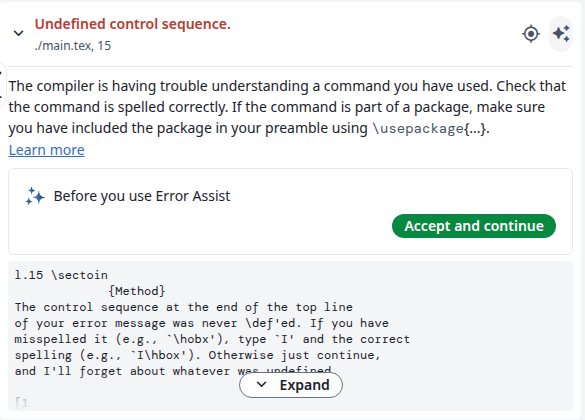

<Info>

Jika entri log tidak memiliki tombol **Suggest fix**, arahkan administrator Anda ke [Integrasi AI](/id/on-premises/configuration/overleaf-toolkit/integrations/ai-integration).

</Info>

<Steps>
<Step title="Buka log">
Setelah kompilasi dengan galat, angka merah muncul pada ikon log di samping **Recompile**, dan titik merah menandai baris di editor. Klik ikon tersebut. Jika kompilasi tidak menghasilkan PDF, log sudah terbuka.

<Frame caption="Kompilasi dengan satu galat">
  
</Frame>
</Step>

<Step title="Klik Suggest fix">
Klik ikon kilau, **Suggest fix**, di sebelah kanan entri log. Peringatan yang menunjuk ke file di proyek Anda juga memilikinya.

<Frame caption="Tombol Suggest fix">
  
</Frame>

Pertama kali, entri menampilkan **Before you use Error Assist**. Klik **Accept and continue**. Anda hanya melakukannya sekali, dan ini juga berlaku untuk [Asisten AI](/id/on-premises/user-guide/users/ai-assistant).

<Frame caption="Ditampilkan sekali">
  
</Frame>
</Step>

<Step title="Baca saran">
Entri menjelaskan galat dan menampilkan baris yang perlu diubah: teks lama di baris <strong>-</strong> dan teks baru di baris <strong>+</strong>. Mengklik nomor baris membawa Anda ke baris tersebut di editor, dan ikon salin menyalin teks baru.

<Frame caption="Saran perbaikan">
  
</Frame>

Jika asisten tidak punya perbaikan, asisten hanya menjelaskan dan tidak ada yang dapat diterapkan. Ikon segarkan, **Suggest a different fix**, meminta lagi.
</Step>

<Step title="Terapkan atau biarkan">
Untuk menerapkannya, klik **Apply suggestion**. Baris berubah di editor, entri menampilkan **Suggestion applied**, dan proyek dikompilasi ulang. Setelah tidak ada galat tersisa, PDF kembali. Untuk membatalkan perubahan, tekan `Ctrl+Z` di editor.

<Frame caption="Perbaikan sudah diterapkan">
  
</Frame>

Untuk menolaknya, jangan lakukan apa pun: tidak ada tombol tolak, dan dokumen tetap seperti semula sampai Anda mengklik **Apply suggestion**.

Jika Anda mengedit baris tersebut terlebih dahulu, **Apply suggestion** dinonaktifkan. Klik **Suggest a different fix** untuk mendapatkan saran baru.
</Step>
</Steps>

## Menemukan saran lagi {#find-the-suggestion-again}

Setelah kompilasi berikutnya, log menampilkan saran sebagai **Last suggested fix**, baik Anda menerapkannya maupun tidak. Klik panah untuk membukanya.

<Frame caption="Saran terakhir tetap ada di log">
  
</Frame>

Asisten Kesalahan dihitung dalam batas yang sama dengan Asisten AI, lihat [Penggunaan token](/id/on-premises/user-guide/users/ai-assistant#token-usage).
