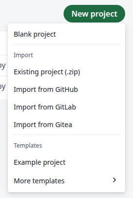

Hubungkan proyek ke repositori Gitea. Perubahan berjalan dua arah, dan hanya saat Anda mengklik **Sync**: tidak ada yang tersinkron dengan sendirinya.

<Info>

Administrator harus mengaktifkan [Sinkronisasi Gitea](/id/on-premises/configuration/overleaf-toolkit/integrations/gitea-synchronisation) terlebih dahulu.

</Info>

## Menautkan akun Gitea Anda {#link-your-gitea-account}

Anda melakukannya sekali.

<Steps>
<Step title="Buka pengaturan akun Anda">
Klik **Account**, lalu **Account settings**. Di bawah **Project synchronisation**, temukan **Gitea** dan klik **Link**.

<Frame caption="Gitea di pengaturan akun">
  
</Frame>
</Step>

<Step title="Otorisasi di Gitea">
Gitea terbuka. Masuk jika diminta, lalu otorisasi aplikasi.
</Step>

<Step title="Periksa tautan">
Anda kembali ke pengaturan akun. Pesan hijau menyatakan bahwa akun Gitea Anda sudah tertaut, dan tombolnya sekarang bertuliskan **Unlink**.

<Frame caption="Akun Gitea Anda sudah tertaut">
  
</Frame>
</Step>
</Steps>

Jika akun Anda belum tertaut, **Import from Gitea** dan kartu **Gitea** di editor meminta Anda menautkannya terlebih dahulu. Klik **Link to your Gitea account**. Anda juga akan tiba di pengaturan akun, di tab baru jika Anda memulai dari editor. Lalu kembali dan mulai lagi.

<Frame caption="Permintaan saat akun Anda belum tertaut">
  
</Frame>

## Mengimpor repositori {#import-a-repository}

Ini membuat proyek baru dari repositori Gitea, yang sudah tertaut dengannya.

<Steps>
<Step title="Buka dialog impor">
Di halaman proyek, klik **New project**, lalu **Import from Gitea**.

<Frame caption="Menu New project">
  
</Frame>
</Step>

<Step title="Pilih repositori">
Klik **Import to Overleaf** di samping repositori. Daftar ini mencakup repositori Anda dan repositori organisasi Anda. Repositori kosong tidak ditampilkan: repositori memerlukan setidaknya satu commit.

<Frame caption="Repositori Gitea Anda">
  
</Frame>
</Step>

<Step title="Periksa proyek">
Proyek baru terbuka dengan file dari repositori.

<Frame caption="Proyek yang diimpor">
  
</Frame>
</Step>
</Steps>

## Mengekspor proyek ke repositori baru {#export-a-project-to-a-new-repository}

Ini membuat repositori dari proyek dan menautkan keduanya. Proyek hanya dapat ditautkan dengan cara ini atau dengan impor: Anda tidak dapat menautkannya ke repositori yang sudah ada.

<Steps>
<Step title="Buka Gitea di editor">
Buka proyek. Di bilah kiri, klik **Integrations**, lalu **Gitea**.

<Frame caption="Panel Integrations">
  
</Frame>
</Step>

<Step title="Isi repositori">
Pilih **Owner**, yang dapat berupa Anda atau salah satu organisasi Anda. Saat Anda memilih organisasi, kolom ini bernama **Organization**. **Repository Name** awalnya berisi nama proyek: jika nama itu mengandung spasi, ubahlah, karena Gitea tidak menerima spasi. Deskripsi bersifat opsional, dan **Private** dipilih secara default. Klik **Create a Gitea repository**.

<Frame caption="Export Project to Gitea">
  
</Frame>

Jika nama mengandung spasi atau sudah dipakai, dialog menampilkan <strong>Please check that the repository name is valid, and that you have permission to create the repository.</strong> Ubah nama dan klik tombol lagi.
</Step>

<Step title="Periksa tautan">
Dialog sekarang menampilkan **This project is linked to** dan nama repositori.

<Frame caption="Proyek sudah tertaut">
  
</Frame>
</Step>
</Steps>

## Menyinkronkan {#sync}

<Steps>
<Step title="Buka dialog sinkronisasi">
Buka proyek yang tertaut. Di bilah kiri, klik **Integrations**, lalu **Gitea**.

**Recent commits in Gitea** menampilkan apa yang akan masuk ke proyek.

<Frame caption="Commit baru menunggu di Gitea">
  
</Frame>
</Step>

<Step title="Jelaskan perubahan Anda">
Jika Anda mengubah sesuatu di proyek, kotak pesan commit akan muncul. Kotak ini opsional: jika Anda membiarkannya kosong, commit bernama `Updates from Overleaf`.

<Frame caption="Pesan commit untuk perubahan Anda">
  
</Frame>
</Step>

<Step title="Klik Sync">
Klik **Sync**. Commit baru dari Gitea masuk ke proyek, dan perubahan Anda masuk ke branch default repositori. Jika kedua sisi mengubah hal yang berbeda, perubahan tersebut digabungkan untuk Anda melalui pull request, yang tetap ada di Gitea sebagai catatan.
</Step>

<Step title="Periksa hasilnya">
Dialog menampilkan <strong>No new commits in Gitea since last merge.</strong> dan kotak pesan commit hilang. File di editor dan commit di Gitea sudah mutakhir.

<Frame caption="Semua sudah tersinkron">
  
</Frame>
</Step>
</Steps>

### Jika baris yang sama berubah di kedua sisi {#if-the-same-lines-changed-on-both-sides}

Dialog menyatakan bahwa perubahan tidak dapat digabungkan dan menyebutkan branch baru, `overleaf-YYYY-MM-DD-HHMMSS`, yang berisi perubahan Anda. Overleaf juga membuka pull request dari branch itu di Gitea.

<Frame caption="Konflik">
  
</Frame>

1.  Gabungkan branch itu ke branch default dengan Git, dan perbaiki konfliknya. Anda dapat menutup dialog sementara itu: dialog menampilkan pesan yang sama saat Anda membukanya lagi.

    ```bash
    git clone <repository-address>
    cd <repository-name>
    git merge origin/overleaf-YYYY-MM-DD-HHMMSS
    # fix the conflict in the file Git names
    git add <file>
    git commit
    git push
    ```
2. Klik **I have manually merged. Continue**. Hasil penggabungan masuk ke proyek. Jika Anda mengkliknya sebelum branch digabungkan, dialog tetap seperti semula.
3. Branch tetap ada di Gitea dan pull request-nya tetap terbuka. Tutup pull request dan hapus branch saat Anda tidak lagi membutuhkannya.

Dialog yang sama muncul saat aturan perlindungan branch menahan pull request, misalnya karena memerlukan persetujuan, meskipun tidak ada baris yang berkonflik. Setelah aturan mengizinkannya, gabungkan pull request di Gitea dan klik **I have manually merged. Continue**. Lihat [Cara kerja sinkronisasi dengan Gitea](/id/on-premises/configuration/overleaf-toolkit/integrations/gitea-synchronisation#how-syncing-works-with-gitea).

## Melepas tautan proyek {#unlink-a-project}

Lakukan ini saat Anda tidak lagi ingin proyek tersinkron.

<Steps>
<Step title="Klik Unlink">
Di dialog sinkronisasi, klik **Unlink**.
</Step>

<Step title="Konfirmasi">
Klik **Confirm**. Ini hanya melepas tautan: koneksi ke repositori milik Anda, yang disebutkan dalam peringatan, adalah opsi yang Anda miliki setelahnya, bukan sesuatu yang terjadi sekarang.

<Frame caption="Konfirmasi pelepasan tautan">
  
</Frame>
</Step>

<Step title="Periksa hasilnya">
Dialog sekarang menampilkan **Export Project to Gitea**. Proyek dan repositori sama-sama mempertahankan isinya. Untuk menyinkronkan lagi, ekspor proyek ke repositori baru, atau impor repositori ke proyek baru.
</Step>
</Steps>

## Melepas tautan akun Gitea Anda {#unlink-your-gitea-account}

Di **Account settings**, di bawah **Gitea**, klik **Unlink**, lalu klik **Unlink** lagi di dialog.

<Frame caption="Lepaskan tautan akun Anda">
  
</Frame>

Proyek Anda tetap tertaut ke repositorinya. Anda tidak dapat menyinkronkannya sampai Anda menautkan akun lagi.

<Info>

Untuk mengetahui siapa yang dapat melakukan apa di proyek bersama, lihat [Siapa yang dapat menautkan dan menyinkronkan](/id/on-premises/configuration/overleaf-toolkit/integrations/gitea-synchronisation#who-can-link-and-sync).

</Info>
