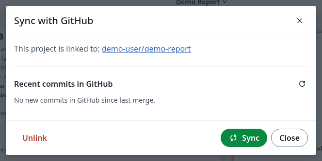

Hubungkan proyek ke repositori GitHub. Perubahan berjalan dua arah, dan hanya saat Anda mengklik **Sync**: tidak ada yang tersinkron dengan sendirinya.

<Info>

Jika Anda tidak melihat opsi GitHub di **Account settings** atau di editor, minta administrator Anda untuk mengaktifkan [Sinkronisasi GitHub](/id/on-premises/configuration/overleaf-toolkit/integrations/github-synchronisation).

</Info>

## Menautkan akun GitHub Anda {#link-your-github-account}

Anda melakukannya sekali.

<Steps>
<Step title="Buka pengaturan akun Anda">
Klik **Account**, lalu **Account settings**. Gulir ke **GitHub** dan klik **Link**.

<Frame caption="GitHub di pengaturan akun">
  
</Frame>
</Step>

<Step title="Otorisasi di GitHub">
GitHub terbuka. Masuk jika diminta, lalu otorisasi aplikasi.
</Step>

<Step title="Periksa tautan">
Anda kembali ke pengaturan akun, dan tombolnya sekarang bertuliskan **Unlink**.

<Frame caption="Akun GitHub Anda sudah tertaut">
  
</Frame>
</Step>
</Steps>

Jika akun Anda belum tertaut, **Import from GitHub** dan kartu **GitHub** di editor meminta Anda menautkannya terlebih dahulu. Klik **Link to your GitHub account**. Anda juga akan tiba di pengaturan akun, di tab baru jika Anda memulai dari editor. Lalu kembali dan mulai lagi.

<Frame caption="Permintaan saat akun Anda belum tertaut">
  
</Frame>

## Mengimpor repositori {#import-a-repository}

Ini membuat proyek baru dari repositori GitHub, yang sudah tertaut dengannya.

<Steps>
<Step title="Buka dialog impor">
Di halaman proyek, klik **New project**, lalu **Import from GitHub**.

<Frame caption="Menu New project">
  
</Frame>

<Info>

**New project** muncul setelah Anda memiliki proyek. Menu **Create a new project** di halaman selamat datang tidak memiliki impor, jadi buat proyek kosong terlebih dahulu.

</Info>
</Step>

<Step title="Pilih repositori">
Klik **Import to Overleaf** di samping repositori. Daftar ini mencakup repositori Anda dan repositori organisasi Anda.

<Frame caption="Repositori GitHub Anda">
  
</Frame>

Jika repositori sebuah organisasi tidak ada, klik <strong>Can't see what you're looking for?</strong> untuk bantuan GitHub tentang menyetujui aplikasi bagi organisasi tersebut.
</Step>

<Step title="Periksa proyek">
Proyek baru terbuka dengan file dari repositori.

<Frame caption="Proyek yang diimpor">
  
</Frame>
</Step>
</Steps>

## Mengekspor proyek ke repositori baru {#export-a-project-to-a-new-repository}

Ini membuat repositori dari proyek yang Anda miliki dan menautkan keduanya. Proyek hanya dapat ditautkan dengan cara ini atau dengan impor: Anda tidak dapat menautkannya ke repositori yang sudah ada.

<Steps>
<Step title="Buka GitHub di editor">
Buka proyek. Di bilah kiri, klik **Integrations**, lalu **GitHub**.

<Frame caption="Panel Integrations">
  
</Frame>
</Step>

<Step title="Isi repositori">
Pilih **Owner**, yang dapat berupa Anda atau salah satu organisasi Anda. **Repository Name** awalnya berisi nama proyek. Deskripsi bersifat opsional, dan **Private** dipilih secara default. Klik **Create a GitHub repository**.

<Frame caption="Export Project to GitHub">
  
</Frame>
</Step>

<Step title="Periksa tautan">
Dialog sekarang menampilkan **This project is linked to** dan nama repositori.

<Frame caption="Proyek sudah tertaut">
  
</Frame>
</Step>
</Steps>

## Menyinkronkan {#sync}

<Steps>
<Step title="Buka dialog sinkronisasi">
Buka proyek yang tertaut. Di bilah kiri, klik **Integrations**, lalu **GitHub**.

**Recent commits in GitHub** menampilkan apa yang akan masuk ke proyek.

<Frame caption="Commit baru menunggu di GitHub">
  
</Frame>
</Step>

<Step title="Jelaskan perubahan Anda">
Jika Anda mengubah sesuatu di proyek, kotak pesan commit akan muncul. Kotak ini opsional: jika Anda membiarkannya kosong, commit bernama `Updates from Overleaf`.

<Frame caption="Pesan commit untuk perubahan Anda">
  
</Frame>
</Step>

<Step title="Klik Sync">
Klik **Sync**. Commit baru dari GitHub masuk ke proyek, dan perubahan Anda masuk ke branch default repositori. Jika kedua sisi mengubah hal yang berbeda, perubahan tersebut digabungkan untuk Anda.
</Step>

<Step title="Periksa hasilnya">
Dialog menampilkan <strong>No new commits in GitHub since last merge.</strong> dan kotak pesan commit hilang. File di editor dan commit di GitHub sudah mutakhir.

<Frame caption="Semua sudah tersinkron">
  
</Frame>
</Step>
</Steps>

### Jika baris yang sama berubah di kedua sisi {#if-the-same-lines-changed-on-both-sides}

Dialog menyatakan bahwa perubahan tidak dapat digabungkan dan menyebutkan branch baru, `overleaf-YYYY-MM-DD-HHMMSS`, yang berisi perubahan Anda.

<Frame caption="Konflik">
  
</Frame>

1. Gabungkan branch itu ke branch default di GitHub atau dengan Git. Anda dapat menutup dialog sementara itu: dialog menampilkan pesan yang sama saat Anda membukanya lagi.
2. Klik **I have manually merged. Continue**. Hasil penggabungan masuk ke proyek.
3. Branch tetap ada di GitHub. Hapus branch itu saat Anda tidak lagi membutuhkannya.

## Melepas tautan proyek {#unlink-a-project}

Lakukan ini saat Anda tidak lagi ingin proyek tersinkron. Hanya pemilik proyek yang dapat melakukannya.

<Steps>
<Step title="Klik Unlink">
Di dialog sinkronisasi, klik **Unlink**.
</Step>

<Step title="Konfirmasi">
Klik **Confirm**. Catatan tentang langganan tidak menghalangi Anda menautkan proyek lagi.

<Frame caption="Konfirmasi pelepasan tautan">
  
</Frame>
</Step>

<Step title="Periksa hasilnya">
Dialog sekarang menampilkan **Export Project to GitHub**. Proyek dan repositori sama-sama mempertahankan isinya. Untuk menyinkronkan lagi, ekspor proyek ke repositori baru, atau impor repositori ke proyek baru.
</Step>
</Steps>

## Melepas tautan akun GitHub Anda {#unlink-your-github-account}

Di **Account settings**, di bawah **GitHub**, klik **Unlink**, lalu klik **Unlink** lagi di dialog.

<Frame caption="Lepaskan tautan akun Anda">
  
</Frame>

Proyek Anda tetap tertaut ke repositorinya. Anda tidak dapat menyinkronkannya sampai Anda menautkan akun lagi.

<Info>

Untuk mengetahui siapa yang dapat melakukan apa di proyek bersama, lihat [Siapa yang dapat menautkan dan menyinkronkan](/id/on-premises/configuration/overleaf-toolkit/integrations/github-synchronisation#who-can-link-and-sync). Setiap kolaborator yang menyinkronkan menautkan akun GitHub-nya sendiri.

</Info>
