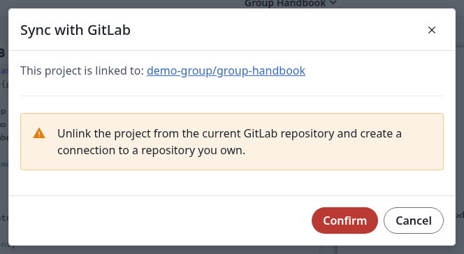

Hubungkan proyek ke repositori GitLab. Perubahan berjalan dua arah, dan hanya saat Anda mengklik **Sync**: tidak ada yang tersinkron dengan sendirinya.

<Info>

Administrator harus mengaktifkan [Sinkronisasi GitLab](/id/on-premises/configuration/overleaf-toolkit/integrations/gitlab-synchronisation) terlebih dahulu.

</Info>

## Menautkan akun GitLab Anda {#link-your-gitlab-account}

Anda melakukannya sekali.

<Steps>
<Step title="Buka pengaturan akun Anda">
Klik **Account**, lalu **Account settings**. Di bawah **Project synchronisation**, temukan **GitLab** dan klik **Link**.

<Frame caption="GitLab di pengaturan akun">
  
</Frame>
</Step>

<Step title="Otorisasi di GitLab">
GitLab terbuka. Masuk jika diminta, lalu otorisasi aplikasi.
</Step>

<Step title="Periksa tautan">
Anda kembali ke pengaturan akun. Pesan hijau menyatakan bahwa akun GitLab Anda sudah tertaut, dan tombolnya sekarang bertuliskan **Unlink**.

<Frame caption="Akun GitLab Anda sudah tertaut">
  
</Frame>
</Step>
</Steps>

Jika akun Anda belum tertaut, **Import from GitLab** dan kartu **GitLab** di editor meminta Anda menautkannya terlebih dahulu. Klik **Link to your GitLab account**. Anda juga akan tiba di pengaturan akun, di tab baru jika Anda memulai dari editor. Lalu kembali dan mulai lagi.

<Frame caption="Permintaan saat akun Anda belum tertaut">
  
</Frame>

## Mengimpor repositori {#import-a-repository}

Ini membuat proyek baru dari repositori GitLab, yang sudah tertaut dengannya.

<Steps>
<Step title="Buka dialog impor">
Di halaman proyek, klik **New project**, lalu **Import from GitLab**.

<Frame caption="Menu New project">
  
</Frame>
</Step>

<Step title="Pilih repositori">
Klik **Import to Overleaf** di samping repositori. Daftar ini mencakup repositori Anda dan repositori grup Anda.

<Frame caption="Repositori GitLab Anda">
  
</Frame>
</Step>

<Step title="Periksa proyek">
Proyek baru terbuka dengan file dari repositori.

<Frame caption="Proyek yang diimpor">
  
</Frame>
</Step>
</Steps>

## Mengekspor proyek ke repositori baru {#export-a-project-to-a-new-repository}

Ini membuat repositori dari proyek dan menautkan keduanya. Proyek hanya dapat ditautkan dengan cara ini atau dengan impor: Anda tidak dapat menautkannya ke repositori yang sudah ada.

<Steps>
<Step title="Buka GitLab di editor">
Buka proyek. Di bilah kiri, klik **Integrations**, lalu **GitLab**.

<Frame caption="Panel Integrations">
  
</Frame>
</Step>

<Step title="Isi repositori">
Pilih **Owner**, yang dapat berupa Anda atau salah satu grup Anda. Saat Anda memilih grup, kolom ini bernama **Organization**. **Repository Name** awalnya berisi nama proyek. Deskripsi bersifat opsional, dan **Private** dipilih secara default. Klik **Create a GitLab repository**.

<Frame caption="Export Project to GitLab">
  
</Frame>

Jika nama sudah dipakai, dialog menampilkan <strong>Please check that the repository name is valid, and that you have permission to create the repository.</strong> Ubah nama dan klik tombol lagi.
</Step>

<Step title="Periksa tautan">
Dialog sekarang menampilkan **This project is linked to** dan nama repositori.

<Frame caption="Proyek sudah tertaut">
  
</Frame>
</Step>
</Steps>

## Menyinkronkan {#sync}

<Steps>
<Step title="Buka dialog sinkronisasi">
Buka proyek yang tertaut. Di bilah kiri, klik **Integrations**, lalu **GitLab**.

**Recent commits in GitLab** menampilkan apa yang akan masuk ke proyek.

<Frame caption="Commit baru menunggu di GitLab">
  
</Frame>
</Step>

<Step title="Jelaskan perubahan Anda">
Jika Anda mengubah sesuatu di proyek, kotak pesan commit akan muncul. Kotak ini opsional: jika Anda membiarkannya kosong, commit bernama `Updates from Overleaf`.

<Frame caption="Pesan commit untuk perubahan Anda">
  
</Frame>
</Step>

<Step title="Klik Sync">
Klik **Sync**. Commit baru dari GitLab masuk ke proyek, dan perubahan Anda masuk ke branch default repositori. Jika kedua sisi mengubah hal yang berbeda, perubahan tersebut digabungkan untuk Anda.
</Step>

<Step title="Periksa hasilnya">
Dialog menampilkan <strong>No new commits in GitLab since last merge.</strong> dan kotak pesan commit hilang. File di editor dan commit di GitLab sudah mutakhir.

<Frame caption="Semua sudah tersinkron">
  
</Frame>
</Step>
</Steps>

### Jika baris yang sama berubah di kedua sisi {#if-the-same-lines-changed-on-both-sides}

Dialog menyatakan bahwa perubahan tidak dapat digabungkan dan menyebutkan branch baru, `overleaf-YYYY-MM-DD-HHMMSS`, yang berisi perubahan Anda. Overleaf juga membuka merge request dari branch itu di GitLab.

<Frame caption="Konflik">
  
</Frame>

1. Gabungkan branch itu ke branch default di GitLab atau dengan Git. Anda dapat menutup dialog sementara itu: dialog menampilkan pesan yang sama saat Anda membukanya lagi.
2. Klik **I have manually merged. Continue**. Hasil penggabungan masuk ke proyek. Jika Anda mengkliknya sebelum branch digabungkan, dialog tetap seperti semula.
3. Branch tetap ada di GitLab, kecuali Anda menghapusnya saat menggabungkan. Hapus branch itu saat Anda tidak lagi membutuhkannya.

Dialog yang sama muncul saat aturan merge repositori menahan merge request, misalnya karena memerlukan persetujuan, meskipun tidak ada baris yang berkonflik. Setelah aturan mengizinkannya, gabungkan merge request di GitLab dan klik **I have manually merged. Continue**. Lihat [Cara kerja sinkronisasi dengan GitLab](/id/on-premises/configuration/overleaf-toolkit/integrations/gitlab-synchronisation#how-syncing-works-with-gitlab).

## Melepas tautan proyek {#unlink-a-project}

Lakukan ini saat Anda tidak lagi ingin proyek tersinkron.

<Steps>
<Step title="Klik Unlink">
Di dialog sinkronisasi, klik **Unlink**.
</Step>

<Step title="Konfirmasi">
Klik **Confirm**. Ini hanya melepas tautan: koneksi ke repositori milik Anda, yang disebutkan dalam peringatan, adalah opsi yang Anda miliki setelahnya, bukan sesuatu yang terjadi sekarang.

<Frame caption="Konfirmasi pelepasan tautan">
  
</Frame>
</Step>

<Step title="Periksa hasilnya">
Dialog sekarang menampilkan **Export Project to GitLab**. Proyek dan repositori sama-sama mempertahankan isinya. Untuk menyinkronkan lagi, ekspor proyek ke repositori baru, atau impor repositori ke proyek baru.
</Step>
</Steps>

## Melepas tautan akun GitLab Anda {#unlink-your-gitlab-account}

Di **Account settings**, di bawah **GitLab**, klik **Unlink**, lalu klik **Unlink** lagi di dialog.

<Frame caption="Lepaskan tautan akun Anda">
  
</Frame>

Proyek Anda tetap tertaut ke repositorinya. Anda tidak dapat menyinkronkannya sampai Anda menautkan akun lagi.

<Info>

Untuk mengetahui siapa yang dapat melakukan apa di proyek bersama, lihat [Siapa yang dapat menautkan dan menyinkronkan](/id/on-premises/configuration/overleaf-toolkit/integrations/gitlab-synchronisation#who-can-link-and-sync).

</Info>
