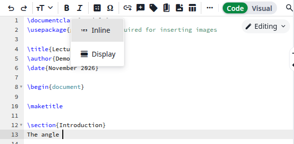

Palet simbol menyisipkan simbol matematika ke dalam dokumen Anda. Jika Anda tidak tahu nama sebuah simbol, gambarlah dan browser Anda akan menemukan perintahnya. Tidak ada yang perlu diatur.

## Menyisipkan simbol {#insert-a-symbol}

<Steps>
<Step title="Letakkan kursor di dalam mode matematika">
Sebagian besar simbol hanya berfungsi di dalam mode matematika. Klik tempat simbol akan diletakkan. Di toolbar editor, klik **Insert math**, lalu **Inline**. Kursor sekarang berada di antara `\(` dan `\)`.

<Frame caption="Menu Insert math">
  
</Frame>
</Step>

<Step title="Buka palet">
Di toolbar, klik tombol **Ω**, **Insert symbol**. Anda juga dapat mengklik **Insert**, lalu **Symbol**, di bagian atas halaman. Palet terbuka di bawah editor.

<Frame caption="Palet simbol">
  
</Frame>
</Step>

<Step title="Temukan simbol">
Klik sebuah tab: **Greek**, **Arrows**, **Operators**, **Relations**, atau **Misc**. Arahkan penunjuk ke sebuah simbol untuk melihat nama dan perintahnya. Beberapa simbol juga menampilkan catatan, seperti paket yang dibutuhkan.

<Frame caption="Nama, perintah, dan catatan simbol">
  
</Frame>
</Step>

<Step title="Klik simbol">
Perintah muncul di posisi kursor. Palet tetap terbuka, jadi Anda dapat langsung menambahkan simbol berikutnya. Klik **Recompile** untuk melihat simbol di PDF.

<Frame caption="Simbol di dokumen dan PDF">
  
</Frame>
</Step>
</Steps>

Palet berfungsi dengan cara yang sama di editor **Visual**.

## Mencari simbol {#search-for-a-symbol}

Ketik di kotak **Search**. Anda dapat mencari perintah (`\sum`), kata dari nama simbol (`arrow`), atau karakter itu sendiri (`α`). Pencarian mencakup semua tab. Kosongkan kotak untuk kembali ke tab.

<Frame caption="Mencari arrow">
  
</Frame>

Jika tidak ada yang cocok, palet menampilkan **No symbols found**.

## Menggambar simbol {#draw-a-symbol}

Gunakan ini saat Anda dapat membayangkan sebuah simbol tetapi tidak tahu namanya.

<Steps>
<Step title="Klik ikon pensil">
Klik ikon pensil, **Draw a symbol**, di sebelah kanan kotak **Search**. Tab menjadi abu-abu dan kotak bergaris putus-putus muncul di sebelah kanan.

<strong>Loading model…</strong> ditampilkan sampai pengenalan siap. Pertama kali, browser Anda mengunduh sekitar 40 MB dari situs Anda. Setelah itu browser menyimpan file-file ini.

<Frame caption="Mode menggambar">
  
</Frame>
</Step>

<Step title="Gambar di kotak bergaris putus-putus">
Saat Anda menyelesaikan satu goresan, hingga sepuluh hasil yang cocok muncul di kiri, yang paling mirip di urutan pertama. Arahkan penunjuk ke salah satunya untuk melihat perintahnya. Untuk simbol dengan beberapa goresan, hasil diperbarui setelah setiap goresan.

<Frame caption="Hasil yang cocok untuk gambar">
  
</Frame>
</Step>

<Step title="Klik hasil yang cocok">
Perintah muncul di posisi kursor. Gambar Anda tetap ada, jadi Anda dapat mencoba hasil lain. Klik **Clear** sebelum menggambar simbol berikutnya.

<Frame caption="Perintah di posisi kursor">
  
</Frame>
</Step>
</Steps>

Untuk kembali ke tab, klik ikon pensil lagi atau klik kotak **Search**.

Pengenalan berjalan di browser Anda. Gambar Anda tidak dikirim ke situs Anda.

### Hasil yang memerlukan paket {#matches-that-need-a-package}

Fitur menggambar mengenali lebih dari 1.300 perintah, sedangkan tab mencantumkan 117. Banyak perintah lainnya berasal dari paket LaTeX. Dalam hal ini, tooltip menampilkan baris yang perlu ditambahkan.

<Frame caption="Hasil yang memerlukan paket">
  
</Frame>

Tambahkan baris tersebut ke preamble Anda, sebelum `\begin{document}`:

```latex
\usepackage{amssymb}
```

Palet tidak menambahkannya untuk Anda.

## Menggunakan keyboard {#use-the-keyboard}

Dari kotak **Search**, tekan Tab sampai sebuah simbol terpilih. Tombol panah berpindah antar simbol. Enter menyisipkan simbol yang dipilih dan menutup palet.

## Menutup palet {#close-the-palette}

Klik <strong>×</strong> di kanan atas palet. Tombol **Ω** dan **Insert**, lalu **Symbol**, juga menutupnya.

## Jika terjadi masalah {#if-something-goes-wrong}

| Yang Anda lihat | Penyebab | Yang harus dilakukan |
| ------------ | --- | ---------- |
| Kompilasi menampilkan **Missing \$ inserted** | Simbol berada di luar mode matematika | Pindahkan ke antara `\(` dan `\)`, atau gunakan **Insert math** terlebih dahulu |
| Kompilasi menampilkan **Undefined control sequence** | Perintah memerlukan paket | Arahkan penunjuk ke simbol di palet untuk melihat paketnya, lalu tambahkan ke preamble Anda |
| Tidak ada ikon pensil | Browser Anda tidak dapat menjalankan pengenalan, misalnya Safari 15 | Perbarui browser atau gunakan browser lain. Tab dan pencarian tetap berfungsi |
| **Recognition unavailable** di bawah kotak bergaris putus-putus | Browser tidak dapat memuat file pengenalan | Klik **Please try again** |
