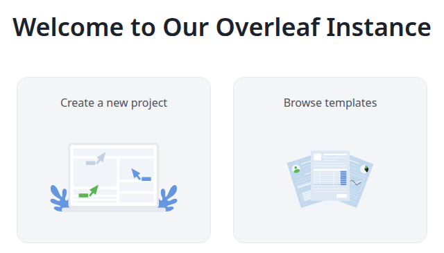

Templat adalah proyek yang dipublikasikan oleh administrator Anda. Membuka templat memberi Anda proyek baru milik Anda sendiri.

<Info>

Jika Anda tidak melihat tautan **Templates**, minta administrator Anda untuk mengaktifkan [galeri templat](/id/on-premises/configuration/overleaf-toolkit/templates).

</Info>

## Membuka galeri {#open-the-gallery}

Di halaman proyek, klik **Templates** di kanan atas.

<Frame caption="Tautan Templates">
  
</Frame>

Halaman **All templates** terbuka, dengan templat yang paling baru diperbarui di urutan pertama.

<Frame caption="Semua templat">
  
</Frame>

Jika Anda belum memiliki proyek, klik **Browse templates** di halaman selamat datang.

<Frame caption="Halaman selamat datang">
  
</Frame>

Jika Anda sudah memiliki proyek, Anda juga dapat mengklik **New project**, lalu **More templates**, lalu sebuah kategori.

<Frame caption="More templates">
  
</Frame>

Secara default, galeri memerlukan login: jika seseorang mengirimi Anda tautan ke templat dan Anda belum login, Anda akan dibawa ke halaman login terlebih dahulu, lalu ke templat.

## Menemukan templat {#find-a-template}

**Cari** di kotak pencarian. Daftar diperbarui saat Anda mengetik dan mencocokkan judul, penulis, dan deskripsi. Jika tidak ada yang cocok, halaman menampilkan <strong>No Templates.</strong>

<Frame caption="Mencari slides">
  
</Frame>

**Urutkan** dengan **Last Updated** atau **Title**, di kanan atas daftar. Klik lagi pengurutan yang sedang digunakan untuk membalik urutan.

**Ganti halaman** di bawah daftar. Satu halaman menampilkan sembilan templat.

<Frame caption="Tombol halaman">
  
</Frame>

<strong>Menjelajah berdasarkan kategori:</strong> klik **Template Gallery** di halaman **All templates**. Halaman galeri memiliki kartu untuk setiap kategori, dengan semua templat di bawahnya.

<Frame caption="Kategori">
  
</Frame>

Klik kartu untuk melihat templat dalam kategori tersebut. Anda juga dapat mencari dan mengurutkan di sini, dan **All templates** membawa Anda kembali.

<Frame caption="Halaman kategori">
  
</Frame>

## Membuka templat sebagai proyek baru {#open-a-template-as-a-new-project}

<Steps>
<Step title="Buka templat">
Klik templat. Anda akan melihat pratinjau halaman pertamanya, penulis, pembaruan terakhir, lisensi, dan abstrak.

<Frame caption="Halaman templat">
  
</Frame>

**View PDF** membuka seluruh PDF. Tombol di sebelahnya mengunduh file sebagai zip.
</Step>

<Step title="Klik Open as Template">
Setelah layar pemuatan singkat, editor terbuka dengan proyek baru Anda.

<Frame caption="Proyek baru Anda">
  
</Frame>
</Step>

<Step title="Periksa proyek">
Proyek memiliki nama dan file templat, serta compiler dan dokumen utama yang sama. Proyek dikompilasi saat dibuka, dan Anda adalah pemiliknya di daftar proyek.

Membuka templat yang sama lagi akan membuat proyek lain, seperti `Journal article (1)`.

<Frame caption="Setiap pembukaan membuat proyek">
  
</Frame>
</Step>
</Steps>

Proyek Anda tidak bergantung pada templat: proyek tetap seperti apa adanya saat templat diperbarui atau dihapus.

<Info>

Akun biasa tidak dapat memublikasikan atau mengubah templat: menu **File** tidak memiliki **Manage Template**, dan halaman templat tidak memiliki **Edit** atau **Delete**. Untuk menambahkan templat ke galeri, minta administrator Anda.

</Info>
