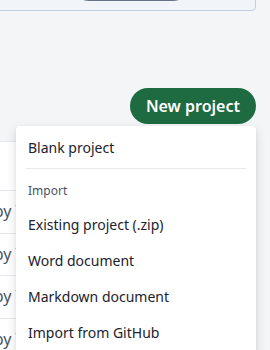

<Info>

Jika Anda tidak melihat opsi ini, minta administrator Anda untuk mengaktifkan [Pandoc Import and Export](/id/on-premises/configuration/overleaf-toolkit/pandoc-import-and-export).

</Info>

## Mengimpor dokumen {#import-a-document}

Ini membuat proyek LaTeX baru dari dokumen Word (`.docx`) atau file Markdown (`.md`). Nama proyek diambil dari nama file.

<Steps>
<Step title="Buka dialog impor">
Di halaman proyek, klik **New project**. Di bawah **Import**, klik **Word document** atau **Markdown document**.

<Frame caption="Menu New project">
  
</Frame>
</Step>

<Step title="Pilih file">
Klik **Select .docx file**, atau seret file ke dialog. Untuk Markdown, tombolnya adalah **Select .md file**. Impor langsung dimulai.

<Frame caption="Memilih dokumen Word">
  
</Frame>
</Step>

<Step title="Mulai mengedit">
Proyek baru terbuka dengan pesan **Document ready for editing**. Klik **Start editing**.

<Frame caption="Impor telah selesai">
  
</Frame>
</Step>

<Step title="Periksa hasilnya">
Dokumen kini ada di `main.tex`, dengan judul-judulnya di kerangka file. Klik **Recompile** untuk melihat PDF. Periksa gayanya, terutama tabel, gambar, dan sitasi, yang mungkin perlu diedit.

<Frame caption="Proyek yang diimpor">
  
</Frame>
</Step>
</Steps>

### Jika impor gagal {#if-the-import-fails}

Jika file tidak dapat dikonversi, dialog menampilkan **Your document couldn't be imported**. Bentangkan **Conversion error details** untuk melihat alasannya. Tidak ada proyek yang dibuat.

<Frame caption="Dokumen yang tidak dapat diimpor">
  
</Frame>

Dialog hanya menerima jenis yang Anda pilih. File `.md` di dialog Word akan menampilkan **You can only upload: .docx**.

## Mengekspor proyek {#export-a-project}

Buka proyek, lalu klik namanya di bagian atas editor. Klik salah satu opsi berikut:

| Opsi                              | Yang Anda dapatkan                                       |
| ----------------------------------- | --------------------------------------------- |
| <strong>Export as Word document (.docx)</strong> | File `.docx` dengan nama proyek        |
| <strong>Export as Markdown (.md)</strong>        | File `.zip` berisi `main.md`                  |
| <strong>Export as HTML (.html)</strong>          | File `.zip` berisi `main.html`                |

Unduhan dimulai dengan sendirinya. Konversi tidak dapat mereproduksi semua format LaTeX, jadi periksa hasilnya.

<Frame caption="Opsi ekspor">
  
</Frame>
