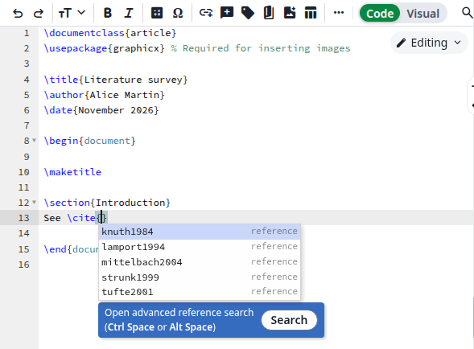
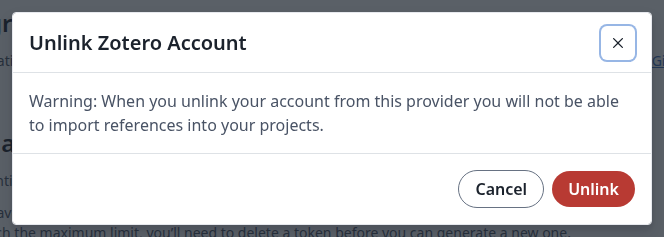

Impor pustaka Zotero ke proyek sebagai file `.bib`, lalu kutip darinya seperti biasa. File tersebut adalah salinan: file hanya berubah saat Anda mengklik **Refresh**.

<Info>

Jika Anda tidak melihat opsi Zotero di **Account settings**, minta administrator Anda untuk mengaktifkan [integrasi Zotero](/id/on-premises/configuration/overleaf-toolkit/integrations/zotero-integration).

</Info>

## Menautkan akun Zotero Anda {#link-your-zotero-account}

Anda hanya melakukan ini sekali.

<Steps>
<Step title="Buka pengaturan akun">
Klik **Account**, lalu **Account settings**. Di bawah **Reference managers**, cari **Zotero** dan klik **Link to Zotero**.

<Frame caption="Zotero di pengaturan akun">
  
</Frame>

Kartu **Zotero** di panel **Integrations** pada editor membawa Anda ke tempat yang sama, di tab yang sama.

<Frame caption="Panel Integrations">
  
</Frame>
</Step>

<Step title="Beri otorisasi di Zotero">
Zotero terbuka. Masuk jika diminta, lalu beri otorisasi pada aplikasi. Aplikasi hanya meminta izin membaca pustaka dan grup Anda, jadi tidak dapat mengubah apa pun di Zotero.
</Step>

<Step title="Periksa tautan">
Anda kembali ke pengaturan akun. Pesan hijau menyatakan **Reference manager linked**, dan tombol kini bertuliskan **Unlink**.

<Frame caption="Akun Zotero Anda sudah tertaut">
  
</Frame>
</Step>
</Steps>

Jika Anda tidak mengizinkan akses di Zotero, bagian yang sama menampilkan **Sorry, something went wrong**. Klik **Link to Zotero** untuk mencoba lagi.

## Membuat file dari pustaka Anda {#create-a-file-from-your-library}

<Steps>
<Step title="Buka dialog Add files">
Buka sebuah proyek. Di pohon file, klik **New file**, lalu **From Zotero**. Entri ini hanya muncul setelah akun Anda tertaut.
</Step>

<Step title="Pilih nama file dan pustaka">
**File Name** awalnya berisi `zotero.bib`. Pertahankan ekstensi `.bib`: tanpanya Anda tidak mendapat pratinjau, dan baik `\cite` maupun `\bibliography` tidak menemukan entrinya.

**Library** awalnya berisi **My Library**, dan juga menampilkan pustaka grup Anda. Satu file berisi satu pustaka.

<Frame caption="File dari pustaka pribadi Anda">
  
</Frame>
</Step>

<Step title="Klik Create">
Dialog tertutup dan file muncul di pohon file. Klik file tersebut: file menampilkan waktu impor dan entrinya. Anda tidak dapat mengeditnya di editor.

<Frame caption="File yang diimpor">
  
</Frame>

Jika **Create** tampak tidak melakukan apa pun, file dengan nama itu sudah ada. Pilih nama lain.
</Step>
</Steps>

### Mengimpor pustaka grup {#import-a-group-library}

Ulangi langkah yang sama dengan nama file tersendiri, lalu pilih grup di **Library**. Satu proyek dapat memiliki beberapa file seperti ini.

<Frame caption="File dari pustaka grup">
  
</Frame>

## Mengutip dari file {#cite-from-the-file}

<Steps>
<Step title="Mulai kutipan">
Di file `.tex`, ketik `\cite{`. Daftar menampilkan entri dari semua file `.bib` di proyek. Klik salah satunya untuk menyisipkannya.

<Frame caption="Entri dari file yang diimpor">
  
</Frame>
</Step>

<Step title="Atau cari berdasarkan judul atau penulis">
Klik **Search** di bawah daftar, atau tekan Ctrl+Space di dalam kurung kurawal. Ketik untuk memfilter, klik satu entri atau lebih, lalu klik **Insert**.

<Frame caption="Pencarian referensi">
  
</Frame>
</Step>

<Step title="Tambahkan daftar pustaka">
Tambahkan baris berikut sebelum `\end{document}`, menggunakan nama file Anda tanpa `.bib`, dipisahkan dengan koma:

```latex
\bibliographystyle{plain}
\bibliography{reading-group,zotero}
```

Klik **Recompile**. Referensi muncul di PDF.

<Frame caption="Referensi yang dikompilasi">
  
</Frame>
</Step>
</Steps>

File yang diimpor tidak ditawarkan di **Settings** pada **References**, **Main bibliography file for this project**, sehingga daftar tetap kosong jika proyek tidak memiliki file `.bib` lain. Anda tetap dapat mengutip darinya.

<Frame caption="Daftar kosong memang wajar">
  
</Frame>

## Menyegarkan file {#refresh-the-file}

Perubahan di pustaka Zotero Anda tidak masuk ke proyek dengan sendirinya, dan kompilasi tidak mengambilnya.

<Steps>
<Step title="Buka file">
Di pohon file, klik file yang diimpor.
</Step>

<Step title="Klik Refresh">
Seluruh file diimpor ulang dari pustaka yang Anda pilih saat membuatnya: entri baru muncul dan entri yang dihapus hilang. Waktu di bagian atas berubah.

<Frame caption="File yang disegarkan">
  
</Frame>
</Step>

<Step title="Kompilasi ulang">
Entri baru langsung ada di daftar `\cite{`. Klik **Recompile** untuk memperbarui PDF.
</Step>
</Steps>

Setiap file disegarkan sendiri-sendiri: segarkan file grup Anda secara terpisah. Untuk mengetahui siapa yang dapat menyegarkan file di proyek bersama, lihat [catatan untuk administrator](/on-premises/configuration/overleaf-toolkit/integrations/zotero-integration#notes).

## Memutuskan tautan akun Zotero Anda {#unlink-your-zotero-account}

Di **Account settings**, di bawah **Zotero**, klik **Unlink**, lalu klik **Unlink** lagi di dialog. Tombol kembali bertuliskan **Link to Zotero**.

<Frame caption="Memutuskan tautan akun Anda">
  
</Frame>

File yang Anda impor tetap ada di proyek dan tetap dapat dikompilasi. **From Zotero** hilang dari dialog **Add files**, dan **Refresh** menampilkan galat sampai Anda menautkan akun lagi.

<Frame caption="Menyegarkan tanpa akun tertaut">
  
</Frame>

Setelah Anda menautkan lagi, **Refresh** berfungsi pada file yang sama.

## Jika terjadi masalah {#if-something-goes-wrong}

**Could not load references from Zotero, please re-link your account and try again**, atau **There was an error accessing your Zotero data** di dialog **Add files**: Overleaf tidak dapat lagi membaca pustaka Anda, misalnya karena Anda mencabut aksesnya di Zotero. Di **Account settings**, klik **Unlink**, lalu **Link to Zotero**. Sampai saat itu, **Create** juga gagal dengan pesan **The project that contains this file is not shared with you**, bahkan di proyek Anda sendiri.

<Frame caption="Overleaf tidak dapat lagi membaca pustaka Anda">
  
</Frame>

**The remote service produced an error** saat Anda mengklik **Refresh**: permintaan ke Zotero gagal. File tetap mempertahankan isinya. Klik **Refresh** lagi nanti.
