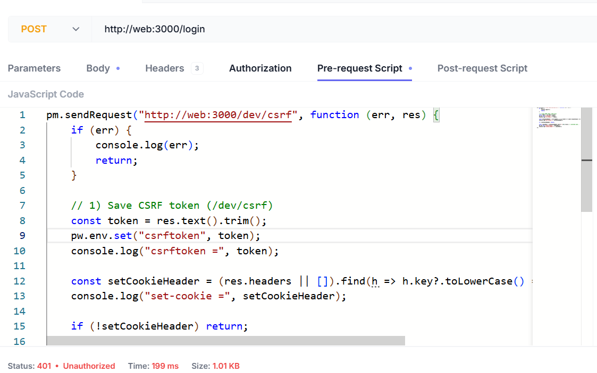

## Strumenti di sviluppo consigliati {#develop-tools-recommended}

Questi servizi opzionali non sono necessari per eseguire Overleaf, ma aiutano molto a sviluppare, fare debug ed esaminare i dati. Fanno tutti parte dell'ambiente di sviluppo, quindi non c'è nulla da aggiungere a `docker-compose.yml`. Dopo l'accesso al sito, il menu **Dev tools** nella sua barra di navigazione rimanda a quelli che il sito serve sui propri percorsi.

| Strumento | Indirizzo | Definito in |
| --- | --- | --- |
| **Grafana**, lo stato, le metriche e i log di ogni servizio | [http://localhost/grafana/](http://localhost/grafana/) | `develop/grafana/docker-compose.yml`, attivo con `GRAFANA_ENABLED=true` in `develop/dev.rc` (predefinito) |
| **Mailpit**, una casella di posta per ogni email inviata dal sito | [http://localhost/mailpit/](http://localhost/mailpit/) | `develop/mail/docker-compose.yml`, attivo con `MAILPIT_ENABLED=true` (predefinito) |
| **Mongo Express**, un'interfaccia per MongoDB | [http://localhost/mongo-express/](http://localhost/mongo-express/) | `develop/docker-compose.yml`, sempre attivo |
| **RedisInsight**, un'interfaccia per i dati di Redis | [http://localhost/redis-insight/](http://localhost/redis-insight/) | `develop/docker-compose.yml`, sempre attivo |
| **Hoppscotch**, un client API nel browser simile a Postman | [http://localhost:9170](http://localhost:9170/) (`HOPPSCOTCH_PORT`) | `develop/hoppscotch/docker-compose.yml`, attivo con `HOPPSCOTCH_ENABLED=true` (predefinito) |

<Warning>

Nessuno di questi strumenti ha un login: gli utenti anonimi di Grafana ne sono gli amministratori, e Mongo Express può modificare qualsiasi documento. Il sito, Hoppscotch, Mongo Express (8081) e RedisInsight (5540) sono in ascolto solo su `127.0.0.1` dell'host, quindi gli altri host non possono raggiungerli.

</Warning>

### Grafana {#grafana}

Grafana è servito dal sito su `/grafana/`, tramite webpack-dev-server, quindi non gli serve una porta propria. La sua cartella **Overleaf Develop** contiene queste dashboard:

| Dashboard | Cosa mostra |
| --- | --- |
| All services (home) | Stato di ogni servizio, indicatori dell'host, carico e log. Un clic su un servizio apre la sua dashboard |
| Server | CPU, carico, memoria, disco e rete dell'host, e le compilazioni di clsi |
| Errors | Log degli errori, risposte 5xx e 4xx, messaggi di errore più frequenti e route che falliscono |
| Data flow | Il percorso di una modifica: document-updater e Redis, project-history, history-v1, Mongo, object store |
| Containers | Stato di ogni container, CPU, memoria, rete e disco, comprese le compilazioni in sandbox |
| Una per servizio | I servizi Node.js, git-bridge (JVM), mongo e redis |

<Columns cols={2}>
<Column>

<Frame caption="All services: lo stato di ogni servizio, l'host e le risorse usate da ogni servizio">
  
</Frame>

</Column>

<Column>

<Frame caption="Data flow: una modifica nel suo percorso da document-updater attraverso project-history fino a history-v1 e Mongo">
  
</Frame>

</Column>
</Columns>

Prometheus raccoglie `/metrics` dei servizi, `mongodb-exporter`, `redis-exporter`, `cadvisor` e `node-exporter`; Alloy invia i log di ogni container del progetto a Loki, dove li leggono i filtri **Log search**, **Service** e **Log level** delle dashboard. I loro dati vivono solo nei container, quindi ricrearli li svuota. cAdvisor gira in modalità privilegiata e legge `/`, `/sys`, i dati di Docker e il socket di containerd dell'host, in sola lettura; node-exporter legge `/` dell'host.

Le dashboard sono generate: modifica `develop/grafana/make-dashboards` ed eseguilo, invece di modificare i file JSON.

### Mailpit {#mailpit}

Con `MAILPIT_ENABLED=true`, `web` invia ogni email a Mailpit invece che a un vero server di posta, e la conferma dell'email è attiva (`EMAIL_CONFIRMATION_DISABLED=false`). Link di attivazione, inviti ai progetti, reimpostazioni della password e codici di conferma si possono quindi seguire dalla casella di posta.

<Frame caption="Un'email di attivazione, un invito a un progetto, un codice di conferma e una reimpostazione della password in Mailpit">
  
</Frame>

Mailpit non ha un volume: ricreare il suo container svuota la casella di posta.

### Mongo Express {#mongo-express}

Mongo Express mostra le collezioni del database `sharelatex` e permette di visualizzare, modificare, importare ed esportare i loro documenti.

<Frame caption="Le collezioni del database sharelatex in Mongo Express">
  
</Frame>

### RedisInsight {#redisinsight}

RedisInsight conserva le sue connessioni in `develop/data/redis-insight`. La prima volta, scegli **Connect existing database** e inserisci l'host `redis` e la porta `6379`.

<Frame caption="RedisInsight connesso al servizio redis">
  
</Frame>

### Configurare Hoppscotch {#setup-hoppscotch}

#### Richieste API tramite proxy {#proxy-api-request}

Hoppscotch invia le richieste dal browser, che non può raggiungere i servizi tramite i loro nomi Docker. Il suo proxy, Proxyscotch, gira nella rete Docker ed è servito su `/proxy` dell'indirizzo di Hoppscotch. Apri [http://localhost:9170](http://localhost:9170/), vai in Settings → Interceptor, scegli **Proxy** e imposta la Proxy URL su `http://localhost:9170/proxy`. L'impostazione resta nel browser.

<Frame caption="L'impostazione Interceptor. Lo screenshot proviene da una configurazione precedente: usa `http://localhost:9170/proxy` come Proxy URL.">
  
</Frame>

Ora puoi fare una prova con [http://web:3000/status](http://web:3000/status) per verificare che il servizio web sia attivo:

<Frame>
  
</Frame>

#### Importare le API dei servizi {#import-the-service-apis}

`develop/hoppscotch/openapi/` contiene un file OpenAPI per l'API interna di ogni servizio. In Hoppscotch, apri Collections → Import → Import from File e seleziona tutti i file in una volta. Ogni file diventa una collezione le cui richieste vanno all'indirizzo Docker del servizio. Gli stessi file sono mostrati nella sezione [API dei servizi](/it/dev/service-api/overview).

#### Problemi con CSRF {#csrf-problems}

<Warning>

Se usi Postman o altri strumenti di debug per generare una richiesta **POST**, potresti notare che il login viene **rifiutato** con un errore 403. Questo accade perché Overleaf è protetto dalla verifica **CSRF**.

</Warning>

<Frame>
  
</Frame>

Nella console potresti vedere:

<Frame>
  
</Frame>

Per gestire questo problema durante lo sviluppo di Overleaf, devi configurare il token CSRF. Ecco il tutorial dettagliato.

<Steps>
<Step title="Aggiungere una Pre-Request">
Aggiungi il seguente codice nella sezione Pre-Request

<Frame>
  
</Frame>

Lo script è il seguente:

```js wrap
pm.sendRequest("http://web:3000/dev/csrf", function (err, res) {
    if (err) {
        console.log(err);
        return;
    }

    // 1) Save CSRF token (/dev/csrf)
    const token = res.text().trim();
    pw.env.set("csrftoken", token);
    console.log("csrftoken =", token);

    const setCookieHeader = (res.headers || []).find(h => h.key?.toLowerCase() === "set-cookie")?.value;
    console.log("set-cookie =", setCookieHeader);

    if (!setCookieHeader) return;

    const cookiePair = setCookieHeader.split(";")[0].trim(); // overleaf.sid=...
    pw.env.set("cookie_header", cookiePair);
    console.log("cookie_header =", cookiePair);
});
```
</Step>

<Step title="Aggiungere gli header della richiesta">
Devi aggiungere i seguenti header:

| Nome header  | Valore header       |
| ------------ | ------------------- |
| Content-Type | `application/json`  |
| X-Csrf-Token | `<<csrftoken>>`     |
| Cookie       | `<<cookie_header>>` |

<Frame>
  
</Frame>
</Step>

<Step title="Effettuare il login con gli strumenti API">
Ora puoi effettuare il login con il tuo nome utente e la tua password.

```json5
{
  "_csrf": "<<csrftoken>>",
  "email": "admin@overleaf.com",
  "password": "xxxxxx"
}
```

Ecco la risposta che ottieni se inserisci un nome utente o una password errati.

<Frame>
  
</Frame>
</Step>
</Steps>
