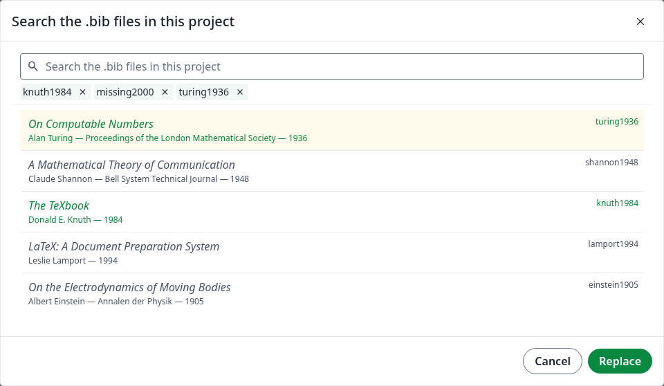

La ricerca dei riferimenti esamina tutti i file `.bib` del tuo progetto, così trovi un riferimento senza ricordarne la chiave di citazione. Non c'è nulla da configurare.

Il tuo progetto ha bisogno di almeno un file `.bib`. Puoi caricarne uno, oppure importare la tua libreria da [Zotero](/it/on-premises/user-guide/users/zotero-integration) o [Mendeley](/it/on-premises/user-guide/users/mendeley-integration).

## Inserire una citazione {#insert-a-citation}

<Steps>
<Step title="Iniziare una citazione">
In un file `.tex`, digita `\cite{`. L'editor aggiunge la parentesi graffa di chiusura. Sotto il cursore vedi le chiavi di citazione e un riquadro blu, **Open advanced reference search**.

<Frame caption="Il riquadro blu sotto una citazione">
  
</Frame>

Anche il pulsante **Insert citation** nella barra degli strumenti e **Insert**, poi **Citation**, avviano un `\cite{}` per te. Il riquadro compare anche per altri comandi di citazione, come `\citep`, `\autocite`, `\parencite` e `\textcite`.
</Step>

<Step title="Aprire la ricerca">
Fai clic su **Search** nel riquadro blu, oppure premi Ctrl+Spazio tra le parentesi graffe. La finestra elenca tutte le voci, con titolo, chiave di citazione, autore, rivista e anno.

<Frame caption="Tutte le voci del progetto">
  
</Frame>
</Step>

<Step title="Trovare la voce">
Digita nella casella di ricerca. Cerca nella chiave di citazione, nell'autore, nel titolo, nella rivista e nell'anno, ed evidenzia ciò che trova. Ogni parola deve corrispondere, quindi `turing 1936` trova l'articolo di Turing del 1936. Gli altri campi, come l'editore, non vengono cercati.

<Frame caption="Ricerca per autore e anno">
  
</Frame>
</Step>

<Step title="Scegliere una o più voci">
Fai clic su una voce. Diventa verde e la sua chiave compare sopra l'elenco. Per aggiungerne un'altra, fai clic su di essa o cerca di nuovo: ciò che hai scelto resta. Per rimuoverne una, fai di nuovo clic su di essa o sulla <strong>×</strong> accanto alla sua chiave.

<Frame caption="Due voci scelte">
  
</Frame>
</Step>

<Step title="Fare clic su Insert">
Le chiavi compaiono tra le parentesi graffe, separate da virgole. Se il tuo documento non ha ancora una bibliografia, aggiungi queste righe prima di `\end{document}`, usando i nomi dei tuoi file `.bib` senza estensione:

```latex
\bibliographystyle{plain}
\bibliography{refs,more}
```

Fai clic su **Recompile**. I riferimenti compaiono nel PDF.

<Frame caption="La citazione compilata">
  
</Frame>
</Step>
</Steps>

La ricerca funziona allo stesso modo nell'editor **Visual**.

## Modificare una citazione {#change-a-citation}

<strong>Aggiungere un riferimento:</strong> metti il cursore tra le parentesi graffe di una citazione esistente e apri la ricerca. **Insert** aggiunge le nuove chiavi dopo quelle già presenti.

<strong>Sostituire riferimenti:</strong> seleziona le chiavi nell'editor, poi premi Ctrl+Spazio. Le chiavi compaiono sopra l'elenco e il pulsante ora dice **Replace**. Rimuovi quelle che non vuoi, aggiungine altre, poi fai clic su **Replace**. Una chiave che non è in nessun file `.bib` resta finché non la rimuovi.

<Frame caption="Sostituire le chiavi selezionate">
  
</Frame>

## Usare la tastiera {#use-the-keyboard}

| Tasto | Cosa fa |
| --- | ------------ |
| **Freccia giù** | Passa dalla casella di ricerca all'elenco, poi scende nell'elenco |
| **Freccia su** | Sale nell'elenco |
| **Spazio** | Sceglie la voce, o la rimuove da ciò che hai scelto |
| **Invio** | Inserisce ciò che hai scelto, quando sei nell'elenco |
| **Tab** | Si sposta tra la casella di ricerca, l'elenco e i pulsanti |
| **Esc** | Chiude la finestra senza modificare nulla |

## Da dove provengono le voci {#where-the-entries-come-from}

La ricerca copre tutti i file `.bib` del progetto, compresi quelli importati da Zotero o Mendeley. Quando modifichi un file `.bib`, la ricerca successiva trova le nuove voci.

## Se qualcosa va storto {#if-something-goes-wrong}

| Cosa vedi | Perché | Cosa fare |
| ------------ | --- | ---------- |
| L'elenco nella finestra è vuoto | Il progetto non ha file `.bib` | Caricane uno o creane uno |
| Nessun riquadro blu, e Ctrl+Spazio elenca comandi LaTeX | Il cursore non è tra le parentesi graffe di una citazione | Fai clic tra le parentesi graffe |
| Ctrl+Spazio non fa nulla | Il tuo computer usa questa scorciatoia per altro | Fai clic su **Search** nel riquadro blu |
| Una voce non viene trovata | La ricerca copre solo chiave, autore, titolo, rivista e anno | Cerca per uno di questi campi |
