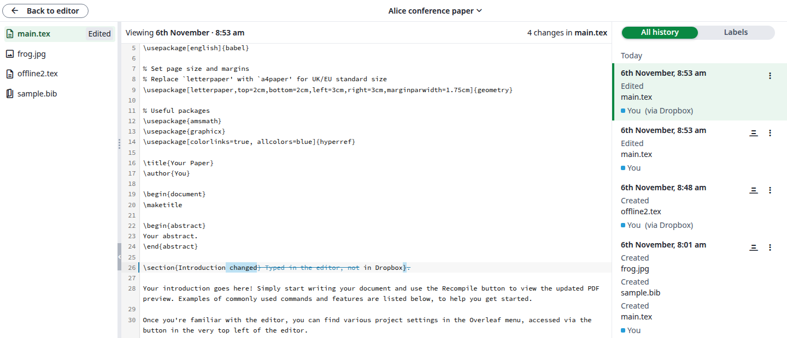

Mantieni tutti i tuoi progetti sincronizzati con una cartella nel tuo Dropbox. Le modifiche vanno in entrambe le direzioni in background, con un'eccezione: ciò che digiti nell'editor arriva a Dropbox qualche minuto dopo che hai lasciato il progetto, oppure quando fai clic su **sync this project now**.

<Info>

Se non vedi alcuna opzione Dropbox in **Account settings** o nell'editor, chiedi al tuo amministratore di attivare la [sincronizzazione con Dropbox](/it/on-premises/configuration/overleaf-toolkit/integrations/dropbox-synchronisation).

</Info>

## Collegare il tuo account Dropbox {#link-your-dropbox-account}

Lo fai una sola volta.

<Steps>
<Step title="Apri le impostazioni dell'account">
Fai clic su **Account**, poi su **Account settings**. In **Project synchronisation**, trova **Dropbox** e fai clic su **Link**.

<Frame caption="Dropbox nelle impostazioni dell'account">
  
</Frame>
</Step>

<Step title="Autorizza su Dropbox">
Si apre Dropbox. Accedi se richiesto, poi autorizza l'applicazione.
</Step>

<Step title="Controlla il collegamento">
Torni alle impostazioni dell'account. Un messaggio verde indica che il tuo account Dropbox è collegato, e il pulsante ora indica **Unlink**. Sotto Dropbox, uno stato mostra che i tuoi progetti vengono inviati.

<Frame caption="Il tuo account Dropbox è collegato">
  
</Frame>

Lo stato passa a **Overleaf and Dropbox have processed all updates** quando sono arrivati tutti.

<Frame caption="Tutto è sincronizzato">
  
</Frame>
</Step>
</Steps>

Se il tuo account non è ancora collegato, la scheda **Dropbox** nell'editor ti chiede prima di collegarlo. Fai clic su **Update Dropbox Settings**: le impostazioni dell'account si aprono in una nuova scheda. Collega lì il tuo account, poi ricarica la pagina dell'editor, come indica la finestra di dialogo.

<Frame caption="La richiesta quando il tuo account non è collegato">
  
</Frame>

Se non consenti l'accesso su Dropbox, torni alle impostazioni dell'account senza alcun messaggio, e il pulsante indica ancora **Link**.

### Se hai progetti con lo stesso nome {#if-you-have-projects-with-the-same-name}

Non puoi collegare l'account finché due dei tuoi progetti hanno lo stesso nome. Il messaggio li nomina. Contano anche i progetti archiviati e quelli nel cestino.

<Frame caption="Due progetti con lo stesso nome">
  
</Frame>

Rinomina uno dei due e fai di nuovo clic su **Link**.

## Trovare i tuoi progetti in Dropbox {#find-your-projects-in-dropbox}

Ognuno dei tuoi progetti è una cartella in `Apps/<app name>/` nel tuo Dropbox, con tutti i suoi file. Il nome dell'app è stato scelto dal tuo amministratore. Ogni progetto viene sincronizzato, anche quelli che creerai in seguito: non puoi sceglierne solo alcuni.

Per vedere la cartella di un progetto, apri il progetto. Nella barra a sinistra, fai clic su **Integrations**, poi su **Dropbox**.

<Frame caption="Il pannello Integrations">
  
</Frame>

La finestra di dialogo nomina la cartella e rimanda a essa su Dropbox.

<Frame caption="La cartella di questo progetto">
  
</Frame>

Un nuovo progetto con lo stesso nome di uno che hai già riceve una cartella numerata, ad esempio `Field notes (1)`. La finestra di dialogo mostra qual è la sua cartella.

<Frame caption="Una cartella numerata">
  
</Frame>

## Le modifiche che fai in Overleaf {#changes-you-make-in-overleaf}

Non devi fare clic su nulla.

* **Nuovi file, rinomine, spostamenti ed eliminazioni** arrivano subito a Dropbox. Una nuova cartella compare lì con il suo primo file.
* **Rinominare un progetto** rinomina la sua cartella.
* **Le modifiche che digiti nell'editor** non arrivano a Dropbox mentre il progetto è aperto, e fare clic su **Recompile** non le invia. Partono circa tre minuti dopo che tutti hanno lasciato il progetto. Per inviarle prima, consulta [Forzare una sincronizzazione](#force-a-sync).
* **Eliminare un progetto** lascia la sua cartella in Dropbox. Elimina tu la cartella se non ti serve più.

## Le modifiche che fai in Dropbox {#changes-you-make-in-dropbox}

Anche qui non devi fare clic su nulla. Dropbox avvisa Overleaf della modifica, che di solito compare in pochi secondi, anche in un editor aperto, senza ricaricare.

* **Nuovi file, modifiche, rinomine ed eliminazioni** in una cartella di progetto vengono applicati al progetto. Lo stesso vale per le nuove cartelle.
* **Una nuova cartella al primo livello della cartella dell'app** diventa un nuovo progetto.
* **I file che Overleaf non sincronizza**, come i file `.DS_Store` o `.aux`, restano solo in Dropbox.

La cronologia del progetto contrassegna queste modifiche con <strong>(via Dropbox)</strong>.

### Se il file è aperto nell'editor {#if-the-file-is-open-in-the-editor}

Il file cambia davanti a te, e una finestra di dialogo te lo segnala. Fai clic su **OK**.

<Frame caption="Un file aperto è cambiato in Dropbox">
  
</Frame>

La versione di Dropbox sostituisce ciò che avevi digitato e non ancora inviato. Il tuo testo non va perso: resta nella cronologia del progetto.

<Frame caption="Il testo sostituito nella cronologia">
  
</Frame>

### Rinominare o eliminare una cartella di progetto {#rename-or-delete-a-project-folder}

Rinomina un progetto in Overleaf, non in Dropbox. Per Overleaf, una cartella rinominata in Dropbox è una cartella eliminata più una nuova: ottieni un nuovo progetto con il nuovo nome, e il vecchio progetto resta.

Quando elimini una cartella di progetto in Dropbox, il progetto resta nel tuo elenco dei progetti, con i suoi file e la sua cronologia. La prossima volta che lo apri, una finestra di dialogo te lo segnala una sola volta. Fai clic su **OK**.

<Frame caption="La cartella di questo progetto non è più in Dropbox">
  
</Frame>

Il progetto continua a sincronizzarsi. Per rimetterlo interamente in Dropbox, fai clic su **sync this project now**.

### Mentre un progetto è archiviato o nel cestino {#while-a-project-is-archived-or-in-the-trash}

Le modifiche che fai nella sua cartella in Dropbox non vengono applicate, e ripristinare il progetto non le recupera. Overleaf smette quindi di inviare i file che hai modificato, così i due lati differiscono. Salva ancora una volta quel file in Dropbox: la versione di Dropbox sostituisce quella in Overleaf.

## Forzare una sincronizzazione {#force-a-sync}

Ogni progetto ha il proprio link. Usalo quando vuoi subito le tue modifiche in Dropbox, senza lasciare il progetto.

<Steps>
<Step title="Apri la finestra di sincronizzazione">
Apri il progetto. Nella barra a sinistra, fai clic su **Integrations**, poi su **Dropbox**.
</Step>

<Step title="Fai clic su sync this project now">
Il link si trova alla fine di <strong>Changes not appearing in Dropbox?</strong>
</Step>

<Step title="Controlla il risultato">
Un messaggio blu indica che è iniziata una sincronizzazione manuale, e lo stato mostra **Sending and receiving updates**. Torna a **Overleaf and Dropbox have processed all updates** quando la sincronizzazione è terminata.

<Frame caption="Una sincronizzazione manuale in corso">
  
</Frame>
</Step>
</Steps>

Il link invia l'intero progetto a Dropbox, comprese le modifiche ancora nell'editor. Legge anche le modifiche in attesa in Dropbox, per tutti i tuoi progetti. Se il tuo sito non può ricevere le [notifiche da Dropbox](/it/on-premises/configuration/overleaf-toolkit/integrations/dropbox-synchronisation#webhook), le modifiche da Dropbox arrivano solo in questo modo.

Puoi farlo una volta al minuto per ogni progetto. Prima di allora, un messaggio rosso ti chiede di attendere.

<Frame caption="Attendi un minuto prima della successiva">
  
</Frame>

## Scollegare il tuo account Dropbox {#unlink-your-dropbox-account}

<Steps>
<Step title="Fai clic su Unlink">
In **Account settings**, sotto **Dropbox**, fai clic su **Unlink**.
</Step>

<Step title="Conferma">
Fai clic su **Unlink** nella finestra di dialogo.

<Frame caption="Scollega il tuo account">
  
</Frame>
</Step>

<Step title="Controlla il risultato">
Il pulsante indica di nuovo **Link**, e la scheda **Dropbox** nell'editor indica che il tuo account non è collegato. Non si sincronizza più nulla, in nessuna direzione. I tuoi progetti e le cartelle in Dropbox conservano i loro file.
</Step>
</Steps>

### Ricollegare in seguito {#link-again-later}

Fai clic su **Link**. I tuoi progetti vengono di nuovo inviati a Dropbox:

* Ogni file sostituisce quello con lo stesso nome in Dropbox. Ciò che hai modificato in quei file in Dropbox mentre l'account era scollegato viene sovrascritto, quindi sposta prima quelle modifiche nel progetto.
* Un file che esiste solo in Dropbox resta lì, ed entra nel progetto la prossima volta che lo modifichi.
* Un progetto che hai rinominato mentre l'account era scollegato riceve una nuova cartella. La vecchia cartella resta.

### Se Overleaf scollega il tuo account {#if-overleaf-unlinks-your-account}

Overleaf scollega il tuo account quando Dropbox non accetta più il collegamento. L'elenco dei progetti ne indica il motivo, finché non ricolleghi l'account.

<Frame caption="Il tuo account è stato scollegato">
  
</Frame>

Per i motivi, consulta il Q\&A della [sincronizzazione con Dropbox](/it/on-premises/configuration/overleaf-toolkit/integrations/dropbox-synchronisation).

<Info>

Per sapere cosa ricevono i collaboratori in un progetto condiviso, consulta [Come funziona la sincronizzazione](/it/on-premises/configuration/overleaf-toolkit/integrations/dropbox-synchronisation#come-funziona-la-sincronizzazione).

</Info>
