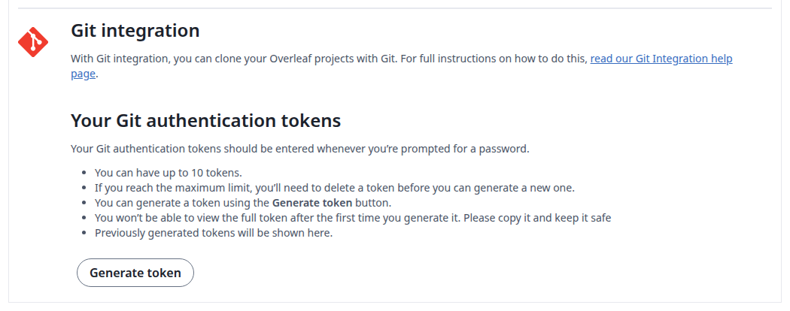

Lavora su un progetto dal tuo computer con Git. Le modifiche vengono trasferite solo quando esegui `git pull` o `git push`.

<Info>

Un amministratore deve prima attivare l'[integrazione Git](/it/on-premises/configuration/overleaf-toolkit/integrations/git-integration).

</Info>

## Creare un token {#create-a-token}

Git accede con un token di autenticazione Git, non con la password del tuo account.

<Steps>
<Step title="Apri le impostazioni dell'account">
Fai clic su **Account**, poi su **Account settings**. In **Git integration**, fai clic su **Generate token**. Quando hai già un token, questo pulsante si chiama **Add another token**.

<Frame caption="L'integrazione Git nelle impostazioni dell'account">
  
</Frame>
</Step>

<Step title="Copia il token">
Fai clic su **Copy** e conserva il token in un luogo sicuro. Lo vedi una sola volta. Poi fai clic su **Close**.

<Frame caption="Il tuo nuovo token">
  
</Frame>
</Step>

<Step title="Controlla il token">
L'elenco mostra ora l'inizio del token, quando è stato creato e quando è stato usato l'ultima volta. Scade dopo un anno. Puoi avere fino a 10 token.

<Frame caption="I tuoi token">
  
</Frame>
</Step>
</Steps>

## Clonare un progetto {#clone-a-project}

<Steps>
<Step title="Apri l'integrazione Git nell'editor">
Apri il progetto. Nella barra a sinistra, fai clic su **Integrations**, poi su **Git integration**.

<Frame caption="Il pannello Integrations">
  
</Frame>
</Step>

<Step title="Copia il comando">
La finestra di dialogo **Clone with Git** mostra il comando, con l'indirizzo del tuo sito e l'ID del progetto. Fai clic su **Copy**. Se non hai ancora un token, **Go to settings** apre le impostazioni dell'account in una nuova scheda.

<Frame caption="Il comando di clonazione">
  
</Frame>
</Step>

<Step title="Eseguilo">
Incolla il comando in un terminale. Quando Git chiede una password, incolla il tuo token.

```text
$ git clone https://git@<your-site>/git/<project-id>
Cloning into '<project-id>'...
Password for 'https://git@<your-site>': <your-token>
```

Una cartella con il nome dell'ID del progetto contiene ora i file del progetto, sul branch `main`. Per scegliere il nome della cartella, aggiungilo alla fine del comando.
</Step>
</Steps>

Git chiede il token ogni volta che contatta il sito. Per farlo ricordare, attiva un credential helper: Git lo chiede ancora una volta, poi lo conserva. L'helper `store` lo salva non cifrato in `~/.git-credentials`.

```bash
git config --global credential.helper store
```

## Scaricare le modifiche dall'editor {#pull-changes-from-the-editor}

All'interno della cartella, esegui:

```bash
git pull
```

Git elenca i file modificati. Le modifiche fatte nell'editor arrivano come commit chiamati `Update on Overleaf.`.

```text
Updating db007e3..c3e6332
Fast-forward
 main.tex | 2 +-
 1 file changed, 1 insertion(+), 1 deletion(-)
```

## Inviare le tue modifiche {#push-your-changes}

Esegui il commit delle modifiche, poi inviale con push:

```bash
git add main.tex
git commit -m "Add a line from Git"
git push
```

L'ultima riga dell'output mostra il branch che è avanzato:

```text
   53aca61..db007e3  main -> main
```

Le modifiche compaiono nell'editor, e un editor aperto si aggiorna da solo. Nuovi file, cartelle e rinomine compaiono nell'albero dei file. In **History**, la tua modifica è contrassegnata come <strong>You (via Git)</strong>. Il messaggio di commit non viene mostrato lì.

<Frame caption="Un push nella cronologia del progetto">
  
</Frame>

### Se Git rifiuta il tuo push {#if-git-refuses-your-push}

Se nel frattempo il progetto è cambiato, Git rifiuta il push:

```text
 ! [rejected]        main -> main (fetch first)
```

Scarica prima quelle modifiche, poi esegui di nuovo il push:

```bash
git pull --no-rebase --no-edit
git push
```

Un semplice `git pull` può fermarsi con `fatal: Need to specify how to reconcile divergent branches.` L'opzione `--no-rebase` qui sopra risolve il problema: unisce i due lati.

Se le stesse righe sono cambiate su entrambi i lati, il pull si ferma con `CONFLICT (content): Merge conflict in main.tex`. Correggi il file, poi:

```bash
git add main.tex
git commit -m "Merge the changes from the editor"
git push
```

Il sito non accetta due cose:

* Altri branch: `! [remote rejected] feature -> feature (wrong branch)`. Esiste solo `main`, quindi invia lì il tuo lavoro.
* Force push: `! [remote rejected] main -> main (forced push prohibited)`. Metti invece le tue modifiche sopra il `main` attuale.

### Se Git risponde Authentication failed {#if-git-says-authentication-failed}

```text
remote: Enter your Git authentication token when prompted for a password.
fatal: Authentication failed for 'https://<your-site>/git/<project-id>/'
```

Il token è errato o è stato eliminato, oppure hai inserito la password dell'account. Crea un nuovo token se non lo hai più, perché non puoi rivedere un token esistente.

## Eliminare un token {#delete-a-token}

In **Account settings**, sotto **Git integration**, fai clic sull'icona di eliminazione accanto al token, poi su **Delete** nella finestra di dialogo. Da quel momento, Git risponde `Authentication failed` a quel token.

<Frame caption="Eliminare un token">
  
</Frame>

<Info>

Per sapere cosa possono fare i collaboratori con accesso in sola lettura, consulta il Q\&A dell'[integrazione Git](/it/on-premises/configuration/overleaf-toolkit/integrations/git-integration).

</Info>
