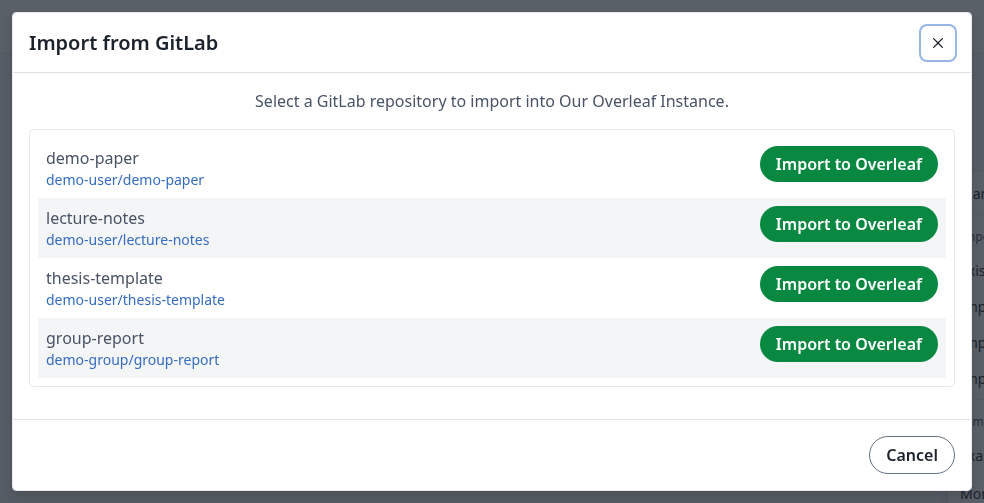
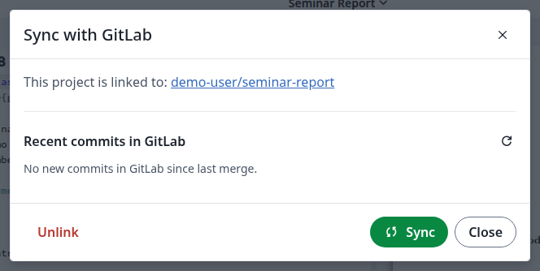

Collega un progetto a un repository GitLab. Le modifiche vanno in entrambe le direzioni, e solo quando fai clic su **Sync**: niente si sincronizza da solo.

<Info>

Un amministratore deve prima attivare la [sincronizzazione con GitLab](/it/on-premises/configuration/overleaf-toolkit/integrations/gitlab-synchronisation).

</Info>

## Collegare il tuo account GitLab {#link-your-gitlab-account}

Lo fai una sola volta.

<Steps>
<Step title="Apri le impostazioni dell'account">
Fai clic su **Account**, poi su **Account settings**. In **Project synchronisation**, trova **GitLab** e fai clic su **Link**.

<Frame caption="GitLab nelle impostazioni dell'account">
  
</Frame>
</Step>

<Step title="Autorizza su GitLab">
Si apre GitLab. Accedi se richiesto, poi autorizza l'applicazione.
</Step>

<Step title="Controlla il collegamento">
Torni alle impostazioni dell'account. Un messaggio verde indica che il tuo account GitLab è collegato, e il pulsante ora indica **Unlink**.

<Frame caption="Il tuo account GitLab è collegato">
  
</Frame>
</Step>
</Steps>

Se il tuo account non è ancora collegato, **Import from GitLab** e la scheda **GitLab** nell'editor ti chiedono prima di collegarlo. Fai clic su **Link to your GitLab account**. Anche così arrivi alle impostazioni dell'account, in una nuova scheda se hai iniziato dall'editor. Poi torna indietro e ricomincia.

<Frame caption="La richiesta quando il tuo account non è collegato">
  
</Frame>

## Importare un repository {#import-a-repository}

Crea un nuovo progetto da un repository GitLab, già collegato a esso.

<Steps>
<Step title="Apri la finestra di importazione">
Nella pagina dei progetti, fai clic su **New project**, poi su **Import from GitLab**.

<Frame caption="Il menu New project">
  
</Frame>
</Step>

<Step title="Scegli il repository">
Fai clic su **Import to Overleaf** accanto al repository. L'elenco include i tuoi repository e quelli dei tuoi gruppi.

<Frame caption="I tuoi repository GitLab">
  
</Frame>
</Step>

<Step title="Controlla il progetto">
Il nuovo progetto si apre con i file del repository.

<Frame caption="Il progetto importato">
  
</Frame>
</Step>
</Steps>

## Esportare un progetto in un nuovo repository {#export-a-project-to-a-new-repository}

Crea un repository da un progetto e li collega. Un progetto può essere collegato solo in questo modo o tramite importazione: non puoi collegarlo a un repository già esistente.

<Steps>
<Step title="Apri GitLab nell'editor">
Apri il progetto. Nella barra a sinistra, fai clic su **Integrations**, poi su **GitLab**.

<Frame caption="Il pannello Integrations">
  
</Frame>
</Step>

<Step title="Compila il repository">
Scegli l'**Owner**, che può essere tu o uno dei tuoi gruppi. Quando scegli un gruppo, questo campo si chiama **Organization**. **Repository Name** parte dal nome del progetto. La descrizione è facoltativa, e **Private** è selezionato per impostazione predefinita. Fai clic su **Create a GitLab repository**.

<Frame caption="Export Project to GitLab">
  
</Frame>

Se il nome è già in uso, la finestra di dialogo mostra <strong>Please check that the repository name is valid, and that you have permission to create the repository.</strong> Cambia il nome e fai di nuovo clic sul pulsante.
</Step>

<Step title="Controlla il collegamento">
La finestra di dialogo ora indica **This project is linked to** e il nome del repository.

<Frame caption="Il progetto è collegato">
  
</Frame>
</Step>
</Steps>

## Sincronizzare {#sync}

<Steps>
<Step title="Apri la finestra di sincronizzazione">
Apri un progetto collegato. Nella barra a sinistra, fai clic su **Integrations**, poi su **GitLab**.

**Recent commits in GitLab** elenca ciò che entrerà nel progetto.

<Frame caption="Un nuovo commit in attesa su GitLab">
  
</Frame>
</Step>

<Step title="Descrivi le tue modifiche">
Se hai modificato qualcosa nel progetto, compare un campo per il messaggio di commit. È facoltativo: se lo lasci vuoto, il commit si chiama `Updates from Overleaf`.

<Frame caption="Il messaggio di commit delle tue modifiche">
  
</Frame>
</Step>

<Step title="Fai clic su Sync">
Fai clic su **Sync**. I nuovi commit da GitLab entrano nel progetto, e le tue modifiche vanno al branch predefinito del repository. Se entrambi i lati hanno modificato cose diverse, vengono unite per te.
</Step>

<Step title="Controlla il risultato">
La finestra di dialogo mostra <strong>No new commits in GitLab since last merge.</strong> e il campo del messaggio di commit è sparito. I file nell'editor e i commit su GitLab sono aggiornati.

<Frame caption="Tutto è sincronizzato">
  
</Frame>
</Step>
</Steps>

### Se le stesse righe sono cambiate su entrambi i lati {#if-the-same-lines-changed-on-both-sides}

La finestra di dialogo indica che le modifiche non sono state unite e nomina un nuovo branch, `overleaf-YYYY-MM-DD-HHMMSS`, che contiene le tue modifiche. Overleaf apre anche una merge request da quel branch su GitLab.

<Frame caption="Un conflitto">
  
</Frame>

1. Unisci quel branch nel branch predefinito su GitLab o con Git. Nel frattempo puoi chiudere la finestra di dialogo: mostra lo stesso messaggio quando la riapri.
2. Fai clic su **I have manually merged. Continue**. Il risultato unito entra nel progetto. Se fai clic prima che il branch sia unito, la finestra di dialogo resta invariata.
3. Il branch resta su GitLab, a meno che tu non l'abbia eliminato durante il merge. Eliminalo quando non ti serve più.

La stessa finestra di dialogo compare quando le regole di merge del repository trattengono la merge request, ad esempio perché richiede un'approvazione, anche se nessuna riga è in conflitto. Quando la regola lo consente, unisci la merge request su GitLab e fai clic su **I have manually merged. Continue**. Consulta [Come funziona la sincronizzazione con GitLab](/it/on-premises/configuration/overleaf-toolkit/integrations/gitlab-synchronisation#how-syncing-works-with-gitlab).

## Scollegare un progetto {#unlink-a-project}

Fallo quando non vuoi più che il progetto si sincronizzi.

<Steps>
<Step title="Fai clic su Unlink">
Nella finestra di sincronizzazione, fai clic su **Unlink**.
</Step>

<Step title="Conferma">
Fai clic su **Confirm**. Questo rimuove solo il collegamento: la connessione a un repository di tua proprietà, menzionata nell'avviso, è un'opzione che hai in seguito, non qualcosa che accade ora.

<Frame caption="Conferma lo scollegamento">
  
</Frame>
</Step>

<Step title="Controlla il risultato">
La finestra di dialogo ora mostra **Export Project to GitLab**. Il progetto e il repository conservano entrambi il loro contenuto. Per sincronizzare di nuovo, esporta il progetto in un nuovo repository o importa il repository in un nuovo progetto.
</Step>
</Steps>

## Scollegare il tuo account GitLab {#unlink-your-gitlab-account}

In **Account settings**, sotto **GitLab**, fai clic su **Unlink**, poi di nuovo su **Unlink** nella finestra di dialogo.

<Frame caption="Scollega il tuo account">
  
</Frame>

I tuoi progetti restano collegati ai loro repository. Non puoi sincronizzarli finché non colleghi di nuovo il tuo account.

<Info>

Per sapere chi può fare cosa in un progetto condiviso, consulta [Chi può collegare e sincronizzare](/it/on-premises/configuration/overleaf-toolkit/integrations/gitlab-synchronisation#who-can-link-and-sync).

</Info>
