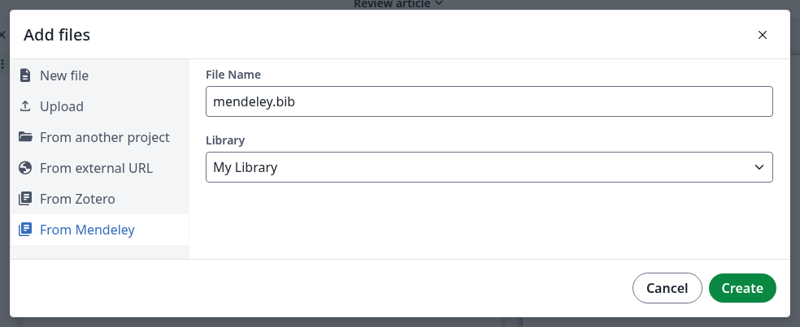

Importa una libreria Mendeley in un progetto come file `.bib`, poi cita da esso come al solito. Il file è una copia: cambia solo quando fai clic su **Refresh**.

<Info>

Se in **Account settings** non vedi alcuna opzione Mendeley, chiedi al tuo amministratore di attivare l'[integrazione Mendeley](/it/on-premises/configuration/overleaf-toolkit/integrations/mendeley-integration).

</Info>

## Collegare il tuo account Mendeley {#link-your-mendeley-account}

Lo fai una sola volta.

<Steps>
<Step title="Aprire le impostazioni dell'account">
Fai clic su **Account**, poi su **Account settings**. In **Reference managers**, trova **Mendeley** e fai clic su **Link to Mendeley**.

<Frame caption="Mendeley nelle impostazioni dell'account">
  
</Frame>

La scheda **Mendeley** nel pannello **Integrations** dell'editor ti porta nello stesso punto, nella stessa scheda del browser.

<Frame caption="Il pannello Integrations">
  
</Frame>
</Step>

<Step title="Autorizzare su Mendeley">
Si apre Mendeley. Accedi se ti viene chiesto, poi autorizza l'applicazione.
</Step>

<Step title="Verificare il collegamento">
Torni alle impostazioni dell'account. Un messaggio verde dice **Reference manager linked** e il pulsante ora dice **Unlink**.

<Frame caption="Il tuo account Mendeley è collegato">
  
</Frame>
</Step>
</Steps>

Se non consenti l'accesso su Mendeley, la stessa sezione dice **Sorry, something went wrong**. Fai clic su **Link to Mendeley** per riprovare.

## Creare un file dalla tua libreria {#create-a-file-from-your-library}

<Steps>
<Step title="Aprire la finestra Add files">
Apri un progetto. Nell'albero dei file, fai clic su **New file**, poi su **From Mendeley**. Questa voce compare solo dopo aver collegato l'account.
</Step>

<Step title="Scegliere il nome del file e la libreria">
**File Name** parte da `mendeley.bib`. Mantieni l'estensione `.bib`: senza di essa non ottieni l'anteprima, e né `\cite` né `\bibliography` trovano le sue voci.

**Library** parte da **My Library** ed elenca anche i tuoi gruppi. Un file contiene una libreria.

<Frame caption="Un file dalla tua libreria personale">
  
</Frame>
</Step>

<Step title="Fare clic su Create">
La finestra si chiude e il file è nell'albero dei file. Fai clic su di esso: mostra quando è stato importato e le sue voci. Non puoi modificarlo nell'editor.

<Frame caption="Il file importato">
  
</Frame>

Se **Create** sembra non fare nulla, esiste già un file con quel nome. Scegli un altro nome.
</Step>
</Steps>

### Importare un gruppo {#import-a-group}

Ripeti l'operazione con un nome di file diverso e scegli il gruppo in **Library**. Un progetto può avere più file di questo tipo.

<Frame caption="Un file da un gruppo">
  
</Frame>

## Citare dal file {#cite-from-the-file}

<Steps>
<Step title="Iniziare una citazione">
In un file `.tex`, digita `\cite{`. L'elenco mostra le voci di tutti i file `.bib` del progetto. Fai clic su una per inserirla.

<Frame caption="Le voci dei file importati">
  
</Frame>
</Step>

<Step title="Oppure cercare per titolo o autore">
Fai clic su **Search** sotto l'elenco, oppure premi Ctrl+Spazio tra le parentesi graffe. Digita per filtrare, fai clic su una o più voci, poi su **Insert**.

<Frame caption="La ricerca dei riferimenti">
  
</Frame>
</Step>

<Step title="Aggiungere la bibliografia">
Aggiungi queste righe prima di `\end{document}`, usando il nome del tuo file senza `.bib`. Per più file, separa i nomi con virgole.

```latex
\bibliographystyle{plain}
\bibliography{mendeley}
```

Fai clic su **Recompile**. Il riferimento compare nel PDF.

<Frame caption="Il riferimento compilato">
  
</Frame>
</Step>
</Steps>

I file importati non vengono proposti in **Settings** sotto **References**, **Main bibliography file for this project**, quindi l'elenco resta vuoto se il progetto non ha altri file `.bib`. Puoi comunque citare da essi.

<Frame caption="L'elenco vuoto è previsto">
  
</Frame>

## Aggiornare il file {#refresh-the-file}

Le modifiche alla tua libreria Mendeley non arrivano da sole nel progetto.

<Steps>
<Step title="Aprire il file">
Nell'albero dei file, fai clic sul file importato.
</Step>

<Step title="Fare clic su Refresh">
L'intero file viene reimportato dalla libreria scelta al momento della creazione: le nuove voci compaiono e quelle rimosse scompaiono. L'ora in alto cambia.

<Frame caption="Il file aggiornato">
  
</Frame>
</Step>

<Step title="Ricompilare">
Fai clic su **Recompile** per aggiornare il PDF.
</Step>
</Steps>

Ogni file si aggiorna separatamente: aggiorna a parte il file del tuo gruppo. Per sapere chi può aggiornare un file in un progetto condiviso, consulta le [note per gli amministratori](/on-premises/configuration/overleaf-toolkit/integrations/mendeley-integration#notes).

## Scollegare il tuo account Mendeley {#unlink-your-mendeley-account}

In **Account settings**, sotto **Mendeley**, fai clic su **Unlink**, poi di nuovo su **Unlink** nella finestra. Il pulsante torna a dire **Link to Mendeley**.

<Frame caption="Scollegare l'account">
  
</Frame>

I file importati restano nei tuoi progetti e si compilano ancora. **From Mendeley** scompare dalla finestra **Add files**, e **Refresh** mostra un errore finché non ricolleghi l'account.

<Frame caption="Aggiornamento senza account collegato">
  
</Frame>

Dopo averlo ricollegato, **Refresh** funziona sugli stessi file.

## Se qualcosa va storto {#if-something-goes-wrong}

**Could not load references from Mendeley, please re-link your account and try again**, oppure **There was an error accessing your Mendeley data** nella finestra **Add files**: Overleaf non riesce più a leggere la tua libreria, per esempio perché ne hai revocato l'accesso su Mendeley. In **Account settings**, fai clic su **Unlink**, poi su **Link to Mendeley**. Fino ad allora anche **Create** non riesce, con il messaggio **The project that contains this file is not shared with you**, anche nel tuo progetto.

<Frame caption="Overleaf non riesce più a leggere la tua libreria">
  
</Frame>

**The remote service produced an error** quando fai clic su **Refresh**: la richiesta a Mendeley non è riuscita. Il file mantiene il suo contenuto. Fai di nuovo clic su **Refresh** più tardi.
