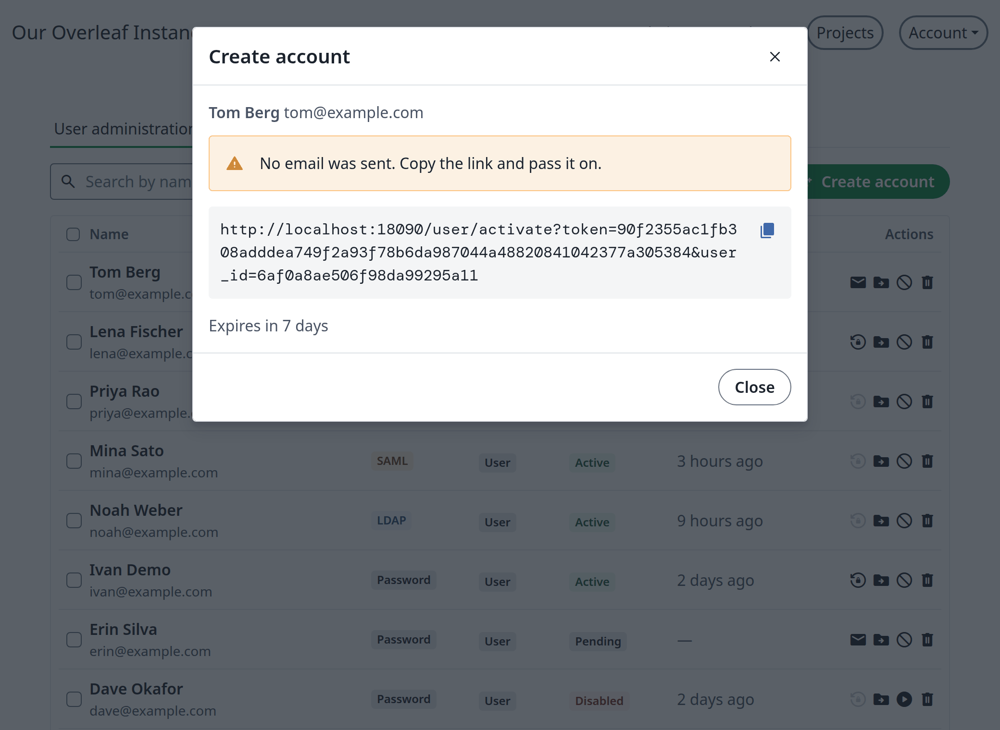
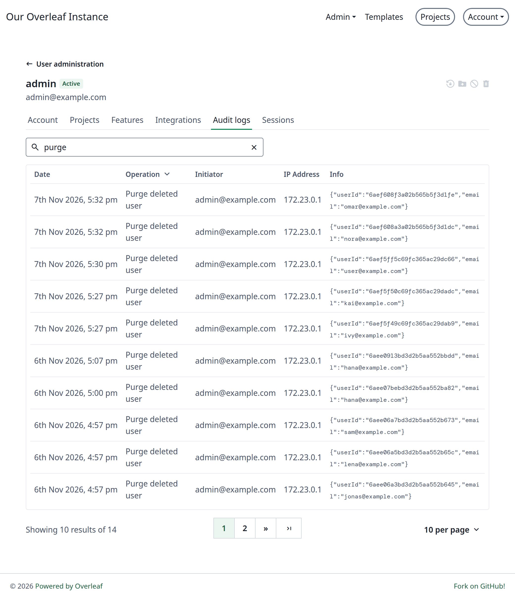

研究室や学科のために Overleaf インスタンスを運用していると、毎週同じ質問が寄せられます。この学生はなぜログインできないのか。まだサーバーを使っているのは誰か。あのアカウントに管理者権限を与えたのは誰か。昨年の学位論文はどこへ行ったのか。データベースのシェルを開かなくてもこれらに答えられるよう、管理パネルを作り直しました。

新しいパネルは Overleaf 6.3 の見た目に合わせており、インターフェースが対応するすべての言語に翻訳されています。すべてのユーザーの一覧、すべてのプロジェクトの一覧、それぞれの詳細ページ、テンプレートを管理する場所、そして監査ログを備えています。

<Info>

新しい管理パネルはメインブランチにマージ済みで、v6.4.0 で正式にリリースされます。この記事のスクリーンショットはすべて、架空のアカウントを登録したテストインスタンスのものです。

</Info>

### 含まれるもの {#what’s-in-it}

* **ユーザー一覧**: 検索、ログイン方法・ロール・ステータスによるフィルター、一括操作。
* **ユーザーページ**: 1 人のユーザーのアカウント、プロジェクト、機能、連携、監査ログ、セッション。
* **プロジェクト一覧**: インスタンス上のすべてのプロジェクト。名前、ID、所有者、共有リンクで検索できます。
* **プロジェクトページ**: 1 つのプロジェクトの設定、ファイル、メンバー、削除済みファイル、監査ログ。
* **テンプレート管理**: プロジェクトをテンプレートとして公開し、更新し、ギャラリーを整理します。
* **監査ログ**: 誰が、いつ、どの IP アドレスから何をしたか。

## すべてのユーザーを 1 つの一覧で {#one-list-for-every-user}

**Admin** をクリックし、**Manage Users** をクリックします。各アカウントは 1 行で表示され、ログイン方法、ロール、ステータスがわかります。

<Frame caption="ユーザー一覧">
  
</Frame>

名前、メールアドレス、ID で検索できます。**Login**、**Role**、**Status** の見出しはフィルターになっており、各オプションには該当するアカウント数が表示されます。SAML から何人がログインしているかが一目でわかり、各 OIDC プロバイダーは設定した名前で表示されます。

<Frame caption="ログイン方法で絞り込む">
  
</Frame>

各アカウントのステータスは必ず 1 つで、4 つのステータスの合計が総数になります。

| ステータス   | 意味                                                         |
| ------------ | ------------------------------------------------------------ |
| **Active**   | 過去 12 か月以内にログインしたか、プロジェクトを開いた。     |
| **Pending**  | 一度もログインしていない。                                   |
| **Inactive** | 以前ログインしたが、過去 12 か月はログインしていない。       |
| **Disabled** | 管理者がアカウントのログインを停止した。                     |

削除済みアカウントは専用のフィルターに分けられ、邪魔になりません。検索が削除済みアカウントにも一致した場合は、表の上の 1 行がそのことを知らせ、表示するよう促します。

<Frame caption="ステータスで絞り込む">
  
</Frame>

検索、並べ替え、ページ送りはサーバー側で実行されるため、一覧が最初の 1,000 行で止まることはなくなりました。

### メールの有無にかかわらずユーザーを迎える {#bring-people-in-with-or-without-email}

**Create account** はユーザーを追加し、そのユーザーに必要なリンクを表示します。[メール配信](/ja/on-premises/configuration/overleaf-toolkit/email-delivery  "mention")が設定されていない場合はダイアログがそのことをはっきり伝え、リンクをコピーできるので、小規模なインスタンスでもユーザーを迎え入れられます。

<Frame caption="新しいアカウントの有効化リンク">
  
</Frame>

パネルはアカウントごとに適切なリンクを提示します。一度もログインしていないアカウントには **Send activation email**(7 日間有効)、ログインしたことのあるアカウントには **Send reset link**(1 時間有効)です。SSO でログインするアカウントにはローカルパスワードがないため、どちらも表示されません。

### 多くのアカウントを一度に変更する {#change-many-accounts-at-once}

いくつかのアカウントにチェックを入れると、ツールバーに **Send activation email**、**Transfer this user's projects**、**Disable**、**Enable**、**Make admin**、**Remove admin**、**Delete account** が表示されます。確定する前に、ダイアログが対象のアカウントを一覧表示します。一部が失敗した場合はどれが失敗したかを伝え、すでに成功した処理はそのまま残ります。

<Frame caption="一括操作">
  
</Frame>

### 間違えにくい設計 {#hard-to-get-wrong}

* 自分のアカウントには **You** と表示され、その操作はグレー表示になるため、自分自身を無効化、削除、降格することはできません。
* すべての操作は、対象アカウントを明記したダイアログで確認を求めます。
* **Delete account** は、削除前にユーザーのプロジェクトを別の人に引き継げます。
* 削除したアカウントは、一緒に削除されたプロジェクトとともに復元できます。最終的なのは **Delete permanently** だけで、実行前に警告が表示されます。

## 1 人のユーザーのすべて {#everything-about-one-person}

名前をクリックするとユーザーページが開きます。6 つのタブがあり、一覧と同じ操作アイコンが並びます。

### アカウント {#account}

ID やメールアドレスから、最終ログインとその IP アドレスまで、アカウントの詳細です。鉛筆アイコンをクリックすると、メールアドレス、名前、パスワードを変更したり、**Admin** をオン・オフしたりできます。

<Frame caption="アカウントの編集">
  
</Frame>

### プロジェクト {#projects}

このユーザーが所有するプロジェクトです。専用の検索、ステータスフィルター、操作があります。

<Frame caption="ユーザーのプロジェクト">
  
</Frame>

### 機能 {#features}

このアカウントで有効になっているもの。プロジェクトあたりの共同編集者数、コンパイルのタイムアウト、連携、AI などに加え、アカウントの AI 使用量とそれをリセットするボタンがあります。

<Frame caption="ユーザーの機能">
  
</Frame>

### 連携 {#integrations}

このユーザーの Git アクセストークンと、リンク済みのサービスです。

<Frame caption="ユーザーの連携">
  
</Frame>

### セッション {#sessions}

このユーザーがログインしている場所です。**Clear sessions** を使うとすべての場所からログアウトさせられます。ノートパソコンを紛失したときに最初にすべきことです。

<Frame caption="ユーザーのセッション">
  
</Frame>

## インスタンス上のすべてのプロジェクト {#every-project-on-the-instance}

**Admin** をクリックし、**Project/Object Lookup** をクリックします。一覧には全ユーザーのプロジェクトが、所有者とステータスとともに表示されます。検索ボックスには、プロジェクトの名前、ID、所有者、またはリンクを入力できます。共有リンクを貼り付ければ、その裏にあるプロジェクトが見つかります。

<Frame caption="すべてのプロジェクト">
  
</Frame>

**Status** フィルターは **Active**、**Archived**、**Trashed**、**Deleted** のプロジェクトを分けます。複数のプロジェクトにチェックを入れると、1 つの `.zip` ファイルにまとめてダウンロードしたり、所有者を変更したり、削除したりできます。**Deleted** ビューでは、ボタンは **Restore** と **Delete permanently** になります。

<Frame caption="ステータスでプロジェクトを絞り込む">
  
</Frame>

## 1 つのプロジェクトのすべて {#everything-about-one-project}

プロジェクトのタイトルをクリックすると、そのページが開きます。

### 概要 {#overview}

名前、リンク共有、コンパイラー、TeX Live のバージョン、メインドキュメントを変更できます。**Change project owner** はプロジェクトを別のユーザーに渡します。誰かが研究室を去っても学位論文を残さなければならないときに役立ちます。

<Frame caption="プロジェクトの編集">
  
</Frame>

### ファイルツリー {#file-tree}

プロジェクトのファイルとフォルダーを読み取り専用で表示します。

<Frame caption="プロジェクトのファイル">
  
</Frame>

### メンバー {#members}

所有者、共同編集者、保留中の招待です。共同編集者のロールを変更したり、アクセスを取り消したり、招待を再送または取り消したりできます。

<Frame caption="プロジェクトのメンバーを変更する">
  
</Frame>

### 削除済みファイル {#deleted-files}

プロジェクトから削除されたファイルです。**Restore file** はプロジェクトのルートフォルダーにコピーを置き、その行にコピーの名前が表示されます。

<Frame caption="復元されたファイル">
  
</Frame>

## テンプレート管理 {#template-management}

テンプレートは普通のプロジェクトから始まります。エディターから公開し、ギャラリーのテンプレートページや管理パネルから管理します。

### すべてのテンプレートを 1 つの表で {#all-templates-in-one-table}

**Admin**、**Project/Object Lookup** の順にクリックし、**Templates** タブをクリックします。公開済みのすべてのテンプレートが、作者、所有者、最終更新日時とともに一覧表示され、検索もできます。タイトルをクリックするとテンプレートが開き、所有者をクリックするとそのユーザーのページが開き、ゴミ箱アイコンをクリックするとテンプレートを削除できます。削除は[あなた自身の監査ログ](#when-there-is-no-log-left)に記録されます。

<Frame caption="管理パネルのすべてのテンプレート">
  
</Frame>

### エディターから公開する {#publish-from-the-editor}

プロジェクトを開き、PDF が正しく見えるまでコンパイルします。ギャラリーには最後に成功したコンパイルの PDF が表示されるためです。次に **File**、**Manage Template** の順にクリックし、タイトル、作者、カテゴリー、Markdown 形式の説明、ライセンスを入力します。プロジェクトのコンパイラーとメインドキュメントはテンプレートに引き継がれるので、テンプレートから開いたプロジェクトも同じものを使います。

<Frame caption="プロジェクトをテンプレートとして公開する">
  
</Frame>

### テンプレートを更新する {#update-a-template}

テンプレートのファイルと PDF を変更するには、同じタイトルでプロジェクトを再度公開します。ダイアログがそのタイトルは既に存在すると伝え、ボタンが **Overwrite** に変わります。すでにテンプレートから開かれたプロジェクトは変わりません。

<Frame caption="同じタイトルで公開する">
  
</Frame>

### テンプレートページ {#the-template-page}

誰でも **Open as Template**、**View PDF**、ダウンロードボタンを使えます。管理者にはさらに **Admin: Source Project**、**Edit**、**Delete** が表示されます。

<Frame caption="テンプレートのページ">
  
</Frame>

**Edit** は、ギャラリーに表示されるテンプレートの情報を変更します。タイトル、作者、カテゴリー、説明、ライセンス、そしてテンプレートから開いたプロジェクトのスペルチェック言語です。ファイルや PDF には影響しません。テンプレートは独自のファイルのコピーを持っているため、元のプロジェクトを削除してもテンプレートは消えません。

<Frame caption="テンプレートの詳細を編集する">
  
</Frame>

### ユーザーのためのギャラリー {#a-gallery-for-your-users}

ギャラリーを開くとカテゴリーごとにカードが表示され、各カテゴリーには専用のページがあります。カテゴリーは[テンプレート](/ja/on-premises/configuration/overleaf-toolkit/templates  "mention")の設定から取得され、そこでは管理者以外のユーザーに公開を許可することもできます。

<Frame caption="テンプレートギャラリー">
  
</Frame>

**All templates** ページには、各テンプレートが最初のページのプレビュー付きで表示され、ユーザーは検索したり、タイトルや日付で並べ替えたりできます。

<Frame caption="すべてのテンプレート">
  
</Frame>

## 監査ログ: 誰が、いつ、何をしたか {#audit-logs-who-did-what-and-when}

ここが私たちの最も気に入っている部分です。すべてのアカウントとすべてのプロジェクトに専用の監査ログができ、サイト管理者はパネル上で直接読むことができます。

ユーザーページで **Audit logs** タブを開きます。新しいエントリーが先頭に表示されます。

<Frame caption="アカウントの監査ログ">
  
</Frame>

下から上へ読むと、このページは 1 つの物語になっています。Lena がログインしました。管理者が彼女のコンパイルのタイムアウトを 300 秒に引き上げ、AI アクセスをオフにし、パスワードリセットのリンクを送り、管理者にしてからそれを取り消し、アカウントを無効化して再度有効化しました。Lena が再びログインし、管理者が彼女のセッションをクリアしました。

| 列             | わかること                                                                           |
| -------------- | ------------------------------------------------------------------------------------ |
| **Date**       | いつ起きたか。                                                                       |
| **Operation**  | 何が起きたか。                                                                       |
| **Initiator**  | 誰が行ったか。管理者がアカウントに対して行った操作は、ユーザーではなく管理者が表示されます。 |
| **IP Address** | リクエストの送信元。                                                                 |
| **Info**       | 新しいコンパイルのタイムアウトや、メールが実際に送信されたかなどの詳細。             |

### 必要なエントリーを見つける {#find-the-entry-you-need}

操作名や IP アドレスで検索できます。**Operation** の見出しはフィルターになっており、このログに含まれるすべての操作とその回数が一覧表示されます。

<Frame caption="操作で絞り込む">
  
</Frame>

### すべてのプロジェクトにログ {#a-log-for-every-project}

プロジェクトページにも同じタブがあります。誰が招待され、誰が参加し、誰のロールが変わり、誰がプロジェクトをダウンロードし、誰が引き継いだかがわかります。

<Frame caption="プロジェクトの監査ログ">
  
</Frame>

### 記録される内容 {#what-gets-recorded}

各ログの主な操作を、パネルに表示される名前で示します。

| ログ         | 分野                   | 操作                                                                                                                                                                                                                                        |
| ------------ | ---------------------- | ------------------------------------------------------------------------------------------------------------------------------------------------------------------------------------------------------------------------------------------- |
| アカウント   | ログインとパスワード   | Login, Logout, Failed password match, Update password, Reset password                                                                                                                                                                       |
| アカウント   | メールと SSO           | Add email, Remove email, Change primary email, Link SSO, Unlink SSO                                                                                                                                                                         |
| アカウント   | 連携                   | Link GitHub, Unlink GitHub, Link Dropbox, Unlink Dropbox, Integration account linked, Integration account unlinked, Create Git token, Delete Git token                                                                                      |
| アカウント   | 管理者の操作           | Create account, Send activation email, Send password reset email, Change name, Change admin access, Change features, Change AI features, Reset AI usage, Account suspension, Account reactivation, Clear sessions, Transfer projects, Delete account, Restore account |
| プロジェクト | 共有                   | Send invite, Resend invite, Revoke invite, Accept invite, Join via token, Accept via link sharing, Remove collaborator, Leave project, Project role changed, Toggle access level, Transfer ownership                                       |
| プロジェクト | ファイル               | Project downloaded, Project exported docx, Project exported markdown, Project exported html, Restore deleted doc                                                                                                                            |
| プロジェクト | 管理者の操作           | Project deleted, Project restored                                                                                                                                                                                                           |
| プロジェクト | Git 同期               | Integration repo linked, Integration repo unlinked                                                                                                                                                                                          |

### ログが残らない場合 {#when-there-is-no-log-left}

**Delete permanently** はアカウントやプロジェクトをそのログごと削除し、テンプレートにはもともとログがありません。そのため、これらの操作は実行した管理者自身のログに、削除された対象のメールアドレスや ID とともに書き込まれます。

<Frame caption="管理者自身のログに記録された完全削除">
  
</Frame>

### 知っておくと便利なこと {#good-to-know}

* エントリーは 2 年半保持され、その後 MongoDB が自動的に削除します。
* リバースプロキシの背後では、[`OVERLEAF_TRUSTED_PROXY_IPS`](/ja/on-premises/configuration/overleaf-toolkit/environment-variables  "mention") を設定して、ログにプロキシではなく訪問者のアドレスが表示されるようにしてください。
* まだすべてが記録されるわけではありません。Git の clone と push、名前やコンパイラーなどのプロジェクト設定の変更、所有者によるプロジェクトの作成、アーカイブ、ゴミ箱への移動、削除は、プロジェクトのログには表示されません。

## 試してみる {#try-it}

新しいパネルは Ayakaleaf Pro v6.4.0 に含まれます。手順ガイドはすでに公開されています。

* [ユーザー管理](/ja/on-premises/user-guide/administrators/user-management  "mention")
* [プロジェクト管理](/ja/on-premises/user-guide/administrators/project-management  "mention")
* [テンプレート管理](/on-premises/user-guide/administrators/template-management  "mention")

足りないものがあったり、期待どおりに動かなかったりした場合は、[GitHub](https://github.com/ayaka-notes/ayakaleaf-pro/issues) でお知らせください。
