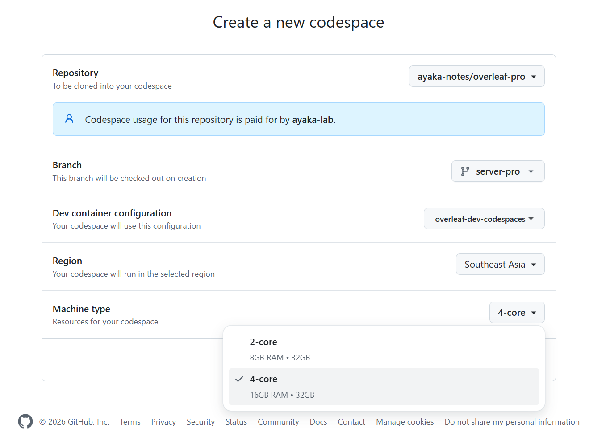

時間を節約し、開発環境を素早く構築できるよう、もう一つの開発環境構成として GitHub Codespace を用意しています。

## 設定チュートリアル {#configuration-tutorial}

<Steps>
<Step title="Codespaces を作成する">
以下のボタンをクリックして、server-pro 開発用のクラウド Codespaces を作成します。

[](https://codespaces.new/ayaka-notes/ayakaleaf-pro)

**Machine Type** は少なくとも **4-core** を選択することをおすすめします。より大きなマシンタイプが必要な場合は、[こちら](https://support.github.com/contact?tags=rr-codespaces%2Ccat_codespaces)から GitHub の公式サポートチームにチケットを提出してリクエストできます。

<Frame>
  
</Frame>
</Step>

<Step title="セットアップスクリプトを実行する">
Codespace が作成されるまで、しばらくお待ちください。ターミナルにアクセスできるようになったら、次のコマンドを実行します。

```text
cd develop/
bin/setup
bin/i18n
```

`bin/setup` はイメージを pull してサービスを起動します。続いて `bin/i18n` が、コミット済みのロケールファイルに含まれていない Ayakaleaf Pro モジュールの翻訳を適用します。[i18n 翻訳を更新する](/ja/dev/environment/update-i18n-translations)を参照してください。

<Frame>
  
</Frame>

<Warning>

このスクリプト（`bin/setup`）を使うと、`server-pro` ブランチの最新コミットで開発環境を最短時間でセットアップできます。古いバージョンや他のブランチには適用できない場合があります。

開発用 Docker イメージは [GitHub Action](https://github.com/ayaka-notes/ayakaleaf-pro/actions) で毎日ビルドしています。

</Warning>
</Step>

<Step title="Launchpad にアクセスする">
ポートタブに切り替えると、利用可能な Web ポートの一覧が表示されます。`80`（`develop/dev.rc` の `OVERLEAF_PORT`）のものをクリックすると、Launchpad ページが表示されます。Mailpit、Grafana、Mongo Express、RedisInsight は同じポートのパス（`/mailpit/`、`/grafana/`、`/mongo-express/`、`/redis-insight/`）にあり、ログイン後はサイトの **Dev tools** メニューからリンクされます。RustFS コンソールは 9001、Hoppscotch は 9170 です。[ポート](/ja/dev/environment/setup-develop-environment-local#ports)を参照してください。

<Frame>
  
</Frame>

次のように表示されます。

<Frame>
  
</Frame>
</Step>

<Step title="開発を楽しむ">
さあ、ここからはあなたの時間です！素晴らしい機能の開発を始めましょう。`bin/setup` はすでにすべてのサービスを開発モード（`bin/dev` と同じ `node --watch`）で起動しているため、コードの変更は追加のコマンドなしで反映されます。

`develop/dev.rc` を変更したら、`bin/setup` をもう一度実行してください。`bin/setup` は、オンになっている機能のファイルを追加する `bin/docker-compose` を経由します。

<Warning>

`docker compose -f docker-compose.yml -f docker-compose.dev.yml -f docker-compose.image.yml up` でサービスを手動で起動しないでください。このコマンドは `dev.rc` の機能ファイルを読み飛ばすため、`web`、`filestore`、`history-v1` が RustFS の設定なしで再作成され、ローカルボリュームにフォールバックします。そこにはプロジェクトの履歴とバイナリファイルがありません。

</Warning>
</Step>
</Steps>
