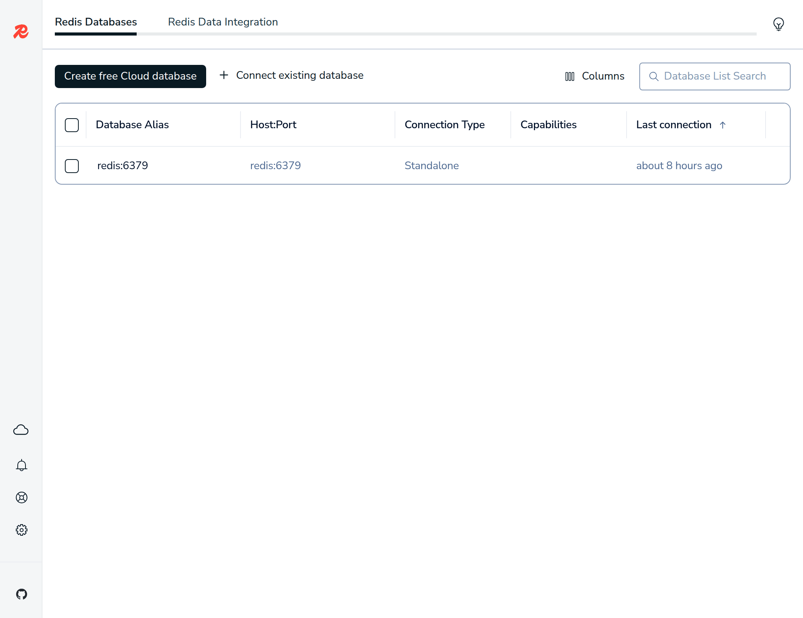

## 推奨開発ツール {#develop-tools-recommended}

これらのオプションのサービスは Overleaf の実行には必要ありませんが、開発、デバッグ、データの調査に大いに役立ちます。すべて開発環境の一部なので、`docker-compose.yml` に追加するものはありません。サイトにログインすると、ナビゲーションバーの **Dev tools** メニューから、サイトが独自のパスで提供しているツールにリンクされます。

| ツール | アドレス | 定義場所 |
| --- | --- | --- |
| **Grafana**, すべてのサービスの状態、メトリクス、ログ | [http://localhost/grafana/](http://localhost/grafana/) | `develop/grafana/docker-compose.yml`, `develop/dev.rc` で `GRAFANA_ENABLED=true` のとき有効（デフォルト） |
| **Mailpit**, サイトが送信するすべてのメールの受信箱 | [http://localhost/mailpit/](http://localhost/mailpit/) | `develop/mail/docker-compose.yml`, `MAILPIT_ENABLED=true` のとき有効（デフォルト） |
| **Mongo Express**, MongoDB の UI | [http://localhost/mongo-express/](http://localhost/mongo-express/) | `develop/docker-compose.yml`, 常に有効 |
| **RedisInsight**, Redis データの UI | [http://localhost/redis-insight/](http://localhost/redis-insight/) | `develop/docker-compose.yml`, 常に有効 |
| **Hoppscotch**, Postman に似たブラウザベースの API クライアント | [http://localhost:9170](http://localhost:9170/) (`HOPPSCOTCH_PORT`) | `develop/hoppscotch/docker-compose.yml`, `HOPPSCOTCH_ENABLED=true` のとき有効（デフォルト） |

<Warning>

これらのツールにはいずれもログインがありません。Grafana の匿名ユーザーは管理者であり、Mongo Express は任意のドキュメントを変更できます。サイト、Hoppscotch、Mongo Express（8081）、RedisInsight（5540）はホストの `127.0.0.1` のみで待ち受けるため、他のホストからはアクセスできません。

</Warning>

### Grafana {#grafana}

Grafana は webpack-dev-server を通じてサイトの `/grafana/` で提供されるため、専用のポートは不要です。**Overleaf Develop** フォルダーには次のダッシュボードがあります。

| ダッシュボード | 表示内容 |
| --- | --- |
| All services (ホーム) | すべてのサービスの状態、ホストのゲージ、負荷、ログ。サービスをクリックするとそのダッシュボードが開きます |
| Server | ホストの CPU、負荷、メモリー、ディスク、ネットワーク、および clsi のコンパイル |
| Errors | エラーログ、5xx と 4xx のレスポンス、最も頻繁なエラーメッセージ、失敗しているルート |
| Data flow | 編集の経路：document-updater と Redis、project-history、history-v1、Mongo、オブジェクトストア |
| Containers | すべてのコンテナの状態、CPU、メモリー、ネットワーク、ディスク（Sandbox Compiles を含む） |
| サービスごとに 1 つ | Node.js サービス、git-bridge（JVM）、mongo、redis |

<Columns cols={2}>
<Column>

<Frame caption="All services：すべてのサービスの状態、ホスト、各サービスが使うリソース">
  
</Frame>

</Column>

<Column>

<Frame caption="Data flow：document-updater から project-history を経て history-v1 と Mongo へ向かう編集">
  
</Frame>

</Column>
</Columns>

Prometheus はサービスの `/metrics`、`mongodb-exporter`、`redis-exporter`、`cadvisor`、`node-exporter` を収集します。Alloy はプロジェクトのすべてのコンテナのログを Loki に送り、ダッシュボードの **Log search**、**Service**、**Log level** フィルターがそれを読み取ります。これらのデータはコンテナ内にしかないため、コンテナを再作成すると空になります。cAdvisor は特権モードで動作し、ホストの `/`、`/sys`、Docker データ、containerd ソケットを読み取り専用で読みます。node-exporter はホストの `/` を読みます。

ダッシュボードは生成されたものです。JSON ファイルを編集する代わりに、`develop/grafana/make-dashboards` を変更して実行してください。

### Mailpit {#mailpit}

`MAILPIT_ENABLED=true` の場合、`web` はすべてのメールを実際のメールサーバーではなく Mailpit に送り、メール確認が有効になります（`EMAIL_CONFIRMATION_DISABLED=false`）。有効化リンク、プロジェクトへの招待、パスワードリセット、確認コードを受信箱からたどれます。

<Frame caption="Mailpit の有効化メール、プロジェクト招待、確認コード、パスワードリセット">
  
</Frame>

Mailpit にはボリュームがありません。コンテナを再作成すると受信箱は空になります。

### Mongo Express {#mongo-express}

Mongo Express は `sharelatex` データベースのコレクションを表示し、そのドキュメントの閲覧、編集、インポート、エクスポートができます。

<Frame caption="Mongo Express の sharelatex データベースのコレクション">
  
</Frame>

### RedisInsight {#redisinsight}

RedisInsight は接続情報を `develop/data/redis-insight` に保存します。初回は **Connect existing database** を選び、ホストに `redis`、ポートに `6379` を入力してください。

<Frame caption="redis サービスに接続した RedisInsight">
  
</Frame>

### Hoppscotch のセットアップ {#setup-hoppscotch}

#### API リクエストのプロキシ {#proxy-api-request}

Hoppscotch はブラウザからリクエストを送信しますが、ブラウザは Docker 名でサービスに到達できません。そのプロキシである Proxyscotch は Docker ネットワーク内で動作し、Hoppscotch のアドレスの `/proxy` で提供されます。[http://localhost:9170](http://localhost:9170/) を開き、Settings → Interceptor で **Proxy** を選び、Proxy URL を `http://localhost:9170/proxy` に設定します。この設定はブラウザに保存されます。

<Frame caption="Interceptor の設定。スクリーンショットは古い構成のものです。Proxy URL には `http://localhost:9170/proxy` を使用してください。">
  
</Frame>

これで [http://web:3000/status](http://web:3000/status) にリクエストを送り、web が稼働しているかを確認できます。

<Frame>
  
</Frame>

#### サービス API をインポートする {#import-the-service-apis}

`develop/hoppscotch/openapi/` には、各サービスの内部 API の OpenAPI ファイルがあります。Hoppscotch で Collections → Import → Import from File を開き、すべてのファイルを一度に選択します。各ファイルは、リクエストがサービスの Docker アドレスに送られるコレクションになります。同じファイルは [サービス API](/ja/dev/service-api/overview) セクションに表示されています。

#### CSRF の問題 {#csrf-problems}

<Warning>

Postman などのデバッグツールで **POST** リクエストを送信すると、ログインが **forbidden** になり、403 エラーが返されることがあります。これは Overleaf が **CSRF** 検証によって保護されているためです。

</Warning>

<Frame>
  
</Frame>

コンソールには次のように表示される場合があります。

<Frame>
  
</Frame>

Overleaf の開発でこれに対処するには、CSRF トークンを設定する必要があります。以下に詳しい手順を示します。

<Steps>
<Step title="Pre-Request を追加する">
Pre-Request に次のコードを追加します。

<Frame>
  
</Frame>

スクリプトは以下のとおりです。

```js wrap
pm.sendRequest("http://web:3000/dev/csrf", function (err, res) {
    if (err) {
        console.log(err);
        return;
    }

    // 1) Save CSRF token (/dev/csrf)
    const token = res.text().trim();
    pw.env.set("csrftoken", token);
    console.log("csrftoken =", token);

    const setCookieHeader = (res.headers || []).find(h => h.key?.toLowerCase() === "set-cookie")?.value;
    console.log("set-cookie =", setCookieHeader);

    if (!setCookieHeader) return;

    const cookiePair = setCookieHeader.split(";")[0].trim(); // overleaf.sid=...
    pw.env.set("cookie_header", cookiePair);
    console.log("cookie_header =", cookiePair);
});
```
</Step>

<Step title="リクエストヘッダーを追加する">
以下のヘッダーを追加する必要があります。

| ヘッダー名   | ヘッダー値          |
| ------------ | ------------------- |
| Content-Type | `application/json`  |
| X-Csrf-Token | `<<csrftoken>>`     |
| Cookie       | `<<cookie_header>>` |

<Frame>
  
</Frame>
</Step>

<Step title="API ツールでログインする">
これでユーザー名とパスワードでログインできます。

```json5
{
  "_csrf": "<<csrftoken>>",
  "email": "admin@overleaf.com",
  "password": "xxxxxx"
}
```

以下は、誤ったユーザー名またはパスワードを入力した場合のレスポンスです。

<Frame>
  
</Frame>
</Step>
</Steps>
