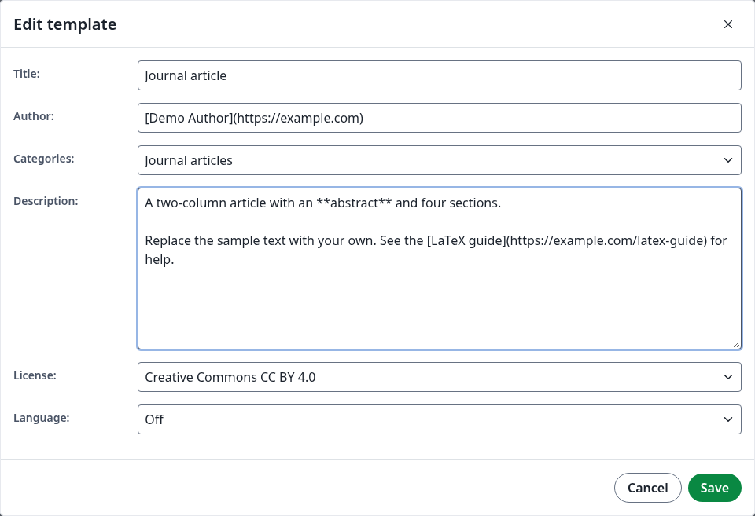

テンプレートはエディターから公開し、ギャラリーのテンプレートページまたは管理パネルで管理します。

<Info>

ギャラリーを有効にする、カテゴリを選ぶ、または管理者ではないユーザーに公開を許可するには、[テンプレート](/ja/on-premises/configuration/overleaf-toolkit/templates)を参照してください。

</Info>

## プロジェクトを公開する {#publish-a-project}

<Steps>
<Step title="プロジェクトをコンパイルする">
プロジェクトを開き、**Recompile** をクリックします。表示されている PDF が、ギャラリーに表示される PDF です。

コンパイルできないプロジェクトを開いたときなど、エディターに PDF がない間は **Manage Template** がグレー表示になります。

<Frame caption="PDF がまだないため、公開できません">
  
</Frame>

<Warning>

公開すると、現在のファイルと、最後に成功したコンパイルの PDF が保存されます。そのコンパイルの後にプロジェクトを編集した場合や、最後のコンパイルが失敗した場合、ギャラリーには新しいファイルの横に古い PDF が表示され、そのファイルはコンパイルできない可能性があります。PDF が正しくなるまで再コンパイルしてから公開してください。

</Warning>
</Step>

<Step title="フォームを開く">
エディターの上部メニューで **File** をクリックし、**Manage Template** をクリックします。

<Frame caption="File メニュー">
  
</Frame>
</Step>

<Step title="フォームに入力する">
<Frame caption="Manage Template ダイアログ">
  
</Frame>

| フィールド | 説明 |
| --- | --- |
| **Title** | 初期値はプロジェクト名です。ギャラリー内で一意である必要があります。最大 150 文字です。 |
| **Author** | 初期値はあなたの名前です。`[Demo Author](https://example.com)` のような Markdown リンクは、テンプレートページでリンクになります。 |
| **Categories** | 1 つのカテゴリです。[カテゴリ](/ja/on-premises/user-guide/administrators/template-management#categories)を参照してください。 |
| **Description** | Markdown に対応しています。最大 4096 文字です。テンプレートページでは **Abstract** として表示され、ギャラリーでは冒頭部分がプレーンテキストで表示されます。 |
| **License** | **Creative Commons CC BY 4.0**、**LaTeX Project Public License 1.3c**、または <strong>Other (as stated in the work)</strong>。 |

プロジェクトのコンパイラーとメインドキュメントはテンプレートに引き継がれるため、先にプロジェクトで設定しておいてください。テンプレートから開いたプロジェクトは同じものを使用します。
</Step>

<Step title="Publish をクリックする">
テンプレートページが開きます。

<Frame caption="新しいテンプレート">
  
</Frame>

**Admin: Source Project**、**Edit**、**Delete** はあなただけに表示されます。他のユーザーには **Open as Template**、**View PDF**、ダウンロードボタンだけが表示されます。
</Step>

<Step title="ギャラリーを確認する">
右上の **Templates** をクリックします。新しいテンプレートが一覧の先頭にあります。
</Step>
</Steps>

## カテゴリ {#categories}

テンプレートは 1 つのカテゴリに属します。名前と説明は[設定](/ja/on-premises/configuration/overleaf-toolkit/templates#configuration)から読み込まれ、サイト上では変更できません。

カテゴリは次の場所に表示されます。

* フォームの **Categories**。
* ギャラリーページ `/templates` の上部にあるカード。**All templates** ページで **Template Gallery** をクリックすると移動できます。
* 各カテゴリのページ（例: `/templates/presentation`）。テンプレートのないカテゴリには <strong>No Templates.</strong> と表示されます。
* プロジェクトページの **New project** から **More templates**。
* テンプレートページのタイトルの上にあるリンク。

<Frame caption="ギャラリーページのカテゴリ">
  
</Frame>

フォームで **All templates** を選ぶと、独自のカテゴリを持たないことになり、テンプレートは全体の一覧にのみ表示されます。

## テンプレートを更新する {#update-a-template}

ファイルと PDF を変更するには、同じタイトルでプロジェクトを再度公開します。

<Steps>
<Step title="プロジェクトを変更する">
プロジェクトを編集し、**Recompile** をクリックします。
</Step>

<Step title="再度公開する">
**File** をクリックし、**Manage Template** をクリックします。フォームにはテンプレートの詳細が表示され、変更できます。**Publish** をクリックします。

タイトルがすでに存在するというメッセージが表示され、ボタンが **Overwrite** に変わります。

<Frame caption="同じタイトルで公開する">
  
</Frame>

ここで **Title** を変更するとメッセージが消え、**Publish** で新しいテンプレートが作成されます。
</Step>

<Step title="Overwrite をクリックする">
同じテンプレートページが新しい PDF で開きます。

<Frame caption="更新されたテンプレート">
  
</Frame>

ユーザーがすでにテンプレートから開いたプロジェクトは変わりません。
</Step>
</Steps>

<Warning>

フォームはプロジェクト名でテンプレートを探します。**Edit** でテンプレートの名前を変更した場合、フォームはプロジェクト名、あなたの名前、最初のカテゴリ、空の説明で開き、テンプレートのタイトルを入力しても詳細は戻りません。その状態で **Overwrite** すると詳細がフォームの内容に置き換わるため、先に入力し直してください。

</Warning>

## 詳細を編集する {#edit-the-details}

ギャラリーに表示されるテンプレートの情報を変更します。ファイルや PDF は変わりません。

<Steps>
<Step title="テンプレートを開く">
右上の **Templates** をクリックし、テンプレートをクリックしてから **Edit** をクリックします。
</Step>

<Step title="フィールドを変更する">
フィールドは公開時と同じですが、1 つ追加されています。**Language** は、テンプレートから開いたプロジェクトのスペルチェック言語です。既定の言語で公開されたプロジェクトでは **Off** と表示され、そこから開いたプロジェクトは <strong>English (American)</strong> を使用します。

<Frame caption="Edit template ダイアログ">
  
</Frame>

他のテンプレートと同じタイトルは受け付けられません。**Title** を変更するまで **Save** はグレー表示のままです。
</Step>

<Step title="Save をクリックする">
ダイアログが閉じ、テンプレートページに新しい詳細が表示されます。
</Step>
</Steps>

## ソースプロジェクト {#the-source-project}

**Admin: Source Project** は、テンプレートの公開元のプロジェクトを開きます。

テンプレートはファイルのコピーを独自に保持しています。プロジェクトを完全に削除するとボタンは消えますが、ユーザーは引き続きテンプレートを開けます。**Trash** にあるだけのプロジェクトではボタンは残ります。[テンプレート](/ja/on-premises/configuration/overleaf-toolkit/templates)の Q&A も参照してください。

## テンプレートを削除する {#delete-a-template}

<Steps>
<Step title="Delete をクリックする">
テンプレートページで **Delete** をクリックします。ダイアログにテンプレートの名前が表示されます。

<Frame caption="Delete template ダイアログ">
  
</Frame>
</Step>

<Step title="Confirm をクリックする">
元のページに戻り、テンプレートはギャラリーから消えます。そのリンクには **Not found** と表示されるようになります。

ソースプロジェクトは残り、ユーザーがテンプレートから開いたプロジェクトも残ります。
</Step>
</Steps>

## 管理パネルでテンプレートを管理する {#manage-templates-in-the-admin-panel}

**Admin** をクリックし、**Project/Object Lookup** をクリックしてから **Templates** タブをクリックします。すべてのテンプレートが作者とオーナーとともに一覧表示され、検索できます。

<Frame caption="管理パネルのすべてのテンプレート">
  
</Frame>

* タイトルをクリックするとテンプレートページが開き、開くアイコンをクリックすると新しいタブで開きます。
* オーナーをクリックすると、そのユーザーのページが開きます。
* ゴミ箱アイコンをクリックしてから **Delete** をクリックすると、テンプレートを削除できます。ダイアログには元に戻せないという警告が表示され、テンプレートはギャラリーから消えます。

## 公開が拒否された場合 {#if-publishing-is-refused}

フォームにはサイトが受け付けるよりも長い内容を入力できます。**Title** が 150 文字を超えると `Template title exceeds the maximum length of 150 characters.` と表示され、**Description** が 4096 文字を超えると `Template description exceeds the maximum length of 4096 characters.` と表示されます。

その後はテキストを短くしても **Publish** はグレー表示のままです。**Cancel** をクリックし、**File**、**Manage Template** の順にクリックして、フォームに入力し直してください。
