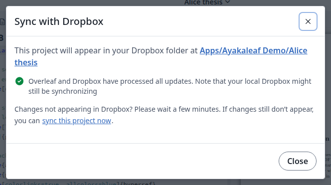

すべてのプロジェクトを Dropbox 内のフォルダーと同期させます。変更はバックグラウンドで双方向に反映されますが、1 つ例外があります。エディターで入力した内容は、プロジェクトを離れてから数分後、または **sync this project now** をクリックしたときに Dropbox に届きます。

<Info>

**Account settings** やエディターに Dropbox のオプションが表示されない場合は、管理者に [Dropbox 同期](/ja/on-premises/configuration/overleaf-toolkit/integrations/dropbox-synchronisation) を有効にするよう依頼してください。

</Info>

## Dropbox アカウントをリンクする {#link-your-dropbox-account}

これは一度だけ行います。

<Steps>
<Step title="アカウント設定を開く">
**Account**、続いて **Account settings** をクリックします。**Project synchronisation** の下で **Dropbox** を探し、**Link** をクリックします。

<Frame caption="アカウント設定の Dropbox">
  
</Frame>
</Step>

<Step title="Dropbox で承認する">
Dropbox が開きます。求められたらサインインし、アプリケーションを承認します。
</Step>

<Step title="リンクを確認する">
アカウント設定に戻ります。Dropbox アカウントがリンクされたことを示す緑色のメッセージが表示され、ボタンが **Unlink** に変わっています。Dropbox の下に、プロジェクトの送信中であることを示すステータスが表示されます。

<Frame caption="Dropbox アカウントがリンクされた状態">
  
</Frame>

すべて届くと、ステータスは **Overleaf and Dropbox have processed all updates** に変わります。

<Frame caption="すべて同期済み">
  
</Frame>
</Step>
</Steps>

アカウントがまだリンクされていない場合、エディターの **Dropbox** カードは、まずリンクするよう求めます。**Update Dropbox Settings** をクリックすると、新しいタブでアカウント設定が開きます。そこでアカウントをリンクし、ダイアログの指示どおりにエディターのページを再読み込みしてください。

<Frame caption="アカウントがリンクされていないときの案内">
  
</Frame>

Dropbox でアクセスを許可しなかった場合は、メッセージなしでアカウント設定に戻り、ボタンは **Link** のままです。

### 同じ名前のプロジェクトがある場合 {#if-you-have-projects-with-the-same-name}

同じ名前のプロジェクトが 2 つある間は、リンクできません。メッセージにそれらの名前が表示されます。アーカイブ済みのプロジェクトやゴミ箱内のプロジェクトも対象です。

<Frame caption="同じ名前の 2 つのプロジェクト">
  
</Frame>

どちらかの名前を変更して、もう一度 **Link** をクリックしてください。

## Dropbox でプロジェクトを見つける {#find-your-projects-in-dropbox}

各プロジェクトは、Dropbox の `Apps/<app name>/` 内にあるフォルダーで、すべてのファイルを含みます。アプリ名は管理者が決めています。すべてのプロジェクトが同期され、後から作成するプロジェクトも対象です。一部だけを選ぶことはできません。

プロジェクトのフォルダーを確認するには、プロジェクトを開きます。左側のバーで **Integrations**、続いて **Dropbox** をクリックします。

<Frame caption="Integrations パネル">
  
</Frame>

ダイアログにフォルダー名が表示され、Dropbox 上のフォルダーへのリンクがあります。

<Frame caption="このプロジェクトのフォルダー">
  
</Frame>

既存のプロジェクトと同じ名前の新しいプロジェクトには、`Field notes (1)` のような番号付きのフォルダーが割り当てられます。どれがそのフォルダーかはダイアログに表示されます。

<Frame caption="番号付きのフォルダー">
  
</Frame>

## Overleaf で行った変更 {#changes-you-make-in-overleaf}

何もクリックする必要はありません。

* **新しいファイル、名前の変更、移動、削除**はすぐに Dropbox に反映されます。新しいフォルダーは、最初のファイルとともに Dropbox に現れます。
* **プロジェクトの名前を変更する**と、そのフォルダーの名前も変わります。
* **エディターで入力した編集内容**は、プロジェクトが開いている間は Dropbox に届かず、**Recompile** をクリックしても送信されません。全員がプロジェクトを離れてから約 3 分後に送信されます。早めに送信するには、[同期を強制する](#force-a-sync) を参照してください。
* **プロジェクトを削除しても**、そのフォルダーは Dropbox に残ります。不要であれば、フォルダーは自分で削除してください。

## Dropbox で行った変更 {#changes-you-make-in-dropbox}

こちらも何もクリックする必要はありません。Dropbox が Overleaf に変更を通知し、通常は数秒以内に反映されます。開いているエディターでも、再読み込みは不要です。

* プロジェクトフォルダー内の**新しいファイル、編集、名前の変更、削除**はプロジェクトに適用されます。新しいフォルダーも同様です。
* **アプリフォルダーの最上位にある新しいフォルダー**は、新しいプロジェクトになります。
* **Overleaf が同期しないファイル**（`.DS_Store` や `.aux` ファイルなど）は、Dropbox にのみ残ります。

プロジェクトの履歴では、これらの変更に <strong>(via Dropbox)</strong> と表示されます。

### ファイルがエディターで開いている場合 {#if-the-file-is-open-in-the-editor}

ファイルが目の前で変わり、ダイアログでそのことが通知されます。**OK** をクリックします。

<Frame caption="開いているファイルが Dropbox で変更された">
  
</Frame>

Dropbox 版が、入力済みでまだ送信されていない内容を置き換えます。テキストは失われず、プロジェクトの履歴に残ります。

<Frame caption="履歴に残る置き換えられたテキスト">
  
</Frame>

### プロジェクトフォルダーの名前を変更または削除する {#rename-or-delete-a-project-folder}

プロジェクトの名前は、Dropbox ではなく Overleaf で変更してください。Overleaf にとって、Dropbox で名前を変更したフォルダーは、削除されたフォルダーと新しいフォルダーです。新しい名前の新しいプロジェクトができ、古いプロジェクトも残ります。

Dropbox でプロジェクトフォルダーを削除しても、プロジェクトはファイルと履歴とともにプロジェクト一覧に残ります。次にそのプロジェクトを開くと、ダイアログで一度だけ通知されます。**OK** をクリックします。

<Frame caption="このプロジェクトのフォルダーが Dropbox から消えた">
  
</Frame>

プロジェクトは引き続き同期されます。プロジェクト全体を Dropbox に戻すには、**sync this project now** をクリックします。

### プロジェクトがアーカイブ済みまたはゴミ箱にある間 {#while-a-project-is-archived-or-in-the-trash}

Dropbox のそのフォルダーで行った変更は適用されず、プロジェクトを復元しても取り込まれません。その後 Overleaf は変更されたファイルの送信を止めるため、両側の内容が食い違います。そのようなファイルを Dropbox でもう一度保存してください。Dropbox 版が Overleaf 側の版を置き換えます。

## 同期を強制する {#force-a-sync}

各プロジェクトに専用のリンクがあります。プロジェクトを離れずに、編集内容をすぐに Dropbox に反映したいときに使います。

<Steps>
<Step title="同期ダイアログを開く">
プロジェクトを開きます。左側のバーで **Integrations**、続いて **Dropbox** をクリックします。
</Step>

<Step title="sync this project now をクリックする">
このリンクは <strong>Changes not appearing in Dropbox?</strong> の末尾にあります。
</Step>

<Step title="結果を確認する">
手動同期が開始されたことを示す青いメッセージが表示され、ステータスは **Sending and receiving updates** になります。同期が完了すると、**Overleaf and Dropbox have processed all updates** に戻ります。

<Frame caption="手動同期の実行中">
  
</Frame>
</Step>
</Steps>

このリンクは、エディターに残っている編集内容も含めて、プロジェクト全体を Dropbox に送信します。また、すべてのプロジェクトについて、Dropbox で待機中の変更を読み込みます。サイトが [Dropbox からの通知](/ja/on-premises/configuration/overleaf-toolkit/integrations/dropbox-synchronisation#webhook) を受信できない場合、Dropbox からの変更はこの方法でしか取り込まれません。

この操作は、プロジェクトごとに 1 分に 1 回行えます。それより早いと、赤いメッセージで待つよう求められます。

<Frame caption="次の同期まで 1 分待つ">
  
</Frame>

## Dropbox アカウントのリンクを解除する {#unlink-your-dropbox-account}

<Steps>
<Step title="Unlink をクリックする">
**Account settings** の **Dropbox** で **Unlink** をクリックします。
</Step>

<Step title="確認する">
ダイアログで **Unlink** をクリックします。

<Frame caption="アカウントのリンクを解除する">
  
</Frame>
</Step>

<Step title="結果を確認する">
ボタンは再び **Link** になり、エディターの **Dropbox** カードにはアカウントがリンクされていないと表示されます。どちらの方向にも同期されなくなります。プロジェクトと Dropbox のフォルダーは、どちらもファイルを保持します。
</Step>
</Steps>

### 後で再度リンクする {#link-again-later}

**Link** をクリックします。プロジェクトが再び Dropbox に送信されます。

* 各ファイルは、Dropbox 内の同じ名前のファイルを置き換えます。リンク解除中に Dropbox でそれらのファイルに加えた変更は上書きされるため、先にその変更をプロジェクトに移してください。
* Dropbox にしかないファイルはそのまま残り、次に変更したときにプロジェクトに取り込まれます。
* リンク解除中に名前を変更したプロジェクトには、新しいフォルダーが割り当てられます。古いフォルダーは残ります。

### Overleaf がアカウントのリンクを解除した場合 {#if-overleaf-unlinks-your-account}

Dropbox がリンクを受け付けなくなると、Overleaf はアカウントのリンクを解除します。再度リンクするまで、プロジェクト一覧にその理由が表示されます。

<Frame caption="アカウントのリンクが解除された">
  
</Frame>

理由については、[Dropbox 同期](/ja/on-premises/configuration/overleaf-toolkit/integrations/dropbox-synchronisation) の Q\&A を参照してください。

<Info>

共有プロジェクトの共同編集者に何が反映されるかについては、[同期の仕組み](/ja/on-premises/configuration/overleaf-toolkit/integrations/dropbox-synchronisation#同期の仕組み) を参照してください。

</Info>
