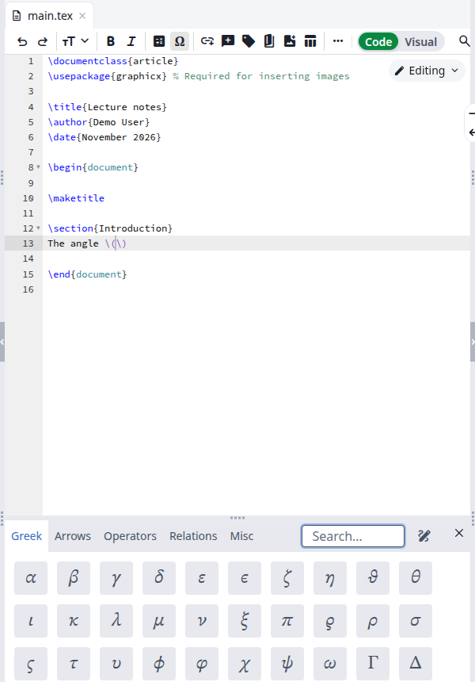

記号パレットは、ドキュメントに数式記号を挿入します。記号の名前がわからない場合は手描きすると、ブラウザーがコマンドを見つけます。設定は不要です。

## 記号を挿入する {#insert-a-symbol}

<Steps>
<Step title="カーソルを数式の中に置く">
ほとんどの記号は数式の中でのみ機能します。記号を入れたい場所をクリックします。エディターのツールバーで **Insert math** をクリックし、**Inline** をクリックします。カーソルが `\(` と `\)` の間に置かれます。

<Frame caption="Insert math メニュー">
  
</Frame>
</Step>

<Step title="パレットを開く">
ツールバーで **Ω** ボタン（**Insert symbol**）をクリックします。ページ上部の **Insert** から **Symbol** をクリックしても開けます。パレットはエディターの下に開きます。

<Frame caption="記号パレット">
  
</Frame>
</Step>

<Step title="記号を探す">
タブをクリックします: **Greek**、**Arrows**、**Operators**、**Relations**、**Misc**。記号にポインターを合わせると、名前とコマンドが表示されます。必要なパッケージなど、注記が表示される記号もあります。

<Frame caption="記号の名前、コマンド、注記">
  
</Frame>
</Step>

<Step title="クリックする">
カーソル位置にコマンドが入ります。パレットは開いたままなので、すぐに次の記号を追加できます。**Recompile** をクリックすると、PDF で記号を確認できます。

<Frame caption="ドキュメントと PDF の記号">
  
</Frame>
</Step>
</Steps>

パレットは **Visual** エディターでも同じように機能します。

## 記号を検索する {#search-for-a-symbol}

**Search** ボックスに入力します。コマンド（`\sum`）、記号名に含まれる単語（`arrow`）、文字そのもの（`α`）で検索できます。検索はすべてのタブが対象です。ボックスを空にするとタブに戻ります。

<Frame caption="arrow を検索する">
  
</Frame>

一致するものがない場合、パレットには **No symbols found** と表示されます。

## 記号を手描きする {#draw-a-symbol}

記号の形は思い浮かぶものの名前がわからないときに使います。

<Steps>
<Step title="鉛筆アイコンをクリックする">
**Search** ボックスの右にある鉛筆アイコン（**Draw a symbol**）をクリックします。タブがグレー表示になり、右側に破線の枠が表示されます。

認識の準備ができるまで <strong>Loading model…</strong> と表示されます。初回は、ブラウザーがサイトから約 40 MB をダウンロードします。その後はブラウザーがこれらのファイルを保持します。

<Frame caption="手描きモード">
  
</Frame>
</Step>

<Step title="破線の枠の中に描く">
1 画描き終えるごとに、左側に最大 10 件の候補が近い順に表示されます。候補にポインターを合わせるとコマンドが表示されます。複数画の記号では、1 画ごとに候補が更新されます。

<Frame caption="手描きの候補">
  
</Frame>
</Step>

<Step title="候補をクリックする">
カーソル位置にコマンドが入ります。描いたものは残るので、別の候補を試せます。次の記号を描く前に **Clear** をクリックしてください。

<Frame caption="カーソル位置のコマンド">
  
</Frame>
</Step>
</Steps>

タブに戻るには、鉛筆アイコンをもう一度クリックするか、**Search** ボックスをクリックします。

認識はブラウザー内で実行されます。描いたものがサイトに送信されることはありません。

### パッケージが必要な候補 {#matches-that-need-a-package}

手描きでは 1,300 以上のコマンドを認識できますが、タブに表示されるのは 117 個です。それ以外の多くは LaTeX パッケージに含まれています。その場合、ツールチップに追加すべき行が表示されます。

<Frame caption="パッケージが必要な候補">
  
</Frame>

その行をプリアンブルの `\begin{document}` より前に追加します。

```latex
\usepackage{amssymb}
```

パレットが自動で追加することはありません。

## キーボードを使う {#use-the-keyboard}

**Search** ボックスから、記号が選択されるまで Tab キーを押します。矢印キーで記号間を移動します。Enter キーを押すと選択した記号が挿入され、パレットが閉じます。

## パレットを閉じる {#close-the-palette}

パレット右上の <strong>×</strong> をクリックします。**Ω** ボタンや **Insert** の **Symbol** でも閉じられます。

## 問題が起きた場合 {#if-something-goes-wrong}

| 表示される内容 | 理由 | 対処方法 |
| ------------ | --- | ---------- |
| コンパイルで **Missing \$ inserted** と表示される | 記号が数式の外にある | `\(` と `\)` の間に移動するか、先に **Insert math** を使う |
| コンパイルで **Undefined control sequence** と表示される | コマンドにパッケージが必要 | パレットで記号にポインターを合わせて必要なパッケージを確認し、プリアンブルに追加する |
| 鉛筆アイコンがない | ブラウザーが認識を実行できない（例: Safari 15） | ブラウザーを更新するか、別のブラウザーを使う。タブと検索は引き続き使える |
| 破線の枠の下に **Recognition unavailable** と表示される | ブラウザーが認識ファイルを読み込めなかった | **Please try again** をクリックする |
