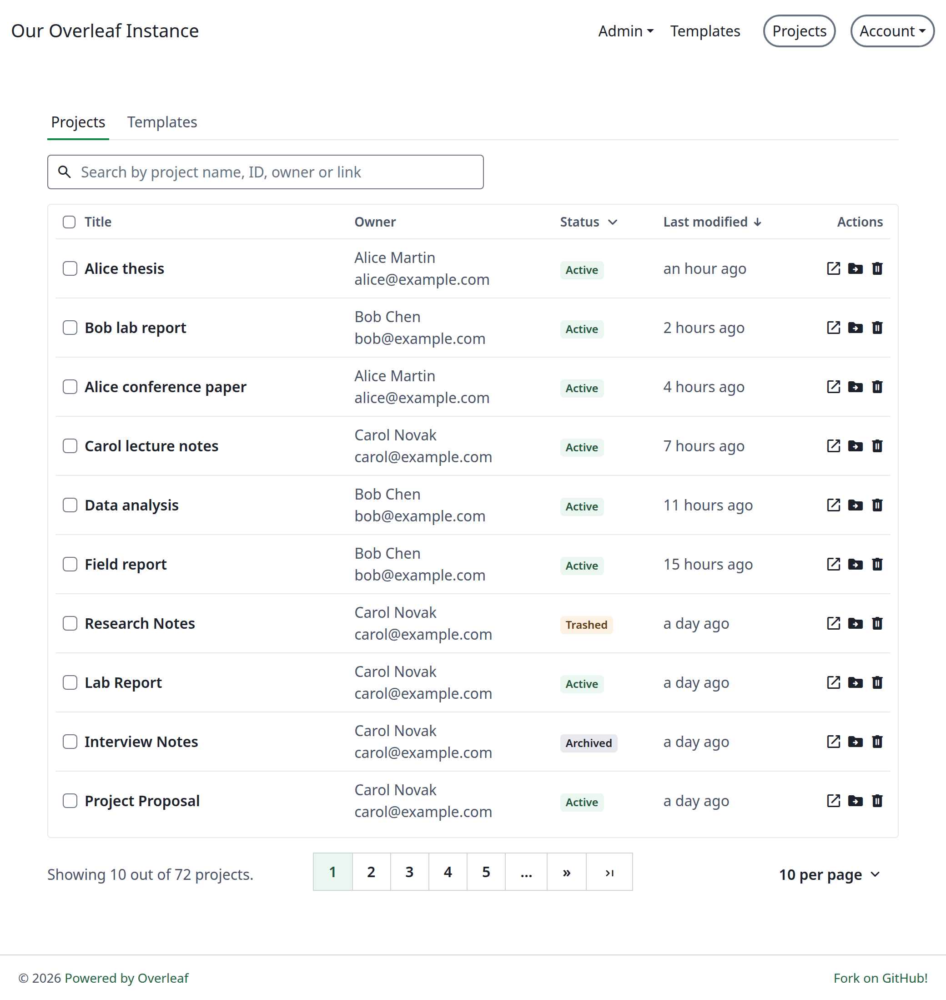
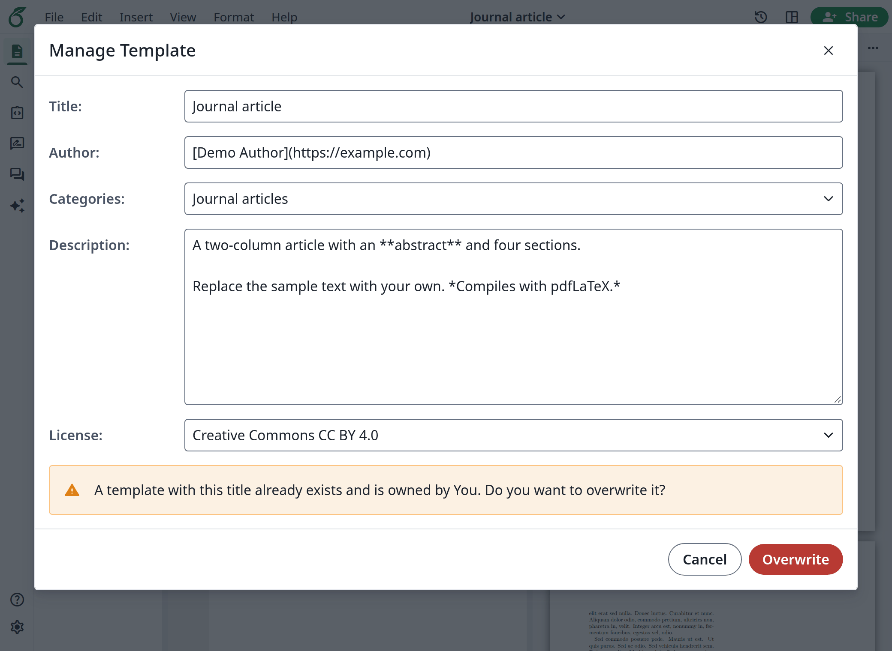

연구실이나 학과를 위해 Overleaf 인스턴스를 운영하다 보면 매주 같은 질문이 나옵니다. 이 학생은 왜 로그인할 수 없을까요? 아직 서버를 쓰는 사람은 누구일까요? 누가 저 계정에 관리자 권한을 줬을까요? 작년 학위 논문은 어디로 갔을까요? 데이터베이스 셸을 열지 않고도 이런 질문에 답할 수 있도록 관리자 패널을 새로 만들었습니다.

새 패널은 Overleaf 6.3의 디자인을 따르며 인터페이스가 지원하는 모든 언어로 번역되어 있습니다. 모든 사용자 목록, 모든 프로젝트 목록, 각각의 상세 페이지, 템플릿을 관리하는 공간, 그리고 감사 로그를 제공합니다.

<Info>

새 관리자 패널은 메인 브랜치에 병합되었으며 v6.4.0에서 정식 출시됩니다. 이 글의 모든 스크린샷은 가상의 계정으로 채운 테스트 인스턴스에서 가져왔습니다.

</Info>

### 포함된 기능 {#what’s-in-it}

* **사용자 목록**: 검색, 로그인 방식·역할·상태별 필터, 일괄 작업.
* **사용자 페이지**: 한 사람의 계정, 프로젝트, 기능, 연동, 감사 로그, 세션.
* **프로젝트 목록**: 인스턴스의 모든 프로젝트. 이름, ID, 소유자, 공유 링크로 검색할 수 있습니다.
* **프로젝트 페이지**: 한 프로젝트의 설정, 파일, 멤버, 삭제된 파일, 감사 로그.
* **템플릿 관리**: 프로젝트를 템플릿으로 게시하고, 업데이트하고, 갤러리를 정리합니다.
* **감사 로그**: 누가, 언제, 어떤 IP 주소에서 무엇을 했는지.

## 모든 사용자를 하나의 목록으로 {#one-list-for-every-user}

**Admin**을 클릭한 다음 **Manage Users**를 클릭합니다. 각 계정은 한 행으로 표시되며 로그인 방식, 역할, 상태를 보여 줍니다.

<Frame caption="사용자 목록">
  
</Frame>

이름, 이메일, ID로 검색하세요. **Login**, **Role**, **Status** 헤더는 필터이며, 각 옵션에는 해당하는 계정 수가 표시됩니다. SAML로 들어오는 사람이 몇 명인지 한눈에 볼 수 있고, 각 OIDC 공급자는 여러분이 지정한 이름으로 나타납니다.

<Frame caption="로그인 방식으로 필터링">
  
</Frame>

모든 계정은 정확히 하나의 상태를 가지며, 네 가지 상태를 더하면 전체 수가 됩니다.

| 상태         | 의미                                                        |
| ------------ | ----------------------------------------------------------- |
| **Active**   | 지난 12개월 안에 로그인했거나 프로젝트를 열었습니다.        |
| **Pending**  | 한 번도 로그인하지 않았습니다.                              |
| **Inactive** | 예전에 로그인했지만 지난 12개월 동안은 로그인하지 않았습니다. |
| **Disabled** | 관리자가 계정의 로그인을 막았습니다.                        |

삭제된 계정은 별도의 필터에 있어 방해가 되지 않습니다. 검색 결과가 삭제된 계정과도 일치하면 표 위의 한 줄이 이를 알려 주고 표시할지 묻습니다.

<Frame caption="상태로 필터링">
  
</Frame>

검색, 정렬, 페이지 나누기가 서버에서 실행되므로 목록이 더 이상 처음 1,000행에서 멈추지 않습니다.

### 이메일이 있든 없든 사용자 맞이하기 {#bring-people-in-with-or-without-email}

**Create account**는 사용자를 추가하고 그 사용자에게 필요한 링크를 제공합니다. [이메일 전송](/ko/on-premises/configuration/overleaf-toolkit/email-delivery  "mention")이 설정되어 있지 않으면 대화 상자가 이를 분명히 알리고 링크를 복사할 수 있게 해 주므로, 작은 인스턴스에서도 새 사용자를 맞이할 수 있습니다.

<Frame caption="새 계정의 활성화 링크">
  
</Frame>

패널은 계정마다 알맞은 링크를 제공합니다. 한 번도 로그인하지 않은 계정에는 7일 동안 유효한 **Send activation email**을, 로그인한 적이 있는 계정에는 1시간 동안 유효한 **Send reset link**를 제공합니다. SSO로 로그인하는 계정은 로컬 비밀번호가 없으므로 둘 다 받지 않습니다.

### 여러 계정을 한 번에 변경하기 {#change-many-accounts-at-once}

몇몇 계정을 선택하면 도구 모음에 **Send activation email**, **Transfer this user's projects**, **Disable**, **Enable**, **Make admin**, **Remove admin**, **Delete account**가 나타납니다. 확인하기 전에 대화 상자가 대상 계정을 나열합니다. 일부가 실패하면 어떤 계정인지 알려 주며, 이미 성공한 작업은 그대로 유지됩니다.

<Frame caption="일괄 작업">
  
</Frame>

### 실수하기 어려운 설계 {#hard-to-get-wrong}

* 본인 계정에는 **You** 표시가 있고 작업이 회색으로 비활성화되어 있어, 자신을 비활성화하거나 삭제하거나 강등할 수 없습니다.
* 모든 작업은 계정 이름을 명시한 대화 상자에서 확인을 요청합니다.
* **Delete account**는 삭제 전에 사용자의 프로젝트를 다른 사람에게 넘길 수 있습니다.
* 삭제된 계정은 함께 삭제된 프로젝트와 함께 복원할 수 있습니다. **Delete permanently**만 되돌릴 수 없으며, 실행 전에 경고합니다.

## 한 사람에 관한 모든 것 {#everything-about-one-person}

이름을 클릭하면 사용자 페이지가 열립니다. 여섯 개의 탭이 있고 목록과 같은 작업 아이콘이 있습니다.

### 계정 {#account}

ID와 이메일부터 마지막 로그인과 그 IP 주소까지 계정의 세부 정보입니다. 연필 아이콘을 클릭하면 이메일, 이름, 비밀번호를 변경하거나 **Admin**을 켜고 끌 수 있습니다.

<Frame caption="계정 편집">
  
</Frame>

### 프로젝트 {#projects}

이 사람이 소유한 프로젝트로, 자체 검색, 상태 필터, 작업이 있습니다.

<Frame caption="사용자의 프로젝트">
  
</Frame>

### 기능 {#features}

프로젝트당 공동 작업자 수, 컴파일 제한 시간, 연동, AI 등 이 계정에 켜져 있는 기능과 함께, 계정의 AI 사용량과 이를 초기화하는 버튼이 있습니다.

<Frame caption="사용자의 기능">
  
</Frame>

### 연동 {#integrations}

이 사람의 Git 액세스 토큰과 연결한 서비스입니다.

<Frame caption="사용자의 연동">
  
</Frame>

### 세션 {#sessions}

이 사람이 로그인한 위치입니다. **Clear sessions**는 모든 곳에서 로그아웃시키며, 노트북을 잃어버렸을 때 가장 먼저 해야 할 일입니다.

<Frame caption="사용자의 세션">
  
</Frame>

## 인스턴스의 모든 프로젝트 {#every-project-on-the-instance}

**Admin**을 클릭한 다음 **Project/Object Lookup**을 클릭합니다. 목록에는 모든 사용자의 프로젝트가 소유자와 상태와 함께 표시됩니다. 검색 상자에는 프로젝트 이름, ID, 소유자 또는 링크를 입력할 수 있습니다. 공유 링크를 붙여 넣으면 그 뒤에 있는 프로젝트를 찾을 수 있습니다.

<Frame caption="모든 프로젝트">
  
</Frame>

**Status** 필터는 **Active**, **Archived**, **Trashed**, **Deleted** 프로젝트를 구분합니다. 여러 프로젝트를 선택해 하나의 `.zip` 파일로 다운로드하거나, 소유자를 변경하거나, 삭제할 수 있습니다. **Deleted** 보기에서는 버튼이 **Restore**와 **Delete permanently**입니다.

<Frame caption="상태로 프로젝트 필터링">
  
</Frame>

## 한 프로젝트에 관한 모든 것 {#everything-about-one-project}

프로젝트 제목을 클릭하면 해당 페이지가 열립니다.

### 개요 {#overview}

이름, 링크 공유, 컴파일러, TeX Live 버전, 기본 문서를 변경합니다. **Change project owner**는 프로젝트를 다른 사용자에게 넘기며, 누군가 연구실을 떠나도 학위 논문은 남아 있어야 할 때 유용합니다.

<Frame caption="프로젝트 편집">
  
</Frame>

### 파일 트리 {#file-tree}

프로젝트의 파일과 폴더를 읽기 전용으로 보여 줍니다.

<Frame caption="프로젝트의 파일">
  
</Frame>

### 멤버 {#members}

소유자, 공동 작업자, 대기 중인 초대입니다. 공동 작업자의 역할을 바꾸거나, 접근 권한을 제거하거나, 초대를 다시 보내거나 취소할 수 있습니다.

<Frame caption="프로젝트 멤버 변경">
  
</Frame>

### 삭제된 파일 {#deleted-files}

프로젝트에서 제거된 파일입니다. **Restore file**은 프로젝트의 루트 폴더에 사본을 넣고, 해당 행에 사본의 이름이 표시됩니다.

<Frame caption="복원된 파일">
  
</Frame>

## 템플릿 관리 {#template-management}

템플릿은 평범한 프로젝트에서 시작합니다. 편집기에서 게시하고, 갤러리의 템플릿 페이지나 관리자 패널에서 관리합니다.

### 모든 템플릿을 하나의 표로 {#all-templates-in-one-table}

**Admin**, **Project/Object Lookup**을 차례로 클릭한 다음 **Templates** 탭을 클릭합니다. 게시된 모든 템플릿이 작성자, 소유자, 마지막 변경 시각과 함께 나열되며 검색할 수 있습니다. 제목을 클릭하면 템플릿이 열리고, 소유자를 클릭하면 해당 사용자의 페이지가 열리며, 휴지통 아이콘을 클릭하면 템플릿을 삭제할 수 있습니다. 삭제는 [여러분 자신의 감사 로그](#when-there-is-no-log-left)에 기록됩니다.

<Frame caption="관리자 패널의 모든 템플릿">
  
</Frame>

### 편집기에서 게시하기 {#publish-from-the-editor}

프로젝트를 열고 PDF가 올바르게 보일 때까지 컴파일하세요. 갤러리에는 마지막으로 성공한 컴파일의 PDF가 표시되기 때문입니다. 그런 다음 **File**, **Manage Template**을 차례로 클릭하고 제목, 작성자, 카테고리, Markdown 형식의 설명, 라이선스를 입력합니다. 프로젝트의 컴파일러와 기본 문서가 템플릿에 함께 저장되므로, 템플릿에서 연 프로젝트도 같은 설정을 사용합니다.

<Frame caption="프로젝트를 템플릿으로 게시">
  
</Frame>

### 템플릿 업데이트 {#update-a-template}

템플릿의 파일과 PDF를 바꾸려면 같은 제목으로 프로젝트를 다시 게시하세요. 대화 상자가 제목이 이미 존재한다고 알려 주고 버튼이 **Overwrite**로 바뀝니다. 이미 템플릿에서 연 프로젝트는 바뀌지 않습니다.

<Frame caption="같은 제목으로 게시">
  
</Frame>

### 템플릿 페이지 {#the-template-page}

누구나 **Open as Template**, **View PDF**, 다운로드 버튼을 사용할 수 있습니다. 관리자에게는 **Admin: Source Project**, **Edit**, **Delete**도 표시됩니다.

<Frame caption="템플릿 페이지">
  
</Frame>

**Edit**는 갤러리에 표시되는 템플릿 정보, 즉 제목, 작성자, 카테고리, 설명, 라이선스와 템플릿에서 연 프로젝트의 맞춤법 검사 언어를 변경합니다. 파일이나 PDF는 건드리지 않습니다. 템플릿은 자체 파일 사본을 보관하므로 원본 프로젝트를 삭제해도 템플릿은 사라지지 않습니다.

<Frame caption="템플릿 세부 정보 편집">
  
</Frame>

### 사용자를 위한 갤러리 {#a-gallery-for-your-users}

갤러리를 열면 카테고리마다 카드가 표시되고, 각 카테고리에는 자체 페이지가 있습니다. 카테고리는 [템플릿](/ko/on-premises/configuration/overleaf-toolkit/templates  "mention") 설정에서 가져오며, 그곳에서 관리자가 아닌 사용자의 게시를 허용할 수도 있습니다.

<Frame caption="템플릿 갤러리">
  
</Frame>

**All templates** 페이지는 모든 템플릿을 첫 페이지 미리 보기와 함께 보여 주며, 사용자는 검색하고 제목이나 날짜순으로 정렬할 수 있습니다.

<Frame caption="모든 템플릿">
  
</Frame>

## 감사 로그: 누가, 언제, 무엇을 했는가 {#audit-logs-who-did-what-and-when}

이 부분이 저희가 가장 만족하는 부분입니다. 이제 모든 계정과 모든 프로젝트에 자체 감사 로그가 있으며, 사이트 관리자는 패널에서 바로 읽을 수 있습니다.

사용자 페이지에서 **Audit logs** 탭을 엽니다. 최신 항목이 맨 위에 옵니다.

<Frame caption="계정의 감사 로그">
  
</Frame>

아래에서 위로 읽으면 이 페이지는 하나의 이야기를 들려줍니다. Lena가 로그인했습니다. 관리자가 그녀의 컴파일 제한 시간을 300초로 늘리고, AI 접근을 끄고, 비밀번호 재설정 링크를 보내고, 관리자로 지정했다가 다시 해제한 뒤, 계정을 비활성화했다가 다시 활성화했습니다. Lena가 다시 로그인했고, 관리자가 그녀의 세션을 지웠습니다.

| 열             | 알려 주는 내용                                                                     |
| -------------- | ---------------------------------------------------------------------------------- |
| **Date**       | 언제 일어났는지.                                                                   |
| **Operation**  | 무슨 일이 일어났는지.                                                              |
| **Initiator**  | 누가 했는지. 관리자가 계정에 한 작업은 사용자가 아니라 관리자로 표시됩니다.        |
| **IP Address** | 요청이 어디에서 왔는지.                                                            |
| **Info**       | 새 컴파일 제한 시간이나 이메일이 실제로 발송되었는지 같은 세부 정보.               |

### 필요한 항목 찾기 {#find-the-entry-you-need}

작업 이름이나 IP 주소로 검색하세요. **Operation** 헤더는 이 로그의 모든 작업과 발생 횟수를 나열하는 필터입니다.

<Frame caption="작업으로 필터링">
  
</Frame>

### 모든 프로젝트의 로그 {#a-log-for-every-project}

프로젝트 페이지에도 같은 탭이 있습니다. 누가 초대되었는지, 누가 참여했는지, 누구의 역할이 바뀌었는지, 누가 프로젝트를 다운로드했는지, 누가 인수했는지 보여 줍니다.

<Frame caption="프로젝트의 감사 로그">
  
</Frame>

### 기록되는 내용 {#what-gets-recorded}

각 로그의 주요 작업을 패널에 표시되는 이름으로 정리했습니다.

| 로그     | 영역                 | 작업                                                                                                                                                                                                                                        |
| -------- | -------------------- | ------------------------------------------------------------------------------------------------------------------------------------------------------------------------------------------------------------------------------------------- |
| 계정     | 로그인과 비밀번호    | Login, Logout, Failed password match, Update password, Reset password                                                                                                                                                                       |
| 계정     | 이메일과 SSO         | Add email, Remove email, Change primary email, Link SSO, Unlink SSO                                                                                                                                                                         |
| 계정     | 연동                 | Link GitHub, Unlink GitHub, Link Dropbox, Unlink Dropbox, Integration account linked, Integration account unlinked, Create Git token, Delete Git token                                                                                      |
| 계정     | 관리자 작업          | Create account, Send activation email, Send password reset email, Change name, Change admin access, Change features, Change AI features, Reset AI usage, Account suspension, Account reactivation, Clear sessions, Transfer projects, Delete account, Restore account |
| 프로젝트 | 공유                 | Send invite, Resend invite, Revoke invite, Accept invite, Join via token, Accept via link sharing, Remove collaborator, Leave project, Project role changed, Toggle access level, Transfer ownership                                       |
| 프로젝트 | 파일                 | Project downloaded, Project exported docx, Project exported markdown, Project exported html, Restore deleted doc                                                                                                                            |
| 프로젝트 | 관리자 작업          | Project deleted, Project restored                                                                                                                                                                                                           |
| 프로젝트 | Git 동기화           | Integration repo linked, Integration repo unlinked                                                                                                                                                                                          |

### 로그가 남지 않을 때 {#when-there-is-no-log-left}

**Delete permanently**는 계정이나 프로젝트를 그 로그와 함께 제거하며, 템플릿은 원래 로그가 없습니다. 그래서 이런 작업은 이를 수행한 관리자의 로그에, 제거된 대상의 이메일이나 ID와 함께 기록됩니다.

<Frame caption="관리자 본인 로그에 기록된 영구 삭제">
  
</Frame>

### 알아 두면 좋은 점 {#good-to-know}

* 항목은 2년 반 동안 보관되며, 그 후 MongoDB가 자동으로 제거합니다.
* 리버스 프록시 뒤에서는 [`OVERLEAF_TRUSTED_PROXY_IPS`](/ko/on-premises/configuration/overleaf-toolkit/environment-variables  "mention")를 설정해 로그에 프록시가 아닌 방문자의 주소가 표시되도록 하세요.
* 아직 모든 것이 기록되지는 않습니다. Git clone과 push, 이름이나 컴파일러 같은 프로젝트 설정 변경, 소유자가 만들거나 보관하거나 휴지통으로 옮기거나 삭제한 프로젝트는 프로젝트 로그에 나타나지 않습니다.

## 사용해 보기 {#try-it}

새 패널은 Ayakaleaf Pro v6.4.0과 함께 제공됩니다. 단계별 가이드는 이미 공개되어 있습니다.

* [사용자 관리](/ko/on-premises/user-guide/administrators/user-management  "mention")
* [프로젝트 관리](/ko/on-premises/user-guide/administrators/project-management  "mention")
* [템플릿 관리](/on-premises/user-guide/administrators/template-management  "mention")

빠진 것이 있거나 기대한 대로 작동하지 않으면 [GitHub](https://github.com/ayaka-notes/ayakaleaf-pro/issues)에서 알려 주세요.
