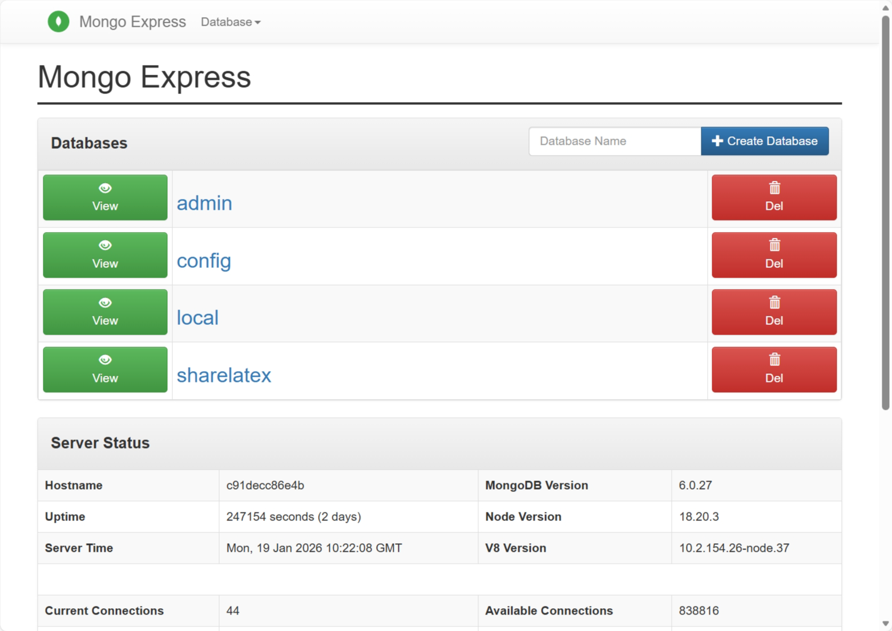

이 섹션에서는 Overleaf의 데이터 모델을 살펴봅니다. Overleaf는 데이터 영속성을 위해 MongoDB를 사용하며, 유일한 데이터베이스 이름은 `sharelatex`입니다. 이는 Overleaf의 전신이기도 합니다.

개발 환경에서는 Mongo 옆에서 Mongo Express가 이미 실행되고 있습니다([setup-develop-tools.md](/ko/dev/environment/setup-develop-tools  "mention") 참고). [http://localhost:8081/](http://localhost:8081/)을 열고 `admin:pass`로 로그인하세요.

<Frame>
  
</Frame>

`develop` 디렉터리에서 Mongo 컨테이너의 셸을 열 수도 있습니다.

```bash
bin/docker-compose exec mongo mongosh sharelatex
```

#### 페이지 작성 방식 {#how-the-pages-are-written}

* 각 페이지는 코드가 쓰는 필드를 타입, 의미, 그리고 이를 보여 주는 코드 줄(Mongoose 스키마의 줄 또는 필드를 쓰는 위치)과 함께 나열합니다. 마이그레이션, 스크립트 또는 web 모듈 중 하나만 쓰는 필드는 그렇게 표시합니다.
* 많은 컬렉션에는 Mongoose 스키마가 없으며, 서비스가 MongoDB 드라이버로 씁니다.
* 인덱스는 `tools/migrations/`의 마이그레이션만 만듭니다. CE는 시작할 때마다 `server-ce` 태그가 붙은 마이그레이션을 실행하며(`server-ce/init_scripts/900_run_web_migrations.sh`), Mongoose `autoIndex`는 꺼져 있습니다(`services/web/app/src/infrastructure/Mongoose.mjs:7`). 인덱스 표에는 CE 인스턴스가 최종적으로 갖게 되는 것만 나열합니다.
* doc의 텍스트는 Mongo에 있지만 다른 내용은 없습니다. 파일 내용은 blob으로, 기록은 청크로 history-v1 버킷(로컬 폴더 또는 S3 / RustFS)에 저장되며, 열린 doc은 document-updater가 플러시할 때까지 Redis에 있습니다.

#### 컬렉션 {#collections}

프로젝트와 내용:

| 컬렉션 | 페이지 | 쓰는 곳 |
| ---------- | ---- | ---------- |
| `users` | [Users 컬렉션](/ko/dev/data-model/users-collection) | web |
| `projects` | [Projects 컬렉션](/ko/dev/data-model/projects-collection) | web |
| `docs` | [Docs 컬렉션](/ko/dev/data-model/docs-collection) | docstore |
| `rooms` | [Rooms 컬렉션](/ko/dev/data-model/rooms-collection) | chat |
| `messages` | [Messages 컬렉션](/ko/dev/data-model/messages-collection) | chat |
| `docSnapshots` | [Doc Snapshots 컬렉션](/ko/dev/data-model/doc-snapshots-collection) | document-updater |

기록:

| 컬렉션 | 페이지 | 쓰는 곳 |
| ---------- | ---- | ---------- |
| `projectHistoryChunks` | [Project History Chunks 컬렉션](/ko/dev/data-model/project-history-chunks-collection) | history-v1 |
| `projectHistoryBlobs` | [Project History Blobs 컬렉션](/ko/dev/data-model/project-history-blobs-collection) | history-v1 |
| `projectHistoryShardedBlobs` | [Project History Sharded Blobs 컬렉션](/ko/dev/data-model/project-history-sharded-blobs-collection) | history-v1 |
| `projectHistorySyncState` | [Project History Sync State 컬렉션](/ko/dev/data-model/project-history-sync-state-collection) | project-history |
| `projectHistoryFailures` | [Project History Failures 컬렉션](/ko/dev/data-model/project-history-failures-collection) | project-history |
| `projectHistoryLabels` | [Project History Labels 컬렉션](/ko/dev/data-model/project-history-labels-collection) | project-history |

공유, 로그인, 삭제:

| 컬렉션 | 페이지 | 쓰는 곳 |
| ---------- | ---- | ---------- |
| `projectInvites` | [Project Invites 컬렉션](/ko/dev/data-model/project-invites-collection) | web |
| `tokens` | [Tokens 컬렉션](/ko/dev/data-model/tokens-collection) | web |
| `oauthAccessTokens` | [OAuth Access Tokens 컬렉션](/ko/dev/data-model/oauth-access-tokens-collection) | web, `oauth2-server` 모듈 |
| `oauthApplications` | [OAuth Applications 컬렉션](/ko/dev/data-model/oauth-applications-collection) | web, `git-bridge` 모듈 |
| `oauthAuthorizationCodes` | [OAuth Authorization Codes 컬렉션](/ko/dev/data-model/oauth-authorization-codes-collection) | Ayakaleaf Pro에서는 없음 |
| `deletedProjects` | [Deleted Projects 컬렉션](/ko/dev/data-model/deleted-projects-collection) | web |
| `deletedUsers` | [Deleted Users 컬렉션](/ko/dev/data-model/deleted-users-collection) | web |

연동과 템플릿:

| 컬렉션 | 페이지 | 쓰는 곳 |
| ---------- | ---- | ---------- |
| `dropboxProjects` | [Dropbox Projects 컬렉션](/ko/dev/data-model/dropbox-projects-collection) | third-party-datastore, `dropbox` 모듈 |
| `dropboxEntities` | [Dropbox Entities 컬렉션](/ko/dev/data-model/dropbox-entities-collection) | third-party-datastore, `dropbox` 모듈 |
| `githubSyncProjectStates` | [GitHub Sync Project States 컬렉션](/ko/dev/data-model/github-sync-project-states-collection) | `github-sync` 모듈 |
| `githubSyncUserCredentials` | [GitHub Sync User Credentials 컬렉션](/ko/dev/data-model/github-sync-user-credentials-collection) | `github-sync` 모듈 |
| `gitlabSyncProjectStates` | [GitLab Sync Project States 컬렉션](/ko/dev/data-model/gitlab-sync-project-states-collection) | `gitlab-sync` 모듈 |
| `gitlabSyncUserCredentials` | [GitLab Sync User Credentials 컬렉션](/ko/dev/data-model/gitlab-sync-user-credentials-collection) | `gitlab-sync` 모듈 |
| `giteaSyncProjectStates` | [Gitea Sync Project States 컬렉션](/ko/dev/data-model/gitea-sync-project-states-collection) | `gitea-sync` 모듈 |
| `giteaSyncUserCredentials` | [Gitea Sync User Credentials 컬렉션](/ko/dev/data-model/gitea-sync-user-credentials-collection) | `gitea-sync` 모듈 |
| `templates` | [Templates 컬렉션](/ko/dev/data-model/templates-collection) | `template-gallery` 모듈 |

대시보드, 로그, 기타:

| 컬렉션 | 페이지 | 쓰는 곳 |
| ---------- | ---- | ---------- |
| `tags` | [Tags 컬렉션](/ko/dev/data-model/tags-collection) | web |
| `notifications` | [Notifications 컬렉션](/ko/dev/data-model/notifications-collection) | notifications |
| `systemmessages` | [System Messages 컬렉션](/ko/dev/data-model/system-messages-collection) | web |
| `userAuditLogEntries` | [User Audit Log Entries 컬렉션](/ko/dev/data-model/user-audit-log-entries-collection) | web |
| `projectAuditLogEntries` | [Project Audit Log Entries 컬렉션](/ko/dev/data-model/project-audit-log-entries-collection) | web |
| `contacts` | [Contacts 컬렉션](/ko/dev/data-model/contacts-collection) | web |
| `spellingPreferences` | [Spelling Preferences 컬렉션](/ko/dev/data-model/spelling-preferences-collection) | web |
| `migrations` | [Migrations 컬렉션](/ko/dev/data-model/migrations-collection) | `tools/migrations` |

CE 데이터베이스에는 이보다 많은 컬렉션이 있습니다. 대부분은 인덱스 마이그레이션이 비어 있는 상태로 만들며 overleaf.com에서만 사용됩니다. 예를 들어 일반적인 사용에서 CE나 우리 모듈은 `splittests`, `samlLogs`, `notificationsPreferences`, `onboardingDataCollection`, `userfeatureusages`에 쓰지 않으므로 이들에는 페이지가 없습니다.
