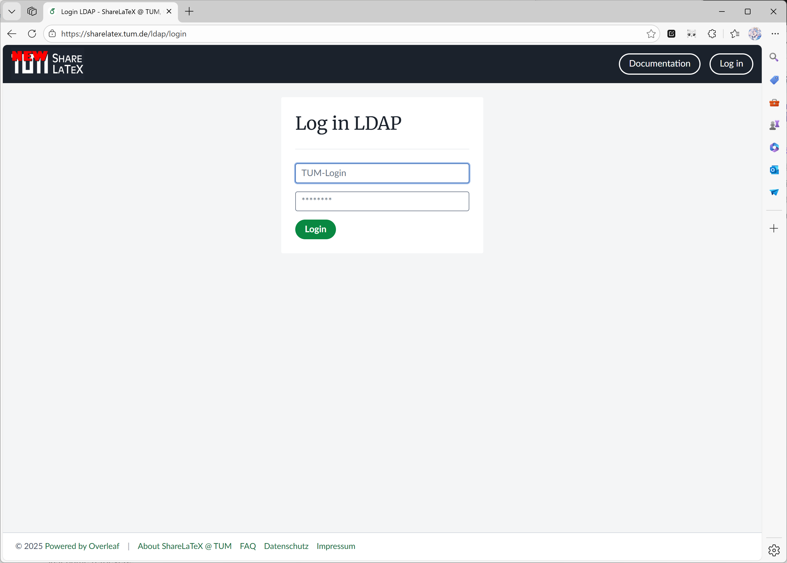

Git 연동은 현재 [ayaka-notes/overleaf](https://github.com/ayaka-notes/overleaf)에서 사용할 수 있습니다.

<Info>

이 기능은 처음에 [ayaka-notes/ayakaleaf-pro](https://github.com/ayaka-notes/ayakaleaf-pro)에서 개발되었습니다.

</Info>

<Steps>
<Step title="git-bridge 활성화 (Toolkit 사용자 전용)">
Toolkit을 사용하는 경우 `config/overleaf.rc`에 다음을 설정하여 `git-bridge`를 활성화하세요.

```text title="config/overleaf.rc"
GIT_BRIDGE_ENABLED=true
```

`SERVER_PRO=true`도 함께 설정되어 있지 않으면 Toolkit은 이 설정을 무시합니다. 그 외에는 아무것도 필요하지 않습니다. Toolkit이 `sharelatex` 컨테이너에 대해 `GIT_BRIDGE_HOST`, `GIT_BRIDGE_PORT`, `V1_HISTORY_URL`을 직접 설정하므로 아래의 두 Docker Compose 단계는 건너뛰세요. `bin/up`을 실행하여 컨테이너를 다시 생성하세요.
</Step>

<Step title="git-bridge 컨테이너 추가 (Docker-compose 사용자 전용)">
사용자 지정 `docker-compose.yml`을 사용하는 경우 compose 파일에 다음 컨테이너 구성을 추가하세요.

```yaml title="docker-compose.yml (git-bridge service)" wrap
git-bridge:
    restart: always
    image: ghcr.io/ayaka-notes/overleaf-pro/git-bridge:6.3.2 # tag should match the `sharelatex` container tag
    volumes:
        - ~/git_bridge_data:/data/git-bridge
    container_name: git-bridge
    expose:
        - "8000"
    environment:
        GIT_BRIDGE_API_BASE_URL: "http://sharelatex:3000/api/v0/" 
        GIT_BRIDGE_OAUTH2_SERVER: "http://sharelatex"
        GIT_BRIDGE_POSTBACK_BASE_URL: "http://git-bridge:8000"
        GIT_BRIDGE_ROOT_DIR: "/data/git-bridge"
    user: root
    command: ["/server-pro-start.sh"]
```

`sharelatex` 이미지와 동일한 태그를 사용하세요. [MCP 서버](/ko/on-premises/configuration/overleaf-toolkit/integrations/mcp-server)(v6.3.1 이상)는 `sharelatex` 이미지에 포함되어 있으며 Git 연동과 함께 활성화되므로 추가 컨테이너가 필요하지 않습니다.
</Step>

<Step title="sharelatex 컨테이너 구성 업데이트">
또한 `sharelatex` 컨테이너에 `git-bridge` 컨테이너를 연결하고 다음 환경 변수를 정의해야 합니다. `V1_HISTORY_URL`에 특히 주의하세요.

```yaml title="docker-compose.yml (sharelatex service)"
sharelatex:
    links:
        - git-bridge
    environment:
         GIT_BRIDGE_ENABLED: true
         GIT_BRIDGE_HOST: "git-bridge"
         GIT_BRIDGE_PORT: "8000"
         # We use v1 now, if you used to set V1_HISTORY_URL, please update now
         V1_HISTORY_URL: "http://sharelatex:3100/api"
```
</Step>

<Step title="인증">
git 클라이언트를 인증할 때 사용자에게는 개인 액세스 토큰(Personal Access Token)이 필요합니다. 사용자는 애플리케이션 UI에서 개인 액세스 토큰을 관리할 수 있습니다(문서 참조).

<Frame caption="Git 연동 개인 액세스 토큰">
  
</Frame>
</Step>

<Step title="모니터링 및 리소스 고려 사항">
`git-bridge`를 활성화한 후에는 호스트 리소스를 모니터링하는 것을 권장합니다. 부하 증가 정도는 다음에 따라 달라집니다.

* 이 기능을 사용하는 사용자 수
* 인스턴스에 호스팅된 프로젝트 유형(일반적으로 프로젝트가 클수록 리소스를 더 많이 사용함)
</Step>
</Steps>

### 프로젝트를 S3로 스왑하기

Git 연동은 사용자가 클론한 각 프로젝트마다 전체 git 저장소를 디스크에 저장합니다. 디스크 공간이 제한적인 경우, 자주 사용하지 않는 저장소를 AWS S3로 옮기는 스왑 작업을 활성화할 수 있습니다. 스왑된 저장소가 다시 필요해지면 디스크로 다시 옮겨집니다. 스왑 작업은 다음 환경 변수로 제어합니다.

| 이름                                  | 설명                                                                                                                                        |
| ------------------------------------- | -------------------------------------------------------------------------------------------------------------------------------------------------- |
| `GIT_BRIDGE_SWAPSTORE_TYPE`           | 스왑 작업을 활성화하려면 "s3"로 설정합니다.                                                                                                         |
| `GIT_BRIDGE_SWAPSTORE_AWS_ACCESS_KEY` | AWS 액세스 키                                                                                                                                |
| `GIT_BRIDGE_SWAPSTORE_AWS_SECRET`     | AWS 시크릿                                                                                                                                    |
| `GIT_BRIDGE_SWAPSTORE_S3_BUCKET_NAME` | 압축된 git 저장소가 저장될 버킷                                                                                               |
| `GIT_BRIDGE_SWAPSTORE_AWS_REGION`     | 버킷의 리전                                                                                                                                |
| `GIT_BRIDGE_SWAPJOB_MIN_PROJECTS`     | <p>디스크에 최소한으로 유지할 프로젝트 수입니다.<br /><br /><strong>- 기본값:</strong> 50</p>                                                      |
| `GIT_BRIDGE_SWAPJOB_LOW_GIB`          | <p>스왑의 하한 임계값입니다. 스왑 작업은 디스크 사용량이 이 값보다 낮아질 때까지 프로젝트를 옮깁니다.<br /><br /><strong>- 기본값:</strong> 128 GB</p> |
| `GIT_BRIDGE_SWAPJOB_HIGH_GIB`         | <p>스왑의 상한 임계값입니다. 디스크 사용량이 이 값에 도달하면 스왑 작업이 시작됩니다.<br /><br /><strong>- 기본값:</strong> 256 GB</p> |
| `GIT_BRIDGE_SWAPJOB_INTERVAL_MILLIS`  | <p>디스크 사용량을 확인하고 스왑 작업을 실행하는 간격입니다.<br /><br /><strong>- 기본값:</strong> 3600000 ms = 1시간</p>             |

### Q\&A

<Accordion title="프로젝트를 다른 사람과 공유하면 Git Bridge 권한 모델은 어떻게 작동하나요?">

읽기 전용 권한이 있는 사용자는 프로젝트를 클론만 할 수 있고, 읽기/쓰기 권한이 있는 사용자는 프로젝트를 클론하고 푸시할 수 있습니다. 참고: 이 프로젝트에 참여하려면 로그인해야 합니다.

</Accordion>

<Accordion title="프로젝트는 어떻게 클론하며, 어떤 사용자 이름과 비밀번호를 사용하나요?">

편집기의 왼쪽 레일에서 **Integrations**를 열고 **Git integration**을 클릭하세요. 다음과 같은 형식의 클론 명령이 표시됩니다.

```sh
git clone https://<your-overleaf>/git/<project_id>
```

Git이 자격 증명을 요청하면 사용자 이름에 `git`을, 비밀번호에 Personal Access Token을 입력하세요. 토큰은 **Account Settings**에서 생성하며 1년 동안 유효합니다. 계정 비밀번호는 사용할 수 없습니다.

변경 사항은 자동으로 동기화되지 않습니다. 편집기에서 변경한 내용을 가져오려면 `git pull`을, 내 변경 사항을 보내려면 `git push`를 사용하세요. `/git` 경로는 `sharelatex` 컨테이너가 제공하므로 앞단의 리버스 프록시에 별도의 규칙이 필요하지 않습니다.

</Accordion>

<Accordion title="`git push`가 `HTTP 413` 또는 `curl 55 Broken pipe`로 실패합니다">

푸시 크기가 업로드 크기 제한보다 큽니다. 이 제한은 `MAX_UPLOAD_SIZE`(메가바이트 단위, 기본값 `50`)로 설정되며 푸시에도 적용됩니다. `config/variables.env`에서 값을 늘린 후(예: `MAX_UPLOAD_SIZE=200`) `bin/up -d`를 실행하세요. [TLS 프록시](/ko/on-premises/configuration/overleaf-toolkit/tls-proxy)나 자체 리버스 프록시를 사용하는 경우 해당 프록시의 `client_max_body_size`도 늘리세요(Toolkit의 `config/nginx/nginx.conf`에서는 `50M`).

git-bridge는 또한 50MB보다 큰 파일과 파일이 2,000개를 초과하는 프로젝트를 거부합니다. 이 제한은 `config/variables.env`의 `GIT_BRIDGE_REPOSTORE_MAX_FILE_SIZE`(바이트 단위)와 `GIT_BRIDGE_REPOSTORE_MAX_FILE_NUM`으로 설정합니다.

</Accordion>

<Accordion title="git-bridge 로그에 `Failed to fetch log level`이 표시됩니다">

이 경고는 무해하며, clone, pull, push는 계속 정상적으로 동작합니다. 6.2.x에서 git-bridge는 1분마다 Google Cloud 메타데이터 서버(`metadata.google.internal`)에 로그 수준을 요청하는데, 이는 Google Cloud에서만 동작합니다. 다른 환경에서는 요청이 실패하며, git-bridge는 오류(`null` 또는 HTTP 상태 등)를 기록하고 `GIT_BRIDGE_LOG_LEVEL`의 수준을 유지합니다. 6.3.0부터는 이 확인이 꺼져 있으며, 업그레이드하면 git-bridge 이미지도 함께 업데이트됩니다. git-bridge 이미지의 버전은 메인 이미지를 따릅니다.

</Accordion>

<Accordion title="Git과 전체 프로젝트 기록을 사용하려면 track-changes 서비스나 `OVERLEAF_IS_SERVER_PRO=true`가 필요한가요?">

<strong>답변:</strong> 아니요. Ayakaleaf Pro에는 track-changes 서비스가 없습니다. 프로젝트 기록은 `project-history` 및 `history-v1` 서비스가 관리하며, 이 서비스는 항상 `sharelatex` 컨테이너 안에서 실행됩니다. git-bridge는 Toolkit이 설정하는 `V1_HISTORY_URL`(`http://sharelatex:3100/api`)의 `history-v1`에서 기록을 읽습니다. `OVERLEAF_IS_SERVER_PRO`는 설정하지 마세요. 이 변수에 의존하는 기능은 없으며, 시작 시 실행되는 데이터베이스 마이그레이션을 Server Pro용으로 바꿀 뿐입니다.

</Accordion>
