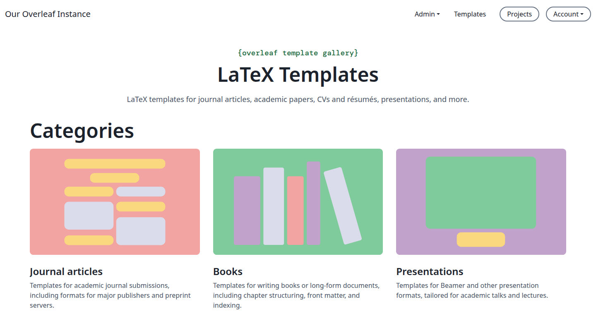

템플릿은 편집기에서 게시하고, 갤러리의 템플릿 페이지나 관리자 패널에서 관리합니다.

<Info>

갤러리를 켜거나, 카테고리를 선택하거나, 관리자가 아닌 사용자가 게시할 수 있게 하려면 [템플릿](/ko/on-premises/configuration/overleaf-toolkit/templates)을 참고하세요.

</Info>

## 프로젝트 게시하기 {#publish-a-project}

<Steps>
<Step title="프로젝트 컴파일하기">
프로젝트를 열고 **Recompile**을 클릭합니다. 지금 보이는 PDF가 갤러리에 표시될 PDF입니다.

컴파일되지 않는 프로젝트를 열었을 때처럼 편집기에 PDF가 없는 동안에는 **Manage Template**이 회색으로 비활성화됩니다.

<Frame caption="아직 PDF가 없어 게시할 수 없음">
  
</Frame>

<Warning>

게시하면 현재 상태의 파일과 마지막으로 성공한 컴파일의 PDF가 저장됩니다. 그 컴파일 이후에 프로젝트를 편집했거나 마지막 컴파일이 실패했다면, 갤러리에는 더 새로운 파일 옆에 오래된 PDF가 표시되고 그 파일은 컴파일되지 않을 수 있습니다. PDF가 올바르게 나올 때까지 다시 컴파일한 다음 게시하세요.

</Warning>
</Step>

<Step title="양식 열기">
편집기 상단 메뉴에서 **File**을 클릭한 다음 **Manage Template**을 클릭합니다.

<Frame caption="File 메뉴">
  
</Frame>
</Step>

<Step title="양식 작성하기">
<Frame caption="Manage Template 대화 상자">
  
</Frame>

| 필드 | 참고 |
| --- | --- |
| **Title** | 처음에는 프로젝트 이름입니다. 갤러리에서 고유해야 합니다. 최대 150자입니다. |
| **Author** | 처음에는 사용자 이름입니다. `[Demo Author](https://example.com)` 같은 Markdown 링크는 템플릿 페이지에서 링크가 됩니다. |
| **Categories** | 카테고리 하나입니다. [카테고리](/ko/on-premises/user-guide/administrators/template-management#categories)를 참고하세요. |
| **Description** | Markdown을 지원합니다. 최대 4096자입니다. 템플릿 페이지에서는 **Abstract**로 표시되고, 갤러리에서는 앞부분이 일반 텍스트로 표시됩니다. |
| **License** | **Creative Commons CC BY 4.0**, **LaTeX Project Public License 1.3c** 또는 <strong>Other (as stated in the work)</strong>. |

프로젝트의 컴파일러와 기본 문서가 템플릿에 함께 저장되므로, 먼저 프로젝트에서 설정해 두세요. 템플릿에서 연 프로젝트는 같은 설정을 사용합니다.
</Step>

<Step title="Publish 클릭하기">
템플릿 페이지가 열립니다.

<Frame caption="새 템플릿">
  
</Frame>

**Admin: Source Project**, **Edit**, **Delete**는 나에게만 표시됩니다. 다른 사용자에게는 **Open as Template**, **View PDF**, 다운로드 버튼만 표시됩니다.
</Step>

<Step title="갤러리 확인하기">
오른쪽 위의 **Templates**를 클릭합니다. 새 템플릿이 목록의 맨 앞에 있습니다.
</Step>
</Steps>

## 카테고리 {#categories}

템플릿은 하나의 카테고리에 속합니다. 이름과 설명은 [구성](/ko/on-premises/configuration/overleaf-toolkit/templates#configuration)에서 가져오며 사이트에서는 변경할 수 없습니다.

카테고리는 다음 위치에 표시됩니다.

* 양식의 **Categories**.
* 갤러리 페이지 `/templates` 상단의 카드. **All templates** 페이지에서 **Template Gallery**를 클릭하면 이동합니다.
* 카테고리별 페이지(예: `/templates/presentation`). 템플릿이 없는 카테고리에는 <strong>No Templates.</strong>가 표시됩니다.
* 프로젝트 페이지의 **New project**에서 **More templates**.
* 템플릿 페이지 제목 위의 링크.

<Frame caption="갤러리 페이지의 카테고리">
  
</Frame>

양식에서 **All templates**는 자체 카테고리가 없다는 뜻입니다. 템플릿은 전체 목록에만 표시됩니다.

## 템플릿 업데이트하기 {#update-a-template}

파일과 PDF를 변경하려면 같은 제목으로 프로젝트를 다시 게시합니다.

<Steps>
<Step title="프로젝트 변경하기">
프로젝트를 편집하고 **Recompile**을 클릭합니다.
</Step>

<Step title="다시 게시하기">
**File**을 클릭한 다음 **Manage Template**을 클릭합니다. 양식에 템플릿의 세부 정보가 표시되며 변경할 수 있습니다. **Publish**를 클릭합니다.

제목이 이미 있다는 메시지가 표시되고 버튼이 **Overwrite**로 바뀝니다.

<Frame caption="같은 제목으로 게시하기">
  
</Frame>

이때 **Title**을 변경하면 메시지가 사라지고 **Publish**는 새 템플릿을 만듭니다.
</Step>

<Step title="Overwrite 클릭하기">
같은 템플릿 페이지가 새 PDF와 함께 열립니다.

<Frame caption="업데이트된 템플릿">
  
</Frame>

사용자가 이미 템플릿에서 연 프로젝트는 변경되지 않습니다.
</Step>
</Steps>

<Warning>

양식은 프로젝트 이름으로 템플릿을 찾습니다. **Edit**으로 템플릿 이름을 바꿨다면, 양식은 프로젝트 이름, 사용자 이름, 첫 번째 카테고리, 빈 설명으로 열리며 템플릿 제목을 입력해도 세부 정보가 돌아오지 않습니다. 이때 **Overwrite**를 누르면 세부 정보가 양식 내용으로 바뀌므로 먼저 다시 작성하세요.

</Warning>

## 세부 정보 편집하기 {#edit-the-details}

갤러리에 표시되는 템플릿 정보를 변경하며, 파일이나 PDF는 변경하지 않습니다.

<Steps>
<Step title="템플릿 열기">
오른쪽 위의 **Templates**를 클릭하고 템플릿을 클릭한 다음 **Edit**을 클릭합니다.
</Step>

<Step title="필드 변경하기">
필드는 게시할 때와 같고 하나가 더 있습니다. **Language**는 템플릿에서 연 프로젝트의 맞춤법 검사 언어입니다. 기본 언어로 게시된 프로젝트는 **Off**로 표시되며, 거기서 연 프로젝트는 <strong>English (American)</strong>을 사용합니다.

<Frame caption="Edit template 대화 상자">
  
</Frame>

다른 템플릿과 같은 제목은 거부됩니다. **Title**을 변경할 때까지 **Save**는 비활성화된 상태로 남습니다.
</Step>

<Step title="Save 클릭하기">
대화 상자가 닫히고 템플릿 페이지에 새 세부 정보가 표시됩니다.
</Step>
</Steps>

## 원본 프로젝트 {#the-source-project}

**Admin: Source Project**는 템플릿을 게시한 프로젝트를 엽니다.

템플릿은 파일의 사본을 따로 보관합니다. 프로젝트를 영구 삭제하면 버튼이 사라지지만, 사용자는 여전히 템플릿을 열 수 있습니다. **Trash**에만 있는 프로젝트는 버튼이 유지됩니다. [템플릿](/ko/on-premises/configuration/overleaf-toolkit/templates)의 Q&A도 참고하세요.

## 템플릿 삭제하기 {#delete-a-template}

<Steps>
<Step title="Delete 클릭하기">
템플릿 페이지에서 **Delete**를 클릭합니다. 대화 상자에 템플릿 이름이 표시됩니다.

<Frame caption="Delete template 대화 상자">
  
</Frame>
</Step>

<Step title="Confirm 클릭하기">
이전 페이지로 돌아가며 템플릿은 더 이상 갤러리에 없습니다. 해당 링크에는 이제 **Not found**가 표시됩니다.

원본 프로젝트는 남아 있고, 사용자가 템플릿에서 연 프로젝트도 남아 있습니다.
</Step>
</Steps>

## 관리자 패널에서 템플릿 관리하기 {#manage-templates-in-the-admin-panel}

**Admin**을 클릭하고 **Project/Object Lookup**을 클릭한 다음 **Templates** 탭을 클릭합니다. 모든 템플릿이 작성자 및 소유자와 함께 표시되며 검색할 수 있습니다.

<Frame caption="관리자 패널의 모든 템플릿">
  
</Frame>

* 제목을 클릭하면 템플릿 페이지가 열리고, 열기 아이콘을 클릭하면 새 탭에서 열립니다.
* 소유자를 클릭하면 해당 사용자의 페이지가 열립니다.
* 휴지통 아이콘을 클릭한 다음 **Delete**를 클릭하면 템플릿이 삭제됩니다. 대화 상자는 이 작업을 되돌릴 수 없다고 경고하며, 템플릿은 갤러리에서 사라집니다.

## 게시가 거부되는 경우 {#if-publishing-is-refused}

양식에는 사이트가 허용하는 것보다 더 많이 입력할 수 있습니다. **Title**이 150자를 넘으면 `Template title exceeds the maximum length of 150 characters.`가 표시되고, **Description**이 4096자를 넘으면 `Template description exceeds the maximum length of 4096 characters.`가 표시됩니다.

그러면 텍스트를 줄여도 **Publish**가 비활성화된 상태로 남습니다. **Cancel**을 클릭하고 **File**, **Manage Template**을 차례로 클릭한 다음 양식을 다시 작성하세요.
