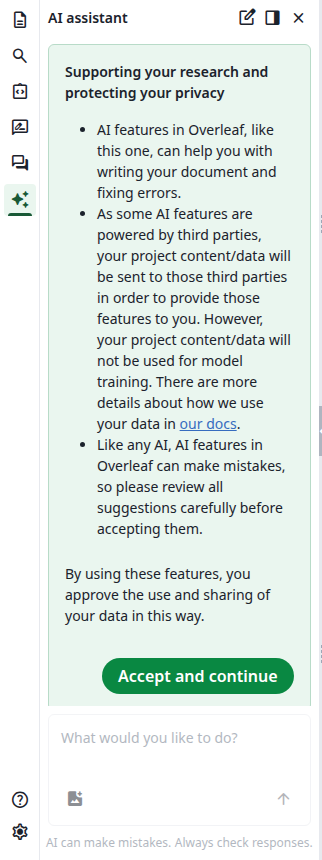

어시스턴트는 열려 있는 프로젝트를 대상으로 작동합니다. 문서를 읽고 편집을 제안하며, 각 편집을 적용할지 거부할지는 사용자가 결정합니다. 스크린샷의 답변은 예시입니다. 실제 답변은 사이트에서 사용하는 모델에 따라 다릅니다.

<Info>

왼쪽 바에 **AI assistant**가 보이지 않으면 관리자에게 [AI 통합](/ko/on-premises/configuration/overleaf-toolkit/integrations/ai-integration)을 참고하도록 안내하세요.

</Info>

## 채팅 시작 {#start-a-chat}

<Steps>
<Step title="어시스턴트 열기">
편집기 왼쪽 바에서 **AI assistant**를 클릭합니다. 편집기 옆에 패널이 열립니다.
</Step>

<Step title="약관 동의">
처음에는 패널에 AI 기능 약관이 표시됩니다. **Accept and continue**를 클릭합니다. 이 작업은 한 번만 하며 [오류 어시스턴트](/ko/on-premises/user-guide/users/error-assistant)에도 적용됩니다.

<Frame caption="한 번만 표시되는 약관">
  
</Frame>
</Step>

<Step title="질문하기">
<strong>What would you like to do?</strong>에 입력하고 Enter 키를 누르거나 화살표를 클릭합니다. **Start a chat** 아래의 제안을 클릭할 수도 있습니다. 제안은 채팅마다 바뀌며, 마지막 컴파일에 오류가 있으면 **Fix the compile errors**가 추가됩니다.

<Frame caption="빈 채팅">
  
</Frame>
</Step>

<Step title="답변 읽기">
어시스턴트가 한 일은 **Read line 15-16 of main.tex**처럼 상자 안의 줄로 표시되며, 단계가 끝나면 체크 표시가 붙습니다. 그다음에 답변이 나옵니다. 모델이 추론 과정을 공유하면 **Reasoned for 1 s**를 클릭해 읽을 수 있습니다.

<Frame caption="질문과 답변">
  
</Frame>
</Step>
</Steps>

## 선택한 줄에 대해 질문 {#ask-about-selected-lines}

편집기에서 줄을 선택합니다. 메시지 상자 위에 `main.tex: 16` 같은 레이블이 나타나고, 선택한 텍스트가 메시지와 함께 전송됩니다. 빈 채팅에서는 제안이 **Make it shorter**처럼 선택 영역에 관한 것으로 바뀝니다.

<Frame caption="선택한 줄">
  
</Frame>

## 제안된 편집 검토 {#review-a-suggested-edit}

편집은 적용하기 전까지 문서에 들어가지 않습니다.

<Steps>
<Step title="제안 읽기">
**Edit line 16**이라는 상자에 이유, 줄 번호, 변경 내용이 표시됩니다. 기존 텍스트에는 취소선이 그어지고 새 텍스트는 강조 표시됩니다. 문서는 아직 바뀌지 않았습니다. **Show result**는 새 텍스트만 보여 주고, **Show diff**는 원래 보기로 돌아갑니다.

<Frame caption="결정을 기다리는 편집">
  
</Frame>
</Step>

<Step title="적용">
**Apply**를 클릭합니다. 변경 사항이 편집기에 나타나고, 상자에 체크 표시가 붙으며, 어시스턴트가 작업을 계속합니다. 편집이 다른 문서에 있으면 그 문서가 열립니다.

<Frame caption="편집이 적용됨">
  
</Frame>
</Step>

<Step title="마음이 바뀌면 되돌리기">
**Undo**는 문서에서 변경을 빼고, **Apply**는 다시 넣습니다. 어시스턴트는 어느 쪽도 알지 못합니다.
</Step>
</Steps>

### 편집 거부 {#reject-an-edit}

**Reject**를 클릭합니다. 문서는 그대로이고, 상자에 <strong>The user declined this edit.</strong>가 표시되며, 어시스턴트는 거부된 것을 알고 작업을 계속합니다. 버튼이 사라지므로 그 편집을 다시 받으려면 다시 요청하세요.

결정하지 않고 새 메시지를 쓰면 편집은 적용되지 않으며 상자에 그 사실이 표시됩니다.

<Frame caption="거부한 편집과 결정하지 않은 편집">
  
</Frame>

## 어시스턴트가 프로젝트에서 할 수 있는 일 {#what-the-assistant-can-do-in-a-project}

결정을 기다리는 것은 편집뿐입니다. 다른 단계는 어시스턴트가 실행하는 즉시 실행됩니다.

| 채팅에 표시되는 줄 | 하는 일 |
| -------------------- | ------------ |
| **Read line 15-16 of main.tex** | 문서의 줄을 읽습니다 |
| **Find “schedule” in main.tex** | 문서에서 텍스트를 찾습니다 |
| **List the project files** | 프로젝트 파일을 나열합니다 |
| **Create appendix.tex** | 빈 문서를 만들고 엽니다 |
| **Edit line 16** | 편집을 제안합니다. 위 내용 참고 |
| **Compile** | 프로젝트를 컴파일합니다 |
| **Check the compile log** | 마지막 컴파일의 오류와 경고를 읽습니다 |
| **Look at PDF page 1** | PDF 페이지를 채팅에 보여 줍니다 |
| **Read the PDF structure** | PDF 구조를 읽습니다 |
| **Switch to xelatex** | **Settings**에서처럼 프로젝트의 컴파일러를 바꿉니다 |
| <strong>Search the web for “...”</strong> | 웹을 검색합니다 |
| <strong>Search the help pages for “...”</strong> | 도움말 페이지를 검색합니다 |

<Frame caption="새 파일, 그리고 다른 문서의 편집">
  
</Frame>

<Frame caption="컴파일과 PDF 페이지">
  
</Frame>

검색 줄에는 찾은 결과 수가 표시됩니다. 클릭하면 결과가 나열됩니다. 검색을 사용할 수 있는지는 사이트에 따라 다릅니다. [선택적 검색 서비스](/ko/on-premises/configuration/overleaf-toolkit/integrations/ai-integration#optional-search-services)를 참고하세요.

<Frame caption="검색 결과">
  
</Frame>

**Fix the compile errors** 제안은 어시스턴트에게 로그를 확인하고 찾은 문제를 고치도록 요청합니다. 수정 사항은 검토할 편집으로 도착합니다.

## 이미지 또는 PDF 첨부 {#attach-an-image-or-a-pdf}

메시지 상자에서 그림 아이콘 **Attach image or PDF**를 클릭하고 파일을 선택합니다. 파일 이름이 텍스트 위에 나타납니다. 메시지를 작성해 보냅니다.

<Frame caption="메시지에 첨부한 파일">
  
</Frame>

패널은 다른 파일을 <strong>Only images and PDF files can be attached.</strong>로, 큰 파일을 <strong>Files must be smaller than 2 MB.</strong>로 거부합니다.

## 어시스턴트 중지 {#stop-the-assistant}

어시스턴트가 작업하는 동안 메시지 상자의 화살표가 **Stop** 버튼으로 바뀝니다. 클릭합니다. 실행 중인 단계는 <strong>Stopped by the user.</strong>로 끝나며, 다시 메시지를 쓸 때까지 아무 일도 일어나지 않습니다.

<Frame caption="Stop 버튼">
  
</Frame>

## 어시스턴트가 스스로 멈춘 경우 {#if-the-assistant-stops-by-itself}

어시스턴트가 메시지 하나에 대해 수행할 수 있는 단계 수는 제한되어 있습니다. 한도에 도달하면 패널에 <strong>The assistant used all the steps it may take for one message. Reply to let it carry on.</strong>가 표시됩니다. `Go on`처럼 답장하면 계속합니다.

<Frame caption="단계 한도">
  
</Frame>

패널에 **Something’s gone wrong**이 표시되면 요청이 실패한 것입니다. 메시지를 다시 보내거나 **Start new chat**을 클릭하세요.

## 패널 이동 및 다시 시작 {#move-the-panel-and-start-over}

패널 위쪽에는 다음 버튼이 있습니다.

* **Start new chat**은 패널을 비웁니다. 이전 채팅 목록은 없습니다. 페이지를 새로 고쳐도 채팅이 비워집니다.
* **Move to the right**는 패널을 PDF 오른쪽으로 옮기며, 파일 트리를 사용하는 동안에도 열려 있습니다. **Move to the left**는 원래 위치로 되돌립니다. 채팅은 유지됩니다.
* **Close**는 패널을 숨깁니다. 왼쪽 바에서 **AI assistant**를 클릭하면 채팅이 남아 있는 상태로 다시 나타납니다.

<Frame caption="오른쪽에 있는 패널">
  
</Frame>

## 토큰 사용량 {#token-usage}

어시스턴트는 사용한 토큰 수를 표시하지 않습니다. 사이트에 한도가 설정되어 있고 한도에 도달하면 다음 메시지에는 답변이 오지 않습니다. 패널에 **Usage limit reached**와 다시 채팅할 수 있을 때까지 남은 시간이 표시되고, 메시지 상자는 회색으로 비활성화됩니다.

<Frame caption="한도에 도달함">
  
</Frame>

새 채팅에도 같은 알림이 표시됩니다. 새로 고치면 상자는 다시 정상으로 보이지만, 다음 메시지에도 알림이 표시됩니다. [오류 어시스턴트](/ko/on-premises/user-guide/users/error-assistant)도 같은 한도에 포함되며 로그 항목에 **Usage limit reached**를 표시합니다.

한도는 관리자가 설정합니다. [사용량 및 재설정](/ko/on-premises/configuration/overleaf-toolkit/integrations/ai-integration#usage-and-reset)을 참고하세요.
