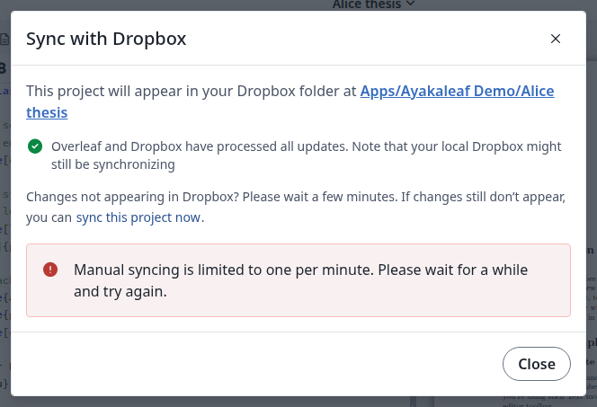

모든 프로젝트를 Dropbox의 폴더와 동기화된 상태로 유지하세요. 변경 사항은 백그라운드에서 양방향으로 이동하지만, 한 가지 예외가 있습니다. 편집기에서 입력한 내용은 프로젝트를 떠나고 몇 분 후, 또는 **sync this project now**를 클릭할 때 Dropbox에 도착합니다.

<Info>

**Account settings**나 편집기에 Dropbox 옵션이 보이지 않으면 관리자에게 [Dropbox 동기화](/ko/on-premises/configuration/overleaf-toolkit/integrations/dropbox-synchronisation)를 켜 달라고 요청하세요.

</Info>

## Dropbox 계정 연결하기 {#link-your-dropbox-account}

이 작업은 한 번만 합니다.

<Steps>
<Step title="계정 설정 열기">
**Account**를 클릭한 다음 **Account settings**를 클릭합니다. **Project synchronisation** 아래에서 **Dropbox**를 찾아 **Link**를 클릭합니다.

<Frame caption="계정 설정의 Dropbox">
  
</Frame>
</Step>

<Step title="Dropbox에서 승인">
Dropbox가 열립니다. 요청을 받으면 로그인한 다음 애플리케이션을 승인합니다.
</Step>

<Step title="연결 확인">
계정 설정으로 돌아옵니다. Dropbox 계정이 연결되었다는 녹색 메시지가 표시되고, 이제 버튼에 **Unlink**가 표시됩니다. Dropbox 아래에는 프로젝트를 보내는 중이라는 상태가 표시됩니다.

<Frame caption="Dropbox 계정이 연결됨">
  
</Frame>

모두 도착하면 상태가 **Overleaf and Dropbox have processed all updates**로 바뀝니다.

<Frame caption="모두 동기화됨">
  
</Frame>
</Step>
</Steps>

계정이 아직 연결되지 않았다면 편집기의 **Dropbox** 카드가 먼저 연결하라고 요청합니다. **Update Dropbox Settings**를 클릭하면 계정 설정이 새 탭에서 열립니다. 그곳에서 계정을 연결한 다음, 대화 상자의 안내대로 편집기 페이지를 새로 고치세요.

<Frame caption="계정이 연결되지 않았을 때의 안내">
  
</Frame>

Dropbox에서 접근을 허용하지 않으면 아무 메시지 없이 계정 설정으로 돌아오며, 버튼은 여전히 **Link**입니다.

### 이름이 같은 프로젝트가 있는 경우 {#if-you-have-projects-with-the-same-name}

두 프로젝트의 이름이 같으면 연결할 수 없습니다. 메시지에 해당 프로젝트가 표시됩니다. 보관된 프로젝트와 휴지통의 프로젝트도 포함됩니다.

<Frame caption="이름이 같은 두 프로젝트">
  
</Frame>

둘 중 하나의 이름을 바꾸고 **Link**를 다시 클릭하세요.

## Dropbox에서 프로젝트 찾기 {#find-your-projects-in-dropbox}

각 프로젝트는 Dropbox의 `Apps/<app name>/` 안에 있는 폴더이며, 모든 파일을 포함합니다. 앱 이름은 관리자가 정했습니다. 나중에 만드는 프로젝트를 포함해 모든 프로젝트가 동기화되며, 일부만 선택할 수는 없습니다.

프로젝트의 폴더를 보려면 프로젝트를 엽니다. 왼쪽 막대에서 **Integrations**를 클릭한 다음 **Dropbox**를 클릭합니다.

<Frame caption="Integrations 패널">
  
</Frame>

대화 상자에 폴더 이름이 표시되고, Dropbox의 해당 폴더로 연결되는 링크가 있습니다.

<Frame caption="이 프로젝트의 폴더">
  
</Frame>

이미 있는 프로젝트와 이름이 같은 새 프로젝트에는 `Field notes (1)`처럼 번호가 붙은 폴더가 생깁니다. 어떤 폴더가 해당 프로젝트의 것인지는 대화 상자에 표시됩니다.

<Frame caption="번호가 붙은 폴더">
  
</Frame>

## Overleaf에서 한 변경 사항 {#changes-you-make-in-overleaf}

아무것도 클릭할 필요가 없습니다.

* **새 파일, 이름 변경, 이동, 삭제**는 즉시 Dropbox에 반영됩니다. 새 폴더는 첫 번째 파일과 함께 Dropbox에 나타납니다.
* **프로젝트 이름을 바꾸면** 폴더 이름도 바뀝니다.
* **편집기에서 입력한 편집 내용**은 프로젝트가 열려 있는 동안 Dropbox에 도착하지 않으며, **Recompile**을 클릭해도 전송되지 않습니다. 모든 사람이 프로젝트를 떠나고 약 3분 후에 전송됩니다. 더 일찍 보내려면 [동기화 강제하기](#force-a-sync)를 참조하세요.
* **프로젝트를 삭제해도** 폴더는 Dropbox에 남습니다. 더 이상 필요 없으면 폴더를 직접 삭제하세요.

## Dropbox에서 한 변경 사항 {#changes-you-make-in-dropbox}

여기서도 아무것도 클릭할 필요가 없습니다. Dropbox가 Overleaf에 변경 사항을 알리며, 보통 몇 초 안에 반영됩니다. 열려 있는 편집기에서도 새로 고칠 필요가 없습니다.

* 프로젝트 폴더의 **새 파일, 편집, 이름 변경, 삭제**가 프로젝트에 적용됩니다. 새 폴더도 마찬가지입니다.
* **앱 폴더 최상위의 새 폴더**는 새 프로젝트가 됩니다.
* **Overleaf가 동기화하지 않는 파일**(예: `.DS_Store` 또는 `.aux` 파일)은 Dropbox에만 남습니다.

프로젝트 기록에서는 이러한 변경 사항에 <strong>(via Dropbox)</strong>가 표시됩니다.

### 파일이 편집기에서 열려 있는 경우 {#if-the-file-is-open-in-the-editor}

파일이 눈앞에서 바뀌고, 대화 상자가 이를 알려 줍니다. **OK**를 클릭하세요.

<Frame caption="열려 있는 파일이 Dropbox에서 변경됨">
  
</Frame>

Dropbox 버전이 입력했지만 아직 전송되지 않은 내용을 대체합니다. 텍스트는 사라지지 않으며 프로젝트 기록에 남습니다.

<Frame caption="기록에 남은 대체된 텍스트">
  
</Frame>

### 프로젝트 폴더 이름 바꾸기 또는 삭제하기 {#rename-or-delete-a-project-folder}

프로젝트 이름은 Dropbox가 아니라 Overleaf에서 바꾸세요. Overleaf에게 Dropbox에서 이름을 바꾼 폴더는 삭제된 폴더와 새 폴더입니다. 새 이름의 새 프로젝트가 생기고, 기존 프로젝트도 남습니다.

Dropbox에서 프로젝트 폴더를 삭제해도 프로젝트는 파일과 기록과 함께 프로젝트 목록에 남습니다. 다음에 프로젝트를 열면 대화 상자가 한 번 알려 줍니다. **OK**를 클릭하세요.

<Frame caption="이 프로젝트의 폴더가 Dropbox에서 사라짐">
  
</Frame>

프로젝트는 계속 동기화됩니다. 프로젝트 전체를 Dropbox에 다시 넣으려면 **sync this project now**를 클릭하세요.

### 프로젝트가 보관되었거나 휴지통에 있는 동안 {#while-a-project-is-archived-or-in-the-trash}

Dropbox의 해당 폴더에서 한 변경 사항은 적용되지 않으며, 프로젝트를 복원해도 반영되지 않습니다. 그러면 Overleaf는 변경한 파일의 전송을 멈추므로 양쪽 내용이 달라집니다. 그런 파일은 Dropbox에서 한 번 더 저장하세요. Dropbox 버전이 Overleaf의 버전을 대체합니다.

## 동기화 강제하기 {#force-a-sync}

프로젝트마다 고유한 링크가 있습니다. 프로젝트를 떠나지 않고 편집 내용을 바로 Dropbox에 보내고 싶을 때 사용하세요.

<Steps>
<Step title="동기화 대화 상자 열기">
프로젝트를 엽니다. 왼쪽 막대에서 **Integrations**를 클릭한 다음 **Dropbox**를 클릭합니다.
</Step>

<Step title="sync this project now 클릭">
이 링크는 <strong>Changes not appearing in Dropbox?</strong>의 끝에 있습니다.
</Step>

<Step title="결과 확인">
수동 동기화가 시작되었다는 파란색 메시지가 표시되고, 상태에 **Sending and receiving updates**가 표시됩니다. 동기화가 끝나면 **Overleaf and Dropbox have processed all updates**로 돌아갑니다.

<Frame caption="수동 동기화 진행 중">
  
</Frame>
</Step>
</Steps>

이 링크는 편집기에 남아 있는 편집 내용을 포함해 프로젝트 전체를 Dropbox로 보냅니다. 또한 모든 프로젝트에 대해 Dropbox에서 대기 중인 변경 사항을 읽어 옵니다. 사이트가 [Dropbox의 알림](/ko/on-premises/configuration/overleaf-toolkit/integrations/dropbox-synchronisation#webhook)을 받을 수 없으면 Dropbox의 변경 사항은 이 방법으로만 들어옵니다.

프로젝트마다 1분에 한 번 할 수 있습니다. 그보다 빠르면 빨간색 메시지가 기다리라고 요청합니다.

<Frame caption="다음 동기화까지 1분 기다리기">
  
</Frame>

## Dropbox 계정 연결 해제하기 {#unlink-your-dropbox-account}

<Steps>
<Step title="Unlink 클릭">
**Account settings**의 **Dropbox**에서 **Unlink**를 클릭합니다.
</Step>

<Step title="확인">
대화 상자에서 **Unlink**를 클릭합니다.

<Frame caption="계정 연결 해제">
  
</Frame>
</Step>

<Step title="결과 확인">
버튼이 다시 **Link**로 바뀌고, 편집기의 **Dropbox** 카드에는 계정이 연결되지 않았다고 표시됩니다. 어느 방향으로도 더 이상 동기화되지 않습니다. 프로젝트와 Dropbox의 폴더는 모두 파일을 유지합니다.
</Step>
</Steps>

### 나중에 다시 연결하기 {#link-again-later}

**Link**를 클릭하세요. 프로젝트가 다시 Dropbox로 전송됩니다.

* 각 파일이 Dropbox의 같은 이름 파일을 대체합니다. 연결이 해제된 동안 Dropbox에서 그 파일에 한 변경 사항은 덮어써지므로, 먼저 그런 변경 사항을 프로젝트로 옮기세요.
* Dropbox에만 있는 파일은 그대로 남으며, 다음에 변경할 때 프로젝트로 들어옵니다.
* 연결이 해제된 동안 이름을 바꾼 프로젝트에는 새 폴더가 생깁니다. 이전 폴더는 남습니다.

### Overleaf가 계정 연결을 해제한 경우 {#if-overleaf-unlinks-your-account}

Dropbox가 더 이상 연결을 받아들이지 않으면 Overleaf가 계정 연결을 해제합니다. 다시 연결할 때까지 프로젝트 목록에 그 이유가 표시됩니다.

<Frame caption="계정 연결이 해제됨">
  
</Frame>

이유는 [Dropbox 동기화](/ko/on-premises/configuration/overleaf-toolkit/integrations/dropbox-synchronisation)의 Q\&A를 참조하세요.

<Info>

공유 프로젝트의 공동 작업자에게 무엇이 반영되는지는 [동기화 방식](/ko/on-premises/configuration/overleaf-toolkit/integrations/dropbox-synchronisation#동기화-방식)을 참조하세요.

</Info>
