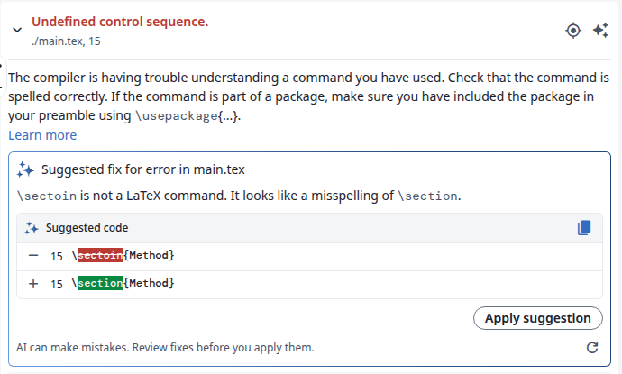

<Info>

로그 항목에 **Suggest fix** 버튼이 없으면 관리자에게 [AI 통합](/ko/on-premises/configuration/overleaf-toolkit/integrations/ai-integration)을 참고하도록 안내하세요.

</Info>

<Steps>
<Step title="로그 열기">
오류가 있는 컴파일 후에는 **Recompile** 옆의 로그 아이콘에 빨간 숫자가 나타나고, 편집기의 해당 줄에 빨간 점이 표시됩니다. 아이콘을 클릭합니다. 컴파일로 PDF가 생성되지 않았다면 로그가 이미 열려 있습니다.

<Frame caption="오류가 하나 있는 컴파일">
  
</Frame>
</Step>

<Step title="Suggest fix 클릭">
로그 항목 오른쪽의 반짝임 아이콘 **Suggest fix**를 클릭합니다. 프로젝트의 파일을 가리키는 경고에도 이 버튼이 있습니다.

<Frame caption="Suggest fix 버튼">
  
</Frame>

처음에는 항목에 **Before you use Error Assist**가 표시됩니다. **Accept and continue**를 클릭합니다. 이 작업은 한 번만 하며 [AI 어시스턴트](/ko/on-premises/user-guide/users/ai-assistant)에도 적용됩니다.

<Frame caption="한 번만 표시됨">
  
</Frame>
</Step>

<Step title="제안 읽기">
항목은 오류를 설명하고 바꿀 줄을 보여 줍니다. 기존 텍스트는 <strong>-</strong> 행에, 새 텍스트는 <strong>+</strong> 행에 있습니다. 줄 번호를 클릭하면 편집기의 해당 줄로 이동하고, 복사 아이콘은 새 텍스트를 복사합니다.

<Frame caption="수정 제안">
  
</Frame>

어시스턴트에게 수정 방법이 없으면 설명만 하며 적용할 것이 없습니다. 새로 고침 아이콘 **Suggest a different fix**는 다시 요청합니다.
</Step>

<Step title="적용하거나 그대로 두기">
적용하려면 **Apply suggestion**을 클릭합니다. 편집기에서 줄이 바뀌고, 항목에 **Suggestion applied**가 표시되며, 프로젝트가 다시 컴파일됩니다. 오류가 남지 않으면 PDF가 다시 나타납니다. 변경을 되돌리려면 편집기에서 `Ctrl+Z`를 누릅니다.

<Frame caption="수정이 적용됨">
  
</Frame>

거부하려면 아무것도 하지 않으면 됩니다. 거부 버튼은 없으며, **Apply suggestion**을 클릭하기 전까지 문서는 그대로입니다.

그 줄을 먼저 편집하면 **Apply suggestion**이 비활성화됩니다. **Suggest a different fix**를 클릭해 새 제안을 받으세요.
</Step>
</Steps>

## 제안 다시 찾기 {#find-the-suggestion-again}

다음 컴파일 후에는 적용 여부와 관계없이 로그에 제안이 **Last suggested fix**로 표시됩니다. 화살표를 클릭해 엽니다.

<Frame caption="마지막 제안은 로그에 남습니다">
  
</Frame>

오류 어시스턴트는 AI 어시스턴트와 같은 한도에 포함됩니다. [토큰 사용량](/ko/on-premises/user-guide/users/ai-assistant#token-usage)을 참고하세요.
