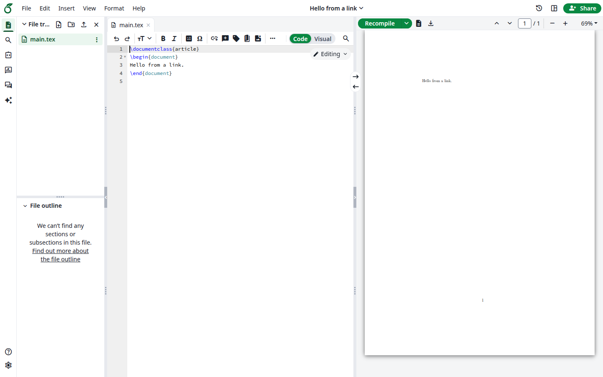

웹사이트, 블로그 또는 강의 페이지에 링크를 두세요. 링크를 클릭한 사람은 누구나 여러분의 파일이 들어 있는 자신만의 새 프로젝트를 받습니다. 별도로 설정할 것은 없습니다.

방문자에게는 인스턴스 계정이 필요합니다. 로그인하지 않은 방문자는 먼저 로그인 페이지로 이동하며, 로그인한 뒤 프로젝트가 열립니다.

이 기능의 페이지에서는 Overleaf라는 이름을 사용합니다. 여러분의 링크나 버튼에는 **Open in Ayakaleaf**처럼 어떤 문구든 쓸 수 있습니다.

## 예제 보기 {#see-the-examples}

사이트에서 `/devs`를 엽니다(예: `https://ayakaleaf.example.com/devs`). 이 페이지로 연결되는 메뉴가 없으므로 주소를 직접 입력하세요. 기본적으로 이 페이지를 보려면 로그인해야 합니다.

<Frame caption="Overleaf API 페이지">
  
</Frame>

**A LaTeX code snippet** 또는 **A zipped project**를 클릭합니다. 예제가 담긴 새 프로젝트가 열립니다.

<Frame caption="zip 예제로 만든 프로젝트">
  
</Frame>

## 웹사이트의 파일에 링크하기 {#link-to-a-file-on-your-website}

<Steps>
<Step title="링크 만들기">
파일 주소를 URL 인코딩하여 `/docs?snip_uri=` 뒤에 붙입니다:

```text
https://ayakaleaf.example.com/docs?snip_uri=https%3A%2F%2Fexample.com%2Fmain.tex
```

압축된 프로젝트에는 `zip_uri`를 사용합니다:

```text
https://ayakaleaf.example.com/docs?zip_uri=https%3A%2F%2Fexample.com%2Fproject.zip
```

인스턴스가 파일을 다운로드하므로 HTTP 또는 HTTPS로 접근할 수 있어야 합니다. 사설 네트워크의 주소는 거부됩니다. [External URL](/ko/on-premises/configuration/overleaf-toolkit/external-url)을 참고하세요.
</Step>

<Step title="페이지에 추가하기">
```html
<a href="https://ayakaleaf.example.com/docs?snip_uri=https%3A%2F%2Fexample.com%2Fmain.tex">Open in Ayakaleaf</a>
```
</Step>

<Step title="클릭하기">
새 프로젝트가 편집기에서 열리며, `main.tex`로 저장된 파일 하나가 들어 있습니다.

<Frame caption="링크로 연 프로젝트">
  
</Frame>

클릭할 때마다 새 프로젝트가 만들어집니다. 프로젝트는 사본이므로 이후 파일을 변경해도 반영되지 않습니다.
</Step>
</Steps>

## 링크에 파일 넣기 {#put-the-file-in-the-link}

작은 파일이라면 아무것도 호스팅할 필요가 없습니다. 내용을 Base64 data URL로 링크에 넣으세요. JavaScript에서는:

```javascript
const tex = '\\documentclass{article}\n\\begin{document}\nHello from a link.\n\\end{document}\n'
const link = 'https://ayakaleaf.example.com/docs?' + new URLSearchParams({
  snip_uri: 'data:application/x-tex;base64,' + btoa(tex),
  name: 'Hello from a link',
})
```

`btoa`는 Latin-1 문자만 받으므로 다른 텍스트는 먼저 UTF-8로 인코딩하세요. 압축된 프로젝트에는 `zip_uri`와 `data:application/zip;base64,`를 사용합니다.

약 8 KB보다 긴 링크는 **414 Request-URI Too Large** 오류와 함께 거부됩니다. 더 큰 내용은 파일을 호스팅하거나 [폼](#use-a-button-instead-of-a-link)을 사용하세요.

## 옵션 선택하기 {#choose-the-options}

다음 매개변수를 링크에 추가하거나 폼의 hidden 필드로 추가합니다:

| 매개변수                   | 기능                                                                                                                 | 예                                            |
| --------------------------- | ---------------------------------------------------------------------------------------------------------------------------- | -------------------------------------------------- |
| `name`                      | 프로젝트 이름을 정합니다. 없으면 압축된 프로젝트는 `\title`의 이름을, 그 밖에는 `Open in Overleaf project`를 사용합니다. | `name=My%20notes`                                  |
| `engine`                    | 컴파일러를 설정합니다: `latex_dvipdf`, `pdflatex`, `xelatex` 또는 `lualatex`.                                                      | `engine=xelatex`                                   |
| `main_document`             | 처음 열리는 메인 `.tex` 파일을 설정합니다.                                                                                | `main_document=thesis.tex`                         |
| `snip_uri[]`, `snip_name[]` | 여러 파일을 같은 순서로 각자의 이름을 붙여 가져옵니다.                                                            | `snip_uri[]=.../a.tex&snip_name[]=a.tex`           |

`\documentclass`가 없는 `.tex` 파일은 표준 문서로 감싸지므로 바로 컴파일됩니다:

```latex
\documentclass[12pt]{article}
\usepackage[english]{babel}
\usepackage{amsmath}
\usepackage{tikz}
\begin{document}
Your file
\end{document}
```

## 링크 대신 버튼 사용하기 {#use-a-button-instead-of-a-link}

폼은 링크와 같은 매개변수를 보냅니다:

```html
<form action="https://ayakaleaf.example.com/docs" method="post" target="_blank">
  <input type="hidden" name="snip_uri" value="https://example.com/main.tex">
  <input type="hidden" name="engine" value="xelatex">
  <button type="submit">Open in Ayakaleaf</button>
</form>
```

LaTeX 자체를 보내려면 일반 텍스트는 `snip`을, `encodeURIComponent`를 거친 텍스트는 `encoded_snip`을 사용합니다.

폼이 항상 동작하지는 않으므로, 파일이 너무 길어 링크에 담을 수 없는 경우가 아니라면 링크가 더 낫습니다:

| 폼의 위치                                     | 방문자가 로그인함            | 방문자가 로그인하지 않음        |
| ----------------------------------------------------- | ------------------------------- | ------------------------------- |
| 인스턴스와 같은 도메인 또는 그 하위 도메인   | 프로젝트가 열림               | 로그인 페이지, 프로젝트 없음      |
| 다른 도메인                                     | 로그인 페이지, 프로젝트 없음      | 로그인 페이지, 프로젝트 없음      |

관리자가 `OVERLEAF_ALLOW_PUBLIC_ACCESS=true`로 설정하면 이 모든 경우에 필요하면 로그인한 뒤 프로젝트가 열립니다. 이 설정은 로그아웃한 방문자에게 다른 페이지도 엽니다. [Page Access](/ko/on-premises/configuration/overleaf-toolkit/authentication/public-access#page-access)를 참고하세요.

관리자가 설정할 수 있는 나머지 항목은 [Overleaf Import API](/ko/on-premises/configuration/overleaf-toolkit/integrations/overleaf-import-api)를 참고하세요. `/devs` 페이지에 예제가 더 있습니다.

## 프로젝트가 열리지 않을 때 {#if-the-project-does-not-open}

페이지에 무엇이 잘못되었는지 표시됩니다. **View the Overleaf API docs**를 클릭하면 `/devs`로 이동합니다.

<Frame caption="인스턴스가 사용할 수 없는 링크">
  
</Frame>

| 메시지                                      | 이유                                                 | 해결 방법                                  |
| -------------------------------------------- | --------------------------------------------------- | ------------------------------------------- |
| `no snippet, snip_uri or zip_uri provided`   | 링크에 이 중 아무것도 없음                          | 매개변수 이름 확인                   |
| `invalid url: ...`                           | 주소가 HTTP 또는 HTTPS로 시작하지 않음       | HTTP 또는 HTTPS 주소나 data URL 사용 |
| `could not download ... (HTTP 404)`          | 그 주소에 파일이 없음                     | 주소 확인                           |
| `could not download ... (HTTP 403)`          | 주소가 사설 네트워크에 있음                 | 인스턴스가 접근할 수 있는 곳에 파일 호스팅 |
| `zip_uri did not resolve to a zip archive`   | `zip_uri`가 가리키는 파일이 zip 파일이 아님         | 파일 확인                              |
| `invalid base64 data url`                    | data URL이 손상됨                             | 파일을 다시 인코딩하고 링크를 URL 인코딩 |
