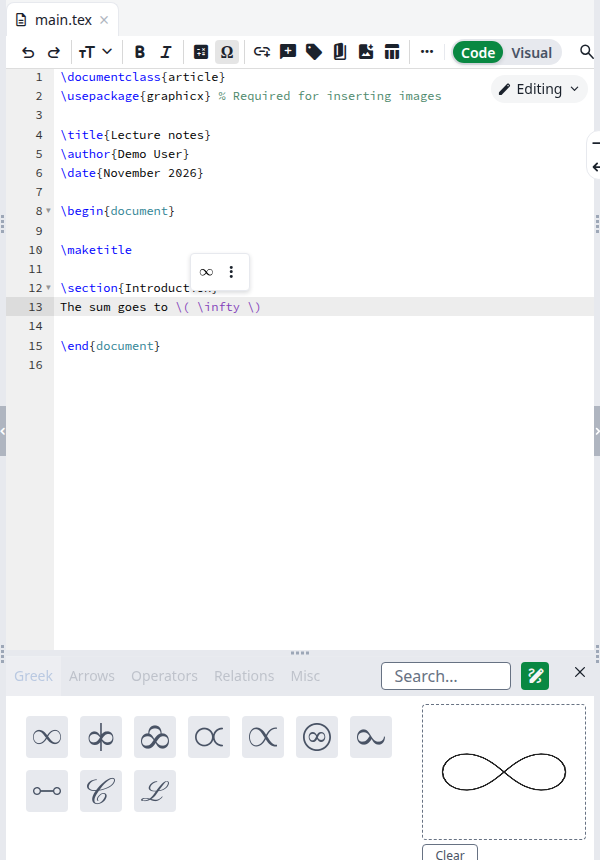

기호 팔레트는 문서에 수학 기호를 삽입합니다. 기호 이름을 모르면 직접 그리세요. 브라우저가 명령을 찾아 줍니다. 별도로 설정할 것은 없습니다.

## 기호 삽입하기 {#insert-a-symbol}

<Steps>
<Step title="커서를 수식 안에 두기">
대부분의 기호는 수식 안에서만 작동합니다. 기호를 넣을 위치를 클릭합니다. 편집기 도구 모음에서 **Insert math**를 클릭한 다음 **Inline**을 클릭합니다. 이제 커서가 `\(`와 `\)` 사이에 있습니다.

<Frame caption="Insert math 메뉴">
  
</Frame>
</Step>

<Step title="팔레트 열기">
도구 모음에서 **Ω** 버튼(**Insert symbol**)을 클릭합니다. 페이지 상단의 **Insert**를 클릭한 다음 **Symbol**을 클릭해도 됩니다. 팔레트가 편집기 아래에 열립니다.

<Frame caption="기호 팔레트">
  
</Frame>
</Step>

<Step title="기호 찾기">
탭을 클릭합니다: **Greek**, **Arrows**, **Operators**, **Relations**, **Misc**. 기호 위에 포인터를 올리면 이름과 명령이 표시됩니다. 필요한 패키지 같은 참고 사항이 표시되는 기호도 있습니다.

<Frame caption="기호의 이름, 명령, 참고 사항">
  
</Frame>
</Step>

<Step title="클릭하기">
커서 위치에 명령이 입력됩니다. 팔레트는 열린 상태로 유지되므로 바로 다음 기호를 추가할 수 있습니다. **Recompile**을 클릭하면 PDF에서 기호를 확인할 수 있습니다.

<Frame caption="문서와 PDF의 기호">
  
</Frame>
</Step>
</Steps>

팔레트는 **Visual** 편집기에서도 같은 방식으로 작동합니다.

## 기호 검색하기 {#search-for-a-symbol}

**Search** 상자에 입력합니다. 명령(`\sum`), 기호 이름에 들어 있는 단어(`arrow`), 또는 문자 자체(`α`)로 검색할 수 있습니다. 검색은 모든 탭을 대상으로 합니다. 상자를 비우면 탭으로 돌아갑니다.

<Frame caption="arrow 검색하기">
  
</Frame>

일치하는 항목이 없으면 팔레트에 **No symbols found**가 표시됩니다.

## 기호 그리기 {#draw-a-symbol}

기호 모양은 떠오르지만 이름을 모를 때 사용합니다.

<Steps>
<Step title="연필 아이콘 클릭하기">
**Search** 상자 오른쪽의 연필 아이콘(**Draw a symbol**)을 클릭합니다. 탭이 회색으로 바뀌고 오른쪽에 점선 상자가 나타납니다.

인식이 준비될 때까지 <strong>Loading model…</strong>이 표시됩니다. 처음에는 브라우저가 사이트에서 약 40MB를 다운로드합니다. 그 후에는 브라우저가 이 파일을 보관합니다.

<Frame caption="그리기 모드">
  
</Frame>
</Step>

<Step title="점선 상자 안에 그리기">
한 획을 마칠 때마다 왼쪽에 일치 항목이 최대 10개까지 가장 가까운 순서로 표시됩니다. 항목 위에 포인터를 올리면 명령이 표시됩니다. 여러 획으로 된 기호는 획마다 일치 항목이 업데이트됩니다.

<Frame caption="그림에 대한 일치 항목">
  
</Frame>
</Step>

<Step title="일치 항목 클릭하기">
커서 위치에 명령이 입력됩니다. 그림은 남아 있으므로 다른 일치 항목을 시도할 수 있습니다. 다음 기호를 그리기 전에 **Clear**를 클릭하세요.

<Frame caption="커서 위치의 명령">
  
</Frame>
</Step>
</Steps>

탭으로 돌아가려면 연필 아이콘을 다시 클릭하거나 **Search** 상자를 클릭합니다.

인식은 브라우저에서 실행됩니다. 그림은 사이트로 전송되지 않습니다.

### 패키지가 필요한 일치 항목 {#matches-that-need-a-package}

그리기로는 1,300개가 넘는 명령을 인식할 수 있지만 탭에는 117개만 나열됩니다. 나머지 중 상당수는 LaTeX 패키지에서 제공됩니다. 이 경우 도구 설명에 추가할 줄이 표시됩니다.

<Frame caption="패키지가 필요한 일치 항목">
  
</Frame>

이 줄을 프리앰블의 `\begin{document}` 앞에 추가합니다.

```latex
\usepackage{amssymb}
```

팔레트가 자동으로 추가하지는 않습니다.

## 키보드 사용하기 {#use-the-keyboard}

**Search** 상자에서 기호가 선택될 때까지 Tab 키를 누릅니다. 화살표 키로 기호 사이를 이동합니다. Enter 키를 누르면 선택한 기호가 삽입되고 팔레트가 닫힙니다.

## 팔레트 닫기 {#close-the-palette}

팔레트 오른쪽 위의 <strong>×</strong>를 클릭합니다. **Ω** 버튼이나 **Insert**의 **Symbol**로도 닫을 수 있습니다.

## 문제가 생긴 경우 {#if-something-goes-wrong}

| 보이는 내용 | 원인 | 해결 방법 |
| ------------ | --- | ---------- |
| 컴파일 시 **Missing \$ inserted**가 표시됨 | 기호가 수식 밖에 있음 | `\(`와 `\)` 사이로 옮기거나 먼저 **Insert math**를 사용 |
| 컴파일 시 **Undefined control sequence**가 표시됨 | 명령에 패키지가 필요함 | 팔레트에서 기호 위에 포인터를 올려 필요한 패키지를 확인하고 프리앰블에 추가 |
| 연필 아이콘이 없음 | 브라우저가 인식을 실행할 수 없음(예: Safari 15) | 브라우저를 업데이트하거나 다른 브라우저를 사용. 탭과 검색은 계속 사용 가능 |
| 점선 상자 아래에 **Recognition unavailable**이 표시됨 | 브라우저가 인식 파일을 불러오지 못함 | **Please try again** 클릭 |
